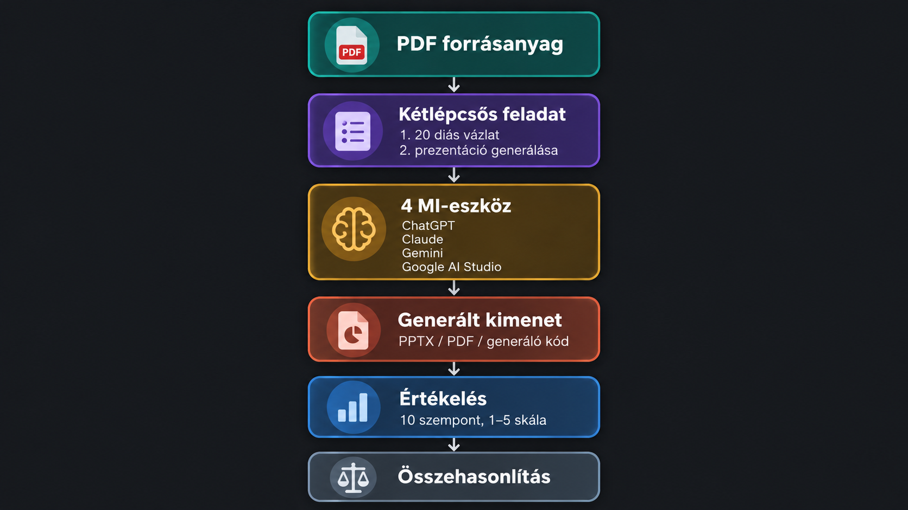
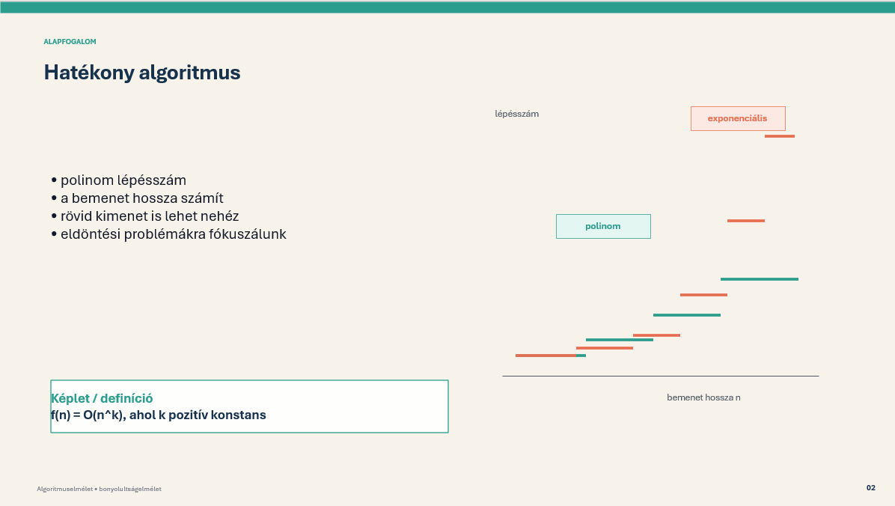
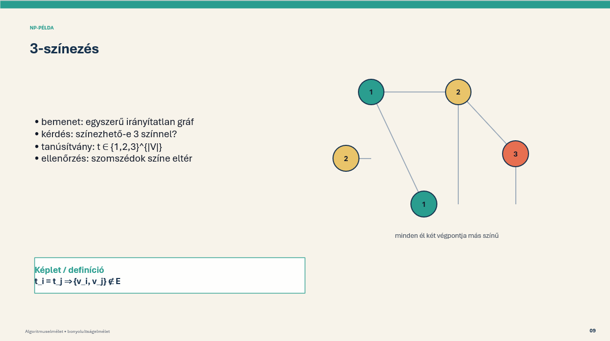
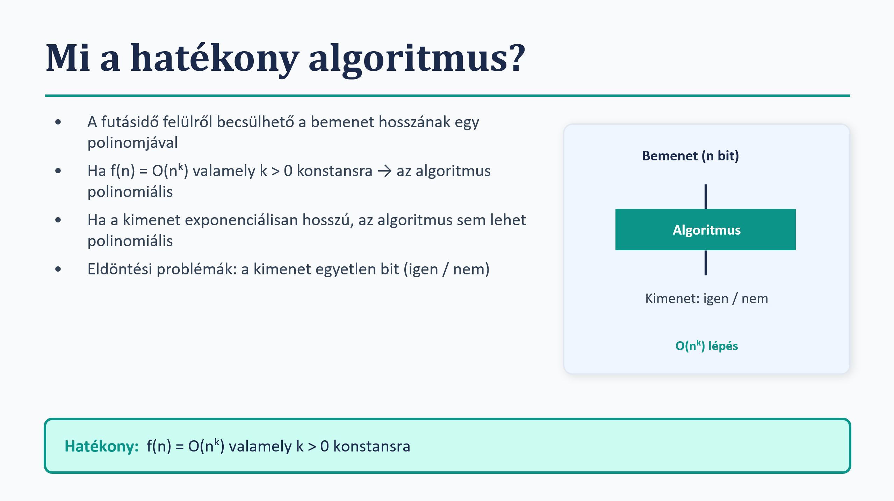
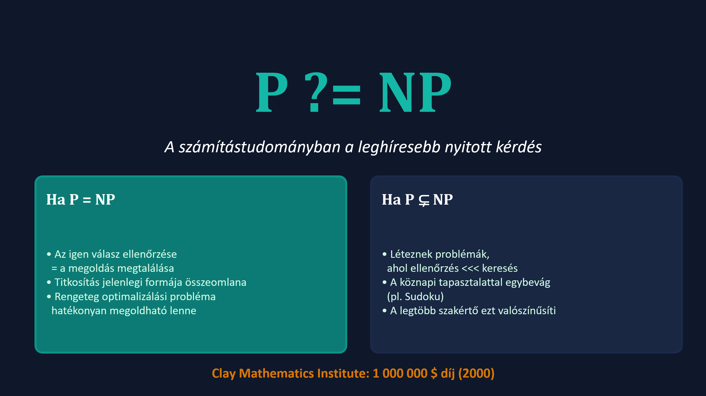
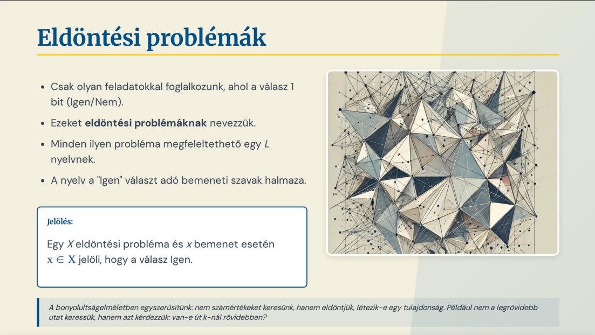
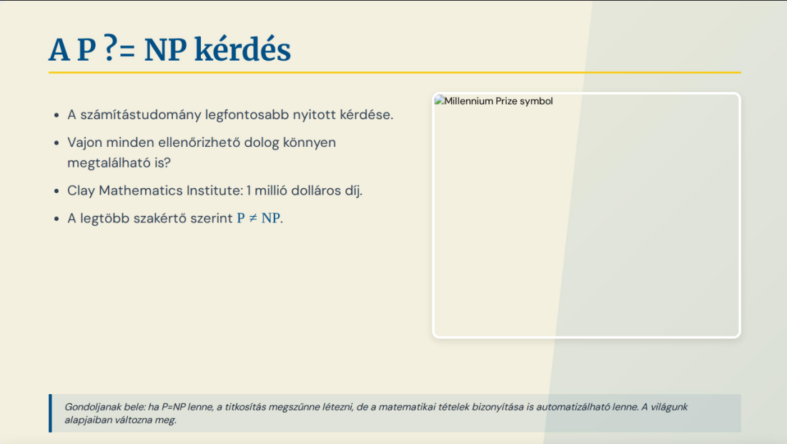
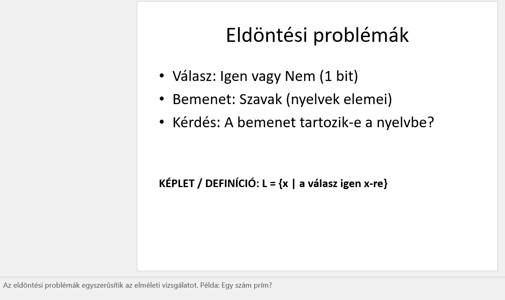
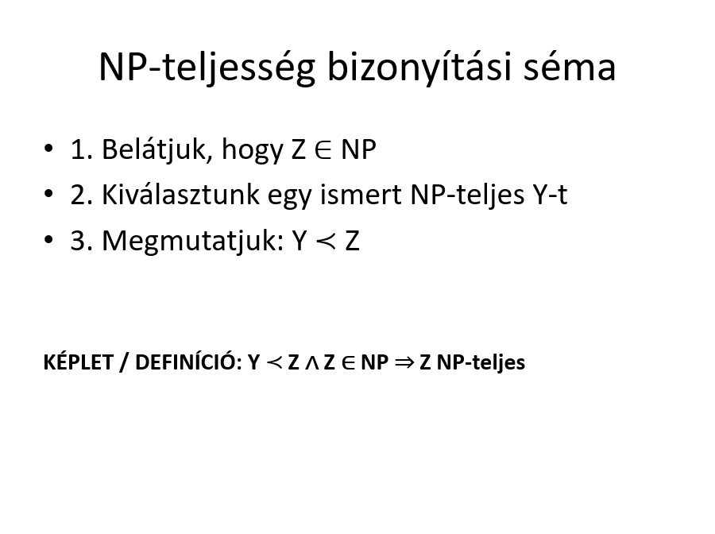

# MI-alapú prezentációgenerálás és összehasonlító értékelés

A generatív MI-eszközök ma már nemcsak prezentációvázlatok készítésére használhatók, hanem egyes rendszerek tényleges PowerPoint-prezentációt, PDF-et vagy a prezentáció létrehozására alkalmas programkódot is képesek generálni.

Ebben az esettanulmányban azt vizsgáltam, hogy különböző generatív MI-eszközök hogyan teljesítenek **ugyanazon PDF-alapú prezentációgenerálási feladaton**, illetve mennyire használható a létrejött eredmény további emberi szerkesztés nélkül.

Az esettanulmányhoz egy egységes vizsgálati keretrendszert is kialakítottam, amely lehetővé tette több generatív MI-eszköz azonos feladaton történő, 10 szempont szerinti összehasonlítható értékelését.

A vizsgált eszközök:

- ChatGPT - GPT-5.5
- Claude - Sonnet 4.6
- Gemini - Gemini 3.5 Flash
- Google AI Studio - Gemma 4 26B

A konkrét kísérletben ugyanazt az algoritmuselméleti PDF-et és ugyanazt a kétlépcsős feladatot kapták a rendszerek.



## Tanulságok

- A **jó prezentáció nem azonos a jó szöveges összefoglalóval**: külön értékelendő a tartalom, a prezentációs struktúra és a vizuális megvalósítás.
- Ugyanaz a „készíts prezentációt” feladat különböző rendszerekben **eltérő típusú kimenetet** eredményezhet: PPTX-et, PDF-et vagy akár prezentációt generáló programkódot.
- A forráshűség különösen fontos szakmai és oktatási anyagok esetén. A generált definíciókat és formális állításokat végleges felhasználás előtt ellenőrizni kell, mert lehetnek hibák és nemcsak a rendelkezésre álló anyagból beszivárgott információk.
- A vizuálisan erős prezentációkban is megjelenhetnek technikai hibák, például elcsúszó vagy túl sűrű ábrák és szövegdobozok.
- A prezentációgenerálás eredményét nem érdemes egyetlen összpontszámmal értékelni: tartalmi pontosság, struktúra, vizuális minőség és szükséges emberi utómunka külön dimenziók.
- A vizsgált konkrét esetben a Claude Sonnet 4.6 adta a legjobb összesített eredményt, de ez **nem általános modellrangsor**, hanem az adott forrásanyagra, promptokra és elérhető eszközverziókra vonatkozó tapasztalat.

## A kísérleti keretrendszer

Az `AIPresentationEvaluation` célja egy egyszerűen reprodukálható környezet kialakítása volt PDF- vagy egyéb forrásanyagból történő MI-alapú prezentációgenerálás vizsgálatára.

A keretrendszer fő elemei:

- `prompts.md` - prezentációgenerálási és továbbfejlesztési promptok
- `experiment_plan.md` - a kísérlet lépései
- `evaluation_criteria.md` - részletes, tíz szempontos értékelési rendszer
- `ppt_evaluation_helper.py` - Python segédprogram az emberi pontozások rögzítéséhez
- `source_materials/` - a bemeneti forrásanyagok
- `outputs/` - a modellek által létrehozott eredmények
- `results/` - a pontszámok és kvalitatív értékelések

A keretrendszer több promptstratégiát is tartalmaz, például forráshűségi, designfókuszú és javító promptokat. A konkrét vizsgálat fókusza az azonos, kétlépcsős prezentációgenerálási feladat összehasonlítása volt több MI-eszközön.

## Az esettanulmány

### Forrásanyag

A bemenet egy BME algoritmuselméleti jegyzet volt:

`Algel_bonyelm_Friedl_Katalin.pdf`

A prezentáció témája:

> **A bonyolultságelmélet alapjai: P, NP, coNP, Karp-redukció, NP-nehézség és NP-teljesség.**

A cél egy **20 diás, oktatási célú és vizsgára készüléshez is használható prezentáció** előállítása volt.

### Kétlépcsős generálás

A feladat két fő lépésből állt.

#### 1. Prezentációvázlat készítése

Elsőként minden modellnek egy 20 diás prezentációvázlatot kellett létrehoznia.

A fontosabb követelmények:

- kizárólag a megadott PDF tartalmára támaszkodjon
- minden diához adjon címet és 3–5 rövid bulletpontot
- emelje ki a fontos definíciókat és képleteket
- javasoljon vizuális elemeket
- adjon rövid előadói jegyzeteket
- a részletes magyarázat ne terhelje túl magukat a diákat

A prompt többek között explicit kérte a P, NP és coNP osztályok, a Karp-redukció, az NP-nehézség, az NP-teljesség és a kapcsolódó gráfos példák feldolgozását.

#### 2. Tényleges prezentáció generálása

A második lépésben a modellnek a korábban létrehozott vázlatból tényleges prezentációt kellett készítenie.

A fő követelmények:

```text
- pontosan 20 dia
- kevés szöveg a diákon
- részletesebb magyarázat az előadói jegyzetekben
- a definíciók és matematikai jelölések vizuális kiemelése
- egyszerű, magyarázó ábrák használata
- egységes, oktatási célra alkalmas design
- a PDF-en kívüli tételek és példák kerülése
```

Érdekes tapasztalat volt, hogy a „prezentáció generálása” nem minden eszköz esetében jelentette ugyanazt: volt, amelyik közvetlen prezentációfájlt készített, más PDF-et adott, míg a Google AI Studio / Gemma prezentációgeneráló Python-kódot állított elő.

## Értékelési módszer

A generált kimenetek értékelése **10 különböző szempont szerint**, 1–5 skálán történt.

| Szempont | Mit vizsgál? |
|---|---|
| Tartalmi pontosság | Helyesek-e a definíciók, állítások és magyarázatok? |
| Forráshűség | Csak a megadott forrásanyagból dolgozik-e? |
| Struktúra | Logikusan épül-e fel a prezentáció? |
| Narratíva | Egymásra épülnek-e a diák, követhető-e a gondolatmenet? |
| Szövegmennyiség | Megfelelő-e a diák szövegsűrűsége? |
| Design | Használható-e a vizuális elrendezés és stílus? |
| Vizuális elemek | Segítik-e ábrák és diagramok a megértést? |
| Előadói jegyzetek | Hasznos magyarázatot adnak-e az előadónak? |
| Emberi utómunka | Mennyi javítás szükséges a használathoz? |
| Összesített használhatóság | Mennyire használható valódi prezentáció alapjaként? |

Az 1-es érték nagyon gyenge, az 5-ös pedig azonnal vagy minimális módosítással használható eredményt jelentett.

## Eredmények

A végleges összehasonlításban az alábbi eredmények születtek:

| Modell | Kimenet | Diák száma | Átlagpontszám | Összesített használhatóság |
|---|---|---:|---:|---:|
| GPT-5.5 | PPTX / prezentációalap | 20 | **3,50** | 4/5 |
| Claude Sonnet 4.6 | PPTX / prezentációalap | 20 | **4,40** | 4/5 |
| Gemini 3.5 Flash | PDF | 22 | **3,67** | 4/5 |
| Google AI Studio / Gemma 4 26B | Python-kód → PPTX | 20 | **2,56** | 2/5 |

A pontszámok az adott kísérleti környezetben használt modellekre és felületekre vonatkoznak, ezért nem tekinthetők általános modellrangsornak.

<!--
Ha készítettél külön eredménytáblázatot képként, például results_table.png
néven, ezt a sort hagyd bent. Ha nincs ilyen kép, ezt a blokkot töröld.


-->

## A generált eredmények vizuális összehasonlítása

### GPT-5.5

A ChatGPT jól strukturált és használható oktatási alapot készített. A fő fogalmak, definíciók és matematikai jelölések megfelelően megjelentek, a választott színkompozíció is kellemes volt.

A fő korlátot a vizuális kivitelezés jelentette. Egyes ábrák és elemek további igazítást vagy teljes újragondolást igényeltek, ezért a kimenet inkább erős prezentációalapnak tekinthető, mint teljesen kész előadásnak.





### Claude Sonnet 4.6

A Claude adta a legerősebb összesített eredményt.

A prezentációban a hangsúlyosabb, sötét hátterű diák és a világosabb magyarázó diák váltakozása jól vezette a figyelmet. A fogalmakhoz több esetben valódi vizuális magyarázatot készített, ezért az eredmény nem pusztán szöveges összefoglalónak, hanem kis átnézéssel prezentációként is használhatónak bizonyult.

Néhány ábra és szövegdoboz ugyanakkor elcsúszott vagy további igazítást igényelt, tehát még ennél a legerősebb eredménynél is szükséges emberi ellenőrzés.





### Gemini 3.5 Flash

A Gemini szakmailag jól követhető és értelmezhető anyagot készített.

Különösen érdekes volt, hogy több esetben meglévő, témába illő vizuális elemekre támaszkodott. Ez szakmailag pontos vizuális magyarázatokat eredményezhet, ugyanakkor a saját generált ábrák között előfordultak túl kicsi, túl sűrű, hiányzó, ismétlődő vagy rosszul elhelyezett elemek.

A modell nem tartotta teljesen a kért kimeneti formátumot sem: PowerPoint helyett PDF-prezentáció készült.





### Google AI Studio / Gemma 4 26B

A Google AI Studio / Gemma megoldása technikailag eltért a többi rendszertől.

A modell nem közvetlenül prezentációfájlt adott, mert jelezte, hogy az adott felületen nem áll rendelkezésre közvetlen .pptx fájlgenerálási lehetőség. Ehelyett Python-kódot generált a prezentáció létrehozására. A kódban hiba is volt, ezért azt először kézzel javítani, majd külön futtatni kellett.

A létrejött 20 diás prezentáció tartalmazta a lényegi információkat és viszonylag jól követhető volt, vizuálisan azonban egyszerű maradt. Ez jól mutatja, hogy a generatív MI egy feladatot közvetett, automatizálási problémaként is megoldhat, de ez nem feltétlenül jelenti a legkisebb emberi munkát.





## Mit mutatott meg az összehasonlítás?

A kísérlet egyik legfontosabb tapasztalata, hogy a prezentációgenerálás minősége több, egymástól részben független tényezőtől függ. Az eredményt nemcsak a választott modell és a prompt befolyásolja, hanem az is, hogy az adott felhasználói fiókban és felületen milyen funkciók - például közvetlen fájlgenerálás, vizuális generálás vagy fájlküldés - érhetők el.

### 1. Tartalmi minőség és vizuális minőség nem ugyanaz

Egy modell képes lehet pontos és jól strukturált tartalmat készíteni anélkül, hogy a prezentáció vizuálisan kész lenne.

Fordítva is igaz: egy esztétikus prezentációban továbbra is szükség lehet a szakmai állítások és definíciók ellenőrzésére.

### 2. A kért fájlformátum betartása önálló képesség

Azonos feladat mellett a vizsgált rendszerek:

- prezentációfájlt,
- PDF-et,
- illetve prezentációt generáló Python-kódot

is előállítottak.

Ezért automatizált munkafolyamatban nem elegendő csak a tartalmi minőséget ellenőrizni: a kimeneti formátum és annak közvetlen használhatósága is fontos.

### 3. Az emberi utómunka továbbra is szükséges

Minden vizsgált rendszer esetében maradt olyan feladat, amely emberi ellenőrzést igényelt:

- formális definíciók ellenőrzése
- ábrák méretének és pozíciójának javítása
- túl sűrű diák egyszerűsítése
- vizuális konzisztencia ellenőrzése
- kimeneti fájlformátum ellenőrzése

### 4. A legjobb megoldás nem feltétlenül egyetlen modell

A kísérlet alapján különböző feladatrészekhez különböző erősségek társultak:

- strukturált első vázlathoz több modell is jól használható,
- vizuális prezentációalap készítésében a Claude teljesített a legerősebben ebben a kísérletben,
- meglévő vizuális források felhasználásában a Gemini mutatott érdekes megoldásokat,
- a Gemma pedig kódalapú automatizálási kerülőutat kínált.

## Javasolt munkafolyamat

A tapasztalatok alapján a teljes prezentációgenerálást érdemes több lépésre bontani:

```text
forrásanyag
    ↓
prezentációvázlat
    ↓
tartalmi és forráshűségi ellenőrzés
    ↓
prezentáció generálása
    ↓
vizuális ellenőrzés
    ↓
emberi finomítás
    ↓
végleges prezentáció
```

A modell feladata tehát nem feltétlenül az, hogy egyetlen lépésben hibátlan prezentációt állítson elő. Megbízhatóbb munkafolyamat alakítható ki, ha külön kezeljük a **tartalmi szervezést, a vizuális generálást és az ellenőrzést**.

## Az eredmény használata

A keretrendszer más prezentációgenerálási feladatokra is újra felhasználható.

Egy új kísérlethez:

1. válassz ki egy PDF-et vagy más forrásanyagot
2. azonos feladattal futtasd le a vizsgálni kívánt MI-eszközökön
3. mentsd el a generált kimeneteket
4. értékeld őket ugyanazon 10 szempont szerint
5. hasonlítsd össze a pontszámokat és a kvalitatív hibákat

A `ppt_evaluation_helper.py` segédprogram az értékelések egységes rögzítését és összesítését támogatja.

## Korlátok

Az eredmények értelmezésekor fontos figyelembe venni, hogy:

- egyetlen konkrét algoritmuselméleti forrásanyagot vizsgáltam;
- az eredményeket az adott időpontban elérhető modellverziók és felületek befolyásolták;
- a modellek fájlgenerálási képessége eltérő;
- a 10 szempontos értékelés részben emberi, ezért tartalmaz szubjektív elemeket;
- egyetlen futásból nem következtethetünk egy modell általános teljesítményére.

A kísérlet ezért elsősorban **esettanulmány és reprodukálható értékelési minta**, nem általános benchmark.

## Összegzés

A vizsgálat alapján a generatív MI jelentősen felgyorsíthatja a prezentációk első verziójának elkészítését, de a „prezentáció generálása” több különböző képesség együttműködését igényli.

A megfelelő eredményhez egyszerre szükséges:

- forráshű tartalom
- jó narratív struktúra
- megfelelő szövegmennyiség
- használható vizuális megjelenés
- megfelelő kimeneti formátum
- és végső emberi ellenőrzés

A legfontosabb tanulság ezért nem az, hogy egy adott modell minden esetben jobb a többinél, hanem az, hogy **a prezentációgenerálást érdemes mérhető, ellenőrizhető, több lépcsős munkafolyamatként kezelni**.