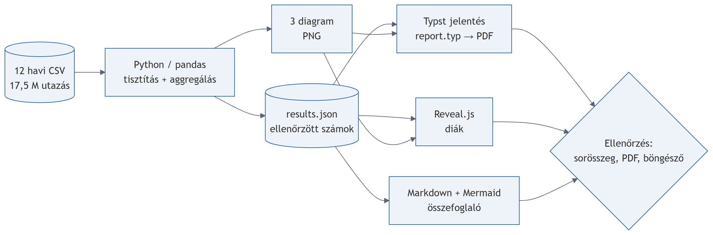
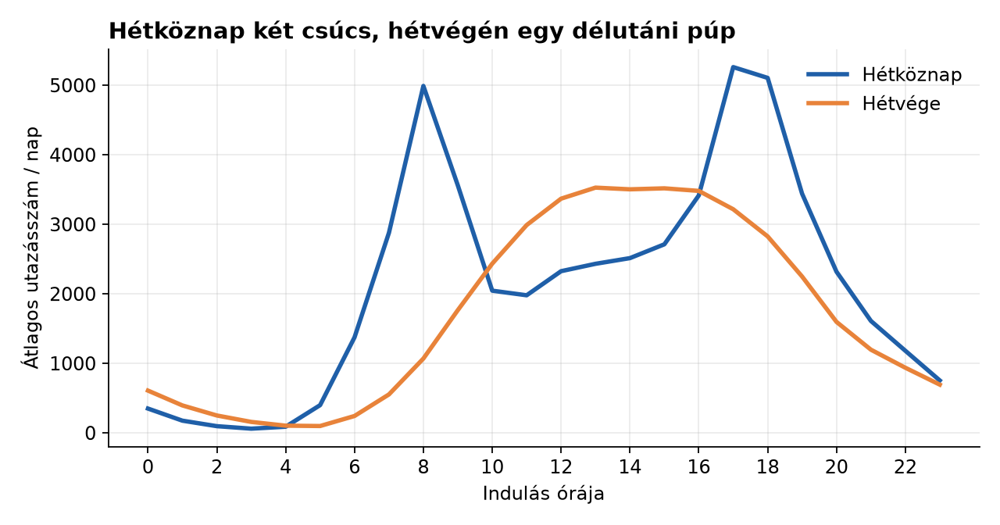
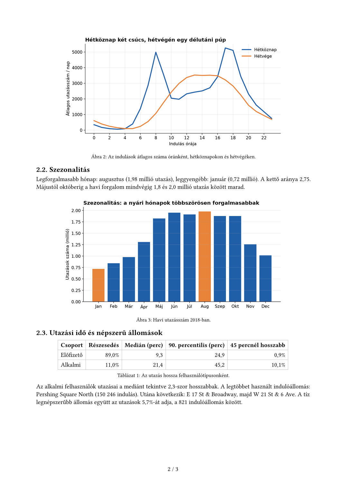
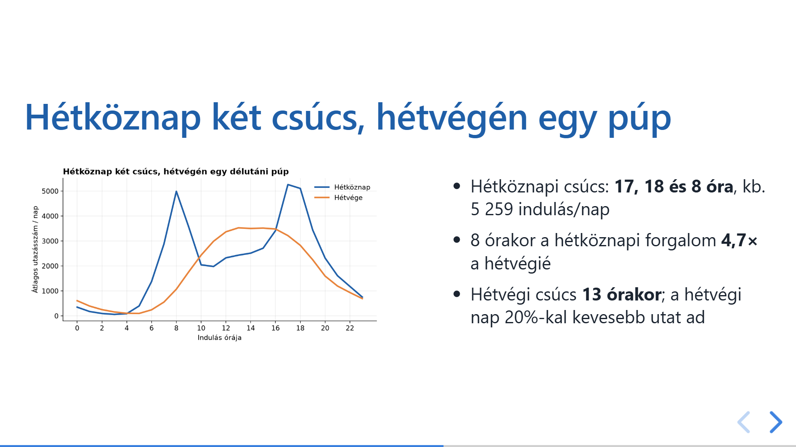

# Többlépéses AI-workflow: adatelemzés, Mermaid, Typst és Reveal.js

Ebben a snippetben azt próbáltam ki, hogy egy AI-asszisztens mennyire tud végigvinni egy **többlépéses, egymásra épülő munkafolyamatot** a nyers adatoktól a kész dokumentumokig. A cél nem egyszerűen egy elemzés elkészítése volt, hanem annak vizsgálata, hogy egy jól megadott feladatból és néhány iránymutatásból képes-e önállóan létrehozni többféle, egymással konzisztens kimenetet.

A feladathoz a New York-i Citi Bike 2018-as adathalmazát választottam, és azt kértem a Claude Code-tól, hogy az adatok alapján készítsen:

- rövid adatelemzést diagramokkal,
- egy Mermaid-alapú workflow-ábrát,
- egy igényesen szerkesztett Typst-jelentést,
- valamint egy böngészőben futó Reveal.js-prezentációt.

A snippet középpontjában tehát **nem maga a kerékpáros adat**, hanem a **teljes AI-alapú workflow** áll: mennyire tud a modell különböző formátumok között következetesen dolgozni, és mennyi kézi beavatkozásra van szükség a végén.

## Eszközök és adathalmaz

| Eszköz | Szerep |
|---|---|
| Claude Code (Sonnet 5.5, medium) | a munkafolyamat nagy részének automatizálása: elemzés, szövegalkotás, dokumentumok és prezentáció elkészítése |
| Python (pandas, matplotlib) | adattisztítás, aggregálás, diagramkészítés |
| [Mermaid](https://mermaid.js.org/) | a workflow folyamatábrájának elkészítése |
| [Typst](https://typst.app/) | a többoldalas PDF-jelentés előállítása |
| [Reveal.js](https://revealjs.com/) | böngészőben futó prezentáció készítése |
| Playwright + Chrome | renderelés és képernyőképek készítése |

Az adatforrás a **New York-i Citi Bike 2018-as utazási adathalmaza**, amely 12 havi CSV-fájlból és összesen **17 548 339 utazásból** áll. Az elemzés során az alábbi kérdésekre kerestünk választ:

- hogyan alakul a forgalom napszak szerint,
- miben különbözik a hétköznapi és hétvégi használat,
- mennyi az utazások jellemző hossza,
- hogyan változik a forgalom az év során,
- és melyek a legnépszerűbb állomások.

A kérdések kijelölése és a kívánt kimenetek meghatározása az én részem volt; az AI ezek alapján készítette el a teljes workflow eredményeit.

## A workflow

A létrejött munkafolyamat négy fő lépésből állt:

1. **CSV → Python**  
   Az AI feldolgozta a 12 havi adatfájlt, elvégezte az alapvető tisztítást és aggregálást, majd több diagramot készített az elemzéshez.

2. **Python → Markdown + Mermaid**  
   Az eredményekből rövid szöveges összefoglaló és egy Mermaid workflow-ábra készült, amely áttekinthetővé tette a teljes folyamatot.

3. **Python → Typst**  
   Az elemzésből egy tömör, igényes, többoldalas PDF-jelentés állt elő Typst segítségével.

4. **Python → Reveal.js**  
   Ugyanezekre az eredményekre építve elkészült egy 8 diás, böngészőben futó prezentáció is.

A workflow egyik legfontosabb tanulsága az volt, hogy a különböző kimenetek ugyanarra a feldolgozott tartalomra épültek, így az elemzési eredmények konzisztensen jelentek meg a jelentésben és a prezentációban is.

## Eredmények

A legfontosabb megállapítások:

- Hétköznap markáns csúcsok látszanak reggel 8 órakor, illetve délután 17–18 órakor, míg hétvégén inkább egy szélesebb, dél körüli–kora délutáni csúcs jelenik meg.
- Az alkalmi felhasználók utazásainak medián hossza **21,4 perc**, míg az előfizetőké **9,3 perc**.
- Augusztusban **2,75-szer annyi** utazás történt, mint januárban.
- A 10 legnépszerűbb indulóállomás az összes utazás **5,7%-át** adta.

Az eredmények jól mutatják, hogy már egy viszonylag egyszerű városi mobilitási adathalmazon is előállítható olyan elemzés, amely többféle formátumban továbbhasznosítható.

A vizsgált adatnak természetesen vannak korlátai is: egyetlen év adatairól van szó, és nem álltak rendelkezésre például időjárási vagy ünnepnapi információk, ezért az ok-okozati magyarázatok csak óvatosan fogalmazhatók meg.

A generált PDF-jelentés itt érhető el: [`report.pdf`](report.pdf)

A Reveal.js-prezentáció a `slides/index.html` megnyitásával futtatható helyben, internetkapcsolat nélkül is.

## Tapasztalatok

### Ami jól működött

- Az AI viszonylag önállóan végig tudta vinni a teljes folyamatot az adatelemzéstől a dokumentumkészítésig.
- A különböző kimenetek – diagramok, PDF és prezentáció – tartalmilag összhangban maradtak.
- A Reveal.js-prezentáció és a Typst-jelentés vizuálisan is meggyőző minőségű lett.
- A workflow jól szemléltette, hogy egyetlen adatelemzési feladatból több különböző, mégis egymásra épülő kimenet hozható létre.

### Milyen problémák jelentek meg?

A folyamat nem volt teljesen hibamentes. A legérdekesebb probléma a Mermaid és a Reveal.js kapcsolatánál jelent meg: az élőben renderelt Mermaid-ábra feliratai a prezentáció skálázása miatt nem látszottak megfelelően. Ezt végül úgy oldotta meg a modell, hogy a diára egy előrenderelt, statikus kép került. Ez nem ideális, de jól mutatja, hogy a vizuális integráció gyakran kényesebb, mint maga a tartalomgenerálás.

Ez a kísérlet egyik legfontosabb tanulsága: az AI nemcsak generálni és hibát javítani képes, hanem sikertelen próbálkozások után alternatív megoldást is kereshet. A működő végeredmény azonban nem feltétlenül jelenti az eredeti funkcionalitás teljes megőrzését.

Emellett kisebb hibák is előfordultak:
- egy képernyőkép először rossz diáról készült,
- egy automatikus módosítás után hibás Python-fájl jött létre,
- néhány magyar megfogalmazást és tipográfiai részletet utólag kellett javítani,
- valamint egy diagram színezését is finomítani kellett.

### Az emberi ellenőrzés szerepe

Az elkészült dokumentumokat és a prezentációt áttekintettem, a modell pedig a generálás során több technikai és vizuális hibát önállóan felismert és javított. Ugyanakkor az adatelemzés részletes szakmai validációja nem történt meg. Az AI alkalmas volt a teljes workflow felépítésére és a különböző formátumok előállítására, de a következtetések szakmai megalapozottságának és a nyelvi finomságoknak az ellenőrzését nem váltja ki teljesen.

## Konklúzió

A kísérlet alapján a többlépéses, AI-vezérelt workflow jól használható olyan feladatokra, ahol egy közös adatalapból többféle, egymással konzisztens kimenetet szeretnénk előállítani. A Claude Code különösen erősnek bizonyult abban, hogy egy összetettebb feladatot részekre bontson, majd elkészítse az elemzést, a jelentést és a prezentációt is.

A legnagyobb kihívást nem az adatok feldolgozása, hanem a különböző technológiák – különösen a vizuális elemek – összehangolása jelentette. Ennek ellenére a végeredmény azt mutatja, hogy megfelelő iránymutatással és utólagos ellenőrzéssel az AI nemcsak egyetlen dokumentum, hanem egy teljes, több formátumon átívelő workflow támogatására is alkalmas lehet.