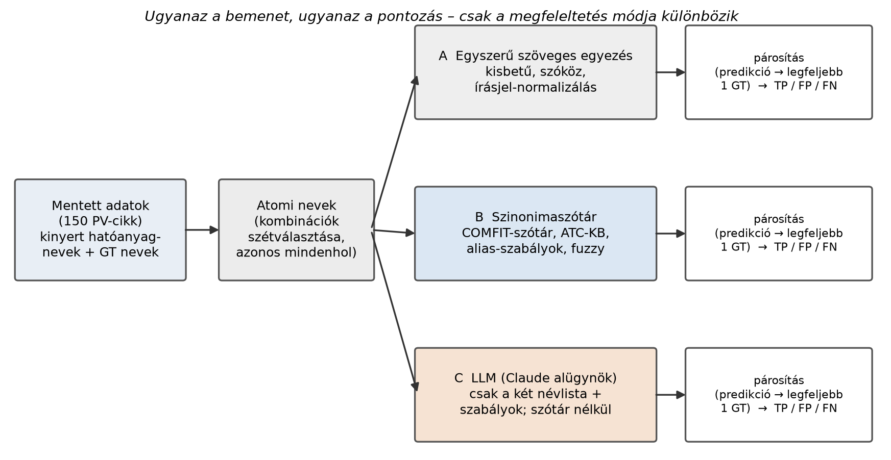
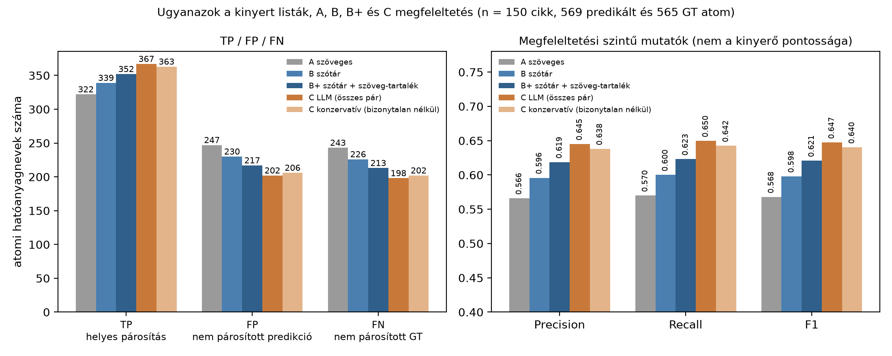
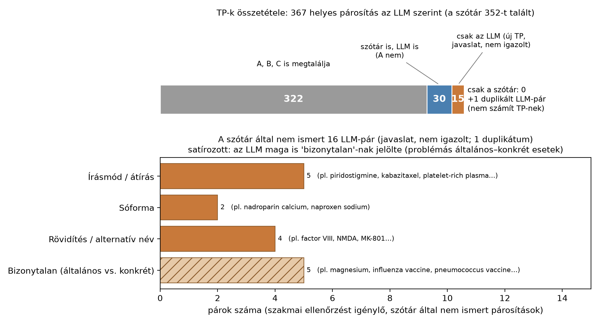

# LLM-alapú hibaelemzés szöveges információkinyerési feladatokban

## Bevezetés

Strukturált információkinyerési feladatokban a kinyert értékeket a referenciaannotációkkal (ground truth, GT) hasonlítjuk össze, és ezek alapján számítjuk ki a precision, recall és F1 metrikákat. Az egyszerű szöveges egyezés azonban nem mindig elegendő, hiszen ugyanazt a fogalmat különböző megnevezésekkel, szinonimákkal, rövidítésekkel vagy eltérő írásmóddal is kifejezhetjük. Ha a megfeleltetés nem veszi figyelembe ezeket a különbségeket, a helyesen kinyert információkat is hibásnak értékelhetjük.

A probléma gyakorlati példája a COMFIT projekt, amelyben orvosi szövegekből gyógyszerhatóanyagokat nyertünk ki egy nagy nyelvi modell (Gemma) segítségével. A kinyert hatóanyagnevek és a referenciaannotációk megfeleltetéséhez szinonimaszótárat és normalizálási szabályokat használtunk. Ezen a területen különösen fontos a különböző nyelvi megnevezések, rövidítések, márkanevek és kémiai formák felismerése.

## A kísérlet célja

Ebben az esettanulmányban azt vizsgáljuk, hogy egy LLM explicit szinonimaszótár nélkül mennyire képes felismerni az azonos hatóanyaghoz tartozó megnevezéseket, hogyan befolyásolja ez a kiértékelési eredményeket, és milyen lehetőségeket kínál a meglévő szinonimaszótár továbbfejlesztésére.

A kísérlet során a kinyert értékek és a referenciaannotációk változatlanok maradnak, kizárólag a megfeleltetés módját változtatjuk.

## Módszertan

### Adathalmaz és mintavétel

A kísérlethez a COMFIT projekt kiértékelési adathalmazából 150 farmakovigilanciai szempontból releváns, nem üres referenciaannotációval rendelkező cikket választottunk véletlenszerűen. A három kohorszból (HU-dev, HU-test, BG-test) egyenként 50 cikk került a mintába, rögzített véletlenmag (seed: 1044) mellett.

A kinyert hatóanyaglisták a projekt egyik korábbi, `google/gemma-4-26B-A4B-it` modellel végzett futásából származnak. Az LLM-alapú megfeleltetéshez kizárólag az anonim hatóanyaglistákat használtuk, az eredeti orvosi szövegeket nem.

### Az összehasonlítás egysége

A megfeleltetést cikkenként, a kinyert és a referenciaannotációban szereplő hatóanyagnevek között végeztük. A több hatóanyagot tartalmazó megnevezéseket egyszerű szöveges szabályok alapján önálló elemekre bontottuk, az összetett kezelési protokollok rövidítéseit (pl. FOLFOX) azonban változatlanul hagytuk.

Az előfeldolgozás eredményeként összesen **569 kinyert és 565 referencia-hatóanyagnév** állt rendelkezésre.

### Összehasonlított módszerek

| | Módszer | Megfeleltetés alapja |
|---|---|---|
| A | Egyszerű szöveges egyezés | Kis- és nagybetűk, szóközök és írásjelek normalizálása |
| B | Szinonimaszótár | A COMFIT meglévő hatóanyag-adatbázisa, szinonimái, alias-szabályai és közelítő szöveges egyezései |
| B+ | Szinonimaszótár + szöveges egyezés | Szótáralapú megfeleltetés, sikertelen feloldás esetén egyszerű szöveges egyezéssel kiegészítve |
| C | LLM-alapú szemantikai megfeleltetés | Claude-alügynökök a hatóanyaglisták és a döntési szabályok alapján, szinonimaszótár nélkül |

A szótáralapú megközelítés két változatát azért vizsgáltuk, mert a szótár nem feltétlenül ismer fel minden megnevezést. A B változatban a fel nem oldott nevek nem eredményeznek egyezést, míg a B+ változatban az egyszerű szöveges egyezés tartalékmegoldásként működik.

### Párosítás és kiértékelés

Minden módszernél azonos pontozási szabályokat alkalmaztunk. Egy kinyert név legfeljebb egy referenciaelemhez rendelhető, és minden referenciaelem legfeljebb egyszer számíthat helyes találatnak.

- **TP (True Positive):** a sikeresen megfeleltetett referenciaelemek száma.
- **FP (False Positive):** a nem megfeleltetett kinyert elemek, illetve azok a duplikátumok, amelyek már párosított referenciaelemhez tartoznak.
- **FN (False Negative):** a nem megfeleltetett referenciaelemek száma.

Ezek alapján számítottuk ki a precision, recall és F1 metrikákat. Az egységes pontozás biztosítja, hogy minden módszernél a TP + FP összege 569, a TP + FN összege pedig 565 legyen.

### LLM-alapú szemantikai megfeleltetés

A kísérletet Claude Code környezetben, Claude Sonnet 5.5 modellel, Medium effort beállítás mellett végeztük. A megfeleltetést hat elkülönített alügynökhívással hajtottuk végre, hívásonként 25 cikket feldolgozva. Az alügynökök az Agent eszköz `sonnet` aliasával futottak.

Az alügynökök kizárólag a hatóanyaglistákat és a megfeleltetési szabályokat kapták meg, a szinonimaszótár tartalmát és a többi módszer eredményeit nem.

A döntési szabályok alapján egyezésnek tekinthetők az ugyanahhoz a hatóanyaghoz tartozó különböző megnevezések, például:

- eltérő nyelvi alakok és írásmódok;
- márkanevek és generikus megnevezések;
- sóformák;
- egyértelmű rövidítések és alternatív nevek.

Nem elegendő ugyanakkor az egyezéshez a hasonló név, az azonos gyógyszercsoport, a hasonló hatásmechanizmus vagy az általános és konkrét hatóanyag közötti kapcsolat.

A modell strukturált JSON-formátumban adta vissza a javasolt párokat, a nem párosított elemeket, a döntések rövid indoklását és a bizonytalansági jelöléseket (`certain` / `uncertain`). A válaszok szerkezeti ellenőrzése is megtörtént.

Az alábbi folyamatábra a három alapvető megfeleltetési megközelítést szemlélteti, a közös bemenettől az egységes pontozásig.

## Eredmények

### A megfeleltetési módszerek összehasonlítása

Az alábbi táblázat a különböző megfeleltetési módszerekkel kapott kiértékelési eredményeket mutatja.

| Módszer | TP | FP | FN | Precision | Recall | F1 |
|---|---|---|---|---|---|---|
| A – szöveges egyezés | 322 | 247 | 243 | 0,566 | 0,570 | 0,568 |
| B – szótár | 339 | 230 | 226 | 0,596 | 0,600 | 0,598 |
| B+ – szótár + szöveges egyezés | 352 | 217 | 213 | 0,619 | 0,623 | 0,621 |
| C – LLM, összes javasolt pár | 367 | 202 | 198 | 0,645 | 0,650 | 0,647 |
| **C – LLM, konzervatív változat** | **363** | **206** | **202** | **0,638** | **0,642** | **0,640** |

A szöveges egyezéshez képest a szinonimaszótár alkalmazása több megfeleltetést eredményezett, az LLM-alapú megközelítés pedig további egyezéseket javasolt. Az F1 értéke 0,568-ról 0,647-re emelkedett.

A konzervatív LLM-változatban kizártuk azt az öt párosítást, amelyet a modell bizonytalannak (`uncertain`) jelölt. Ezek közül négy új TP-t eredményezett volna, míg az ötödik (*osmolitol*) egy már megfeleltetett referenciaelemhez tartozott. A kizárás után az F1 értéke 0,640-re csökkent, de továbbra is meghaladta a B+ módszer 0,621-es értékét. Ez mindhárom vizsgált kohorszban megfigyelhető volt.

**A magasabb F1-érték nem a kinyerő rendszer teljesítményének javulását jelenti**, hanem a megfeleltetési módszer hatását mutatja.

Megjegyzés: a COMFIT projekt eredeti, halmazalapú kiértékelése ugyanezen a mintán 0,685-ös F1-értéket eredményezett (TP: 339, FP: 150, FN: 162). Az eltérő pontozási szabályok és a nem pontozható nevek kihagyása miatt ez az érték nem hasonlítható közvetlenül a fenti eredményekhez.

### Az LLM által javasolt új megfeleltetések

A párosítások részletes vizsgálata alapján az LLM a B+ módszer mind a 352 megfeleltetését reprodukálta. Emellett **16 olyan új hatóanyagpárt javasolt, amelyet a szótáralapú megközelítés nem ismert fel**.

A javaslatok előzetes, AI segítségével végzett kategorizálása:

- 5 eltérő írásmód vagy átírás;
- 2 sóformák közötti megfeleltetés;
- 4 rövidítés vagy alternatív megnevezés;
- 5 bizonytalannak jelölt megfeleltetés.

A 16 javaslatból 15 új TP-t eredményezett az LLM-alapú pontozás szerint, egy pedig duplikált megfeleltetés volt.

### Konkrét megfeleltetési példák

Az alábbi táblázat néhány ténylegesen megfigyelt példán keresztül szemlélteti a módszerek közötti különbségeket.

| Kinyert név | GT név | A | Szótár | LLM | Megjegyzés |
|---|---|---|---|---|---|
| lidocaine | lidocaine | igen | igen | igen | Azonos megnevezés |
| valproate | valproic acid | nem | igen | igen | A szótár által is felismert megfeleltetés |
| ceftriaxon | ceftriaxone | nem | igen | igen | Eltérő nyelvi alak |
| succinylcholine | suxamethonium | nem | igen | igen | Eltérő nemzetközi és amerikai megnevezés |
| kabazitaxel | cabazitaxel | nem | nem | javasolja | Eltérő írásmód, szótárbővítési jelölt |
| nadroparin calcium | nadroparin | nem | nem | javasolja | Sóforma, ellenőrizendő |
| NMDA | n-methyl-d-aspartate | nem | nem | javasolja | Rövidítés, ellenőrizendő |
| MK-801 | dizocilpine | nem | nem | javasolja | Alternatív megnevezés, ellenőrizendő |
| osmolitol | mannitol | nem | nem | bizonytalan | Duplikált megfeleltetés |
| prednisolone | prednisone | nem | nem | nem | Hasonló nevű, eltérő hatóanyagok |
| olaparib | niraparib | nem | nem | nem | Azonos gyógyszercsoport, eltérő hatóanyagok |
| insulin | insulin degludec | nem | nem | nem | Általános és konkrét megnevezés |

A példák között egyszerű nyelvi eltérések és összetettebb szemantikai kapcsolatok is szerepelnek. Az LLM által javasolt új párok lehetséges szótárbővítési jelöltek, nem függetlenül igazolt megfeleltetések.

## Tapasztalatok és hibaelemzés

### A szinonimaszótár fejlesztési lehetőségei

Az LLM segítségével olyan megnevezések is azonosíthatók, amelyeknél a jelenlegi szótáralapú megközelítés nem hoz létre egyezést.

Különösen érdekes megfigyelés a sóformák kezelése: míg a szótár az *enoxaparin sodium* és az *enoxaparin* megnevezéseket ugyanahhoz a hatóanyag-koncepcióhoz rendeli, addig a *nadroparin calcium* és a *nadroparin* esetében nem történik ilyen megfeleltetés. Ez a normalizálási szabályok lehetséges következetlenségére utal, és célzottan vizsgálható fejlesztési irányt jelöl ki.

Az ilyen esetek feltárása különösen hasznos lehet nagyobb szinonimaszótárak karbantartásánál, ahol a hiányzó vagy eltérően kezelt megnevezések manuális azonosítása időigényes.

### Problémás általános–konkrét párosítások

Az LLM szemantikai rugalmassága ugyanakkor nem minden esetben jelent előnyt. Négy javaslat olyan általános–konkrét kapcsolatot érintett, amelyet a megadott döntési szabályok nem tekintettek megfelelő egyezésnek.

| Kinyert név | GT név | Kockázat |
|---|---|---|
| influenza vaccine | influenza | Az oltóanyag és a betegség megnevezése nem automatikusan azonos |
| pneumococcus vaccine | pneumococcus | Az oltóanyag és a kórokozó megnevezése közötti eltérés |
| zinc | zinc sulfate | Általános megnevezés és egy konkrét sóforma |
| magnesium | magnesium supplements | Általános megnevezés és egy készítménycsoport |

Az LLM mind a négy esetet bizonytalannak jelölte, miközben az *insulin* és az *insulin degludec* közötti megfeleltetést elutasította.

Ez arra utal, hogy a modell nem minden esetben alkalmazza következetesen ugyanazt a döntési szabályt. A párosítások megítéléséhez az adott szakterület fogalmi különbségeit és a referenciaannotációk konvencióit is figyelembe kell venni.

Pozitívum, hogy a modell a vizsgált példákban nem párosított olyan hasonló nevű, de eltérő hatóanyagokat, mint a *prednisolone* és a *prednisone*, illetve az *olaparib* és a *niraparib*.

### A kiértékelés értelmezése

Fontos különbséget tenni az információkinyerés referenciaannotációi és a megnevezések közötti szemantikai megfeleltetés referenciája között. Az előbbi a keresett hatóanyagokat rögzíti, az utóbbi pedig azt határozná meg, hogy mely különböző megnevezések tekinthetők ekvivalensnek.

A kísérletben nem állt rendelkezésre függetlenül validált megfeleltetési referencia, ezért az LLM és a szótár eltérései önmagukban nem bizonyítják egyik módszer helyességét vagy hibáját. A C változatok pontszámai az LLM döntései alapján számított értékek.

A megfeleltetés finomítása ugyanakkor segíthet elkülöníteni a valódi információkinyerési hibákat azoktól az esetektől, amelyek pusztán eltérő megnevezésekből adódnak.

## Konklúzió

A kísérlet alapján az LLM **alkalmas lehet a szinonimaszótár bővítési javaslatainak automatikus előállítására és a szövegkinyerési feladatok hibaelemzésének támogatására**. A szemantikai megközelítés előnye, hogy olyan nyelvi és fogalmi kapcsolatokat is képes javasolni, amelyeket a meglévő szabályok és szótárak nem fednek le.

A determinisztikus megfeleltetés előnye ezzel szemben az ellenőrizhetőség, a következetesség és a reprodukálhatóság.

A két megközelítés ezért jól kiegészítheti egymást: a szótár biztosítja a már ismert megfeleltetéseket, az LLM pedig az ismeretlen vagy eltérő eseteket gyűjti össze szakmai ellenőrzésre. A jóváhagyott javaslatok ezt követően beépíthetők a szinonimaszótárba.

Ez a megközelítés nemcsak gyógyszerhatóanyagok kinyerésénél, hanem más, szakterületi terminológiát használó információkinyerési feladatoknál is hasznos lehet.

Az eredmények a vizsgált 150 cikkből álló mintára vonatkoznak. Az LLM által javasolt új megfeleltetések szakmai validációja további vizsgálatot igényel.
