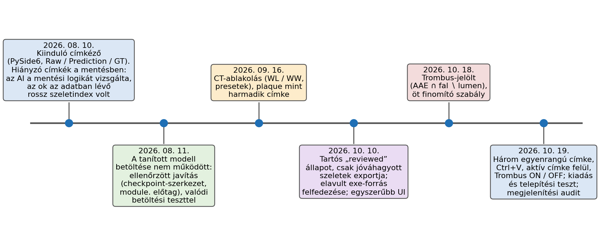
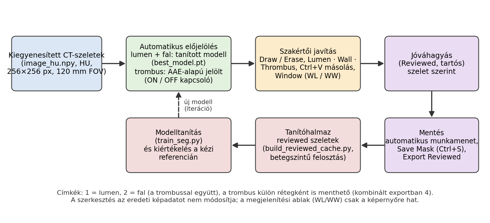
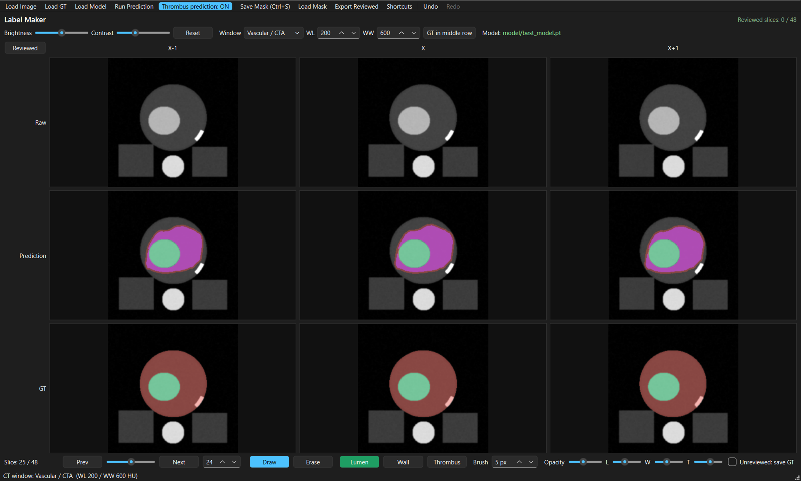
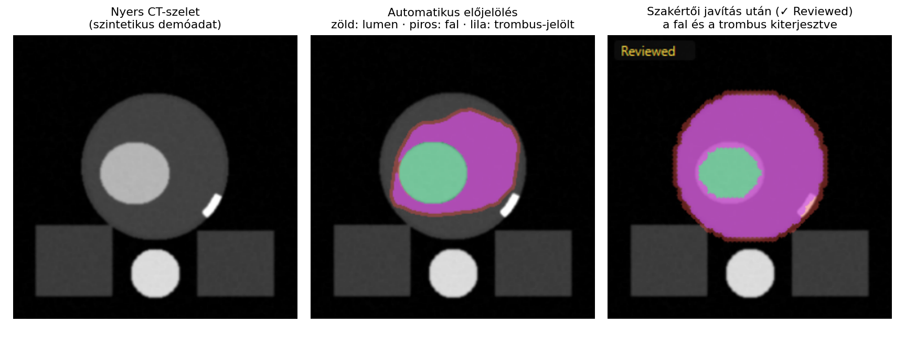
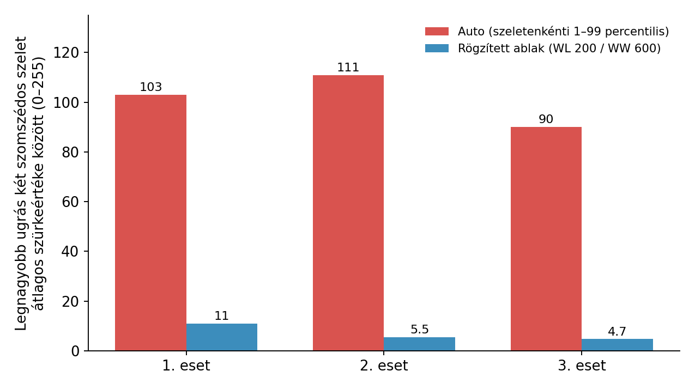

# AI-támogatott, feladatspecifikus orvosi címkéző alkalmazás fejlesztése

## Bevezetés

A felügyelt gépi tanulási modellek minősége nagyban függ a tanítóannotációk minőségétől. Orvosi képeknél ez különösen igaz: a címkéket szakértőnek kell elkészítenie vagy ellenőriznie, a feladat pedig gyakran olyan egyedi igényeket támaszt, amelyeket egy általános annotációs szoftver nem feltétlenül fed le.

A konkrét példa az aortafal-szegmentálási kutatásunk. A fotonszámláló CT (PCCT) felvételeken az aorta középvonalát kinyerjük, az eret „kiegyenesítjük”, majd a kiegyenesített szeleteken (256×256 px, 120 mm látómező) szegmentáljuk a lument és az érfalat, aneurizmáknál a trombust is. A modell tanításához és a klinikai validációhoz szakértő által ellenőrzött címkék kellettek. Erre készült a **Label Maker**, egy PySide6-alapú, Python nélkül is futtatható címkéző alkalmazás. A snippet azt mutatja be, hogyan alakult ki egy AI-alapú fejlesztői asszisztenssel (Claude Code) folytatott iteratív munka során.

## A feladat és a követelmények

A felhasználó a radiológus, aki a modell előjelöléseit ellenőrzi és javítja. A követelmények nem egyszerre, hanem a használat során pontosodtak. A végső változatban a legfontosabbak:

- három szerkeszthető címke: **lumen, fal és trombus**, mindhárom ugyanúgy rajzolható, törölhető, menthető és visszatölthető;
- a modell előjelölése és a meglévő referencia egyszerre látható, a szomszédos szeletekkel együtt;
- a szelet jóváhagyása (*reviewed*) tartós, és csak a jóváhagyott szeletek exportálhatók referenciaként;
- a megjelenítés (ablakolás) soha nem módosítja a HU-adatot, a modell bemenetét vagy a mentett címkéket;
- az eszköz egy másik Windows-gépen, Python nélkül is induljon, és ne írja felül a meglévő annotációt.

Egy általános eszköz helyett azért érte meg saját alkalmazást fejleszteni, mert ezek a követelmények együtt szóltak: modellelőjelölés javítása három szelet kontextusában, szeletszintű, tartós jóváhagyás pontos szeletazonosítókkal, valamint a trombus automatikus jelöltje, amely nem lóghat ki az érfalból. Általános annotációs szoftverekkel nem végeztünk rendszeres összehasonlítást, ez az indoklás a saját igényeinken alapul.

## A fejlesztés folyamata

A rekonstrukció a rendelkezésre álló beszélgetési előzményeken, a fájlokon és a dokumentáción alapul. A beszélgetési előzmények az alkalmazás első említésétől (2026. augusztus 10.) érhetők el. Az ennél korábbi kiinduló változat egy projektrepóban található, 1390 soros `label_maker.py`: ennek korábbi AI-támogatású fejlesztése nem rekonstruálható. Az alkalmazás azóta 2630 soros főfájllá és három önálló modullá nőtt (a tartós review-logika, a címkeszerkesztés és a trombusjelölt képzése), mellé egy fej nélküli önteszt is készült.

A munkamód végig ugyanaz volt: a követelményt én fogalmaztam meg, Claude Code megvalósította és tesztelte, a valódi használat közben talált eltéréseket pedig visszajeleztem. Néhány jellemző utasítás:

> „A cél, hogy a `reviewed` státusz tartós, felhasználó által kezelt jóváhagyást jelentsen, ne pedig egy ideiglenes állapotot, amelyet a program automatikusan megváltoztat.”

> „Nagyon fontos követelmény, hogy a thrombus-jelölt semmilyen körülmények között ne lóghasson ki a jelenlegi prediktált érfalrégióból.”

> „amikor egy adott címkével rajzolok, az aktuális ecset/címke legyen felül, tehát tudjak wallt és lument is rárajzolni egy korábban meglévő thrombus területre”

A trombusfunkciót az AI egy képlettel valósította meg (`AAE_noncalcified ∩ jelenlegi fal ∖ lumen`, ahol az AAE egy külső, nem kontrasztos CT-n tanult modell kimenete), konfigurálható küszöbökkel és öt morfológiai utófeldolgozási szabállyal. A szabályokat a javasolt kimenet első megtekintése után fogalmaztam meg. A paramétereket egyetlen eset négy kézi trombusszeletén hangoltuk (átlagos Dice 0,934 → 0,952, hamis pozitív nélkül a 14 trombusmentes szeleten). Ez irányjelző eredmény, nem validáció.

## Az elkészült alkalmazás

A felhasználó betölti a kiegyenesített CT-szeleteket (HU-ban tárolt `.npy`) és a tanított modellt. A modell előjelöli a lument és a falat, a trombus automatikus jelöltje pedig egy **ON / OFF** kapcsolóval kapcsolható. Ha a kapcsoló OFF, nincs trombusréteg, és trombus nem is mentődik.

A felület három sorban mutatja a nyers képet, az előjelölést és a referenciát, három szomszédos szeletre (X−1, X, X+1). Az alábbi kép a valódi alkalmazás képernyőképe, **szintetikus demóadaton**, nem betegfelvételen.

A szerkesztés ecsettel történik (Draw / Erase, címkeválasztás, állítható ecsetméret, Undo / Redo). Az aktív címke mindig felülírja a többit a rajzolt területen, az Erase csak az aktív címkét törli. A `Ctrl+V` az aktív címke maszkját a következő, a `Ctrl+Shift+V` az előző szeletre másolja. A kézzel szerkesztett szelet automatikusan *reviewed* lesz, de változtatás nélkül átnézett szelet is jóváhagyható (`Ctrl+R`).

A címkék a kép melletti munkamenetmappába mentődnek automatikusan, a `Ctrl+S` pedig megadott névvel és helyre ment. A fő formátum egy `uint8` tömb (`manual_mask.npy`, 1 = lumen, 2 = fal a trombussal együtt), mellette a szeletenkénti állapot (JSON) és a jóváhagyott szeletszámok listája. A trombus külön fájlba kerül, a kombinált exportban a kódja 4. Az **Export Reviewed** kizárólag a jóváhagyott szeleteket írja új, időbélyeges mappába, a többi szelet nem számít érvényes referenciának. Ezekből a szeletekből építhető a tanítóhalmaz, betegszintű train–validation felosztással, a kész modell pedig visszatölthető a címkézőbe előjelölőként.

## Tapasztalatok és hibajavítás

**1. Hiányzó címkék a mentett fájlban.** A mentett maszkból egyes szeletek hiányoztak. Az AI a mentési logikát vizsgálta: az érintetlen szeletekre a modell előjelölése (vagy annak hiányában üres tömb) kerül, és javítási javaslatot is adott. Később kiderült, hogy valójában néhány esetnél rossz szeletindexek szerepeltek az adatban, amit magam javítottam. Az AI magyarázata a kód valódi viselkedését írta le, de nem ez volt a kiváltó ok. Tanulság: a kódszintű diagnózis mellett az adatot is ellenőrizni kell, ehhez szakterületi ismeret kell.

**2. A tanított modell nem töltődött be.** A mentett `best_model.pt` nem volt betölthető. Az AI a modell architektúráját a checkpointból építette újra, kezelte az elosztott (DDP) tanításból származó `module.` kulcsprefixet, jelezte a hiányzó és váratlan kulcsokat, és valódi betöltéssel meg predikcióval ellenőrizte a javítást. A hibát három példányban kellett javítani, mert a fájl több helyen is létezett. Az elfogadási feltételt én szabtam meg: csak akkor kész, ha a modell hiba nélkül betöltődik, és a predikció elindul. Tanulság: elfogadási kritérium nélkül „működik” nem bizonyíték, és a másolatok külön hibaforrások.

**3. Az exe egy elavult forrásból épült.** A radiológusnak átadott telepíthető változat nem tartalmazta az újabb funkciókat. Az AI kiderítette, hogy az exe egy régi, jóval kisebb másolatból épült, nem a fő forrásból. Az új build közvetlenül a fő forrásból készül, a forrás hash-ét rögzíti, és a futtatható állomány beépített önteszttel ellenőrizhető (a végső változaton 89 ellenőrzés, tiszta környezetben). Ugyanekkor a tartós *reviewed* állapotot is újra kellett gondolni: korábban minden ecsetvonás automatikusan jóváhagyottnak számított, ami valójában csak „módosítottat” jelentett. Tanulság: a build folyamat is a követelmény része.

**4. A szomszédos szeletek eltérő világossága.** A radiológiai használat előtt észrevettem, hogy fix ablak mellett is eltérően világosak a szomszédos szeletek. Az AI ellenőrizte a nyers HU-értékeket (a zsír- és lágyrészmediánok ugrása szomszédos szeletek között legfeljebb 10 HU volt), majd megállapította, hogy az ok megjelenítési: az alapértelmezett *Auto* ablak minden szeletet a saját percentilisei szerint skáláz, a WL/WW mezők közben félrevezetően 200/600-at mutattak.

A mai kódban az alapérték továbbra is az *Auto*; a kiadásnál a *Vascular / CTA* preset használatát javasoltuk. Tanulság: a „szokatlanul néz ki” gyanú emberi észrevétel volt, a HU-adat és a megjelenítés szétválasztása pedig AI által végzett mérés.

### Mi gyorsult az AI-val, és mihez kellett szakértői visszajelzés?

Az AI gyorsan és sok részfeladatban segített: kódgenerálás és a meglévő funkciók módosítása (címkeszerkesztés, ablakolás, review-logika), a felület átrendezése, hibakeresés, a trombusjelölt integrálása, fej nélküli önteszt és egységtesztek, a Windows-csomag elkészítése és a dokumentáció. A következők viszont emberi iránymutatást igényeltek: a kutatási probléma és a címkék jelentése, a klinikailag értelmes szabályok (például hogy a trombus ne érjen ki a külső falig), az olyan döntések, mint a plaque felületről való kivétele, a hibás működés észrevétele valós használat közben, valamint a kézi referenciaszeletek biztosítása. Az alkalmazás tehát iteratív együttműködés eredménye, nem önálló AI-fejlesztésé.

## Konklúzió

Egy feladatspecifikus kutatási eszköz esetében nem egyetlen prompt, hanem sok, valódi használatból származó iteráció vezetett működő alkalmazáshoz. Az AI a megvalósításban és az ellenőrzésben gyorsított: a mérésekkel alátámasztott diagnózisok (modellbetöltés, megjelenítési hiba) és az önteszt jelentették a tényleges előnyt. A hibák többségét azonban a használatot ismerő ember vette észre, és a „kész” kritériumát is ő határozta meg.

Három gyakorlati tanulság: a követelményeket érdemes mérhető elfogadási feltételekkel megadni, a hibaokot adatban és kódban is keresni, a csomagolást pedig ugyanazzal a gonddal tesztelni, mint a funkciókat. Az itt leírt tapasztalatok egyetlen projektre és egyetlen fejlesztési környezetre vonatkoznak, nem általánosítható becslések az AI-fejlesztés hatékonyságáról.
