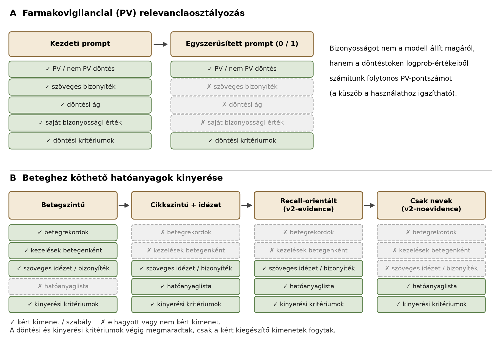
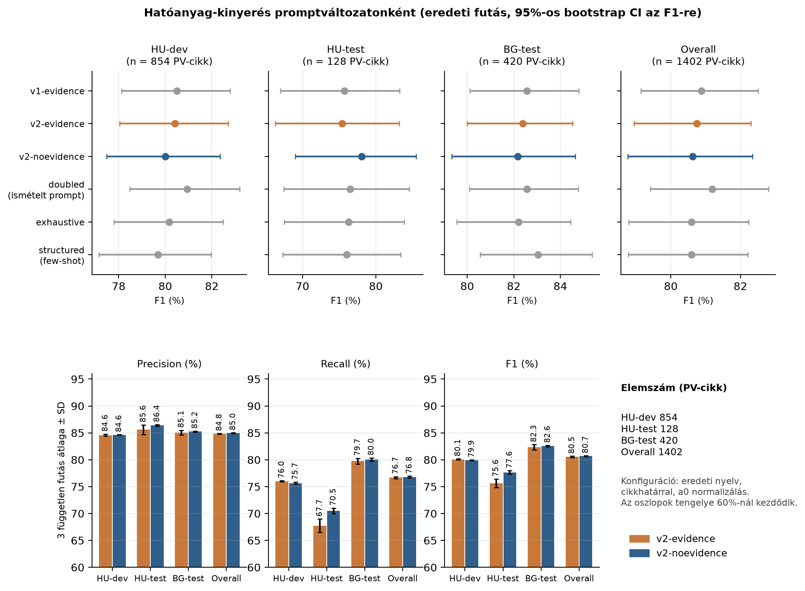
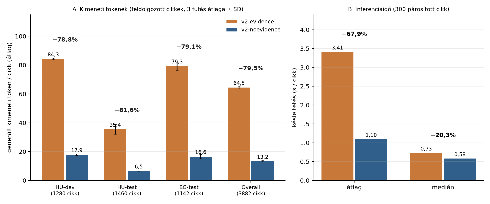
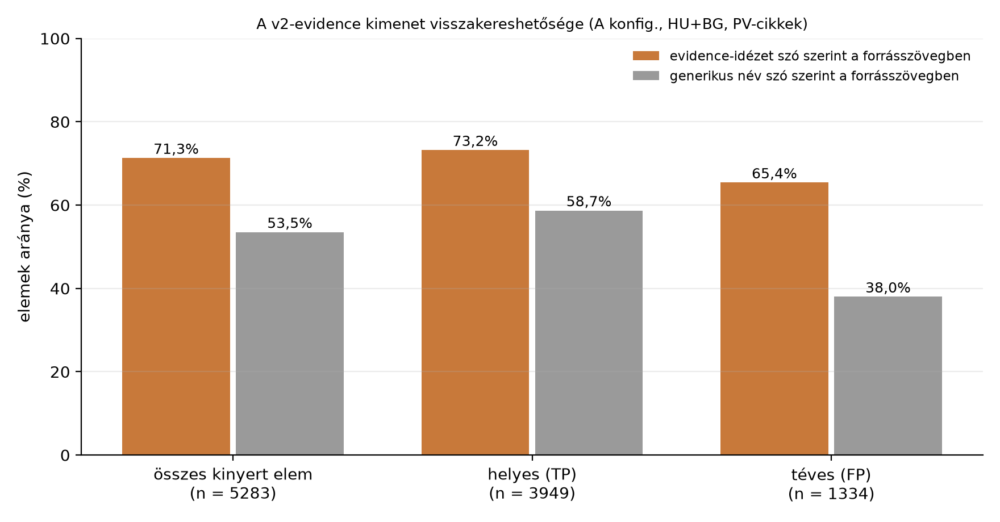

# LLM-promptok és kimenetek egyszerűsítése információkinyerési feladatokban

## Bevezetés

Ha egy LLM-től strukturált információt kérünk, hajlamosak vagyunk mellé magyarázatot, indoklást, idézett bizonyítékot vagy saját bizonyossági értéket is kérni. Ezek hasznosak lehetnek az ellenőrzéshez, de a modellnek le kell generálnia őket, ami tokenekben, késleltetésben és számítási költségben is megjelenik. Nem magától értetődő, hogy a fő feladat pontossága cserébe javul-e.

Ez a snippet a COMFIT projekt két tapasztalatán mutatja be a kérdést. A COMFIT-ban farmakovigilanciai szempontból vizsgált orvosi folyóiratcikkeket dolgozunk fel helyben futtatott nyelvi modellel: eldöntjük, hogy egy cikk farmakovigilanciai (PV) szempontból releváns-e, és kinyerjük a cikkben szereplő betegeknek beadott hatóanyagokat. Mindkét feladatnál a kért kimenet fokozatos egyszerűsítése volt a fejlesztés vezérfonala. A kísérlet nem azt állítja, hogy minden rövidebb prompt jobb. A kérdés az, hogy mi marad meg a főfeladat teljesítményéből, ha a nélkülözhető kiegészítő kimeneteket elhagyjuk, és a döntési szabályokat a promptban érintetlenül hagyjuk.

## A promptok fejlődése



**PV-relevanciaosztályozás.** A kezdeti prompt a relevanciadöntés mellett szöveges bizonyítékot, a döntési folyamatábra érintett ágát és a modell saját bizonyossági értékét is kérte. Az interpretálhatóságot és a hibaelemzést szolgálták, de a modell feladatát is bonyolították. Ráadásul az irodalom szerint a nyelvi modellek szóban megadott bizonyossága gyakran túlzó, ezért ezt a kimenetet elhagytuk. A végleges prompt csak egy `0` vagy `1` tokent kér, a relevanciakritériumok viszont változatlanul benne maradtak. A bizonyosság helyett a döntéstoken logprob-értékeiből számolunk folytonos PV-pontszámot, amelyhez küszöb állítható.

A két kimenet szemléltetése (a mezőnevek és az értékek **szemléltetők**, nem tényleges modellkimenetek):

```json
{"decision": 1, "evidence": "<idézet a cikkből>", "branch": "<döntési ág>", "confidence": 0.9}
```
```
1
```

A gemma-4-26B-A4B-it ezzel a formátummal a teljes adatkészleten kb. 94%-os PV-recallt és 0,947-es ROC-AUC-t ért el. Ennél az ágnál nem készült kontrollált összehasonlítás a kezdeti és az egyszerűsített prompt között, a döntés tehát tervezési indoklásra épül, nem mért eredményre.

**Hatóanyag-kinyerés.** Itt az egyszerűsítés lépésenként mérhető volt. A korai, betegenként több lépésben dolgozó pipeline (beteg azonosítása, kezelései, mindkettőhöz bizonyító mondat) a 120 cikkes HU-gold halmazon, a régi kiértékelővel F1 = 0,646-ot ért el, és körülbelül három órát futott. Az egyhívásos, cikkszintű változat, amely már csak hatóanyagneveket és idézeteket ad vissza, ugyanott F1 = 0,661 volt, 413 másodperc alatt. Ezek a számok nem hasonlíthatók össze a mostani, tisztított halmazokon kapottakkal, de jól mutatják a kezdeti irányt. A szemléltető kimenetek:

```json
{"patients": [{"id": "P1", "description": "<beteg leírása>", "treatments": [{"substance": "<hatóanyag>", "evidence": "<mondat>"}]}]}
```
```json
[{"name": "metformin", "evidence": "<rövid szó szerinti idézet a cikkből>"}]
```
```json
[{"name": "metformin"}, {"name": "insulin glargine"}]
```

(Az első kimenetben a mezőnevek szemléltetők. A második és a harmadik a tényleges kimeneti séma szerkezetét követi, az értékek szemléltetők; a harmadik a végső kimenet.) A cikkszintű kimenetben a betegek beazonosítása már nem külön lépés, de a beteghez kötött beadás követelménye a promptban megmaradt. Ezután a hibák elemzése vezette a fejlesztést: kizárási szabályok (háttér, komparátor, más vizsgálat), márkanév–hatóanyag megfeleltetés, szupportív terápiák, anti-infektívumok, végül egy recall-orientált bekezdés (ez lett a `v2-evidence`). A kísérletek között voltak olyanok is, amelyek bonyolítottak: második kinyerési kör, LLM-es utóellenőrzés (a recall 12 pontot esett, miközben a költség 1,6-szeresére nőtt, ezért elvetettük), még kimerítőbb utasítás, few-shot példás strukturált prompt, ismételt prompt és cikk. A többlépéses vagy összetettebb változatok egyike sem hozott megbízható javulást (lásd az Eredményeknél).

Végül az `evidence` mező kérdése maradt: a `v2-noevidence` változat a `v2-evidence` promptjának egyetlen sorában tér el, a kimeneti sémából elhagyja az idézetet. Az evidence-kérés a promptcsalád legelső változatától szerepelt, ez volt tehát az utolsó kiegészítő kimenet.

## Módszertan

Az összehasonlítás a `v2-evidence` és a `v2-noevidence` között történt, ugyanazon cikkeken, azonos kinyerési kritériumokkal és azonos kiértékeléssel. A modell a vLLM-mel kiszolgált `google/gemma-4-26B-A4B-it`, hőmérséklet 0, a gondolkodó mód kikapcsolva, a kimenet legfeljebb 1400 token, a cikkszöveg legfeljebb 26 000 karakter. Az eredeti nyelvű (magyar és bolgár) cikkeket először egy külön hívás az érintett cikkre vágja (cikkhatár-felismerés), majd jön a kinyerés. A kinyert neveket a determinisztikus utófeldolgozás és normalizálás után hasonlítjuk a szakértői annotációhoz, az evidence a pontozásban nem vesz részt.

A hatóanyag-metrikák a kézzel annotált PV-cikkekre vonatkoznak: HU-dev (854 cikk, ebben HU-2020, HU-2025 és HU-gold), HU-test (128) és BG-test (420), összesen 1402 cikk. A kimeneti tokenek és a formátumhibák az összes feldolgozott cikkre (3882, PV és nem PV) vonatkoznak. Mindkét prompt háromszor futott le a teljes adatkészleten (független futások), és az eredmények a három futás átlagát mutatják. Az inferenciaidőt külön, párosított kísérletben mértük: 300 cikk, mindkét prompttal, váltakozó sorrendben, egy szálon, a kinyerő hívás idejét mérve cikkhatár-felismerés nélkül. A tokenszámok az API által jelentett értékek. A két prompt közti pontossági különbséget a futások közötti szóráshoz mérjük, formális egyenértékűségi vizsgálatot nem végeztünk.

## Eredmények



| Kohorsz (PV-cikk) | Prompt | Precision (%) | Recall (%) | F1 (%) |
|---|---|---|---|---|
| HU-dev (854) | v2-evidence | 84,6 | 76,0 | 80,1 |
| | v2-noevidence | 84,6 | 75,7 | 79,9 |
| HU-test (128) | v2-evidence | 85,6 | 67,7 | 75,6 |
| | v2-noevidence | 86,4 | 70,5 | 77,6 |
| BG-test (420) | v2-evidence | 85,1 | 79,7 | 82,3 |
| | v2-noevidence | 85,2 | 80,0 | 82,6 |
| Overall (1402) | v2-evidence | 84,8 | 76,7 | 80,5 |
| | v2-noevidence | 85,0 | 76,8 | 80,7 |

(három független futás átlaga; a futások szórása az F1-re ≤ 0,8 százalékpont, Overall esetén 0,1 százalékpont.) Összességében a két prompt hatóanyag-kinyerése összehasonlítható: az eredeti futásból számolt páros bootstrap szerint az F1-különbség (evidence nélküli mínusz evidence-es) −0,11 százalékpont, 95%-os CI [−0,87; +0,57]. A kohorszok nem mosódnak össze: HU-dev és BG-test esetén a különbség a futások szórásán belül van (a HU-dev recallnál az evidence-es változat 0,3 pontot jobb, ami a három futásban következetes). A HU-test az egyetlen kohorsz, ahol az evidence nélküli változat következetesen jobb: a recall 2,8, az F1 2,0–2,7 százalékponttal magasabb (eredeti futás: +2,65 pont, CI [+0,79; +4,89]). Ez a kohorsz csak 128 PV-cikket tartalmaz, ezért óvatosan értelmezendő. A teljesítmény tehát nem javult minden kohorszon, és ugyanez igaz a kísérlet többi promptjára is: az összes változat F1-e az 1402 cikkes halmazon 80,6 és 81,2% közé esett, a 95%-os bootstrap CI-k erősen átfedtek. Az összetettebb prompt (kimerítő utasítás, few-shot, ismételt prompt) nem hozott kimutatható javulást.



A kimeneti tokenek átlagos száma 64,5-ről 13,2-re csökkent (−79,5%), kohorszonként −78,8% és −81,6% közt. Az értékek eltérése a kohorszok között a PV-arány különbségéből jön: a HU-test 1460 cikkéből csak 128 PV-cikk, a többi nem PV, ahol a kimenet gyakran üres, és ezért rövid. A párosított időmérésben az átlagos késleltetés 3,41 s-ról 1,10 s-ra csökkent (−67,9%), a medián viszont csak 0,73 s-ról 0,58 s-ra (−20,3%). A mediánnál mérsékeltebb csökkenés valószínű oka, hogy a cikkek többségénél a kimenet eleve rövid, és ilyenkor a bemenet feldolgozása adja az időigény zömét. Az átlag a hosszú, sok hatóanyagot sorra vevő kimenetek miatt javul látványosabban. A formátumhibák aránya (érvénytelen JSON, a tokenkorlát miatt csonka vagy nem értelmezhető kimenet) 0,90%-ról 0,09%-ra csökkent.

A bemenet közben alig változott: a párosított mintában a kérések átlagosan 5130, illetve 5116 bemeneti tokent tartalmaztak, a kimeneti token 75,6-ról 17,8-ra csökkent. A prompt mérete tehát lényegében azonos maradt, és a kérésenkénti összes token (bemenet + kimenet) csak mintegy 1,4%-kal lett kevesebb. A nyereség a generálás időigényében és a kimeneti oldalon jelentkezik. Reasoning tokenek nincsenek, mert a gondolkodó mód ki volt kapcsolva.

## Tapasztalatok

**Mit ér az evidence?** A `v2-evidence` által kért idézetek célja az ellenőrizhetőség. Az idézet a kinyert elemek 71,3%-ánál szó szerint megtalálható a forrásszövegben, míg a generikus név önmagában csak 53,5%-ánál (valószínűleg azért, mert az angol generikus nevek a magyar szövegben gyakran nem szerepelnek betűre). Az idézet tehát segíti a visszakeresést.



Ugyanakkor a téves (FP) elemek 65,4%-ához is tartozik szó szerint visszakereshető idézet, vagyis az idézet megléte nem jelenti, hogy a hatóanyag helyes. Az F1 maga a nevekre épül, ezért nem mond semmit az idézetek helyességéről. A maradék 28,7% idézetet (átfogalmazott, rövidített vagy fordított szöveg) külön nem osztályoztuk, ezért nem tudjuk megmondani, mennyi ebből a pontatlanság. Azt sem vizsgáltuk, hogy az evidence valóban gyorsítja-e az emberi ellenőrzést. Egy korábbi kísérletben az idézet utófeldolgozási szűrőként sem javította a pontosságot.

**Mi nem ugyanaz.** A kísérlet több dolgot választ szét, amelyek nem járnak automatikusan együtt:
- *rövidebb bemeneti prompt*: nem történt, a prompt mérete gyakorlatilag változatlan;
- *egyszerűbb feladat*: igen, a modellnek már nem kell az idézetet is kiválasztania;
- *rövidebb generált kimenet*: igen, kb. 80%-kal;
- *gyorsabb inferencia*: igen, de átlagban jóval nagyobb a javulás (−68%), mint mediánban (−20%);
- *jobb vagy változatlan pontosság*: a kinyerésben összességében változatlan, HU-test-en kismértékben jobb, de ez egy kis kohorsz.

A prompt szövege tehát nem lett rövidebb: ugyanazok a döntési és kizárási szabályok maradtak benne. Az egyszerűsítés a nélkülözhető kimenetet érintette, a feladat szempontjából szükséges szabályokat nem.

## Konklúzió

A COMFIT-ban a kért kimenet egyszerűsítése nem rontott kimutathatóan a fő feladat teljesítményén, miközben a generált tokenek száma körülbelül ötödére, az átlagos késleltetés körülbelül harmadára csökkent. Gyakorlati tanulság, hogy egy LLM hatékony alkalmazásához nem feltétlenül kell mindent egyetlen válaszban előállíttatni. Ha pontosan meghatározzuk a fő feladatot és a szükséges kimenetet, a kiegészítők gyakran elhagyhatók, a döntési szabályokat viszont érdemes megtartani.

A szöveges bizonyíték elhagyása viszont kompromisszum: cserébe a nyomon követhetőségről mondunk le. Ha egy alkalmazásban az emberi ellenőrzéshez az idézetre szükség van, érdemes megtartani, esetleg csak a kétséges esetekre kérni. A megfelelő kimenet az alkalmazási céltól függ, és az eredmények egyetlen modellre, egyetlen feladatra és az itt vizsgált adathalmazokra vonatkoznak.
