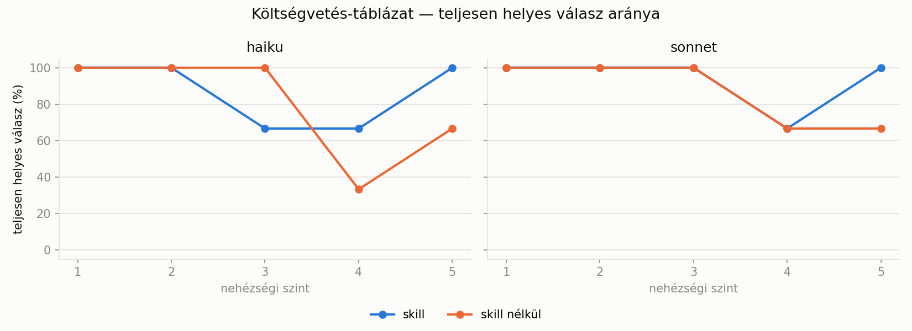
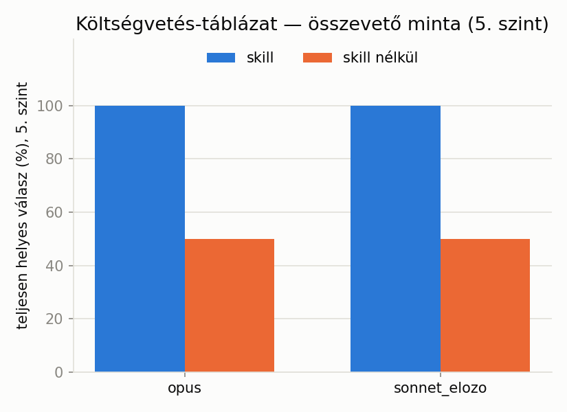
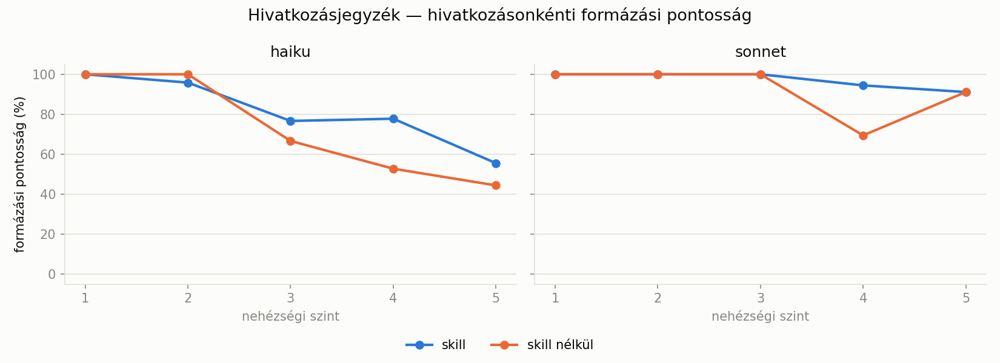
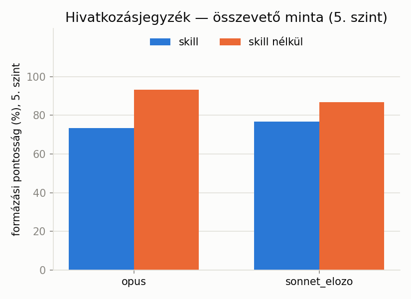

# Agent Skillek diákoknak: segítenek-e a hivatalos dokumentum-skillek egy hétköznapi feladatnál?

## Mi az az Agent Skill?

Az Agent Skill egy csomagolt, újrafelhasználható képesség-egység: egy mappa, aminek a gyökerében egy `SKILL.md` fájl van. A `SKILL.md` eleje egy rövid leírás, ami megmondja, mikor releváns a skill (milyen feladattípusra, milyen kulcsszavakra), utána pedig részletes, lépésenkénti instrukció következik. Ez utóbbit Claude csak akkor tölti be a saját kontextusába, ha a feladat alapján relevánsnak ítéli a skillt. Ezt hívják "progresszív feltárásnak" (progressive disclosure): a rövid leírás mindig jelen van, a részletes tartalom csak szükség esetén kerül elő, így nem terheli feleslegesen a kontextusablakot. Egy skill futtatható kódot (jellemzően Python scripteket) is tartalmazhat, amit Claude a kódfuttatás-eszközén keresztül hív meg. Egy skill tehát nemcsak instrukció, hanem ténylegesen működő eszköz is lehet, ami valódi fájlokat hoz létre.

Egy diák kétféleképp találkozhat vele: a claude.ai fizetős csomagjaiban előre elérhetők a hivatalos dokumentum-skillek (Excel, Word, PowerPoint, PDF kezelésére), amiket be- és kikapcsolhat; a Claude Code-ban (a fejlesztői parancssori eszközben) pedig telepíthetők az Anthropic nyilvános, hivatalos skill-gyűjteményéből (`github.com/anthropics/skills`) származó skill-csomagok, vagy akár saját, egyedi skill is írható és elhelyezhető egy projekt `.claude/skills/` mappájában.

Ez az esettanulmány nem azt vizsgálja, hogyan lehet skillt írni, hanem azt, hogy a már meglévő, hivatalos dokumentum-skillek (konkrétan: táblázatkezelő és szövegszerkesztő) ténylegesen jobb, pontosabb eredményt adnak-e egy hétköznapi feladatnál, mint amikor a modell skill nélkül, csak a beépített kódfuttatás-eszközére hagyatkozva válaszol ugyanarra a feladatra.

## A szcenárió

Két feladatot vizsgálok, mindkettőt egy-egy hivatalos, Anthropic által karbantartott dokumentum-skillel: egy táblázatkezelőt (xlsx) és egy szövegszerkesztőt (docx). Mindkét feladatnak van objektív, szkriptből generálható és ellenőrizhető helyes válasza, ezért a kiértékelés teljes egészében automatizált: nincs benne emberi bíráló vagy valós felhasználói teszt.

Az első pilot-hívásokból (mielőtt a teljes mérést elindítottam) egy fontos dolog derült ki: a dokumentum-skill telepítése **nem** azon dönt, hogy a modell egyáltalán képes-e xlsx/docx fájlt létrehozni. Ezt a Claude Code beépített kódfuttatás-eszköze skill nélkül is tudja (saját Python-kódot ír, ami `openpyxl`-t vagy hasonló könyvtárat használ). Emiatt a promptok mindkét feltételnél (skill / skill nélkül) szó szerint azonosak: a változó kizárólag az, hogy a hivatalos dokumentum-skill telepítve van-e az adott hívás munkakönyvtárában, nem az, hogy a modell milyen formában válaszolhat.

## Forgatókönyv A: Költségvetés-táblázat (xlsx skill)

**A feladat:** egy rendezetlen, természetes nyelvi formában megadott havi tranzakciólistából (bevételek és kiadások) el kell készíteni egy szervezett táblázatot helyes kategóriánkénti összesítéssel és záró egyenleggel.

### Nehézségi létra

| Szint | Tranzakciók | Kategóriák | Kategorizálás | Összegformátum | Extra lépés |
|---|---|---|---|---|---|
| 1 | 8-10 | 3, mindig explicit | nem kell kikövetkeztetni | egységes | nincs |
| 2 | 12-15 | 5, néha hiányzik | leírásból kikövetkeztetve | egységes | nincs |
| 3 | 15-18 | 5, gyakran hiányzik | mint 2. szint | vegyes írásmód ("3500 Ft", "3,5k", "3500") | nincs |
| 4 | 18-22 | 6-7, gyakran hiányzik | mint 2. szint | vegyes | megosztott költség (pl. "3 felé osztva") |
| 5 | 25-30 | 8-10, gyakran hiányzik | mint 2. szint | vegyes | megosztott költség + heti bontás, melyik héten volt legmagasabb az élelmiszer-kiadás |

3 ismétlés szintenként. Minden feladat 4 modellen fut: `haiku` és `sonnet` minden szinten, `opus` és egy korábbi generációs `sonnet` csak az 5. (legnehezebb) szinten, összevető mintaként.

### Ground truth

A tranzakciókat egy Python script generálja, szintenként és ismétlésenként string-kulcsos, seedelt véletlenszám-generátorral (`random.Random(f"budget_{level}_{repeat}")`, sosem a beépített `hash()` függvénnyel, ami Python-futtatások között nem reprodukálható). A generátor egy előre megírt tételsablon-készletből (leírás + kategória + összegtartomány hármasokból) választ, és a pontos forintösszeget a megadott tartományon belül véletlenszerűen sorsolja ki, majd ugyanabból a generált adatból számolja a helyes kategóriánkénti összeget és záró egyenleget. Nem külön "megbecsüli" a helyes választ.

### Promptminta (2. szint, rövidítve)

```
Az alábbi nyers tranzakciólistából (ez egy hónap tranzakciói) készíts egy
szervezett költségvetés-táblázatot xlsx fájlként.

A lehetséges kategóriák: élelmiszer, lakhatás, szórakozás, közlekedés, bevétel.

Tranzakciók:
- Tesco bevásárlás - 8400 Ft
- albérlet (lakhatás) - 102050 Ft
- Spotify előfizetés - 2000 Ft
[...]

Feladat:
1. Kategorizáld az egyes tételeket (ha a kategória nincs explicit megadva,
   a leírásból következtesd ki, és a fenti kategórialistából válassz).
2. Számítsd ki a kategóriánkénti összköltést.
3. Számítsd ki a záró egyenleget.

Mentsd el az eredményt "output.xlsx" néven a jelenlegi könyvtárba.
```

A teljes promptok: [`data/budget/prompts/`](data/budget/prompts/).

## Forgatókönyv B: Hivatkozásjegyzék (docx skill)

**A feladat:** rendezetlen, véletlen mezősorrendű, néhol hiányos forrásadatokból helyes, APA 7. kiadás szerint formázott, ábécésorrendbe rendezett hivatkozásjegyzéket kell készíteni.

### Nehézségi létra

| Szint | Források | Típusok | Mezők hiánya | Szerzőszám | Egyéb |
|---|---|---|---|---|---|
| 1 | 5 | csak könyv | nincs | 1 | mezők logikus sorrendben |
| 2 | 8 | könyv + folyóiratcikk | nincs | 1 | nincs |
| 3 | 10 | könyv + folyóiratcikk | néhol oldalszám/DOI hiányzik | 1-2 | nincs |
| 4 | 12 | + weboldal | néhol hiányzik | 1-2 | mezők véletlen sorrendben megadva |
| 5 | 15 | mind a három típus | néhol hiányzik | 1-3 | + a nyers forráslista sem ábécésorrendben van |

### Ground truth

A formázási szabályt egy `format_apa()` függvény valósítja meg (könyv/folyóiratcikk/weboldal, 1-3 szerző, hiányzó mezők kihagyása). Ez maga a ground truth, nem külső adatbázisból jön. A forrásadatokat (fiktív, de valósághűen hangzó szerző-, cím-, folyóirat- és kiadópoolokból) szintén seedelt RNG generálja (`random.Random(f"citation_{level}_{repeat}")`).

### Promptminta (2. szint, rövidítve)

```
Az alábbi rendezetlen, véletlen sorrendű forrásadatokból készíts egy helyes,
APA 7. kiadás szerint formázott, ábécésorrendbe rendezett hivatkozás-
jegyzéket docx fájlként.

Források:
- típus: book
  szerző(k): Kovács, J.
  cím: A tanulás pszichológiája
  év: 2018
  kiadó: Akadémiai Kiadó
[...]

Mentsd el "output.docx" néven a jelenlegi könyvtárba. Minden hivatkozás
külön bekezdésben szerepeljen, a szerző vezetékneve szerint ábécésorrendbe
rendezve. Ha egy mező nincs megadva, hagyd ki, ne találj ki helyette adatot.
```

A teljes promptok: [`data/citations/prompts/`](data/citations/prompts/).

## Modellek és feltételek

4 modell: `haiku`, `sonnet`, `opus`, és egy korábbi generációs `sonnet` (`sonnet_elozo`). Költségkorlátozás céljából `haiku` és `sonnet` fut minden szinten és ismétlésen ("teljes rács"), `opus` és `sonnet_elozo` csak az 5. szinten, 2 ismétlésen ("összevető minta").

A skill be/ki feltétel két külön munkakönyvtárral valósul meg: az egyikben telepítve van a hivatalos `document-skills` plugin (`claude plugin install document-skills@anthropic-agent-skills --scope project`), a másik érintetlen. A hívás ugyanaz a prompt, csak más könyvtárból indul. Összesen 136 hívás (2 forgatókönyv x 68), teljes költség **$32.51**.

A tényleges skill-használatot utólag, a Claude Code munkamenet-naplókból is ellenőriztem: mind a 68 "skill" feltételű hívás (34 költségvetés, 34 hivatkozásjegyzék) ténylegesen meghívta a megfelelő skillt (`document-skills:xlsx`, illetve `document-skills:docx`): nincs olyan eset, ahol a skill elérhető volt, de a modell mégsem nyúlt hozzá. A mért különbségek tehát tényleg a skill hatását tükrözik, nem a skill esetleges figyelmen kívül hagyását.

## Eredmények: Költségvetés-táblázat





Egy feladat akkor számít teljesen helyesnek, ha minden kategória-összeg és a záró egyenleg is pontosan egyezik a ground truthtal. Egy ábrapont szintenként és feltételenként 3 feladatból áll (az összevető mintán 2-ből), ezért egyetlen hibás feladat 33, illetve 50 százalékpontot mozgat.

Az 1-2. szinten minden modell és mindkét feltétel hibátlan. A 3-4. szinten nincs éles, egyirányú különbség: helyenként a skill jobb (4. szint, kategória-összegek), helyenként rosszabb (3. szint, `haiku` skillel egy esetben elszámolta a záró egyenleget). Az **5. (legnehezebb) szinten viszont mind a négy modellnél a skill-feltétel ad tökéletes (100%) eredményt, míg skill nélkül 50-67%-ra esik vissza.** Skill nélkül minden modellnél pontosan egy feladat bukott el, mindig rossz kategória-összeg miatt (a `haiku` és a `sonnet` esetében 3, illetve 5 kategóriánál, `opus`-nál és `sonnet_elozo`-nál 1-1 kategóriánál). A heti bontás (legmagasabb élelmiszer-kiadású hét) egyik hívásnál sem hibázott.

## Eredmények: Hivatkozásjegyzék





Az ábrák azt mutatják, hogy a modell által írt hivatkozások hány százaléka helyes. Egy hivatkozás akkor helyes, ha a szövege (a szóközök és az idézőjelek egységesítése után) pontosan egyezik a várt hivatkozással. Az összevető minta az 5. szinten futó `opus` és korábbi generációs `sonnet`.

| Modell | Szint | Skillel | Skill nélkül |
|---|---|---|---|
| `haiku` | 3. | 77% | 67% |
| `haiku` | 4. | 78% | 53% |
| `haiku` | 5. | 56% | 44% |
| `sonnet` | 4. | 94% | 69% |
| `sonnet` | 5. | 91% | 91% |
| `opus` | 5. | 73% | 93% |
| `sonnet_elozo` | 5. | 77% | 87% |

Az 1-2. szinten a két feltétel gyakorlatilag azonos. `haiku`-nál és `sonnet`-nél a skill jobb vagy egyenlő, az összevető mintán viszont mindkét modellnél a skill nélküli feltétel a pontosabb. Ennek van azonosítható oka, lásd a Konkrét példákat.

Azért nem azt ábrázolom, hogy hány feladat lett teljesen helyes, mert az mind a 12-15 hivatkozástól hibátlanságot vár. Ha egy hivatkozás 90% eséllyel helyes, 12 hivatkozás mindegyike csak 0,9^12 ≈ 28% eséllyel az, tehát egyetlen apró hiba is elveszi a feladatot. A skill javulása így elvész. A sorrend és a teljesség emellett ritkán romlik el: a 68 feladat 91%-ában helyes az ábécésorrend, 98,5%-ában nincs kihagyott vagy kitalált forrás. A hibák többsége a formázásból jön.

A 130 hibás hivatkozás különböző súlyú (a hasonlóságot a várt és az írt szöveg közötti egyezés aránya adja, 1,0 a tökéletes egyezés): **114 (88%) apró eltérés** (jellemzően egy elgépelt szó, hiányzó pont vagy nagybetű, mint az "önszabályozott"/"önszabályított" eset), **15 nagyobb eltérés** (a hasonlóság 0,88 és 0,95 között van, tehát ezek is közel állnak a helyes változathoz) és **1 teljesen hiányzó**. Egy diák számára ezek nem ugyanakkora hibák, a "teljesen helyes" mutató mégis egyformán hibásnak számolja őket.

## Költség és idő

A skill használata nemcsak pontosságban, hanem költségben és időben is számít: átlagosan **2,45x** drágábbá és **2,49x** lassabbá teszi a hívást a költségvetés-forgatókönyvnél (0,15 → 0,36 dollár, 70 → 174 másodperc), és **1,74x** drágábbá, **1,44x** lassabbá a hivatkozásjegyzéknél (0,16 → 0,28 dollár, 76 → 109 másodperc). Ennek fő oka a turn-ök számának megnövekedése: 3-4 turn-ről 11-re nő átlagosan, mivel a skill beolvasása, a scriptek futtatása és az eredmény ellenőrzése több lépésből áll, mint egy közvetlen válasz. Ez egy diák számára is releváns döntési szempont: a magasabb pontosságért (ahol van ilyen) cserébe hosszabb várakozási idő és nagyobb API-költség jár.

## Konkrét példák

### Költségvetés-táblázat: miért segít a skill a 4. szinten

A `budget_L4_r1` feladatban `haiku` és `sonnet` is 5/7 kategóriát talál el skill nélkül, de 7/7-et skillel. A különbség nem számítási hiba: a skill nélküli táblázat egyszerűen kihagyta a "ruházat" és "egészség" kategóriasort, mert ebben a konkrét feladatban nem volt bennük tranzakció. A skill-feltétel viszont a teljes kategórialistát felsorolta, a nulla-értékű kategóriákat is. ([`budget_L4_r1__haiku__noskill.xlsx`](data/budget/raw/budget_L4_r1__haiku__noskill.xlsx) vs. [`budget_L4_r1__haiku__skill.xlsx`](data/budget/raw/budget_L4_r1__haiku__skill.xlsx))

A skill-feltétel emellett valódi Excel-képleteket (`SUMIF`, `SUM`) írt a hardcode-olt számok helyett, ami helyes, jó gyakorlat egy táblázatnál, de a kiértékelő szkriptnek külön meg kellett tanítanom kiszámolni ezeket (lásd a Módszertani buktatók 2. pontját).

### Hivatkozásjegyzék: egy szó, ami elég a hibához

A `citation_L4_r1` feladatban `haiku` skill-lel egy teljes, jól formázott, helyes sorrendű docx-et hozott létre, egyetlen forrás kivételével: az eredeti cím "Az önszabályozott tanulás mérési lehetőségei" volt, a modell "önszabályított"-ra írta át (nem létező szó egy létező helyett). A többi 11 hivatkozás pontosan egyezett. ([`citation_L4_r1__haiku__skill.docx`](data/citations/raw/citation_L4_r1__haiku__skill.docx))

### Hivatkozásjegyzék: miért rontott a skill az összevető mintán

Megnéztem, konkrétan mi romlik el `opus`-nál és `sonnet_elozo`-nál skillel, és két, egymástól független, de azonos irányú hibát találtam, mindkettő kizárólag a skill-feltételnél jelentkezik, `haiku`-nál és `sonnet`-nél sehol. `opus` skillel a weboldal-típusú források dátumát magyar írásmóddal írta ("2021. szeptember 12.") az APA által kért, vesszős angol forma helyett ("2021, szeptember 12"): a 11 weboldal-forrásból 5-nél, skill nélkül 0-nál. ([`citation_L5_r2__opus__skill.docx`](data/citations/raw/citation_L5_r2__opus__skill.docx) vs. [`citation_L5_r2__opus__noskill.docx`](data/citations/raw/citation_L5_r2__opus__noskill.docx)) `sonnet_elozo` skillel az egyik feladatban a magyar hónapneveket angolra fordította ("augusztus" → "August"), miközben a dokumentum minden más része magyar maradt: 6 hivatkozásnál, skill nélkül egyszer sem. ([`citation_L5_r1__sonnet_elozo__skill.docx`](data/citations/raw/citation_L5_r1__sonnet_elozo__skill.docx) vs. [`citation_L5_r1__sonnet_elozo__noskill.docx`](data/citations/raw/citation_L5_r1__sonnet_elozo__noskill.docx)) Mindkét esetben ugyanaz a mintázat: a skill egy angol nyelvi/formázási alapértelmezés felé tolja el ezt a két modellt egy egyébként magyar nyelvű dokumentumnál, a skill nélküli, szabadabb szöveges válasz viszont következetesen magyarul marad. Ez arra utal, hogy a (feltehetően angolul írt) skill-instrukció nyelve átszivároghat a kimenetbe, olyan modelleknél, amik kevésbé jól tartják el egymástól a saját válasz nyelvét és az utasítás nyelvét.

### Kiegészítő teszt: segít-e egy explicit "maradj magyarul" utasítás?

Kipróbáltam, hogy egy explicit nyelvi utasítás ("a hivatkozásjegyzék kizárólag magyar nyelven készüljön, a hónapneveket és a dátumformátumot is beleértve") megoldja-e a fenti problémát. Ugyanazt a 2 feladatot (`citation_L5_r1`, `citation_L5_r2`) futtattam újra `opus`-szal és `sonnet_elozo`-val, mindkét feltétellel (8 hívás, $3,98: jóval több, mint amit előzetesen becsültem, mert az `opus` hívásai nála sokkal drágábbak, mint a többi modellel számolt átlag). ([`harness/citations/test_hu_instruction.py`](harness/citations/test_hu_instruction.py))

Az eredmény vegyes, összességében inkább rontott, mint javított. `sonnet_elozo` skillel valóban javult (93% formázási pontosság a korábbi 77%-hoz képest, az angol hónapnevek eltűntek), a másik három cellában viszont romlott: `opus` skillel 73%-ról 57%-ra, `opus` skill nélkül 93%-ról 43%-ra (a korábban tökéletes eredmény tört meg), `sonnet_elozo` skill nélkül 87%-ról 57%-ra. A romlás oka a romló cellákban ugyanolyan: a modellek a "maradj magyarul" utasítást az APA-szabvány saját, nyelvfüggetlen jelöléseire is alkalmazták, nem csak a szövegre. A 8 hívásból 4-ben történt ez. Háromban az `&` szerzőelválasztó helyett "és" állt mind a 10 többszerzős hivatkozásban (`opus` skillel az 1., `opus` skill nélkül a 2., `sonnet_elozo` skill nélkül az 1. feladatban). Háromban a dátum magyaros, pontokkal tagolt formát kapott ("2018. augusztus 28.") a vesszős APA-forma helyett ("2018, augusztus 28"): `opus` skillel az 1., skill nélkül mindkét feladatban.

Ez azt mutatja, hogy egy első ránézésre logikus javítás önmagában nem old meg semmit: a modellek nem különböztetik meg a dokumentum prózai nyelvét az APA-szabvány saját, nyelvfüggetlen jelöléseitől, ha csak annyit mondok, hogy "maradj magyarul". Egy pontosabb utasítás (pl. kifejezetten megnevezve, hogy az APA-jelölés a nyelvi utasítás alól kivétel) valószínűleg jobban működne, de ezt már nem teszteltem tovább.

## Módszertani buktatók

### 1. Kerekítési hiba a ground truthban

A vegyes összegformátumoknál ("42,6k Ft") a generátor 1 tizedesjegyre kerekített, így a promptban 42 600 Ft állt, a ground truth viszont a pontos 42 650 Ft-ot várta. A hiba a 3-5. szint minden feladatát érintette, a tranzakciók kb. 28%-át. A már lefutott 68 hívást nem lehetett utólag javítani, ezért a teljes költségvetés-forgatókönyvet újra kellett futtatnom. Az eldobott futás $19,59-ba került.

### 2. A pontozó több helyen félreolvasta a táblázatot

Az első verzióban a költségvetés-forgatókönyv mindenhol 0%-ot adott, és ezt négy külön hiba okozta:

- A kategórianév ("lakhatás") a tranzakciólistában is szerepel, nem csak az összesítőben, a pontozó pedig az első találatot fogadta el. Most az összesítő jellegű munkalapokat részesíti előnyben.
- A skill valódi Excel-képleteket ír (`=SUMIF(...)`), amiket az `openpyxl` nem számol ki. Emiatt a skill-feltétel indokolatlanul rosszabbnak látszott, pont fordítva, mint amit mérni akartam. Most a `formulas` könyvtár számolja ki őket.
- Az 5. szinten a heti bontású sorokban (`kategória, 1. hét, ..., 4. hét, Összesen`) a pontozó az első számot vette, nem az utolsót, ezért az egész szint 0% lett.
- Egy fájlban az összegek szöveges cellába kerültek ("32,600.00"). Ezt a pontozó most számként olvassa.

### 3. A megosztott költség kerekítése

Ha egy tétel implicit módon meg van osztva ("hárman osztottuk"), a modellnek kell osztania. A generátor a részt 50 Ft-ra kerekítette, a modellek viszont forintra pontosan számoltak, ezért az 5. szint hívásainak 80%-a (16/20) hibásnak látszott. Először ±50 Ft toleranciával kezeltem, de ez elfedte volna a valódi hibákat is. A tényleges javítás a ground truthban volt: a megosztott rész most forintra kerekül, az 50 Ft-os kerekítés csak a promptban kimondott részösszegekre marad. Ezután már ±1 Ft tolerancia is ugyanazt az eredményt adta.

### 4. Kettőspontos forráscím

Az egyik weboldal-forrás címe ("A felsőoktatás jövője: tíz tendencia") kettőspont utáni alcímet tartalmaz. Az APA 7 szerint a kettőspont utáni szó nagybetűs ("Tíz"), a magyar helyesírás szerint kisbetűs. A ground truthba először a kisbetűs alakot írtam be, majd az APA szerintire javítottam. A cím 40 hivatkozásban szerepelt, és a modellek csak 7-szer írták nagybetűvel. Ez nem biztos, hogy modellhiba: egy angol stílusszabály magyar címen eleve kétértelmű, és a feladat ezt nem döntötte el.

### 5. Párhuzamos futtatás közös munkakönyvtárban

A hálózati hibák miatti pótló hívásokat néhányszor a fő futással egy időben indítottam, ugyanabba a `workdir_skill` mappába. A `run_test.py` egyszerre csak egy hívást feltételez: hívás előtt törli az `output.docx`-ot, utána átnevezi, ami a mappában van. Két párhuzamos hívásnál az egyik elvitte a másik fájlját, hiba nélkül. Úgy vettem észre, hogy minden docx tartalmát összevetettem az összes feladat elvárt listájával: a `citation_L5_r1__sonnet_elozo__skill.docx` hét hivatkozása a `citation_L2_r2` feladathoz tartozott. A fájlt töröltem, és a hívást egyedül újrafuttattam ($0,27). A költségvetés-forgatókönyv 68 fájlján ugyanezt az ellenőrzést is lefuttattam, ott nem volt keveredés.

## Korlátok

- A tranzakció- és forrásadatok szintetikusak (script generálja), nem valódi felhasználói adatok: a valós, kevésbé szabályos bemenetek (pl. tényleg kaotikus, ellentmondásos leírások) másképp viselkedhetnek.
- A pontozás automatikus, heurisztikus fájl-beolvasásra épül (címke-érték párok keresése egy táblázatban, szöveg-normalizálás egy dokumentumban). Ha egy modell szokatlan, a fentiektől eltérő elrendezést választ, a pontozó tévesen hibásnak jelezhet egy valójában helyes választ.
- Nincs valós diák-tesztelő bevonva: a feladatok realisztikusak (költségvetés, hivatkozásjegyzék), de azt nem méri a kísérlet, hogy egy tényleges felhasználó ugyanígy fogalmazná-e meg a kérést.
- 3 ismétlés szintenként (az összevető mintánál 2) kevés a statisztikai megbízhatósághoz: egy-egy szélsőséges eredmény simán lehet mintavételi zaj, nem szisztematikus mintázat.
- Egy angol nyelvi szabályrendszert (APA 7) magyar nyelvű tartalomra alkalmazok. A kettőspontos alcím nagybetűzése (4. módszertani buktató) megmutatta, hogy ez önmagában is kétértelmű helyzeteket teremt, amit a feladat nem old fel egyértelműen.

## Összefoglaló tanulságok

1. A hivatalos dokumentum-skill telepítése önmagában nem azon dönt, hogy egy modell képes-e a kért fájlformátumot előállítani: a Claude Code beépített kódfuttatás-eszköze skill nélkül is tud xlsx/docx fájlt írni. A skill inkább a *minőségen*, *konzisztencián* és a *jó gyakorlatok* (pl. valódi képletek, teljes kategórialista) követésén segít, nem az alapkapacitáson.
2. A skill hatása nem egyenletes a nehézségi szinteken: a legkönnyebb feladatoknál nincs érzékelhető különbség (mindkét feltétel hibátlan), a legnehezebbnél viszont a költségvetés-forgatókönyvnél mind a négy modell tökéletes lett skillel, míg nélküle 50-67%-ra esett vissza.
3. A skill hatása erősen forgatókönyv- és modellfüggő: a költségvetés-táblázatnál a legnehezebb szinten minden modellnél egyértelmű, nagy előnyt adott. A hivatkozásjegyzéknél árnyaltabb a kép: `haiku`-nál és `sonnet`-nél (legalábbis a 4. szinten) a skill inkább javította a hivatkozásonkénti formázási pontosságot, az összevető mintán (`opus`, korábbi generációs `sonnet`) viszont pont fordítva, a skill nélküli feltétel volt pontosabb az 5. szinten. Ennek azonosítható oka van: ez a két modell skillel néhol angol nyelvi/formázási alapértelmezésre váltott egy magyar nyelvű dokumentumban (angol hónapnév, magyaros helyett angolos dátumírásmód), skill nélkül ez egyszer sem fordult elő. Nincs egyetlen, minden esetre érvényes szabály.
4. Egy automatikus kiértékelő rendszer építése önmagában legalább annyi hibalehetőséget rejt, mint a mért jelenség: az öt dokumentált buktatóból négy a saját generáló-, pontozó- vagy futtatókódomban volt, az ötödik pedig abból adódott, hogy a feladat nem döntött el egy kétértelmű szabályt. Egyik sem a modellek viselkedésében. Ezeket csak a nyers kimenetek kézzel történő átnézésével sikerült megtalálnom, jóval a "kész" eredmény után is.
5. Egy kerekítési hiba a ground truth generálásában valódi, jelentős pénzbe került (egy teljes forgatókönyv újrafuttatása, kb. $20). A ground truth és a promptok közötti konzisztencia ellenőrzése legalább annyira kritikus, mint magának a modellnek a tesztelése.
6. A skill jelenléte a hivatkozásjegyzéknél valójában javítja a hivatkozásonkénti formázási pontosságot, ez a javulás mégis alig látszik a feladat-szintű "teljesen helyes" mutatóban, mert 12-15 egymástól független hivatkozásnál egyetlen apró hiba is elég a teljes feladat elbukásához. Egy mindent-vagy-semmit kritérium sok elemből álló feladatnál könnyen elfedi a részleges javulást.
7. A skill nem ingyenes: átlagosan 1,4-2,5x-ös költség- és időtöbbletet jelent hívásonként, a turn-ök száma nagyjából megháromszorozódik. Ahol a pontosságbeli előny nem egyértelmű (mint a hivatkozásjegyzéknél), ez a többlet nem feltétlenül éri meg.

## Fájlok

- [`harness/models.json`](harness/models.json): a 4 modell (teljes rács / összevető minta) definíciója
- [`harness/setup_skills.sh`](harness/setup_skills.sh): a dokumentum-skill telepítése
- [`harness/run_test.py`](harness/run_test.py): a teszt-mátrix futtatása
- [`harness/budget/generate_transactions.py`](harness/budget/generate_transactions.py), [`score_budget.py`](harness/budget/score_budget.py): ground truth és kiértékelés (költségvetés)
- [`harness/citations/generate_citations.py`](harness/citations/generate_citations.py), [`score_citations.py`](harness/citations/score_citations.py): ground truth és kiértékelés (hivatkozásjegyzék), benne a `format_apa()` formázó függvény
- [`harness/citations/test_hu_instruction.py`](harness/citations/test_hu_instruction.py): kiegészítő teszt, explicit magyar nyelvi utasítással
- [`analyze.py`](analyze.py): összesítő táblák és ábrák
- [`data/budget/ground_truth.json`](data/budget/ground_truth.json), [`data/budget/results.csv`](data/budget/results.csv)
- [`data/citations/ground_truth.json`](data/citations/ground_truth.json), [`data/citations/results.csv`](data/citations/results.csv)
- [`data/summary_tables.md`](data/summary_tables.md): szintenkénti/modellenkénti összesítés
