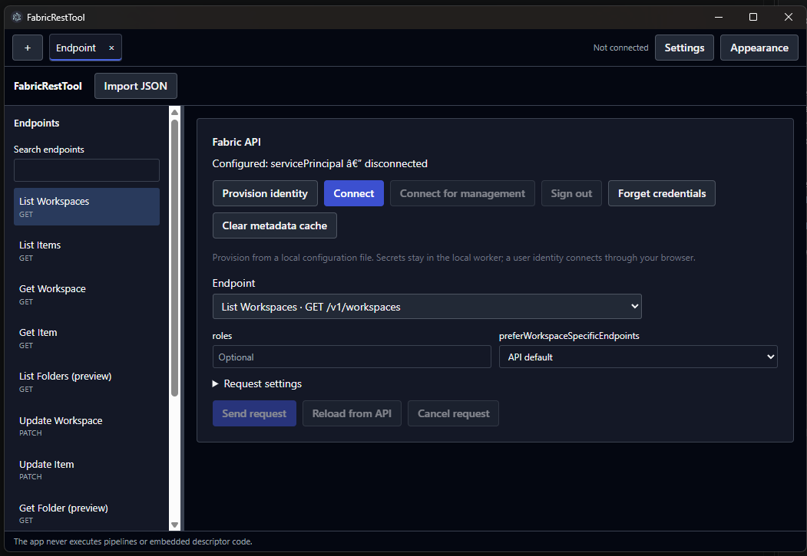
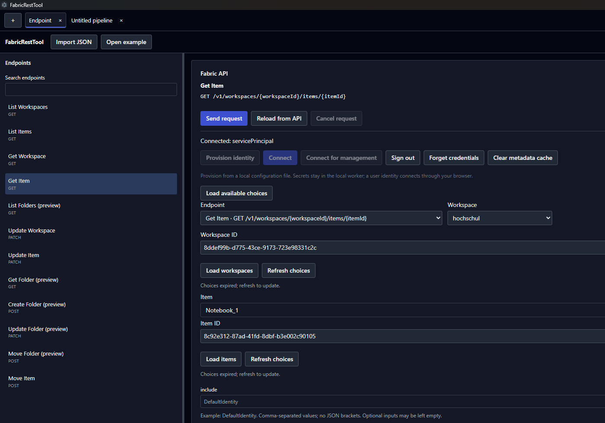
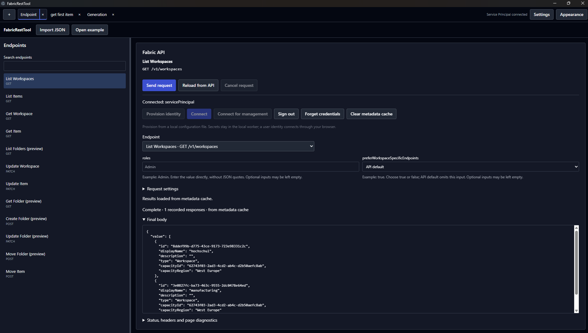
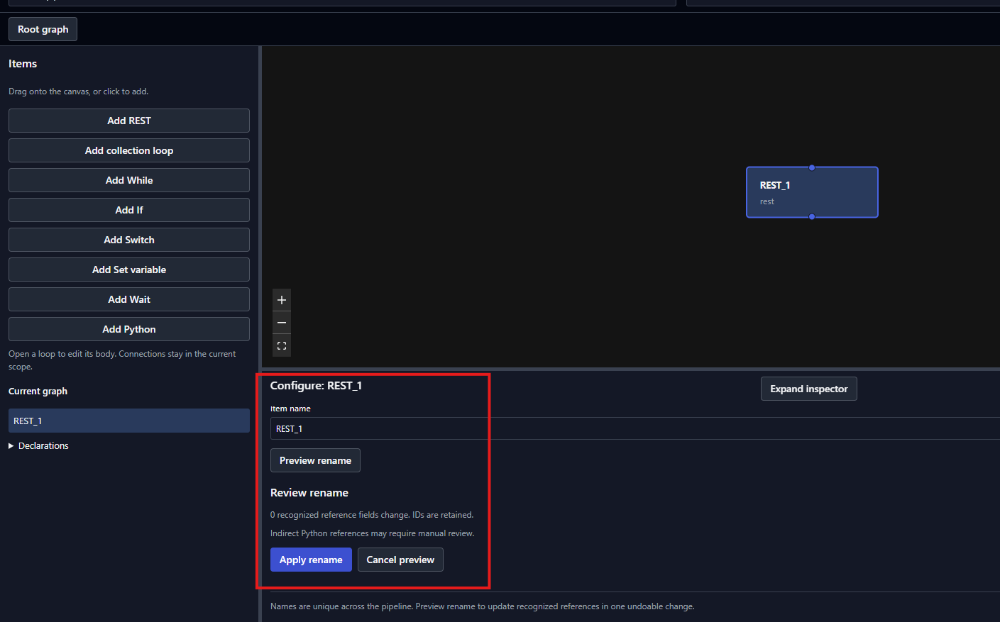
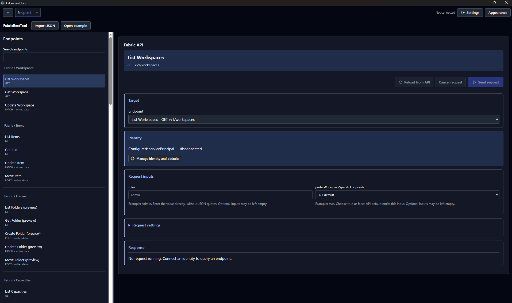
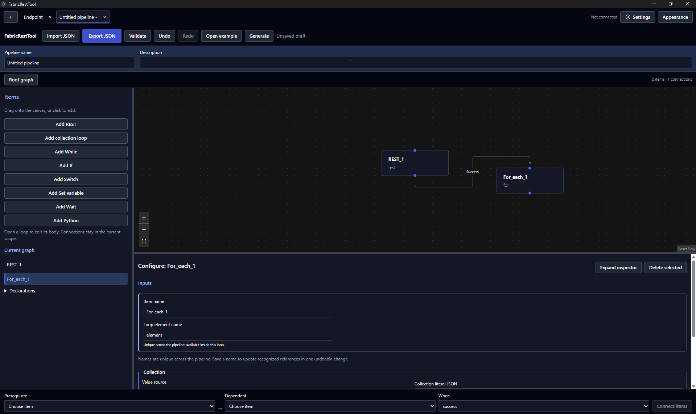
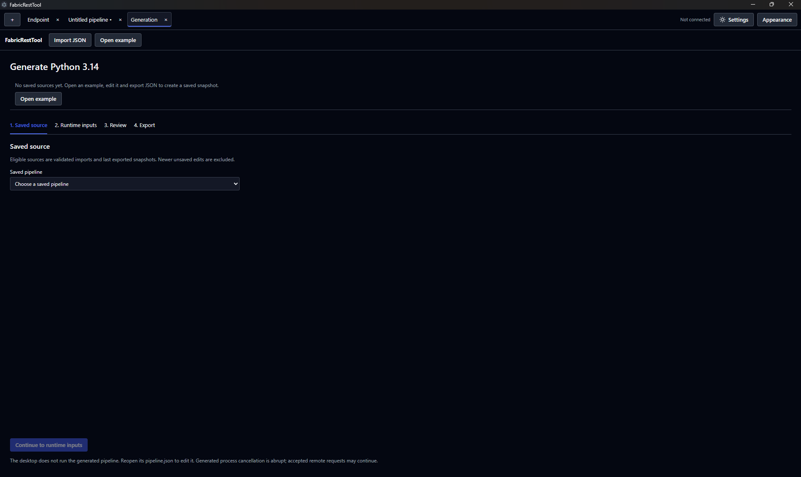
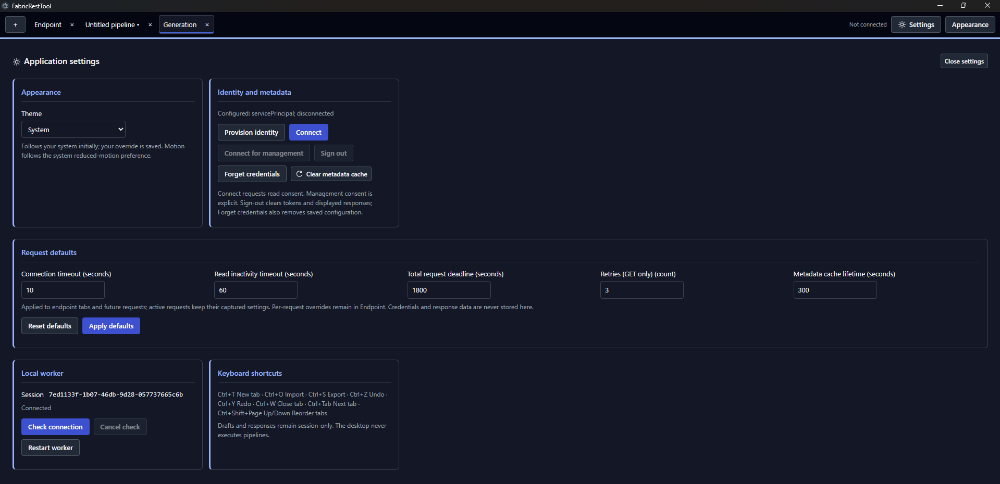

# MI esettanulmány – Microsoft Fabric Rest API alapú pipeline generál generáló applikáció ágens alapú fejlesztése

Az elkészült app elérhető a következő GitHub repository-ban https://github.com/peterz0ne/FabricRestTool.

## Célkitűzések
A munkám közben gyakori probléma automatizmusok készítése Microsoft Fabric-ban, annak Rest API-jának felhasználásával,. Erre azonban sajnos még nem találtam megfelelő eszközt. A FabricRestTool ezt a hiányosságot célozza lefedni, amely egy asztali alkalmazás formájában egyszerűen enged kódot generálni, amely a Fabric Rest API kollekciójával gyakran visszatérő folyamatok megoldására kínál megoldást.

Az alkalmazás egy komplex projekt, amely megvalósítása magas szaktudást és rengeteg energiát igényel. Az esettanulmány célja rávilágítani, hogy hasonlóan nagy volumenű projektek esetén a feljelsztés mennyire szervezhető ki az AI-nak, továbbá megválaszolni a kérdést, hogy az AI képes-e teljes mértékben tehermentesíteni a fejlesztéstől így elég csupán a részletek kigondolásába fektetnem az energiám. Mindezen felül pedig felveti a kérdést, hogy hatékony és kifezetődő döntés-e kiszervezni a megvalósítást ágensekre.

Az esettanulmány magyarul készült, azonban a használt dokumentáció, illetve a modellel való kommunikáció nyelve az angol volt. Ezt a pontosság motiválta, a nyelvi és fordítási félreértések elkerülése végett.

## Ötlet

Az alkalmazás ötlete már régóta körvonalazódott bennem, azonban csupán annak egyes aspektusait képzeltem el, a részletek kidolgozása még hátra volt. Gyakran hallani, hogy az ötlet maga csak 10%-a a projektnek, a többi a megvalósítás. Ezt a hipotézist szeretném a gyakorlatban elemezni, hogy modern ágensek segítségével is igaz-e a kijelentés.

A feladat megoldása során kezdetben egy átfogó dokumentációt dolgozok ki, ahol az egyes részletekben szintén felhasználom az AI segítségét. A kész dokumentációt ezután ágensek segítségével lépsről lépésre fejlesztem le. Végül pedig a később felmerülő igényeket, hibákat refactor iterációkkal javítom, szintén az ágens felhasználásával. 

## Használt modell

A feladat megoldása során a ChatGPT Plus által elérhető `GPT 6.1 Sol Medium` modellt használtam.

## Dokumentáció készítése.

A feladatot egy kezdetleges dokumentáció készítésével kezdtem, amiben összefoglaltam, hogy milyen elvárásaim vannak az alkalmazással szemben. Ezt utána az AI segítségével kritizáltam majd egészítettem ki, hogy minél részletesebb legyen, lehetőleg minél több aspektust fedjen le.
A részletesség oka az igény arra, hogy az AI a fejlesztés során ad-hoc megoldások helyett, előre általam is ismert és jóváhagyott tervezői döntéseket alkalmazzon.

A projekttel kapcsolatos gondolataimat a `Readmev1.md` fájlban foglaltam össze.

Elsőként a pontatlanságok kijavítására törekedtem és azokat több iterációban tettem.
A kezdő promptom az ágenshez a következő volt, ahhoz csatolva a `Readmev1.md` fájlt:
```txt
I would like to build a desktop application where most of the development work is done by AI agents based on a set of documentation.

I have started putting together the documentation for this purpose. What additional details would you recommend, including making the requirements as clear and unambiguous as possible, and to ensure efficient and effective implementation by the coding agents?
```

A válaszból látszott, hogy sikerült megismernie a fejlesztendő eszköz funkcióit és a következő típusú javaslatokat tette.
* Működéssel kapcsolatos inkonzisztenciák (pl.: mi van, ha egyszerre több dependencia van felállítva 2 elem között? A leíróban, hogyan vannak a független elemek reprezentálva)
* Szerződések (contract) javaslata, amelyeket a fejlesztés során az ágenseknek be kell tartaniuk (pl.: Pipeline leírókra példák, sablonok előre készítése)
* Szerkezeti javaslatok (több szintű dokumentáció a különböző szintekre és domének lefedésére)

Ezt követte rengeteg iteráció, ahol:
- tisztázta a pontatlan részleteket
- megvalósítási ajánlásokat tett
- részekre bontotta és kibővítette a dokumentációt

Az iterációk során kiegészítette a dokumentációt, majd egy külön fájlban kérdéseket tett fel. Ezekre válaszoltam és a kommunikáció zökkenőmentesen folyt. Sikerült megértenie az irányokat és azokhoz megfelelőnek tűnő ajánlásokat tenni.

Rendkívül hatékonynak hatott a használata és a generált dokumentációk alapján úgy érződött, mintha nem is ágenseknek, hanem humán fejlesztőknek készítené a dokumentációt. 

Az alkalmazás megvalósításához és működéséhez elengedhetetlen olyan területek ismerete is, amelyben eddig kevés tudásom volt. Ilyen esetekben azonban a válasszal kapcsolatban javaslatot kértem a modelltől, majd ha valami bizonytalanság merült fel bennem azzal kapcsolatban, akkor azt megmagyaráztattam.

A kontrollt tervezési szinten nem adtam ki a kezemből, arra törekedtem, hogy a definíciók az általam megtevezettek legyenek és legyek teljesen mértékben tisztában a projekt irányelveivel.

A kész dokumentációkat a `/docs` mappába készítette el.

### Eredmények

Meglepően hasznos és hatékony segítséget tudott nyújtani a modell.
Érdekes volt megfigyelni, hogy bár az ötlet már régóta érdekelt, valójában ez jóval távolabb állt az implementációtól, mint gondoltam. Az egyes iterációk során rengetegszer rávilágított, hogy:
- a funkciók néhol ellentmondásosak
- jelentős funkciók definíciói hiányosak voltak
- a megoldás valójában nem a Rest API-k hívására helyezi a hagsúlyt, hanema pipeline-ok készítésére
- a pontos definíció még a saját fejemben sem állt össze, hiába érződött korábban annak

A generált dokumentációk magas minőségűek voltak és rengeteg időt spóroltak meg. Egy hasonló kialakítása alsó becslésként is heteket vett volna igénybe.

A számomra ismeretlen technológiákkal kapcsolatos javaslatokat érthetően kifejtette és úgy éreztem, hogy többnyire megfelelő megoldást javasolt a problémákra. Ahol azonban nem, ott kis javítást követően gyorsan kielégítő alternatívákat kínált.

### Tanulságok

- dokumentáció pontosításra hatékony lehet, mivel fel tud hozni le nem fedett eseteket.
- Technológiák, lehetséges opciók javasolására kényelmes, hatékonyan ki tudja fejteni, elemezni azokat.

## Fejlesztés előkészítése

Az ezt követő szakaszban azzal kapcsolatban kértem a segítségét, hogy a fejlesztés előtt segítsen, hogyan lehetne elősegíteni az ágens alapú fejlesztését a projektnek.

A következő javaslatokat tette:
* Létrehozni egy `.md` fájlt, ahol a fejlesztés során általános koncepciók kerülnek definiálásra (hogyan futtasson, írjon teszteket, melyik szabályokat tilos teljesen megszegnie), az alábbi [dokumentum](https://developers.openai.com/cookbook/examples/codex/iterating-development-workflows-with-codex) alapján.
* A fejlesztést egy külön kontextusban tegyem.
* Szerződések (contract-ok) írása pl: python és electron közötti kommunikációra objektumok, JSON leírók.
* A szabályok továbbdefiniálása konkrét példákkal táblázat alapján `Felállás -> elvárt kimenet`
* Egy konkrét workflow lemodellezése, onnantól, hogy a felhasználó megnyitja az alkalmazást, odáig, hogy legenerálja a Python kódot. Az egyes lépéskhez pedig továbbá elfogadási kritériumok és ellenőrzések definiálása az alábbi [útmutató](https://developers.openai.com/blog/run-long-horizon-tasks-with-codex) alapján.
* A fejlesztés korai fázisától törekedni egy működő szállítható appra, amely a további fázisokban egészül ki funkciókkal. Így a futtatási problémák korán előjönnek.
* A fejlesztési lépések méretét limitálni, hogy még kézzel ellenőrizhető méretű maradjon

A javaslatok reálisnak tűntek, így az egyes részeket el is készíttettem az ágenssel.

Ebben a fázisban generált fájlok a következő struktúrábban jöttek létre
* `/test` -> konkrét példák az egyes helyes és helytelen leírókra, kezdeti futáshoz szükséges konfigurációk
* `/tools` -> az egyes tesztelések, validációk, ellenőrzésekhez szükséges kódok 
* `/docs/contracts` -> JSON leírók és `.md` fájlok az ágenseknek a fejlesztéshez

A generált fájlok többnyire helyesnek tűntek, de kérdeses esetekben megkértem, hogy fejtse ki, az adott megvalósítást, pl.: JSON leírók, API végpontok hozzáadása.
A válaszok kielégítőek voltak és végül, de nem utolsó sorban egy prompt-ot javasolt, amelyel egy új kontextusban érdemes elkezdenem az implementációt:
```
Implement M01 from PLANS.md in this repository.

Read AGENTS.md, PLANS.md, docs/README.md, the relevant UI and
architecture specifications, and docs/contracts before editing.

First inspect the repository and rerun the existing preparation
checks. Then implement only M01: the Electron/React desktop shell,
bundled local Python worker, private IPC handshake/error/cancellation
lifecycle, and initial Windows packaging.

Follow the approved UI stack and architecture. Do not add a remote
server, live authentication, endpoint execution, or pipeline execution.

Resolve routine engineering details consistently with the contracts.
If product behavior is genuinely unresolved, stop only the affected
work and explain the decision needed.

Run the relevant tests, typechecks and build/package checks. Update
PLANS.md with observed evidence. Report limitations explicitly,
including any clean-machine check that could not be performed.
Do not start M02 automatically.
```

### Eredmények

Sajnos csak kevés korábbi tapasztalatom volt azzal kapcsolatban, hogy, hogyan és milyen eszközökkel lehet elősegíteni a hatékonyabb fejlesztését ágenseknek, azonban a kapott eredmény kifejezetten meglepett.
Az ágensek fejlesztésének elősegítésének módja a kapott válasz alapján nagyban egyezik humán fejlesztők támogatásával.


A generált segéddokumentumok, csupán csak az ágensek számára értelmezhető, optimalizált és hatékony szöveg helyett, részletes instrukciók, színes példatár és szerződések tömkelege voltak, amik csak csökkentik a fejlesztés soráni félreértés lehetőségét. Ez kifejezetten előnyös, mivel azokat áttekintve számomra is egyértelműbbé vált a fejlesztés menete, funkciók megvalósításának alapgondolatai.

### Tanulságok

- Az implementációs fázis előtt érdemesnek bizonyul a token-keret egy részét az fejlesztési folyamat egyértelműsétésére fordítani. 
- A konkrét implementálási lépések ledefiniálása, contract-ok készítése, példák biztosítása és azok áttekintése tovább csökkenti a félreértéseket az elvárás és a megvalósítás között.
- Hasznosnak bizonyul továbbá, hogy ha az ágensnek nem fejlesztés közben kell a részletekre visszakérdezni, vagy esetleg magától döntenie, hanem egy trnaszparens, a fejlesztő által is áttekinthető dokumentumban vannak összefoglalva előre.

## Implementáció

Maga az implementációs folyamat kifejezetten egyértelműnek és egyszerűnek bizonyult, mivel csak a kezdő-prompt-ot kellett kiadnom és az egyes lépések között esetenként kipróbálni az app-ot vagy csupán csak az implementáció folytatására kérni az ágenst.

Nem meglepő módon a modell itt használta a legtöbb token-t. A rendelkezésre álló 5 órás token-limit közel 2 lépés implementálására bizonyult elégnek, így a 8 eltervezett lépést 4 iterációban tudta elvégezni.

A modell a fejlesztés során folyamatosan generált további teszteket és végre is hajtotta azokat. Amíg az aktuális tesztkészlet nem futott le, nem haladt tovább a fejlesztésben.

A fejlesztés során az első pár lépést követően elkészítettem egy teszt környezetet a Fabric-ban, azt különféle elemekkel és use-case-ekkel. Ezzel a célom az volt, hogy kipróbálhassa az aktuálisan implementált funkcionalitásokat. Utólag látszódott, hogy ez nagyban elősegítette a fejlesztés hatékonyságát, mivel a tesztek során meg tudta hívni az eleinte leimplementált végpontokat, azokra releváns választ kapva, illetve az autentikációt.

Az ehhez szükséges jelszavakat egy külön fájlba bocsájtottam rendelkezésére. Azt nem csak, hogy elsőként hozzáadta a `.gitignore` fájlhoz, hanem még fejlesztés során is kifejezetten ügyelt rá, hogy ne kerüljenek bele a jelszavak az alkalmazásba semmilyen módon.


### Eredmények
Az elkészült alkalmazás a következő külsővel nyílt meg:



A funkcionalitások többnyire működtek és az alkalmazás ígéretesnek tűnt, bár korán előjött pár gyermekbetegsége.
Az alkalmazás önmagában megfelelően működött és bár a dokumentációban leírtakat megvalósította, a használat limitáltnak érződött.
Többnyire csak a contract-ok és példák által leírt utasításokra volt használható az alkalmazás. Ennek eredményeképp úgy hatott, mintha az alkalmazás egyes részei nem működtek együtt, nem passzoltak össze és kényelmetlen volt a használata.

Néhány konkrét példa:
- Lehetett benne végpontokat lekérdezni, de az automatikus lehetőségek kiválasztásához, azokat előbb megfelelő sorrendben kellett futtatni, hogy előre betöltse a lehetséges értékeket, így a sok elemtől függő elemek közel használhatatlanok voltak.
- A pipeline-ok elemei tudtak egymás kimenetére referálni, de komplexitásban limitált volt, csak a példában megadott use-case-t lehetett megvalósítani.
- A felhasználói felület kényelmetlen volt, a gombok ugynakkorák és hasonlóak voltak használati gyakoriságuktól és funkciójuktól függetlenül. Több szövegdoboz indokolatlanul nagy vagy kicsi volt ezzel elvéve másiktól a helyet vagy használhatatlanná téve magát.
- Voltak elgépelések, különleges karakterek a szövegekben.
- Kényelmetlen volt, a pipeline-ok összekötése nem volt egyértelmű, kényelmetlen méretű vezérlőkkel, bonyolult konfigurálási opciókkal, rosszul elkülönítve.
- A generáció nem működött, konfigurálása nehézkes és bonyolult volt

Az egész alkalmazás tehát összecsapottnak érződött és bonyolult volt használni. A visszacsatolás tervezéskor és az implementációt követően, közel sem voltak összhangban. A kész app nem fedte le a felhasználói igényeket.

Ugyanakkor egy kiinduló POC-nak lenyűgöző volt, le tudta írni, hogy az alkalmazás mire hivatott és milyen funkcionalitásokat kínál.


### Tanulságok

- Implementálásra kifejezetten hatékony segítséget tudott nyújtani az ágens.
- A specifikációkat pontosan követte (néhat túlzottan pontosan is) és bele sem lehet gondolni, hogy mennyi időt és energiát spórolt meg.
- A válaszott technológiák népszerűségének köszönhetően hatékonyan kihasználta a programozási nyelvek, technológiák, könyvtárak adottságait.
- POC, előzetes dizájn készítésére tökéletes eszköz.
- Az implementáció során nem fektetett elég energiát a felhasználói élmény megfelelő kialakítására.
- A funkcionalitásokat csak limitáltan implementálta, csupán a kész példákra és contact-okra koncentrálva.


## Refactor

A kezdeti gyors sikereken felbozdulva azt a következtetést vontam le, hogy az első verzió tekinthető egy POC-nak, de a ebben a tempóban gyorsan elérhet release fázisba. Ebből kifolyólag egy külön dokumentumban (`issues.md`) összegyűjtöttem, hogy milyen javítási lehetőségeket találtam az alkalmazásban.
Ezekre generált egy megoldási tervet majd nekiállt azokat kijavítani.

Sajnos a javítások ismét túl direktnek bizonyultak, viszont ezúttal a magas kezdeti fejlesztései teljesítmény erősen visszaesett. 
Mikor egy általános problémát igyekeztem megfogalmazni (például gombok mérete), csupán minimálisan növelte meg őket, ezzel nem javítva az összhatást.

Mikor keveseltem a rendelkezésre álló REST Endpoint-ok számát, csupán 7 újat vett hozzá és ez a fejlesztés közel egy órán keresztül tartott. Ez kifejezetten meglepett, mivel az alkalmazás dizájn fázisában egyértelműen úgy lett kialakítva az app, hogy könnyű legyen új végpontok felvétele. A hosszú fejlesztési idő mögött az állt, hogy mindet egyesével felvette, majd külön tesztkészleten keresztül leellenőrizte.

A kezdeti funkciók közül alig sikerült párat ténylegesen kijavítania, a nagyrészében, nem biztosított valódi javítást.

A redesign után


Ezt követően visszatértem a tervezői kontextushoz és egy refactor tervét kezdtem el.
A refactor az általam tapasztalt problémákat igyekezett úgy kijavítani, hogy azok a dokumentáció szinten általánosan legyenek igazak.
Ilyenek például:
- új dizájnszabályok használata
- egyszerűbben lekérdezőnyelv kialakítása a pipeline-ok definíciójában
- alap kezdőértékek alkalmazása a konfigurációk esetén
- példatár készítése

Ez alapján elkészítettünk egy refactor tervét.
A készített tervek magukban foglalták az egyes javításokat, amelyeket a funkcionalitással és a használhatósággal szemben igényeltem. Ugyanakkor ezek leírása nem volt továbbra sem aprólékos, csupán irányelveket határoztak meg.

Refactor után:


Bár a refactor előtt, hiába iteráltam újra a modellel tervezői lépéseken, illetve készítettünk újabb dokumentációkat, az eredmény sajnos továbbra is csak a konkrét pélákban hivatkozott elemekre nyújtott valódi megoldást, az irányzatok megfelelő implementálására alkalmatlannak bizonyult.

Az alkalmazás érezhetően használhatóbb volt, de úgy érződött, mintha egy funkció javításának hatására további kényelmetlenségek jönnek létre az applikációban. Például a refactort követően a modell minden áron biztosítani akarta az alkalmazás komptaibilitását a korábbi leírókkal. Ehhez új gombokat és vezérlőket hozott be, hogy régi neveket mindenképp át tudja fordítani a felhasználó, az új formátumra, mivel azonban az alkalmazás POC fázisban van, emiatt ez teljes mértékben felesleges. Erre nem csupán token-eket használt el a modell, hanem időt és erőforrást is a lefejlesztésre, tervezésre.



Ezt követően egy újabb refaktor fázis következett.
Ebben a fázisban a fent is említett hibákat továbbá egyébb hasznos funkciók lefejlesztését kezdeményeztem.
Pár példa:
- A generált kód jobb struktúrába történő szervezése.
- kiegészítését további REST végpontokkal.
- Futtatás esetén log üzenetek és részletes hibaüzenetek. 

A frissített alkalmazás ismét alulmúlta az igényeket és csupán a kért változtatásokat tartalmazta. Az ágensnek nem sikerült megértenie az irányzatokat.

Ezt követték még további refaktorálási iterációk, de sajnos azok eredménye is hasonló eredménnyel zárult.

### Eredmények
További refaktorálási iterációkat követve sem sikerült az elképzelt alkalmazást elkészíteni, kijutni a POC fázisból.
Annak ellenére, hogy az iparági standardokat sikeresen és hatékonyan alkalmazta, azokat nem sikerült koherensen az alkalmazásba illeszteni. Például sikerült egy REST végpontot hívó klienst, egy pipeline szerkesztő környezetet és egy kifejezésnyelvet lefejlesztenie, azonban azok együttes materializált implementációja nem hozható összhangba, nem működnek együtt hatékonyan. 

Kérdést vet fel, hogy ebben az esetben meg lehetett volna előzni részletesebb dokumentáció, több contract és példakód biztosításával, a kellemetlenségeket és elősegíteni a hatékpny fejlesztést.
Ugyanakkor:
- a modell hamisan azt a visszajelzést adta korábban, hogy a fejlesztéshez minden rendelkezésre áll
- sosem lehet tökéletes, minden végletet lefedő specifikációt készíteni és míg egy humán fejlesztő a logikai kérdéseket megoldja rutinból, addig az ágens csak bután implementálva, nem foglalkozik annak az egész alkalmazásra  gyakorolt hatásával

Végső app:





### Tanulságok

- A modell képes gyorsan és biztonságosan refaktorálni, anélkül, hogy kárt tenne a kész alkalmazásban.
- Az ágens primitív felfogású, csőlátású, hiányzik belőle a rendszer szinten értelmezés.
- Ha a modell egy javaslatot tesz, azt hatékonyan implementálja és alkalmazza, viszont, azok nem feltétlen veszik figyelembe a teljes alkalmazásra gyakorolt hatását.


## Tanulságok kifejtve
- Git használata

  >Az ágens gyakran olyen kódsorokat is változtat, olyan funkciókat is leimplementál, amikre nincsenek igényeink. Továbbá a vscode nem ad jól átlátható felületet a változtatások áttekintésére. Ezek alapján érdemes egy repository használata és az egy stádiumokban összevetni, illetve commit-álni a változatásokat.
- Hatékony implementáció

  >Egyszerű szoftvert érdemesebb lehet ágenssel implementálni, mint kézzel írni. Hatékonyabb és gyorsabb, ugyanakkor egyértelmű definíciót kíván meg. Pár soros script-ektől egészen rövid, pár funkciójú applikációkig, a lehető leghatékonyabb eszköz.
- POC-ok készítésére kiváló (pár prompt alapján teljes funkcionalitás/app fejlesztése).

  >Gyorsan és hatékonyan tud általános gondolatokat kódban materializálni, megvalósításig elvinni. Pár rövid mondat alapján képes irányelveket, funkciókat primitíven működő szoftverré alakítani.
- Tervek és dokumentáció készítésére nagy segítség tud lenni, de nem tudja önállóan elkészíteni. 

   >Egy dokumentáció halmazt hatékonyan végig tud elemezni és hasznos kérdésket feltenni, problémákra rávilágítani, esetlegesen példakódokat, ötleteket javasolni. Ugyanakkor nem tudja az LLM sem felhívni a figyelmet az összes ellentmondásra, az terv mindig fog ellentmondásokat, le nem fedett edge-case szituációkat tartalmazni. A generált dokumentációk, példakódok, contract-ok mindig igényelnek humán felülvizsgálatot, a kontroll megtartása érdekében. 
- Az implementációt végző ágnes primitív.

   >Fejlesztés során, mindig csupán csak az aktuális funckionalitás, részlet implementálására fókuszál. Ennek eredményeképp az elkészült komponensek nem feltétlenül kerülnek egymással gyakran összhangba, amelyet tesztek írásával igyekszik ellensúlyozni, de gyakran ez kevésnek bizonyul. A feladatot végletekig menően és egyértelműen kell definiálni. Hiba vagy  ellentmondás esetén nem kérdőjelez meg részleteket, hanem primitív módon implementálja azokat.
- Hatékony, azonban primitív refaktor teljesítmény.

   >Refaktorálás során nehezen priorizál az irányelvek között, a működő szoftvert tartja meg elsődleges célként a lehető legtöbb funkció egyidejű lefedésével. Ha a refaktorálással bevezetett új funkcionalitás régi elvekkel megy szemben, a modell túlzottan törekedett a visszafelé kompatibilitásra. A régi funkciók támogatásával, az újakat csupán kompromisszumokkal vezeti be, ezzel rontva a teljesítményt és a felhasználói élményt.
- Limitált értelmező képesség

   >Bár rengeteget fejlődött a modellek értelmezési és felfogási készsége, sajnos ez még nem tökéletes. Általánosan egy kontextust vagy képes felfogni, mivel találkozott tanulás során hasonlóval, vagy egyáltalán nem. Ilyen esetekben sajnos képtelen elfogadható megoldással szolgálni és hiába mutat jeleket arra, hogy tudomására jutottak az irányelvek, a gyakorlatban gyorsan előjönnek a hiányosságok. 
- Felhasználói élmény hiánya.

   >A modell meglepően gyenge teljesítménnyel alakította ki a felhasználói felületet. Bár a vezérlők igényesek voltak, azok elhelyezése, méretezése, használata már vetett fel kérdéseket. Képtelen olyan módon kialakítani a felhasználói felületet, hogy az intutív legyen a felhasználó számára, hogy azt könnyen és egyszerűen lehessen használni.
- A gyors fejlesztés eredménye képpen sokkal egyszerűbb hibás szoftvert fejleszteni.
   >Mivel gyakran a működő kódot tekintik a hatékonyság mércéjének, gyakran előbb készül el adott funkcionalitás, mint ahogyan az részletesen át lenne gondolva, le lenne definiálva. A szoftver így gyakran refaktor lépéseken kell, hogy túlessen, amelyben azonban limitáltak a képességei
- Továbbra is csupán csak egy eszköz
   >Brainstorming-val és implementációs kérdésekkel hatékony segítséget tud nyújtani, de komoly szaktudást igénylő kérdésekben nem tud hatékony maradni minden esetben. Továbbra is képtelen komoly tervezői gondolatokat megkérdőjelezni, és túlságosan is a vevői igények kielégítésére törekszik, mégha az valójában nem is kohézív.
- Állandó primitivitás
   >Gyakran előjöttek helyzetek, ahol a modell más megoldást ajánlt, mint, amit a tervező kigondolt. Ilyen esetbkben, ha a modell többszöri nekifutásra sem képtelen felfogni el kell fogadnunk, hogy a probléma nem lesz lefedve vagy csak más további funkcionalitások kivezetése, elrontása árán. 

## Záró gondolatok
A jelenlegi AI modellek hatalmas fejlődésen mentek keresztül és valóban ijesztő, hogy milyen komplex feladatokat, mennyire pontosan, gyorsan és hatékonyan tudnak megvalósítani. Érdekes módon viszont még mindig komoly hiányosságokkal rendelkeznek, amelyek megkérdőjelezik a bizalmat bennük.

A tanulmánynak sikerült rávilágítania, hogy bár az implementálástól a fejlesztő tehermentesíthető, ugynakkor ágensek használata újabb problémákat hoz. Az AI továbbra is csak mint eszköz maradt meg, nem képes felülmúlni, kiváltani a tervezők munkáját.

Nem szabad humán erőforrásként gondolni rájuk, mégha azok munkáját is hivatott ebben a szenárióban kiváltani. Hiába nő a modellek komplexitása a primitivitásuk gyakran kétségbe ejtően még mindig problémát okoz. Komplex gondolatokat képes átlátni és megfelelő javaslatokat tenni, azonban képtelen egy kohézív, egyszerűen használható alkalmazás elkészítésére. 
Képes jól körülhatárolt feladatok ellátására, azonban azok mélyebb értelmezésére és az összefüggések átlátására képtelen volt. Ha valamit nem fogott fel, azt képtelen volt implementálni és próbálkozásaival csak továbbrontotta az alkalmazás minőségét.

Implementálásra hatékonyabb mint a humán erőforrás, viszont feljesztés közben felmerülő doméntudástól és kreatív gondolatoktól mentes. Első ránézésre hihetjük, hogy elég csak a tervezésre fordítani az energiánkat fejlesztőként, ugyanakkor ezzel a saját tanulásunktól és az apró részletekben elbújó tervezői döntésekettől is kénytelenek leszünk elzárkózni.

Használata egy olyan komplex keresőmotorra emlékeztet, amely már kész és biztos funkciókat képes a felhasználói igényekkel azonosítani. Ugyanakkor azokat csak részekben igyekszik lefedni, ezzel a végeredmény szétszórtnak, félkésznek érződhet. 

A felgyorsult világ és a környezet hatására a fejlesztők motiváltak lettek hasonló, erős eszközök használatára, ugyanakkor a következményével gyakran nem számolnak. Az általam legerőteljesebb negatív intuíciók a következők:
- A gyorsan elkészült kód gyakran, összecsapott, kevéssé átgondolt, az AI pedig elősegíti az ilyenek gyártását.
- Az implementálás és a monoton munka képe valójában egy tanulási görbe, amelytől a lustaság érdekében az AI-val megfosztjuk magunkat.
- Egy sokszor leimplementált és többszörös refaktoráláson átesett kód, amely továbbra sem fedi le a felhasználói igényeket, nem csak hogy időkidobás hosszútávon, hanem hatalmas hardware és energiafogyasztási igényekkel is jár, amelyekbe gyakran bele sem gondolunk a kezdeti hatékonyságon felbuzdulva.