# MI-esettanulmány – Spotify-kliens fejlesztése vibe coding alapú megközelítéssel

## Ötlet

A mindennapok során rengeteg zenét hallgatok és limitáltnak érzem a Spotify asztali klienst. Évekkel ezelőtt rátaláltam egy `spotify-tui` nevű parancssoros alkalmazásra, amely a Spotify felhasználói felületére kínál alternatívát gazdag gyorsgomb támogatással.
Az alkalmazás azonban önmagában működésképtelen, szükség van hozzá egy eszközre, amely a zenét képes streamelni pl. `spotifyd`. Amikor évekkel ezelőtt kipróbáltam maga a `spotify-tui` még működött, viszont a `spotifyd`-t, sajnos sehogyan nem beüzemelnem, mivel hibára futott és sajnos nem értek a Rust programozási nyelvhez, amiben íródott. Időközben sajnos már a `spotify-tui` sincs aktívan fejlesztve, így sajnos nem indul el.

## Célkitűzés
A magas szintű cél egy `spotify-tui`-ra épülő Spotify-lejátszó készítése. A fejlesztés és modellezés során szeretnék a lehetőségekhez mérten kívülállóként viszonyulni a projekthez és csak a végtermékre koncentrálni.

Kiinduláskor a célok a következők voltak:

1. `spotify-tui` parancssoros alkalmazás újra működőképessé tétele.
2. `spotifyd`-hez hasonló lejátszó készítése


> Ezt követően pedig egy újrafelhasználható `spotifyd` alternatívát szeretnék fejleszteni, amely képes az eszközön zenét streamelni.

>A megvalósítással kapcsolatban nem szabok a modell számára különösebb szabályokat, egyedül a működő végtermék(ek) elérése a célom, azaz vibe-coding módszerrel használom fel a modellt.

## Használt modell

A feladat megoldása során a ChatGPT Plus által elérhető `GPT 6.1 Sol Medium`, illetve `GPT 6.1 Astra Medium` modelleket használtam.

## `spotify-tui` javítása

A `spotify-tui` egy Rustban készült parancssoros felhasználói felület a Spotify-hoz, amely a Spotify web API-jára épül és egy különleges és letisztultabb felhasználói felületet nyújt.

A telepítése meglehetősen egyszerű a leírása alapján, azonban sajnos az alkalmazás nem működik. Ennek elsősorban az az oka, hogy az utolsó commit a master ágon közel 5 éves.

A következő utasítást adtam az ágensnek:
```txt
Próbáltam futtatni a projektet, azonban nem indul el
A parancs, amit használtam: cargo build --release
```

Az ágens nem csupán a fordtításhoz szükséges részleteket javította meg, hanem magától kijavított minden az alapműködéshez szükséges hibát is (változott minimálisan a Spotify API így az autentikációval is voltak kezdetleges problémák).

Ugyanakkor még további hibák merültek fel az alkalmazással. A problémákat magas szinten felhasználóként fogalmaztam meg a modellnek, hogy javítsa azokat. Az egyes hibákat különböző iterációkban javítottam. A javított elemek a következők voltak:
- A keresés esetében nem tudta kezelni az API válaszát (valószínűleg változott a séma)
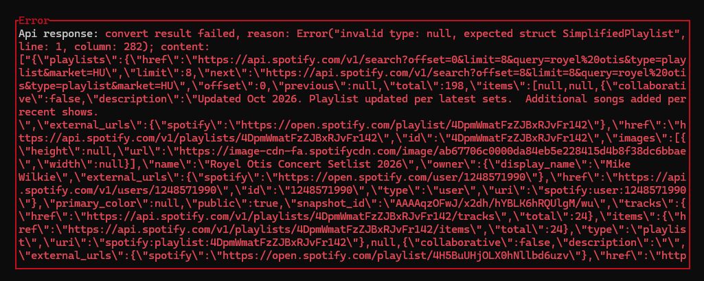
-Előadók kiválasztásakor üres képernyő fogadott
- Az előadót kiválasztva nem csupán az albumai látszódtak, hanem az összes, az előadóhoz releváns album
- Lapozás külön gombokra történt, tekerhető (scrollable) gesztus helyett


### Eredmények

Érdekes módon a tui nem enged szöveget másolni, így az egyes hibaüzeneteket sem tudtam először a modellnek biztosítani. Erre megoldásnak az ágens kiegészítette az alkalmazást egy olyan funkcióval, hogy a `c` gomb lenyomására a látható szöveget a vágólapra másolja. Ez kreatív megoldásnak tűnt és mutatta, hogy tisztában van a felhasználói felülethez használt framework működésével.

A modell hatékonyan és gyorsan képes volt implementálni a kért funkciókat. Hibák esetén egyből képes volt hatékony megoldással javítani azokat.

Tesztelni azonban nem tesztelte felhasználói felületet, csupán a kért funkciók implementálására fókuszált.


### Tanulságok

- Hatékony kódbázisok analizálásában és továbbfejlesztésében. A kódbázis még az ágensalapú fejlesztés előtt lett elhagyva, így bár a dokumentáció limitált továbbá ágenseket segítő instrukciók sem érhetők el, az ágens hatékonyan tudta direkten a kért változtatásokat alkalmazni, hibákat javítani.


## Spotify player 

Miután a `spotify-tui` megkapta a szükséges alapfunkciókat át lehetett térni a lejátszó fejlesztésére.

Az alábbi prompttal kezdtem az ágens kontextusát:
```txt
Szeretnék egy Spotify-klienst, amely a spotify-tui alkalmazásból használható, hasonlóan a spotifyd-hez.

Legyen szimpla (lightweight), és tetszőleges operációs rendszeren képes legyen futni.

A nyitott kérdésekre javasolj megoldásokat.

A hangkimenet lehessen tetszőleges eszköz, akár a zenét mikrofonként is használhassam mint bemenet más programnak.

Legyen egyszerű de mégis személyre szabható egy konfigurációs fájlon keresztül.
```

Az ágens egyből bele is kezdett a fejlesztésbe és gyorsan el is készített egy Python-lejátszót. Sajnos azonban ez nem volt működőképes. Futtatva azt, bár sikerült kiválasztani mint eszköz, sajnos zenét képtelen volt lejátszani.

Az ágensnek jeleztem a problémát, illetve megkérdeztem, hogy miért nem volt szükség autentikációra, de ezzel sikerült összezavarnom és autentikációs hibának értelmezte a problémát.

```txt
A következő hibát kapom:
[hibaüzenet]...

Továbbá, miért nem szükséges autentikáció megadása a lejátszó számára?
```

További kérdés-válasz iterációkat követve világossá vált, hogy a kért lejátszó elkészítése nem lehetséges már, biztonsági okok miatt. Javasolt egy `soloist` nevű alternatívát, amely egy működő headless lejátszó és tökéletesen megfelel a céljaimnak.

### Eredmények

Sajnos sikerült egy megvalósíthatatlan feladatot kitűznöm célul az ágensnek. Az viszont kritizálás helyett nekikezdett az implementációnak. Frusztráló volt látni, hogy gondolkozás nélkül fogott bele az implementációba, nem kérdőjelezte meg annak működőképességét vagy jelentőségét.

Ez arra enged következtetni, hogy hasonló lehet a felállás más ágens által végzett implementációk esetén is. Elképzelhető, hogy lehetetlen funkciók kerültek implementálásra és csak kipróbáláskor válik bizonyossá azok működésképtelensége.

### Tanulság

- Sajnos a modellek még mindig primitívek abból a szempontból, hogy csupán a felhasználó igényeinek kielégítésére törekszik. A funkció fejlesztésekor meg sem próbált lebeszélni vagy megkérdőjelezni, hogy az implementálandó kód nem fog tudni működni. A lehetőségeket alapvetően a fejlesztőnek kellene feltérképeznie és az AI-nak csak segíteni benne, ugyanakkor ebben a szituációban, ahol mint felhasználó nem volt érdekelt a részletek kidolgozásában, csupán a végkimenetben sajnos nagy csalódással járt az eredmény.

- Könnyű volt továbbá összezavarni. A hibaüzenettel egy promptban tettem fel egy kérdést és a kettőt teljesen összekapcsolta, mintha javaslatot tennék a megoldásra. 


## Soloist használata és integrációja a `spotify-tui`-val

Konstatálva a limitációkat egy új irányba haladt tovább a fejlesztés. A kezdeti, csupán célok ismertetése helyett egy absztrakciós szinttel mélyebben bele kellett avatkozni a fejlesztésbe, a helyes technológiák kiválasztásával, mivel szerettem volna elkerülni a korábbi helyzetet.

 Az új cél a `soloist`, illetve a `spotify-tui` integrációja volt. Egy olyan alkalmazást tűztem ki, ahol `soloist` egy elrejtett lejátszó a `spotify-tui` alatt és teljes mértékben kontrollálható a `tui`-val. Ehhez azonban a `tui`-t is ki kell egészíteni, hogy képes legyen kommunikálni a `soloist`-tal.

A modellnek, amely a `soloist` javaslatot tette, a következő promptot adtam:
```txt
Rendben, akkor haladjunk tovább a soloist-tal.
Van továbbá egy másik ágens, amely a spotify-tui fejlesztéséért felel, készítsd elő a soloist-ot az integrációra és adj utasítást a másik modellnek, hogy hatékonyan tudjatok együtt dolgozni.
A spotify-tui forráskódja mappaszinten egy szinttel feljebb található mappából érhető el.
```

A modell készített contractokat és javasolt egy promptot. Érdekes módon azonban a következő iterációkban már ignorálta, hogy együtt kellene dolgoznia a másik modellel és maga végezte el a változtatásokat a `spotify-tui` kódbázisán.


Új funkcionalitás
- A `tui` képes lett `soloist` lejátszók indítására, bezárására
- A soloist-hoz készített egy WebSocket-végpontot
- Az alapfunkciókhoz (hangerő, léptetés) szükséges kommunikáció a kettő között módosult WebSocket-alapúra

További funkciók
- alapbeállítások mentése
- aktuálisan játszandó zene helyzetének, illetve beállításának mentése
- audiokimenet kiválasztása (hangszóró, fülhallgató stb.)
- `soloist` profil és ahhoz egy szerkesztő
- eszközváltás
- részletes logolás
- több platform támogatása

A funkciók fejlesztése során további hibák merültek fel, amelyek oka kérdéses, hogy az ágens hanyag fejlesztése vagy még korábban elő nem került edge-case szenáriók eredménye. Összességében viszont a modell hatékonyan tudta javítani azokat

Felmerülő hibák:
- aktuális zene panel eltűnése
- lejátszó inkonzisztens és hibás működése (összeomlik, nem indul el, háttérben tovább fut leállítást követően)
- Felhasználói felület átrendezése
- Nem megfelelő vezérlők használata (nem fér ki a szöveg, kényelmetlen használat)
- Zene streamelése hálózaton keresztül

Az equalizer esetén több lehetőséget javasolt, amelyek közül a leggazdagabb funkcióhalmazt lefedő opció egy további szoftver, a `vb-cable` telepítését követelte meg, egy kifejezetten Windowson futó szoftver. Furcsa módon ugyanakkor a későbbi stádiumban a további platformok támogatása is ki volt tűzve célként, amely ezzel a megoldásban szöges ellentétben állt. Ez szintén mutatja azt, hogy a rövid távú célokat részesítette előnyben a hosszú távúakkal szemben.
Ez a tulajdonság tovább gyengíti a szoftver minőségét, amely további kérdéseket vetett fel bennem. Kisebb diskurzus után kiderült, hogy a `soloist` használata nagyban limitálja az opciókat, így sajnos ezt a célt el kellett felejtenem.

Érdekes volt továbbá, hogy a `vb-cable` installációját az eszközre a felhasználónak kell telepítenie varázslóból, ugyanakkor az ágens ezeket a lépéseket is elvégezte volna.

Végeredmény (eredeti témával):
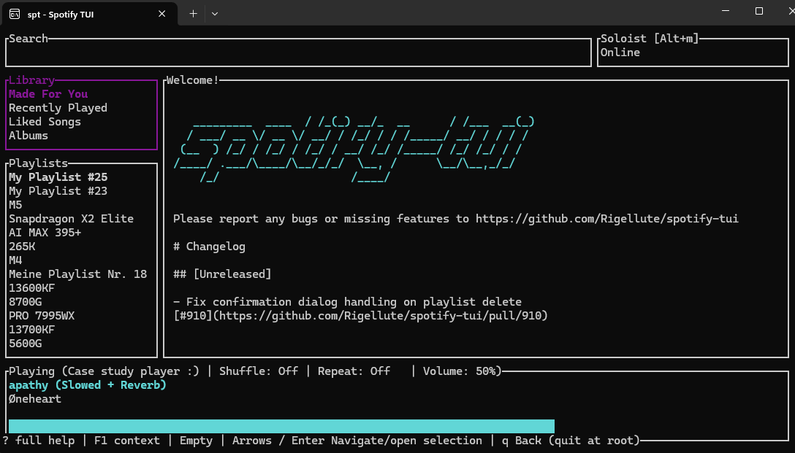
Audiokimenet-választó
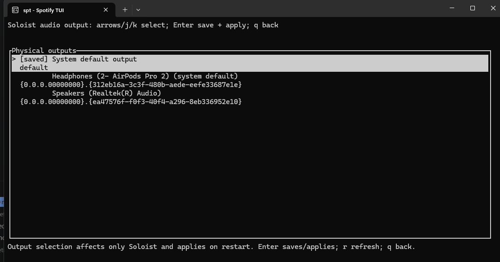
Aktuális zenék sorrendje
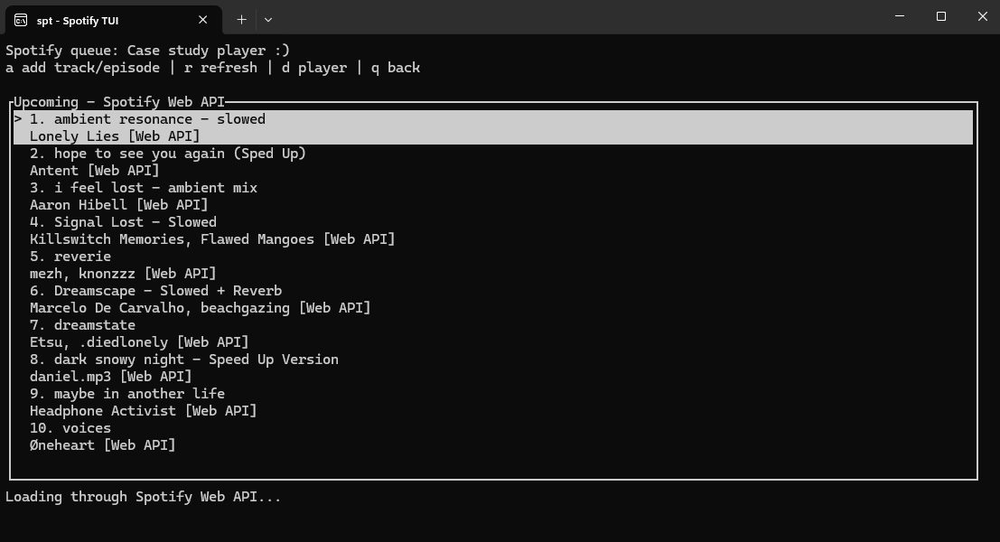
Keresés
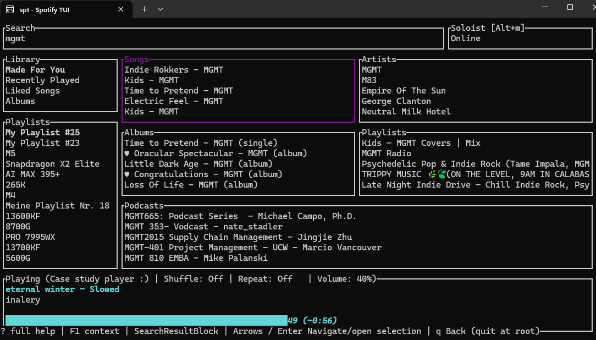
Eszköz a Spotify asztali alkalmazásból
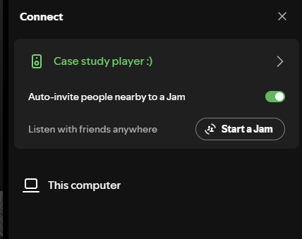
Súgó
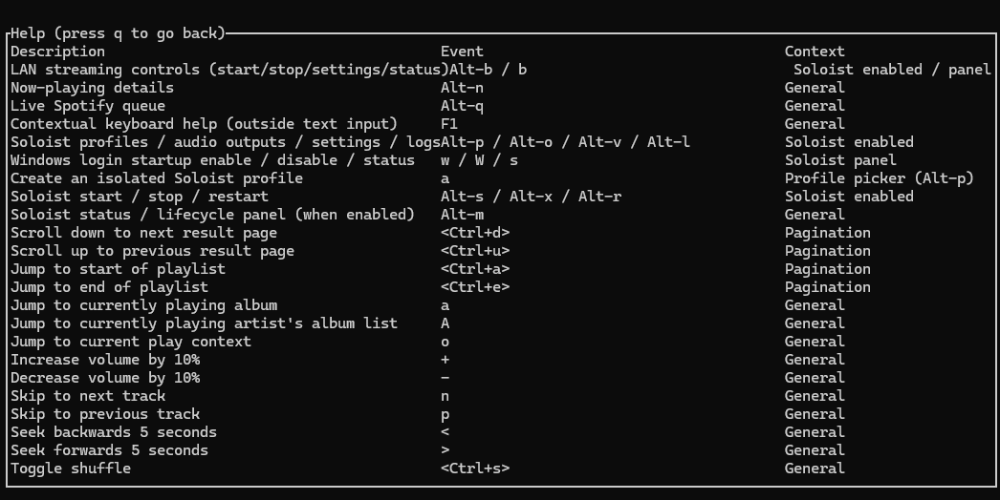
Aktuális zene
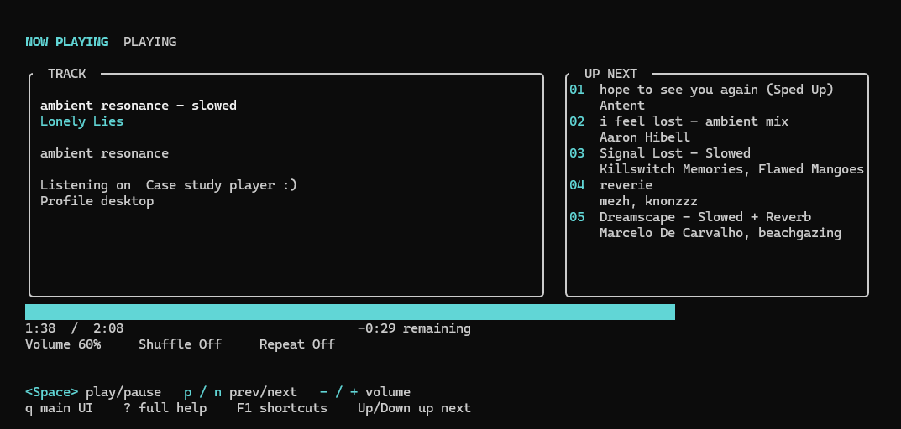
Beállítások
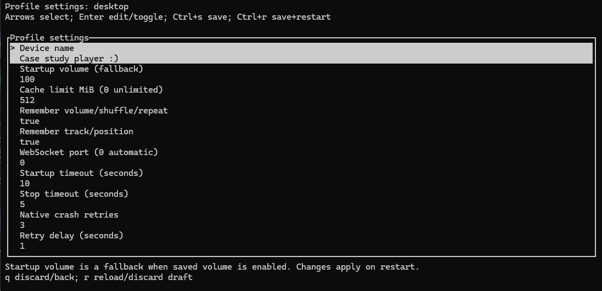

Végül, de nem utolsósorban megkértem az ágenst, hogy adjon új külsőt az alkalmazásnak, de legyen csak opcionálisan választható különböző témákként.

Új témák:
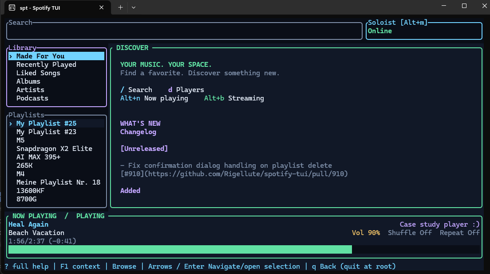
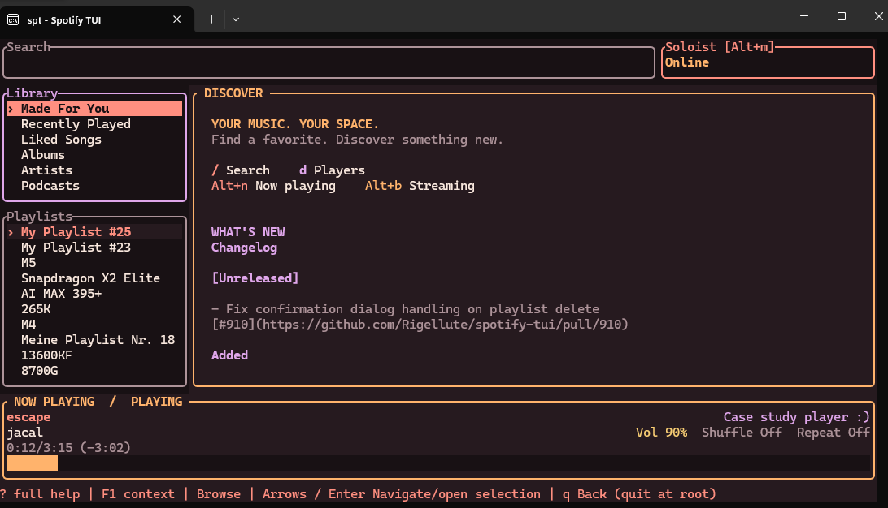
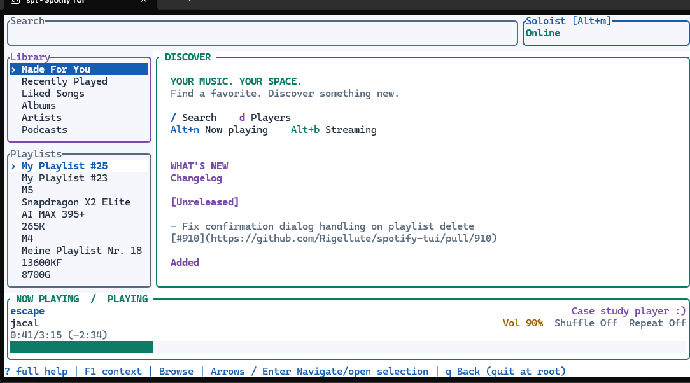

### Eredmények

A kezdeti nehézségeken az ágens sikeresen továbblendült és eredményesen tudta implementálni a funkciókat.

Érdekes módon teljesen figyelmen kívül hagyta, hogy adott kódbázisért adott ágens felel és módosított a nem neki szánt kódbázison is. Ugyanakkor a két kódbázist hatékonyan tartotta karban, nem keveredett össze a kettő között.

A magas főként szinten megfogalmazott kéréseket meglepően hatékonyan képes megvalósítani. A két kódbázis végig szinkronban volt. Voltak javaslatai hasznos funkciókra és sikeresen kivitelezte azokat.

Az equalizer funkcióra nem tudott kielégítő megoldást nyújtani, így sajnos nem tudott minden igényt kielégíteni.

Az UI-refaktort hatékonyan készítette el és sikerült egy esztétikus, modern külsővel ellátni az alkalmazást

### Tanulságok

- Miután az egyes funkciókat megvitattam a modellel és a részleteket tisztáztam, az implementációt hatékonyan tudta szállítani. A célokat többnyire pontosan megfogta a végeredménnyel pedig elégedett voltam.

- A célok közötti priorizálásban gyengén teljesített. A megoldás során többnyire az aktuálisat priorizálta és adott funkció kidolgozásához vezetett be olyan megoldást, amely későbbit esetlegesen kizárt. Így a későbbi stádiumban előjövő nehézségek, alternatív megoldások lehetségesen a rossz és gyors korai dizájn eredménye.


## Tanulságok kifejtve

- Hatékony fejlesztés, kódbázis-karbantartás
  > A mai modellek rendkívüli hatékonysággal tudnak kódbázisokat analizálni, elemezni majd azokat továbbfejleszteni. Nagy kódbázisok esetén azonban többnyire ezt csupán ágensek segítségével tehetjük hatékonyan, amelyek azonban gyakran sajnos előfizetéshez kötöttek.

- Az erős hallucináció még mindig komoly problémát okoz
  > Bár az utóbbi években a nagy nyelvi modellek hatalmas fejlődésen mentek keresztül, sajnos még mindig fennáll a hallucinálás, téves, alátámasztatlan megoldás javaslata. Személyesen erre a hibára, a legjobb megoldásnak, a fejlesztő motiváltságát, precizitását, kíváncsiságát, továbbá a POC-alapú fejlesztését tekintem. Ha a tervezési döntések jól átgondoltak, kipróbáltak, POC-val alátámaszthatók, akkor gyorsan kiesnek a hallucinált téves megoldási ötletek.

- Pontos és részletes megfogalmazás
  > Gyakori eset, hogy a fejlesztő fejében egyértelmű, ugyanakkor a modell számára félreérthető a prompt. Ha egyszerre több kérdésre is választ várunk, több utasítást adunk, érdemes törekedni rá, hogy a megfogalmazás tiszta, a mondat jól taglalt, a feladat nem érthető félre. Ellenkező esetben a modell kontextusát gyorsan összekavarjuk, amely komoly nyomot hagyhat a kódbázison, félkész, nem kért funkciók nyomában vagy akár indokolatlan célok kitűzéseként.
