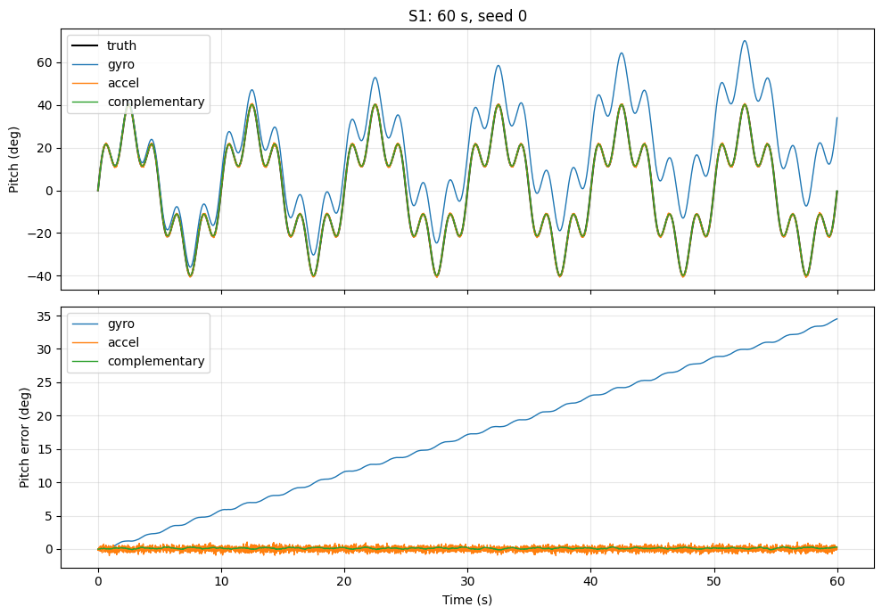
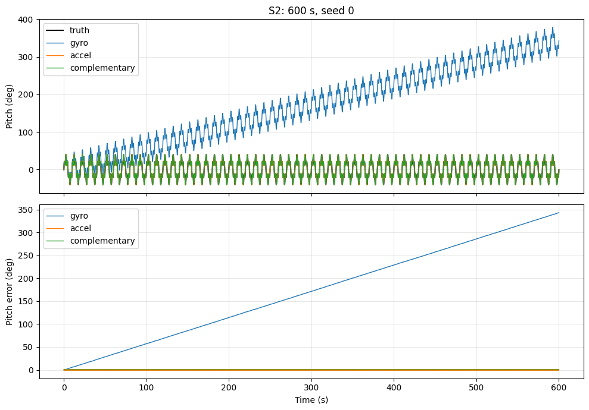
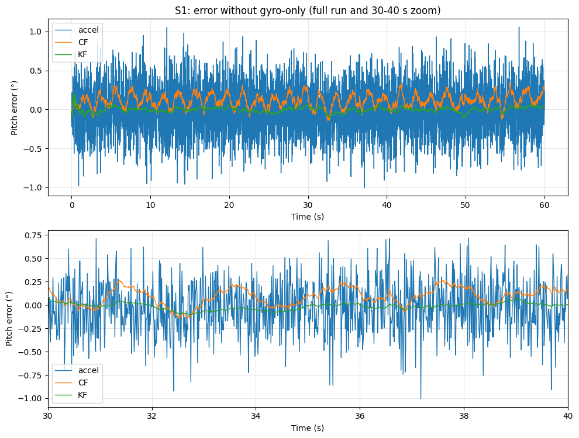
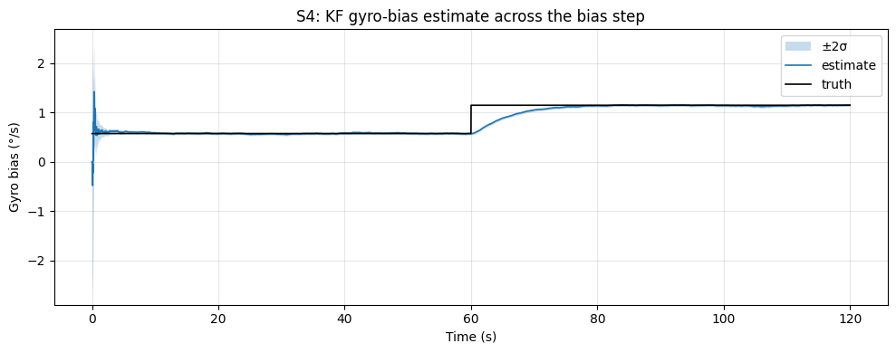
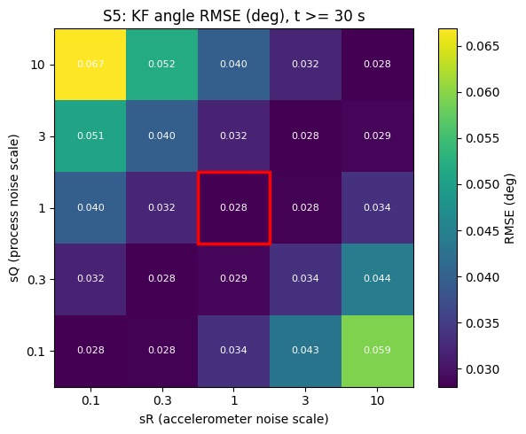

# From Complementary Filter to Kalman Filter: AI-assisted IMU Sensor Fusion (Part 1 of 2)
---
## Problem Statement
Almost every device that needs to know its own orientation – drones, balancing robots, smartphones, game controllers, camera gimbals – relies on an Inertial Measurement Unit (IMU): a small, cheap sensor package that combines a *gyroscope*, which measures how fast the device is rotating, and an *accelerometer*, which measures acceleration, including the constant pull of gravity. In principle, either sensor alone can be used to estimate how much the device is tilted. In practice, neither is reliable on its own. The gyroscope gives a smooth, responsive signal, but to turn a rotation *rate* into an *angle* it has to be integrated over time, and even a tiny constant error in its reading (called a *bias*) accumulates into an angle that slowly drifts away from reality. The accelerometer, on the other hand, can compute the tilt directly from the direction of gravity, so it never drifts – but its readings are noisy, and any movement of the device (e.g., a drone accelerating sideways) is mistaken for a change in tilt. The solution is *sensor fusion*: combining both sensors so that each one compensates for the weakness of the other. The most well-known method for this is the *Kalman filter*, an algorithm that repeatedly **predicts** the new angle from the gyroscope, then **corrects** that prediction with the accelerometer, and decides how much to trust each source based on how noisy each one is assumed to be. It can even estimate the gyroscope bias while it runs. However, implementing a Kalman filter requires a solid grasp of probability and matrix math, and choosing its noise parameters is often a matter of trial and error, which makes it a common stumbling block for engineers who only need a working orientation estimate. In this case study, the first of two parts, we highlight the following question: How well can a team of AI models – each with a single role – design, implement, tune and verify a Kalman filter for IMU sensor fusion, starting from simulated data?

## Task Description
The task requires simulated IMU data, a Python environment and multiple AI sessions:
| Tool | Description |
|--------|-------------|
| Python (NumPy, Matplotlib) | Simulation, filtering and plotting |
| Jupyter Notebook | Development environment, one section per tier |

The work was split across four AI sessions inside one Claude project, each with a single role. The stronger model was given the roles that **define and judge** the work, and the lighter model the roles that **build and test** it:
| Session | Model | Sees | Role |
|---|-------------|-------------|-------------|
| Planner | Opus 5.5 | My requirements | Asks clarifying questions and writes a specification per tier: required behavior, exact function interfaces and success criteria, but no code |
| Executor | Sonnet 5.5 | The specification | Implements the simulation and filters |
| Tester | Sonnet 5.5 | The specification only, never the code | Writes independent tests that check the implementation against the success criteria |
| Evaluator | Opus 5.5 | All specifications, final code, test results and plots | Scores the complete work against the specifications at the end (see Part 2) |

> All four sessions used Medium effort with Thinking enabled.

Every tier followed the same loop:
1. The planner wrote the specification for the tier.
2. The specification was handed to the executor and the tester at the same time, so that the tests were written without any knowledge of the implementation.
3. I ran the implementation and the tests in the notebook and inspected the plots.
4. Failures were routed to their source: implementation errors to the executor, test errors to the tester, and unclear or wrong requirements to the planner, after which both received the updated specification.
5. Once all tests passed, the work moved on to the next tier.

After the final tier, the evaluator received the complete work and scored it against a fixed rubric; its results are presented in Part 2.

The filters were developed in three increasingly complex tiers. This part covers Tiers 1 and 2; Tier 3 continues in Part 2 (folder `AIAssistedIMUSensorFusion2`):
| Tier | Description | Data | Complexity | Part |
|--------|-------------|--------|------------|------|
| 1 – Baseline | Pitch from gyroscope integration only, accelerometer only, and a complementary filter | Simulated | Simple | 1 |
| 2 – Kalman Filter | Linear Kalman filter for pitch, estimating both the angle and the gyroscope bias | Simulated | Moderate | 1 |
| 3 – Disturbances and Real Data | Roll and pitch under motion disturbances, then applied to real smartphone recordings | Simulated + Real | Complex | 2 |

> Yaw (heading) was deliberately excluded: it can be estimated by integrating the gyroscope, but gravity carries no heading information, so the accelerometer cannot correct its drift. Correcting it requires an additional reference, such as a magnetometer, GPS or a camera.

---
## Lessons Learned
- **Placing the stronger model in the planning role paid off** – with Opus writing the specifications and Sonnet implementing them, the executor passed all 237 Tier 1 tests on the first run, and in neither tier did a failure come from the filter mathematics itself. The only problem that did occur came from the environment. When the hard thinking happens in the specification, a lighter model can reliably carry out the implementation.
- **A specification only works as a contract if nothing is left to interpretation** – the tester never saw a line of code, yet its tests matched the implementation because the specifications fixed every function name, array shape, unit, sign convention and formula. Wherever the wording left room, both sessions flagged it in their notes instead of silently guessing.
- **"It works on my machine" applies to AI sandboxes too** – the Tier 2 executor verified its notebook in its own sandbox, which ran a newer Python, so a single line of syntax that only newer Python versions support passed there and failed on my machine. Only the independent test run caught it. After the platform was made an explicit, binding requirement (the exact Python version and a list of forbidden syntax), the problem never returned.
- **Planners can forget the rules they are given** – the first prompt stated that the tester never sees the code, yet in Tier 2 the planner asked the tester to run the old code and save its output. Even when the roles are clearly defined, a human has to check that each task fits the role it is given.
- **A correct decision can come with a wrong explanation** – in Tier 2, the planner switched the Kalman filter to a more accurate way of integrating the gyroscope, which was the right call. However, it justified the change by claiming the old method caused most of the complementary filter's error in Tier 1. The final evaluation (Part 2) showed otherwise: the better method would only have lowered that error from 0.140° to 0.122°. The reasoning behind a decision has to be checked separately from the decision itself.
- **Asking for proof can reveal more than the proof itself** – the planner calculated the Kalman filter's two noise settings ($Q$ for the gyroscope, $R$ for the accelerometer) from the sensor specifications, and I asked for a test that proves these values are good. The test confirmed they were the best of 25 combinations, but it also showed something unexpected: changing both settings by the same factor gives exactly the same result. Only the balance between them affects the estimate; their absolute size only changes how confident the filter claims to be. Without asking for the test, this would have gone unnoticed.
- **A tester that never sees the code keeps the tests honest** – in this architecture, the tester wrote its tests from the specification alone, at the same time as the executor wrote the code. Since the tests never saw the implementation, they could not inherit its mistakes: they caught the notebook failure that the executor's own checks had missed, while the work on both sides happened in parallel instead of one after the other. The extra session cost one more step per tier, but every result was checked by someone other than its author.

---
## Using the Result

1. Download the folder `AIAssistedIMUSensorFusion1`.
2. Install Python (3.9 or newer) and the required libraries with one command: `pip install numpy matplotlib pandas ipywidgets`.
3. Open `imu_fusion/tier1.ipynb` in VS Code or Jupyter and choose **Run All** to compare the three simple estimators.
4. Open `imu_fusion/tier2.ipynb` and choose **Run All** to see the Kalman filter, including how it handles a drifting and a suddenly changing gyroscope bias.
5. Continue with Part 2 (folder `AIAssistedIMUSensorFusion2`), where the filter is applied to both tilt angles, motion disturbances and real phone data.

---
## Workflow Details

### Establishing Context and Constraints
The planner session started with a prompt that defined the goal, the three tiers, the evaluation metrics and the constraints, and described the roles of the other two sessions:
#### ***User***
```text
I need to implement IMU sensor fusion. You are the PLANNER. The work is split between three roles:
- You write the specifications.
- An EXECUTOR implements the code from your specifications.
- A TESTER writes independent tests from your specifications, without ever seeing the code.
Do not write implementation code or test code yourself.
[...]
Constraints: keep the filter linear (no EKF or quaternions), keep simulation and filter code
separate, and the filters must never read ground truth.

Because the tester never sees the code, each specification must define the interface exactly:
function names, arguments, return values, array shapes, units, sign conventions and data formats.
Each success criterion must be measurable, so that it can be turned directly into a test.

Whenever you are unsure about something, ask me instead of assuming. [...]
```
The last two paragraphs carry most of the weight. Since the tester writes its tests blind, the specification becomes the *only* contract between the executor and the tester, so every name, shape and unit has to be pinned down in it. The instruction to ask instead of assume keeps the planner from filling gaps with its own guesses. The executor and the tester each received a short role prompt and the specification file, nothing else.

### Tier 1 – Baseline
Tier 1 establishes the problem before the Kalman filter is introduced. A simulated IMU is tilted back and forth (pitch only), and three simple estimators try to recover the angle from the noisy sensor data:
- **Gyroscope integration** – adds up the measured rotation rate over time. Smooth, but the gyroscope bias accumulates into drift.
- **Accelerometer tilt** – computes the angle from the direction of gravity. Never drifts, but every sample is noisy.
- **Complementary filter** – a simple form of sensor fusion: it follows the gyroscope over short time scales and slowly pulls the estimate towards the accelerometer, with a time constant $\tau$ deciding the balance:

```math
\theta_k = \alpha\,(\theta_{k-1} + \omega_k\,\Delta t) + (1-\alpha)\,\theta_{acc,k}, \qquad \alpha = \frac{\tau}{\tau + \Delta t}
```

#### *Planning*
Before writing anything, the planner asked 17 clarifying questions, grouped into conventions, simulation, filters and testing, each with a proposed default (e.g., using the same axis convention as Android phones, so that real recordings later need no conversion). I accepted almost all defaults and asked the planner to propose the pass/fail thresholds for my approval.

The resulting specification was far more detailed than the request: binding conventions for all tiers, exact function signatures and array shapes, and 29 measurable success criteria, ranging from accuracy targets to checks that the filter code never reads the true angle. The planner also highlighted four decisions it made beyond the agreed defaults, each with a reason. The most interesting one was the complementary filter's setting $\tau$ = 0.2 s, which decides how long the filter trusts the gyroscope before the accelerometer pulls it back. Because the gyroscope has a small constant error (its bias $b$), the filter always ends up off by about

```math
e_{ss} = b \cdot \tau
```

so a larger value such as 0.5 s would have left an error as large as the accelerometer's own noise, and the filter would have been no better than the accelerometer alone. The pass/fail thresholds were calculated in advance from the expected errors, with one rule: if a test fails, I decide whether the code or the threshold is wrong, and the executor may not simply loosen it.

#### *Implementation and Testing*
The executor and the tester worked on the specification at the same time. Both returned a "Notes" section listing where the specification was ambiguous, and the tester also listed what it *could not* test: the visual review of the plots and the written discussion in the notebook. Those were left to me.

The first run passed all 237 tests (the 29 criteria expanded over seeds and parameter combinations) in under 30 seconds, without a single fix. The measured values matched the planner's analytic estimates closely:

| Estimator | RMSE | Max. Error | Drift Rate (600 s run) |
|---|---|---|---|
| Gyroscope only | 19.68° | 34.51° | 0.572 °/s |
| Accelerometer only | 0.292° | 1.057° | ≈ 0 |
| Complementary filter | **0.140°** | **0.347°** | ≈ 0 |



The gyroscope estimate follows the shape of the motion but drifts away linearly at the rate of the bias, reaching about 340° of error after ten minutes. The complementary filter halves the error of the accelerometer alone and does not drift.



Reviewing the plots revealed something the tests could not. The error panel is scaled to fit the gyroscope's drift (up to 35°), so the accelerometer and complementary filter errors, both below 1°, are squashed into a flat line at the bottom. All the numbers were correct, yet the main result of the tier – that fusion beats the accelerometer alone – could not be seen. I passed this back to the planner, and Tier 2 added an error plot that leaves out the gyroscope and zooms in.

### Tier 2 – Kalman Filter
Tier 2 replaces the complementary filter with a Kalman filter that tracks two quantities at once: the pitch angle and the gyroscope bias. At every sample it **predicts** the new angle from the gyroscope (after subtracting its current bias estimate), then **corrects** both the angle and the bias using the accelerometer. How strongly it corrects depends on two noise settings: $Q$, which describes how much the prediction can be trusted, and $R$, which describes how noisy the accelerometer measurement is. Choosing these two is usually where implementations go wrong, so the original requirements asked the planner to *justify* them rather than tune them by hand.

#### *Planning*
The planner opened with five questions, again each with a default. Two of them shaped the tier. First, it proposed making the gyroscope bias change over time (a slow drift and an optional sudden jump), since a constant bias only has to be learned once and does not show whether the filter keeps tracking. Second, it proposed deriving $Q$ and $R$ directly from the sensor noise levels, the way they would be read off a datasheet, instead of tuning them. I accepted both and added three requirements: the derivation had to be proven empirically by a tuning sweep (a grid of scaled $Q$ and $R$ values, where the derived values must land near the best result), the filter had to be *consistent* (its own estimate of its uncertainty had to match reality), and the simulator and the filter had to describe the bias drift in identical units, since a mismatch would silently mis-tune the filter.

The draft specification listed four decisions the planner made on its own. The most notable one revisited its own Tier 1 design: the integration rule chosen in Tier 1 adds a small error, harmless for the complementary filter but large compared to the Kalman filter's expected accuracy of about 0.03°, so the planner switched the Kalman filter to a more accurate (trapezoidal) rule. Another decision did not survive review: to prove that Tier 1 still behaves the same, the planner asked the tester to run the Tier 1 code, even though the tester never receives any code. The fix kept the idea but changed the owner: the tester wrote a small script, and I ran it before installing anything from Tier 2.

#### *Implementation and Testing*
Both sessions continued in their Tier 1 chats, so the executor extended its own modules and the tester updated its own tests. In its notes, the executor pointed out a genuine contradiction between two sections of the specification, implemented the more specific one, and flagged the conflict instead of guessing.

The first run passed 488 of 489 tests. The only failure was in the notebook: a single line used syntax that only works on newer Python versions than the one on my machine. The executor had verified its work in its own sandbox, which ran a newer Python, so the notebook worked there but not for me. Once the error was reported, the executor fixed the line, located an interpreter matching my Python version, and re-ran both notebooks under it before delivering. The second run passed all 489 tests, including the check that the Tier 1 simulator output is unchanged.

| Estimator | RMSE | Max. Error |
|---|---|---|
| Complementary filter | 0.140° | 0.347° |
| **Kalman filter** | **0.033°** | **0.201°** |

The Kalman filter is about four times more accurate than the complementary filter, because it removes the bias instead of living with the constant $b \cdot \tau$ offset. The new error plot, which leaves out the gyroscope-only estimate and adds a zoomed window, makes this visible for the first time:



The bias step shows the difference between the two filters most clearly. At t = 60 s the gyroscope bias suddenly doubles. Immediately after the step both filters peak at a similar error (0.41° for the Kalman filter, 0.44° for the complementary filter), but only the Kalman filter recovers: it re-learns the new bias within 12.8 s and returns to its low error, while the complementary filter settles at a new, larger offset and stays there.



With a slowly drifting bias, the filter tracked it with an angle error of 0.032°, and the true bias stayed within the range the filter itself predicted for 93 % of the samples, close to the theoretical 95 %. In other words, the filter is not only accurate but also correctly estimates its own uncertainty.

The tuning sweep confirmed the derivation: the datasheet-derived values sit exactly at the best result of the grid. It also revealed something worth knowing about Kalman filters. Every cell on the diagonal gives the same error, because scaling $Q$ and $R$ by the same factor leaves the filter's behavior unchanged. Only their **ratio** decides how the filter balances the two sensors; their absolute size only affects how confident the filter believes it is, which is exactly what the consistency check verifies.



One readability issue remained: in the error plots, the accelerometer's very noisy error fills most of the plot and sets its scale, so the much smaller complementary and Kalman filter errors are still hard to see. I passed this to the planner as feedback for Tier 3, together with the Python version issue and the contradiction found by the executor.

> The work continues in Part 2 (folder `AIAssistedIMUSensorFusion2`): *Disturbances, Real Phone Data and Final Evaluation*, where the filter is extended to both angles, exposed to motion disturbances and real phone recordings, and the complete work is independently evaluated.

**Author:** Charaf Mohamad