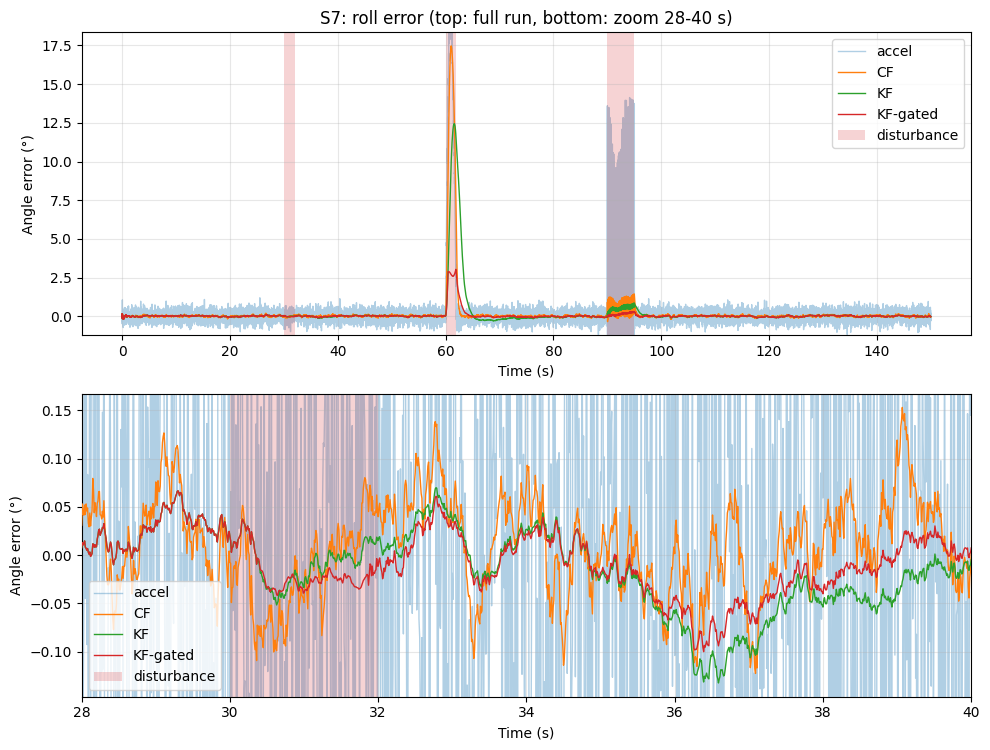
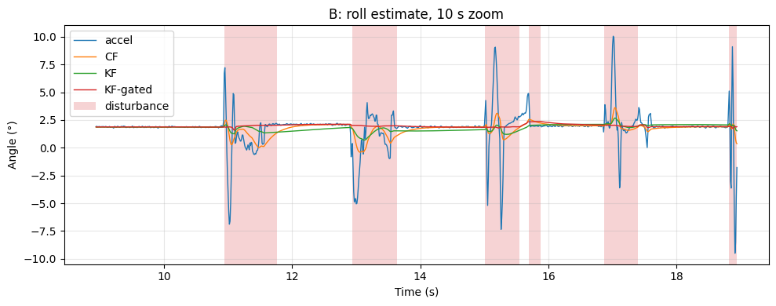
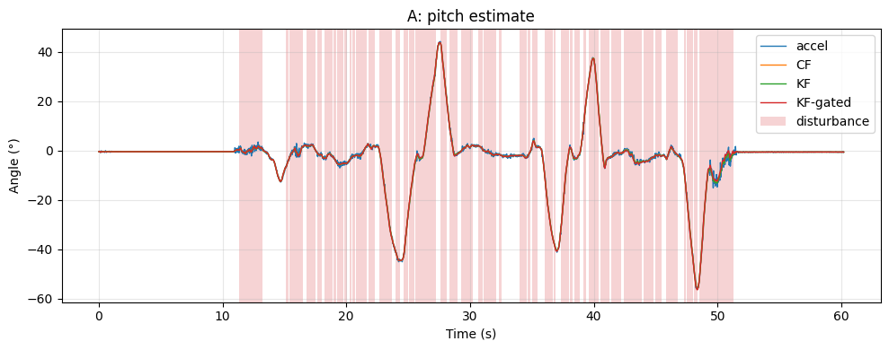
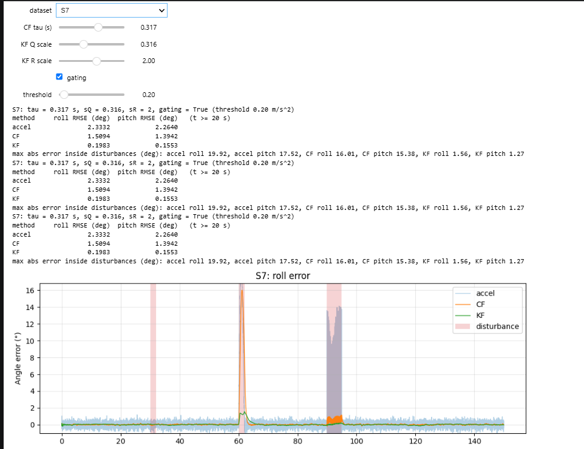

# Disturbances, Real Phone Data and Final Evaluation: AI-assisted IMU Sensor Fusion (Part 2 of 2)
---
> This is the second of two parts. It continues Part 1, *From Complementary Filter to Kalman Filter* (folder `AIAssistedIMUSensorFusion1`), and it is recommended to read Part 1 first. In Part 1, a team of four AI sessions – a planner (Opus 5.5), an executor (Sonnet 5.5), an independent tester (Sonnet 5.5) and an evaluator (Opus 5.5) – built a linear Kalman filter that estimates the pitch angle and the gyroscope bias of a simulated IMU, reaching an error of 0.033°, about four times lower than a complementary filter.

## Problem Statement
An Inertial Measurement Unit (IMU) combines a gyroscope, which measures rotation rates, and an accelerometer, which senses gravity and therefore the tilt of the device; a Kalman filter fuses the two into one reliable tilt estimate. In Part 1, such a filter performed very well, but under ideal conditions: only one tilt axis, a simulated sensor whose exact noise levels were entered directly into the filter's settings, and no movement other than tilting. A real device breaks all three assumptions. Its two tilt angles (roll and pitch) interact; any acceleration of the device – a phone pushed across a table, a drone speeding up – is indistinguishable from a change of tilt for the accelerometer; and a real sensor's noise rarely matches the values assumed during design. In addition, a growing amount of engineering work is now produced by AI models, which raises the question of how that work should be judged once it is finished. In this case study, we highlight the following question: How well can the same team of AI models adapt a Kalman filter to real-world conditions, and what does an independent review of the finished work reveal?

## Task Description
The same four AI sessions from Part 1 continued in the same Claude project, with the same roles and the same loop for every tier: the planner writes a specification, the executor and the tester work from it in parallel, I run the code and the tests and inspect the plots, and failures are routed to the session that caused them. After this tier, the evaluator scored the complete work from both parts.

| Tool | Description |
|--------|-------------|
| Python (NumPy, Matplotlib) | Simulation, filtering and plotting |
| Jupyter Notebook + ipywidgets | Development environment and interactive explorer |
| phyphox | Free smartphone app used to record real IMU data as CSV |
| iPhone 15 Plus | Source of the two real recordings (accelerometer and gyroscope at 100 Hz) |

Tier 3 was evaluated on four datasets of increasing difficulty:
| Dataset | Description | Data | Complexity |
|--------|-------------|--------|------------|
| Clean run | Roll and pitch together, no disturbances | Simulated | Moderate |
| Disturbances | Sideways acceleration pulses and vibration | Simulated | Complex |
| Recording A | Slow hand tilts in roll and pitch | Real | Moderate |
| Recording B | Phone slid across a table and the table tapped | Real | Complex |

Finally, the filters were wrapped in an interactive notebook interface, where the noise levels and filter parameters can be adjusted with sliders and the effect on the estimates is shown immediately.

> The code, specifications, test results and recordings are stored with Part 1, in the folder `AIAssistedIMUSensorFusion1`.

---
## Lessons Learned
- **Multiple sessions using the same specification help with verifying errors** – in Tier 3, the executor and the tester, who never communicated, both noticed that one expected value in the specification had the wrong sign. Two separate checks reaching the same conclusion is a reliable sign that the specification, not the code, needs fixing.
- **Mistakes can come from any session, so every failure has to be traced first** – in Tier 2, the failing test exposed a mistake in the executor's code; in Tier 3, the only failure came from a mistake in the tester's own test code, while the executor's code was correct. Checking where each failure came from before sending it to the responsible session meant every problem was fixed in a single round.
- **Settings chosen in simulation do not automatically fit real hardware** – the real phone was five to eight times less noisy than the simulated sensor. The gating rule (which tells the filter to ignore the accelerometer while the device is being pushed or shaken) had been tuned in simulation, and on the phone it switched off the accelerometer for almost half of an ordinary recording, because normal hand movements already crossed its threshold. The Kalman filter still worked well, because the phone's two sensors were less noisy by a similar amount, so the balance between them stayed about the same.
- **A fresh reviewer finds what the authors miss** – the planner, the executor and I all assumed that the filter's remaining error during a sideways push happened at the start of the push. The evaluator, which had not been involved in the work, checked the timing and showed that the largest error actually occurs at the end of each push, after the gating rule (which ignores the accelerometer while the device is being pushed) has already switched the accelerometer back on.
- **Written conclusions need more checking than the code** – the evaluator found the code correct, but listed nine statements in the written discussions that the measured numbers do not support. For example, one filter was described as "a few times worse" than another, although it was only about 1.5 times worse. AI-written summaries tend to round results into confident statements, so every claim has to be checked against the numbers.
- **Some judgments can only be made by a human** – the tests could not notice that a plot hid the main result, that the first attempted phone recording was far too violent for any linear filter, or that a written discussion claimed more than its numbers showed. Recording the data, reviewing the plots and deciding where a failure belongs remained my part of the work.

---
## Using the Result

1. Download the folder `AIAssistedIMUSensorFusion1`, which contains the code and the phone recordings for both parts.
2. Install Python (3.9 or newer) and the required libraries with one command: `pip install numpy matplotlib pandas ipywidgets`.
3. Open `imu_fusion/tier3.ipynb` in VS Code or Jupyter and choose **Run All** to see the filters on the simulated disturbances and on the two phone recordings.
4. Use the sliders at the end of the notebook to see how the filter settings change the results.
5. To try your own phone, record with the free app phyphox (Accelerometer and Gyroscope, phone lying still for about 10 s at the start and end), export it as "CSV (Comma, decimal point)", place the zip file in `imu_fusion/data`, and change the file name in the notebook's real-data section.

---
## Workflow Details

### Tier 3 – Disturbances and Real Data
Tier 3 brings the problem closer to a real device in three ways: both angles (roll and pitch) are estimated at the same time, the simulated sensor is disturbed by sideways accelerations and vibration, and the filters are applied to two recordings from my own phone.

#### *Planning*
The planner asked the most questions of all three tiers, and two of them are worth highlighting. First, once the device tilts in two directions at once, the gyroscope readings no longer translate directly into roll and pitch. The planner proposed converting them before they enter the filter, so the filter itself could stay simple and linear, and asked whether that still met my constraints. Second, it asked whether the Kalman filter should only be shown failing under disturbances, or whether it should also get a countermeasure. I chose the countermeasure: **gating**, a simple rule that tells the filter to distrust the accelerometer whenever the measured acceleration differs noticeably from gravity, since that means the sensor is being pushed rather than just tilted.

For the real data, the planner asked for a test recording so it could define the loader from my actual export rather than from documentation. I recorded with the free app phyphox on an iPhone 15 Plus, with the phone lying still for about 10 s at the start and end. For the disturbance recording, I slid the phone quickly across the table and tapped the table, which fools the accelerometer without tilting the phone further than the filters are designed for. The recordings also showed that the real phone is five to eight times less noisy than the simulated sensor, so I asked the planner to estimate the noise levels and biases from the still segment of each recording instead of using fixed values.

The specification listed eight decisions the planner made on its own. It applied the parameter estimation from the still window to simulated data as well, so both kinds of data run through the same code. It also documented a limitation of gating openly: since the gate only looks at the *magnitude* of the measured acceleration, and a sideways push barely changes that magnitude, a horizontal acceleration only closes the gate once it exceeds about 2 m/s².

#### *Implementation and Testing*
The executor never had access to my phone recordings. To test the code that reads them, it created its own sample files based on the file format described in the specification. When I ran the code on my real recordings, it read them correctly on the first attempt, which shows that a precise description of the data format was enough to write working code for data the AI had never seen. In their notes, the executor and the tester independently flagged the same error in the specification: one expected value had the wrong sign.

The first run passed 926 of 927 tests. This time the failure was in a test: a helper function in the tests misread valid notebook code and reported a syntax error that did not exist in the real file. After the tester fixed the helper, all 927 tests passed.

| Estimator | Clean Run – RMSE Roll / Pitch | Disturbances – Max. Error | Disturbances – Worst Recovery |
|---|---|---|---|
| Accelerometer only | 0.311° / 0.288° | 19.9° | does not recover |
| Complementary filter | 0.053° / 0.045° | 17.5° | 0.5 s |
| Kalman filter | 0.037° / 0.027° | 12.4° | 2.4 s |
| **Kalman filter with gating** | **0.037° / 0.027°** | **3.0°** | **1.2 s** |

Without disturbances, gating changes nothing. With disturbances, it reduces the worst error four times compared with the plain Kalman filter and almost six times compared with the complementary filter, while also shortening the recovery.

On the real recordings there is no ground truth, so the evaluation relies on consistency checks: the filters agree with the accelerometer while the phone is still, and the angle at the end of each recording matches the angle at the start within 0.14°. The tilt recording is tracked cleanly by all methods. The disturbance recording shows the effect of gating most clearly: every time the phone is slid across the table, the accelerometer jumps by 7–10°, the complementary filter follows part of each jump, and the gated Kalman filter stays almost flat at the true tilt of about 2°.

The real data also exposed a limit of the simulation: with ordinary hand motion, the gating threshold chosen for the simulated sensor kept the gate closed for 41–48 % of each recording, as the shaded areas show. The filter still performed well, because the phone's gyroscope bias is tiny, but the threshold clearly needs adjusting for real use.

### UI Implementation
The last section of the Tier 3 notebook is an interactive explorer built with ipywidgets. A dropdown selects the dataset (the clean or disturbed simulation, or one of the two phone recordings), and sliders adjust the complementary filter's time constant, the Kalman filter's noise scaling, and the gating threshold, with a checkbox to switch gating on and off. The plots and a small metrics table update immediately.

The explorer makes two findings tangible: moving the $Q$ and $R$ sliders together leaves the estimate unchanged, and on the disturbed simulation, letting the filter trust the gyroscope a little more (a $Q$ scale of about 0.3 and an $R$ scale of 2) halves the gated filter's worst error from 3.0° to 1.6°.

### Testing Results
The table below summarizes every full test run across both parts (Tiers 1 and 2 are described in Part 1), and where each failure was routed:

| Tier | Run | Result | Cause of the failure | Fixed by |
|---|---|---|---|---|
| 1 | 1 | 237 / 237 passed | – | – |
| 2 | 1 | 488 / 489 passed | Python 3.12-only syntax in the notebook | Executor |
| 2 | 2 | 489 / 489 passed | – | – |
| 3 | 1 | 926 / 927 passed | Test helper removed valid code lines | Tester |
| 3 | 2 | 927 / 927 passed | – | – |

Each tier needed at most one correction, and each correction took a single exchange with the responsible session.

### Final Evaluation
After the last tier, a fresh Opus session (the evaluator) that had not taken part in the project received the three final specifications from both parts, the source code, the test suite, the executed notebooks, the results files, the final test summary and the key figures. It was asked to score the work in seven categories from 1 to 5, with concrete evidence for each score, and to list issues, strengths, risks, and any claim the numbers do not support. Beyond reading the files, it extracted the filter code and ran it in its own environment to check several claims.

#### **Brief Category Descriptions**:
- ***Spec Compliance*** — Are all requirements and deliverables of the three specifications implemented as written?
- ***Mathematical Correctness*** — Are the simulation models, angle kinematics, filter equations and noise derivations correct?
- ***Estimation Performance*** — How do the measured results compare with the success criteria, and with what margins?
- ***Robustness*** — How do the filters behave under disturbances and on real recordings?
- ***Test Quality*** — Is every criterion covered, and are the expected values independent of the implementation?
- ***Platform & Reproducibility*** — Does the work run on the reference machine, deterministically and within its time limits?
- ***Code & Documentation Quality*** — Is the code structured and readable, and are the written discussions supported by the numbers?

| Spec Compliance | Mathematical Correctness | Estimation Performance | Robustness | Test Quality | Platform & Reproducibility | Code & Documentation | **Average** |
|---|---|---|---|---|---|---|---|
| 4 | 4 | 4 | 3 | 4 | 4 | 3 | **3.71** |

The evaluator found no problems serious enough to block the work: every success criterion was met. It called the test suite the strongest part of the project, because the tester had calculated the expected results independently, without ever looking at the executor's code, and several tests would have caught even a small design mistake. Its most important finding, however, contradicted both the planner and the executor. In the simulated disturbances, the device was briefly pushed sideways: it speeds up, then slows down and stops again, over about two seconds. During such a movement, the gating rule tells the filter to ignore the accelerometer, because the accelerometer is fooled by the movement. The planner and the executor had both assumed that the remaining error came from the very start of the movement, before it was strong enough to be detected. The evaluator followed the filter's behavior over time and showed that the largest error actually occurs at the end: as the device slows down, the movement soon becomes too weak to detect, the gating rule switches the accelerometer back on, and the filter is misled by the last part of the movement.

The lower scores came from the written explanations rather than the code. The evaluator found nine statements in the executor's notebook discussions and results files that the measured numbers do not support. For example, the executor wrote that the complementary filter was "a few times worse" than the Kalman filter, although the numbers show it was only about 1.5 times worse. It also wrote that vibration "averages out" in the accelerometer, although the accelerometer's error reached 14° while the device was vibrating. Finally, the evaluator pointed out that the checks on the real phone data, set by the planner, were so easy to pass that they proved very little.

**Author:** Charaf Mohamad