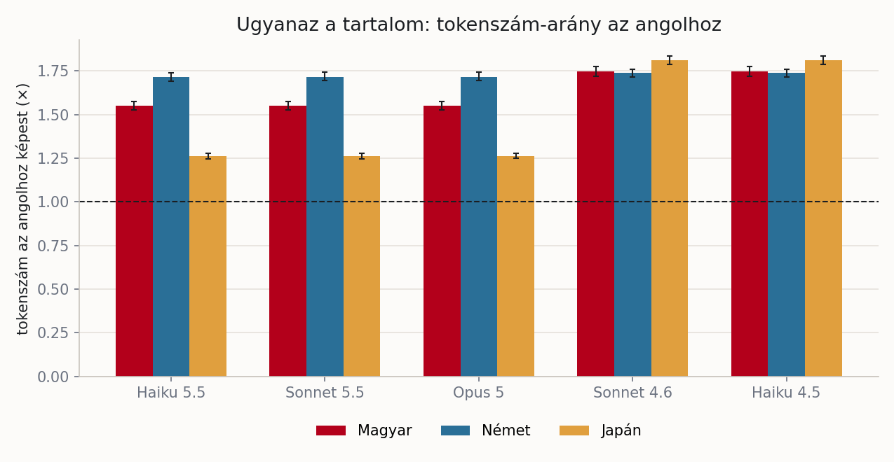
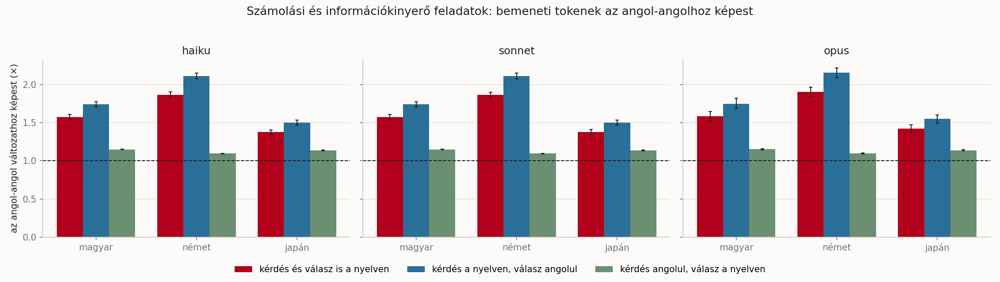
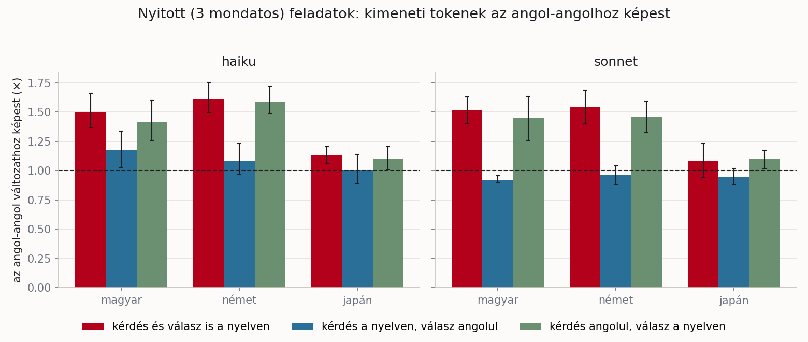
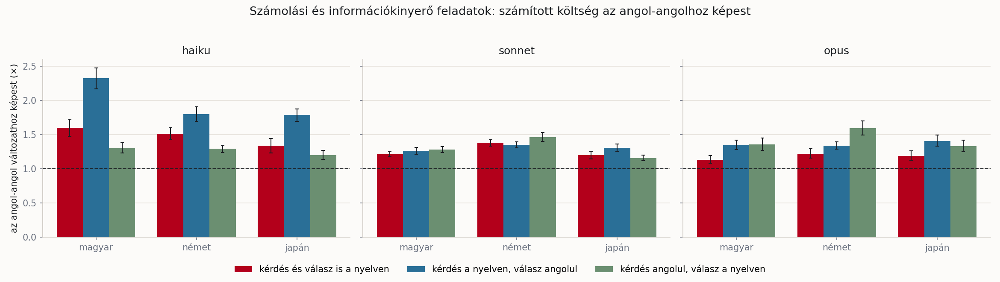
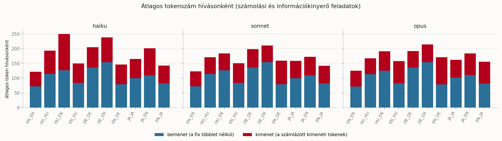
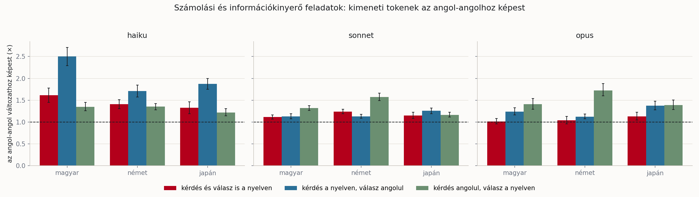

# Nyelvek és tokenek: többe kerül-e, ha nem angolul beszélünk a modellel?

## Röviden

A mérés négy nyelven (angol, magyar, német, japán), három új és két régebbi tokenizálójú Claude-modellen készült, 4 600 teljes feladat-hívással és 2 020 tokenizálási méréssel. A fő eredmények:

- **Bemenet:** ugyanaz a tartalom az angolhoz képest magyarul 1,55-1,75-szörös, németül 1,72-1,74-szeres, japánul 1,26-1,81-szeres tokenmennyiség, a tokenizáló generációjától függően.
- **Az újabb tokenizálónál a nyelvek közti arány ezért csökken:** az angol szöveg tokenszáma nő (1,44-szeresre), a magyaré és a japáné nem csökken.
- **Kimenet (nyitott, hosszkorlátozott válasz):** ha a válasz magyar vagy német, a kimeneti tokenek száma 1,4-1,6-szoros, ha angol, kb. 0,9-1,2-szeres, a kérdés nyelvétől függetlenül.
- **Számított költség (számolási és információkinyerő feladatok):** a más nyelven feltett kérdés 1,1-1,6-szoros költséget jelent. A Haiku 5.5-nél a magyar kérdés és angol válasz változatban 2,33-szorosat, mert a válaszban nem látható kimeneti tokenek száma nő meg (angol kérdésnél átlagosan 4, ebben a változatban 64 token). A Sonnet 5.5-nél és az Opus 5-nél ez nem jelent meg.

A kísérlet a költséget méri. A válaszok helyességét csak ellenőrzésként rögzítettem, és a feladatok olyan könnyűek voltak, hogy a pontosságról ez a mérés nem mond semmit.

## A szcenárió

Egy nyelvi modell használatának költsége tokenekben mérődik: a modell nem karaktereket vagy szavakat számol, hanem a szöveg szavakból és szórészletekből álló darabjait, a tokeneket. Külön díj van a bemeneti tokenekre (amit a modell kap) és a kimenetiekre (amit a modell ír). A kimeneti token díja a használt modellek árlistáján ötszöröse a bemenetinek.

Ugyanaz a mondanivaló különböző nyelveken különböző számú tokent jelenthet. Ez a kísérlet azt méri, **mennyivel többe kerül ugyanaz a feladat, ha nem angolul beszélek a modellel**, és hogy ez a többlet a bemeneten, a kimeneten vagy mindkettőn jelentkezik. A vizsgált nyelvek: angol (viszonyítási alap), magyar, német és japán.

Két külön kérdést vizsgáltam, mert más a költségük és más a tanulságuk:

- **A rész, tokenizálás:** ugyanannyi jelentés hány tokent jelent az egyes nyelveken és modelleken? Itt csak a bemenet tokenszámát mértem.
- **B rész, teljes feladat:** valódi hívásokkal mértem a bemeneti és a kimeneti tokeneket, a számított költséget, és ellenőrzésként a válasz helyességét. Külön kezeltem, hogy milyen nyelven **kérdezek** és milyen nyelven **kérek választ**, mert ez a gyakorlatban két, egymástól független döntés.

A kiértékelés automatikus: a feladatok helyes válasza szkriptből generált és egyértelmű, emberi bíráló nincs.

## A kísérlet felépítése

### Modellek

| Szerep | Modell | Hol használtam |
|---|---|---|
| Új tokenizáló | Claude Haiku 5.5 (`claude-haiku-5-5`) | A és B (az összes feladat) |
| Új tokenizáló | Claude Sonnet 5.5 (`claude-sonnet-5-5`) | A és B (az összes feladat) |
| Új tokenizáló | Claude Opus 5 (`claude-opus-5`) | A és B (kisebb minta) |
| Új tokenizáló | Claude Opus 5.5 (`claude-opus-5-5`) | csak az Opus 5-tel való tokenizáló-összevetés (l. az A rész eredményei) |
| Régebbi tokenizáló | Claude Sonnet 4.6 (`claude-sonnet-4-6`) | csak A |
| Régebbi tokenizáló | Claude Haiku 4.5 (`claude-haiku-4-5`) | csak A |

Eredetileg az Opus 5.5 szerepelt volna, de a fő mérésnél használt Claude Code verzió (2.1.179) ezt a modellt még nem támogatta, ezért az összehasonlító mintán az Opus 5-öt használtam. A két modell tokenizálóját utólag, egy újabb Claude Code verzióval (2.1.317) hasonlítottam össze (l. az A rész eredményeinél). A három új tokenizálós modell (Haiku 5.5, Sonnet 5.5, Opus 5) tokenszámai az A rész mind a 404 adagján azonosak, ezért az A részben ez egyetlen független mérésnek számít, nem háromnak.

### Hívásszerkezet

Minden hívás a Claude Code parancssori eszközön (`claude -p`) fut, nem az Anthropic API-n. Egy hívás fix, rövid, angol rendszerpromptot kap, eszközök nélkül (a modell nem futtathat kódot), rögzített `--effort low` beállítással, üres munkakönyvtárból, a claude.ai-csatlakozók és a projektkörnyezet kikapcsolásával. Így a hívás fix bemeneti többlete modellenként állandó (pl. 184 token a Haiku 5.5-nél), és levonható. A tokenszámokat a hívások JSON-kimenetének `usage` mezőiből olvastam ki. A fő mérés a Claude Code 2.1.179 verziójával készült.

A dollárösszegek **számított költségek**: a tokenszámokat a nyilvános API-árakkal szoroztam. A tényleges kiadás nulla volt, mert a hívások a claude.ai-bejelentkezéshez tartozó előfizetés használati keretéből futottak (API-kulcs nem volt beállítva). Az árak a modell-dokumentáció 2026. október eleji árlistájából származnak (millió tokenre, bemenet / kimenet): Haiku 5.5 0,10 / 0,50 dollár, Sonnet 5.5 2 / 10 dollár, Opus 5 5 / 25 dollár, Sonnet 4.6 3 / 15 dollár, Haiku 4.5 1 / 5 dollár.

### A rész: tokenizálás

A FLORES-200 `devtest` részének első 1010 mondata (a négy nyelvi fájl sorai egymásnak megfelelő mondatok), 10 mondatos adagokban, nyelvenként 101 adag. Az adagokat a modell kapja bemenetként, a kért válasz egyetlen fix szó. Modellenként egy kiindulási hívás méri a fix többletet, ezt minden adagból levontam. Összesen 2 020 mérési hívás, a 10 kiindulási hívással együtt 2 030.

### B rész: teljes feladat

100 feladat, mindegyik tartalma szkriptből generált:

| Kategória | Darab | Mit mér |
|---|---|---|
| Szöveges számtani feladat | 30 | egy-két lépéses számolás |
| Nehezebb, többlépéses számtani feladat | 30 | négy paraméteres, több műveletes számolás |
| Információkinyerés | 30 | egy adat kiválasztása egy rövid szövegből |
| Nyitott magyarázat | 10 | "pontosan 3 mondatban magyarázd el" (csak a kimenet hosszát mértem) |

Minden feladat **10 változatban** fut, hogy a kérdés és a válasz nyelvének hatása külön látszódjon:

| Változat | Kérdés nyelve | Válasz nyelve |
|---|---|---|
| `EN_EN` | angol | angol |
| `L_L` | `L` | `L` |
| `L_EN` | `L` | angol (az `L` nyelven kérve) |
| `EN_L` | angol | `L` (angolul kérve) |

ahol `L` a magyar (`HU`), a német (`DE`) vagy a japán (`JA`). Minden változat 2 ismétlésben fut. A Haiku 5.5 és a Sonnet 5.5 mind a 100 feladatot kapja (2 000-2 000 hívás), az Opus 5 az első három kategóriából 10-10 feladatot (600 hívás). Összesen **4 600 hívás**, mind sikeres volt.

A válaszokból a szkript az utolsó `ANSWER:` sort olvassa ki, és a számot a generált helyes válasszal vetettem össze.

## Az adatok és a fordítás

A számtani és információkinyerő feladatok sablonokból és véletlen számokból készülnek, rögzített, string-kulcsos véletlenszám-generátorral (`random.Random(f"nyelv_{sablon}_{sorszam}")`, nem a beépített `hash()` függvénnyel). A bemeneti számok egész számok, 2 és 999 között, tizedesjegy és ezres elválasztó nélkül, hogy a számok írásmódja ne okozzon külön nyelvi különbséget. A helyes választ ugyanabból az adatból számolja a generátor, amiből a promptot állítja össze. Két egymás utáni futtatás bájtra azonos feladatsort ad.

A sablonok és az utasítás-mondatok (összesen 42 szöveg) angolul készültek, és a DeepL API ingyenes csomagjával fordítottam őket magyarra, németre és japánra. A fordítás ellenőrzése:

1. Visszafordítás angolra (DeepL), hasonlóság az eredetihez (chrF).
2. Független keresztellenőrzés a helyben futó, ingyenes NLLB-200 modellel. Az NLLB fordításai nyilvánvaló hibákat is tartalmaztak (pl. a "screws" szóra "sikátor"), és a DeepL-től való eltérésük a japánnál volt a legnagyobb, ezért csak gyanús tételek jelzésére használtam, nem a fordítás helyettesítésére.
3. A magyar tételeket teljes egészében átolvastam. A német és a japán tételeket egy Claude-modell nézte át a tételenkénti ellenőrző lapok alapján, anyanyelvi ellenőrzés nélkül. Összesen **17 tételt kellett kézzel javítani** (magyar 10, német 3, japán 4). Az indoklások az [`overrides.json`](data/templates/overrides.json)-ban, a tételenkénti ellenőrző lapok a [`review_hu.md`](data/templates/review_hu.md), [`review_de.md`](data/templates/review_de.md) és [`review_ja.md`](data/templates/review_ja.md) fájlokban vannak.

## Eredmények: A rész, tokenizálás



Az ábra azt mutatja, hogy ugyanaz a tartalom hányszor annyi tokent jelent, mint angolul. A pontos értékek (zárójelben a 95%-os konfidencia-intervallum, amit az adagok újramintavételezésével számoltam):

| Modell | magyar | német | japán | angol szöveg karakter/token |
|---|---|---|---|---|
| Haiku 5.5 | 1,55 (1,53-1,58) | 1,72 (1,69-1,74) | 1,26 (1,25-1,28) | 3,09 |
| Sonnet 5.5 | 1,55 (1,53-1,58) | 1,72 (1,69-1,74) | 1,26 (1,25-1,28) | 3,09 |
| Opus 5 | 1,55 (1,53-1,57) | 1,72 (1,69-1,74) | 1,26 (1,25-1,28) | 3,09 |
| Sonnet 4.6 | 1,75 (1,72-1,78) | 1,74 (1,71-1,76) | 1,81 (1,79-1,84) | 4,44 |
| Haiku 4.5 | 1,75 (1,72-1,78) | 1,74 (1,71-1,76) | 1,81 (1,79-1,84) | 4,44 |

Három dolog látszik:

- **Az angol igényli a legkevesebb tokent.** A magyar 1,55-1,75-szörös, a német 1,72-1,74-szeres, a japán 1,26-1,81-szeres tokenmennyiséget jelent ugyanarra a tartalomra.
- **A tokenizáló generációja számít.** A régebbi modelleknél a három nyelv közel azonos mértékben drágább (1,74-1,81). Az újabb tokenizálónál a japán felára harmadára csökken (1,26 az 1,81 helyett), a magyaré kisebb lesz (1,55 az 1,75 helyett), a németé viszont alig változik (1,72).
- **Az újabb tokenizálónál az angol szöveg tokenszáma nő a legnagyobb mértékben.** Ugyanazt az angol szöveget az új tokenizáló 1,44-szer annyi tokenre bontja, mint a régi (4,44 helyett 3,09 karakter jut egy tokenre). A magyarnál ez 1,27-szeres, a németnél 1,42-szeres, a japánnál 1,00. A nyelvek közti arány tehát nem azért csökkent, mert a magyar vagy a japán szöveg tokenszáma csökkent, hanem mert az angolé nőtt.

### Az Opus 5.5 tokenizálójának ellenőrzése

A fő mérésnél az Opus 5.5 nem futott (a Claude Code 2.1.179 nem támogatta), ezért utólag egy újabb verzióval (2.1.317) ellenőriztem, hogy tokenizálója azonos-e az Opus 5-ével. Mindkét modellt mind a 404 adagon megmértem ugyanazzal az új verzióval ([`harness/check_opus55.py`](harness/check_opus55.py)). Az új verzióval ugyanannak a promptnak az ismételt hívása is kissé eltérő bemeneti tokenszámot ad (azonos prompt 8 hívásánál az Opus 5-nél 1414 és 1420, az Opus 5.5-nél 1396 és 1402 között, l. [`data/a_check_ismetelt_hivas.json`](data/a_check_ismetelt_hivas.json)), ezért a fix többletet modellenként 20 kiindulási hívás átlagából számoltam (Opus 5: 916,9, Opus 5.5: 898,8 token; a szórás kb. 2 token).

Az Opus 5.5 és az Opus 5 nettó tokenszámának különbsége a 404 adagon átlagosan **0,06 token** (95%-os konfidencia-intervallum: ±0,32), egy adag nettó tokenszáma kb. 400-700. Nyelvenként: angol +0,44, német +0,29, magyar -0,39, japán -0,12. Az adagonkénti szórás 3,3 token, ami összhangban van a hívásonkénti zajjal. Ez alapján a két modell tokenszáma átlagosan 0,3 tokenes pontossággal azonos. Adagonkénti pontos egyezést a hívásonkénti zaj miatt nem lehet kimutatni.

## Eredmények: B rész, teljes feladat

### Bemeneti tokenek



| Változat | Haiku 5.5 | Sonnet 5.5 | Opus 5 |
|---|---|---|---|
| magyar: kérdés és válasz is | 1,57 (1,54-1,61) | 1,57 (1,54-1,61) | 1,58 (1,52-1,65) |
| magyar: kérdés magyarul, angol válasz | 1,74 (1,71-1,78) | 1,74 (1,70-1,78) | 1,75 (1,68-1,82) |
| magyar: angol kérdés, magyar válasz | 1,15 (1,15-1,16) | 1,15 (1,15-1,16) | 1,15 (1,15-1,16) |
| német: kérdés és válasz is | 1,87 (1,83-1,90) | 1,87 (1,83-1,90) | 1,90 (1,85-1,96) |
| német: kérdés németül, angol válasz | 2,11 (2,08-2,15) | 2,11 (2,08-2,15) | 2,15 (2,09-2,22) |
| német: angol kérdés, német válasz | 1,10 (1,09-1,10) | 1,10 (1,09-1,10) | 1,10 (1,09-1,10) |
| japán: kérdés és válasz is | 1,38 (1,35-1,41) | 1,38 (1,35-1,41) | 1,42 (1,37-1,47) |
| japán: kérdés japánul, angol válasz | 1,50 (1,47-1,53) | 1,50 (1,47-1,53) | 1,55 (1,50-1,60) |
| japán: angol kérdés, japán válasz | 1,14 (1,13-1,14) | 1,14 (1,13-1,14) | 1,14 (1,13-1,15) |

A bemeneti tokenek száma a nyelvtől és a tokenizálótól függ, a három modellnél lényegében azonos. Ha a kérdést magyarul, németül vagy japánul teszem fel, a bemenet 1,4-1,9-szeres, ha csak az angol kérdés végére írom hozzá, hogy a választ más nyelven kérem, 1,1-1,15-szörös. Ha az "angolul válaszolj" utasítást is a kérdés nyelvén írom, a bemenet a leghosszabb (1,5-2,1-szeres), mert a kérdés mellett az utasítás is más nyelven áll.

### Kimeneti tokenek



A kimeneti tokenek nyelvi hatását a nyitott, hosszkorlátozott ("pontosan 3 mondat") feladatokon lehet a legjobban összehasonlítani, mert a hosszkorlát miatt a válaszok hossza kevésbé tér el. A számolási feladatoknál a válasz néhány szó és egy-két művelet, és nincs kért hosszkorlát.

| Változat | Haiku 5.5 | Sonnet 5.5 |
|---|---|---|
| magyar: kérdés és válasz is | 1,50 (1,37-1,66) | 1,52 (1,40-1,63) |
| magyar: kérdés magyarul, angol válasz | 1,18 (1,03-1,34) | 0,92 (0,89-0,96) |
| magyar: angol kérdés, magyar válasz | 1,42 (1,26-1,60) | 1,45 (1,26-1,64) |
| német: kérdés és válasz is | 1,61 (1,50-1,75) | 1,54 (1,40-1,69) |
| német: kérdés németül, angol válasz | 1,08 (0,96-1,23) | 0,96 (0,88-1,04) |
| német: angol kérdés, német válasz | 1,59 (1,49-1,72) | 1,46 (1,32-1,59) |
| japán: kérdés és válasz is | 1,13 (1,06-1,20) | 1,08 (0,94-1,23) |
| japán: kérdés japánul, angol válasz | 1,00 (0,89-1,14) | 0,95 (0,88-1,02) |
| japán: angol kérdés, japán válasz | 1,10 (1,01-1,20) | 1,10 (1,02-1,17) |

A két mért modellnél a kimenet hossza a válasz nyelvével változik, a kérdés nyelvétől függetlenül: ha a válasz magyar vagy német, a kimenet 1,4-1,6-szoros, ha angol, kb. 0,9-1,2-szeres. A japán válasz 1,1-szeres. Ha **angolul kérem a választ, a nyitott feladatoknál a kimeneti tokenek többlete megszűnik** (a számolási feladatoknál ez nem általános, l. lent).

### Összesített költség





| Változat | Haiku 5.5 | Sonnet 5.5 | Opus 5 |
|---|---|---|---|
| magyar: kérdés és válasz is | 1,60 (1,48-1,73) | 1,22 (1,18-1,26) | 1,13 (1,08-1,19) |
| magyar: kérdés magyarul, angol válasz | 2,33 (2,17-2,48) | 1,26 (1,21-1,32) | 1,35 (1,28-1,42) |
| magyar: angol kérdés, magyar válasz | 1,30 (1,23-1,38) | 1,28 (1,24-1,32) | 1,36 (1,27-1,45) |
| német: kérdés és válasz is | 1,51 (1,43-1,60) | 1,38 (1,33-1,43) | 1,22 (1,16-1,29) |
| német: kérdés németül, angol válasz | 1,80 (1,69-1,91) | 1,35 (1,31-1,39) | 1,34 (1,29-1,40) |
| német: angol kérdés, német válasz | 1,29 (1,24-1,35) | 1,47 (1,40-1,54) | 1,59 (1,49-1,70) |
| japán: kérdés és válasz is | 1,34 (1,23-1,44) | 1,20 (1,15-1,26) | 1,19 (1,12-1,26) |
| japán: kérdés japánul, angol válasz | 1,79 (1,70-1,88) | 1,31 (1,26-1,37) | 1,41 (1,33-1,49) |
| japán: angol kérdés, japán válasz | 1,20 (1,14-1,27) | 1,16 (1,12-1,20) | 1,33 (1,25-1,42) |

A számolási és információkinyerő feladatokon a más nyelven feltett kérdés 1,1-1,6-szoros költséget jelent (a Haikunál akár 2,3-szorosat). A Sonnet 5.5-nél és az Opus 5-nél a költségarány kisebb, mint a bemeneti tokenek aránya, a Haiku 5.5-nél a magyar kérdés és angol válasz változatban nagyobb (2,33 a bemenet 1,74-ével szemben, l. alább).

### A válaszban nem látható kimeneti tokenek

A hívás számlázott kimeneti tokenjeinek száma (`output_tokens`) több lehet, mint a válasz látható szövegének tokenszáma. Ezért egy véletlenszerű, 20%-os részmintán (920 hívás) külön megmértem a látható válasz tokenszámát: a válasz szövegét ugyanazon a modellen bemenetként elküldtem, a fix többletet levontam, és a számlázott kimenetből ezt kivonva kaptam a nem látható részt. Ez közelítés, a cellákban 6-47 mérés van. A táblázat második száma ez a különbség.

| Változat | Haiku 5.5 (látható / nem látható) | Sonnet 5.5 | Opus 5 |
|---|---|---|---|
| angol kérdés, angol válasz | 50 / 4 (n=37) | 47 / 1 (n=27) | 39 / 14 (n=14) |
| magyar kérdés, magyar válasz | 55 / 25 (n=40) | 59 / 1 (n=36) | 39 / 12 (n=12) |
| magyar kérdés, angol válasz | 51 / 64 (n=29) | 58 / 1 (n=22) | 48 / 12 (n=13) |
| angol kérdés, magyar válasz | 58 / 10 (n=36) | 69 / 1 (n=27) | 57 / 18 (n=14) |
| német kérdés, német válasz | 59 / 6 (n=35) | 59 / 1 (n=38) | 53 / 16 (n=6) |
| német kérdés, angol válasz | 50 / 28 (n=42) | 55 / 1 (n=46) | 48 / 15 (n=15) |
| angol kérdés, német válasz | 68 / 3 (n=47) | 81 / 1 (n=38) | 79 / 18 (n=12) |
| japán kérdés, japán válasz | 49 / 19 (n=42) | 62 / 1 (n=34) | 44 / 15 (n=18) |
| japán kérdés, angol válasz | 57 / 37 (n=33) | 61 / 1 (n=31) | 61 / 18 (n=12) |
| angol kérdés, japán válasz | 55 / 2 (n=38) | 58 / 1 (n=34) | 50 / 13 (n=11) |



A Haiku 5.5-nél a nem látható kimeneti tokenek száma angol kérdésnél átlagosan 4, magyar kérdés és angol válasznál 64, miközben a látható válasz hossza alig változik (50 és 51 token). A magyar kérdés és angol válasz változatban a Haiku kimeneti tokenjei 2,5-szeresek, a költsége 2,33-szoros (a magyar kérdés és magyar válasz változatban 1,60). A kimeneti többlet a nem látható tokenekből ered, a látható szöveg hossza alig változik. A Sonnet 5.5-nél a különbség minden cellában 1 token, az Opus 5-nél 12 és 18 token között ingadozik.

Szúrópróbaként néhány hívást a részletes kimenettel (`--output-format stream-json`) is lefuttattam, amelyben a válasz blokkjai külön látszanak. Ezeknél az Opus 5 és egy Haiku 5.5 hívás válaszában a szöveges blokk előtt `thinking` blokk állt, amelynek a tartalma nem jelenik meg. Egy másik, azonos prompton futtatott Haiku 5.5 hívásnál és a kipróbált Sonnet 5.5 hívásoknál nem volt `thinking` blokk. A minta kicsi, ezért azt, hogy a nem látható tokenek mekkora része gondolkodás, és hogyan oszlik el a hívások között, nem tudom megmondani.

### Helyesség (ellenőrzés)

A 4 200 számolási és információkinyerő válaszból **4 199 helyes** (a pontos, `ANSWER:` jelölővel megadott válasz 4 197 esetben). A három eltérés mind a jelölő formátumát érinti, nem a számot: kétszer a Haiku az `ANSWER:` jelölőt lefordította ("ANTWORT:"), és egyszer a jelölő nélkül írta az utolsó sort. Az egyetlen "hibásnak" számító válasz is a helyes számot tartalmazta, csak jelölő nélkül. A feladatok a modellek számára könnyűek voltak, ezért a helyesség minden nyelvnél és változatnál közel 100%, és ez a mérés a pontosságról nem mond semmit. Ezt a Korlátok szakasz részletezi.

A nyitott feladatoknál a válasz nyelvét is ellenőriztem (a 400 válaszból mind a 400 esetben felismerhető volt a nyelv). A modellek 397 esetben a kért nyelven válaszoltak, háromszor nem: a Haiku 5.5 angolul válaszolt, amikor angol kérdésre magyar választ kértem.

## Konkrét példák

Ugyanaz a feladat (`N03_1`), a Sonnet 5.5 első ismétlésében, a hívás fix bemeneti többlete nélkül:

| Változat | Kérdés | Bemeneti token | Kimeneti token |
|---|---|---|---|
| `EN_EN` | A student reads 29 pages every day for 7 days. The book has 296 pages. How many pages are left to read? | 59 | 42 |
| `HU_HU` | Egy diák 29 oldalt olvas minden nap 7 napon keresztül. A könyvnek 296 oldala van. Hány oldal van még hátra? | 101 | 50 |
| `DE_DE` | Ein Schüler liest 29 Seiten pro Tag über einen Zeitraum von 7 Tagen. Das Buch hat 296 Seiten. Wie viele Seiten muss er noch lesen? | 124 | 60 |
| `JA_JA` | ある生徒が、7日間、毎日29ページずつ読んでいます。その本は296ページあります。あと何ページ残っていますか？ | 83 | 60 |

A bemeneti tokenek itt az angolhoz képest 1,4-2,1-szeresek, a kimenetnél a különbség kisebb.

A Haiku 5.5 eltérése ugyanazon a feladaton (`N03_1`), angol kérdésnél és magyar kérdésre adott angol válasznál:

```
EN_EN, 45 kimeneti token:
29 pages/day × 7 days = 203 pages read.
296 − 203 = 93 pages left.

ANSWER: 93

HU_EN, 155 kimeneti token:
A student reads 29 pages a day for 7 days: 29 × 7 = 203 pages read.

The book has 296 pages, so 296 − 203 = 93 pages remain.

ANSWER: 93
```

Mindkét válasz helyes, a második látható szövege hosszabb, a hívás számlázott kimenete pedig több mint háromszoros (155 és 45 token). A nyers rekordok a [`data/b_raw.jsonl`](data/b_raw.jsonl) fájlban vannak (`_name`: `N03_1__EN_EN__haiku__r1.json` és `N03_1__HU_EN__haiku__r1.json`).

## Költség és idő

| Rész | Hívás | Bemeneti token | Kimeneti token | Számított költség | Futásidő |
|---|---|---|---|---|---|
| A, tokenizálás | 2 030 | 1,45 millió | 62 ezer | 3,59 dollár | kb. 2 óra |
| B, teljes feladat | 4 600 | 1,30 millió | 0,35 millió | 4,57 dollár | kb. 1 óra 40 perc |
| B, látható tokenek mérése (20%-os részminta) | 920 | kb. 0,24 millió | elhanyagolható | kb. 0,4 dollár (becslés) | kb. 30 perc |

A hívások párhuzamosan futottak (B: 6 egyszerre), a részek részben egyidejűleg. A teljes költség a nyilvános API-árakkal számolva 10 dollár alatt van (kb. 8,5 dollár). A tényleges kiadás nulla volt, mert a hívások az előfizetés használati keretéből futottak.

## Módszertani buktató 1: a bemeneti többlet nem volt állandó

Az első próbahívásoknál ugyanaz a rövid prompt hol 188, hol 3 646 bemeneti tokent adott, és a magasabb esetben gyorsítótár-írás is látszott. A ~3 450 tokenes többlet okát nem azonosítottam pontosan. A `--disable-slash-commands` kapcsoló nem szüntette meg. A `--strict-mcp-config` kapcsolóval, az `ENABLE_CLAUDEAI_MCP_SERVERS=false` környezeti változóval és egy üres munkakönyvtárral (a repón és a home könyvtáron kívül) együtt a többlet minden kipróbált modellnél és az összes mérési hívásnál állandó lett (az A részben pl. 184 token a Haiku 5.5-nél). Hogy a három beállítás közül melyik volt szükséges, nem vizsgáltam. A ~3 450 tokenes ingadozás nagyobb volt, mint a nyelvek közti különbség egy 10 mondatos adagnál, ezért az állandó többlet a mérés előfeltétele volt.

## Módszertani buktató 2: a gépi fordítás hibái

A DeepL fordítása első ránézésre jó volt, az ellenőrzés során viszont több hiba is kiderült:

- **Számhoz kötött toldalék magyarul.** A helykitöltő után a toldalék a szám kiejtésétől függ ("{B}-t", "{A}-en"), ezért a mondatokat át kellett fogalmazni, hogy ne legyen számhoz kötött toldalék.
- **Szóroncsolás.** Az egyik német tételben a gép "besa{A}" alakot adott (a szó vége és a helykitöltő összeolvadt), miközben a helykitöltő-ellenőrzés (a helykitöltők száma) hibátlannak mutatta.
- **Rossz szó.** A "loose" (szabad) szóra "szórványos", a "full" doboz japán fordítására "満杯" (színültig tele) került, amit az ellenőrzésnél természetellenesnek ítéltek.
- **Következetlen megszólítás.** A magyar utasítások fele tegezett, fele magázott.
- **Nyelvtani hiba, amit csak a mérés után vettek észre.** Az N01 sablon magyar változatának első mondata hibás ("Egy diáknak {A} alma van", a helyes alak "almája van"). Ez az N01_1-3 feladatok magyar kérdéses változatait (`HU_HU`, `HU_EN`) érinti, 28 hívást a 4 600-ból. A hívásokat nem futtattam újra. A 28 hívás kihagyásával a magyar változatok táblázataiban az arányok legfeljebb 0,014-del (a bemeneti tokenekénél legfeljebb 0,002-vel, a költségénél legfeljebb 0,011-gyel) változnak, ami jóval a konfidencia-intervallumok szélessége alatt van.

Összesen 17 tételt kellett kézzel javítani. Az indoklások az `overrides.json`-ban vannak.

## Módszertani buktató 3: pontozási és értékelési buktatók

- **Rövid válaszokon a nyelvfelismerés nem megbízható.** A számolási feladatok válaszai gyakran csak egy-két szó és néhány művelet ("80 + 12 = 92, majd 92 − 22 = 70."), amin a nyelvfelismerő könyvtár tévedett. Ezért a nyelvet csak 25 betűnél hosszabb válaszon mértem, a rövideket "ismeretlen"-nek jelöltem, és a kért nyelv betartását a nyitott feladatokon értékeltem.
- **A modell lefordította a válaszjelölőt.** Két esetben a Haiku az `ANSWER:` jelölőt "ANTWORT:"-ra fordította, mindkétszer német nyelvű válasznál. A szám helyes volt, de a pontos jelölő hiányzott. A pontozó ezért két mutatót ad: a helyességet (a fordított jelölőket is elfogadva) és a pontos jelölő használatát külön.
- **A feladatok túl könnyűek voltak.** A próbafuttatáson mind a 60 számolási válasz hibátlan volt, mindhárom modellnél. A feladatsort ezért kiegészítettem egy nehezebb, négy paraméteres, többlépéses számtani kategóriával. A teljes futásban ez sem hozott hibát.

## Módszertani buktató 4: az új Claude Code verzió zajt és eltolást vitt a mérésbe

Az Opus 5.5 ellenőrzésénél az első két összevetés a két modellt adagonként eltérőnek mutatta (404 adagból 354-nél, majd 388-nál különbözött a nettó tokenszám, legfeljebb 14 tokennel). Az ok a mérés volt, nem a tokenizáló: az új Claude Code verzióval a kiindulási prompt bemenete kb. 900 token (a régi verzióval kb. 190), és azonos prompt ismételt hívására is kb. 2-3 tokennel ingadozik. A kiindulási hívást eleinte csak egyszer mértem modellenként, ennek zaja rendszerszerű, kb. +5 tokenes eltolásként jelent meg minden adagnál. A kiindulási hívás 20-szoros mérésével az átlagos különbség 0,06 tokenre csökkent.

## Korlátok

- **A fordítások gépiek.** Csak a magyar tételeket olvastam át teljes egészében. A német és a japán fordítást egy Claude-modell nézte át az ellenőrző lapok alapján, anyanyelvi ellenőrzés nélkül. Egy hiba (az N01 magyar változata) csak a mérés után derült ki, ezért további hibák, különösen a németben és a japánban, nem zárhatók ki. Egy rossz fordítás nyelvi hatásnak látszhat.
- **A pontosságot nem mértem.** A modellek a feladatok csaknem mindegyikét helyesen oldották meg (4 200-ból 4 199), ezért erről a mérés nem mond semmit. Ahol a modell ténylegesen téved, a hatás lehet más.
- **Rövid válaszok.** A számolási feladatoknál a kimenet kevés szóból áll, és a hossza nem korlátozott. A nyelv hatását a kimenetre a nyitott feladatokon lehet a legjobban összehasonlítani, azokon pedig csak két modellt mértem.
- **Az A rész egyetlen korpuszon készült.** A tokenarányokat csak a FLORES-200 mondatain mértem. Szakszövegen, kódon vagy számokban gazdag szövegen az arány eltérhet.
- **Nincsenek személynevek.** A feladatokban emberi nevek helyett szerepek szerepelnek (diák, tanár), hogy a nevek átírása és ragozása ne vigyen külön változót a mérésbe. Egy természetesebb, névvel írt feladat más eredményt adhatna.
- **A hívásszerkezet nem a nyers API.** A hívások a Claude Code `-p` módján át mentek, fix rendszerprompttal, kikapcsolt eszközökkel. A hívás fix bemeneti többletét levontam, de a számok nem pontosan azok, amiket egy közvetlen API-hívás mutatna.
- **Rögzített `effort`.** Minden hívás `low` beállítással futott. Magasabb beállításnál a kimeneti tokenek száma és a nyelvi hatás eltérhet.
- **A nem látható tokenek becslése közelítő.** Csak egy 20%-os részmintán, a látható válasz visszamérésével készült, a cellákban kevés mérés van, és nem tudom, hogy ezek a tokenek mekkora részben gondolkodás.
- **Számított költség.** A dollárösszegek tokenszámokból számolt értékek, nem tényleges számlák, és a nyilvános árak idővel változnak. A tokenizálók is változnak: az eredmények a használt modellverziókra érvényesek.
- **Két Claude Code verzió.** A fő mérés a 2.1.179, az Opus 5.5 ellenőrzése a 2.1.317 verzióval készült. A két verzió fix bemeneti többlete különbözik, ezért a két mérés nyers tokenszámai nem hasonlíthatók össze, csak a levont többlettel képzett nettó értékek.
- **Négy nyelv.** Más nyelvekről (finn, kínai, hindi, arab stb.) az eredmény nem mond semmit.
- **Kis feladatszám.** 100 feladat 2 ismétléssel; az Opus 5 mintája 30 feladat, nyitott feladat nélkül.

## Összefoglaló tanulságok

1. **A nem angol szöveg a bemeneten több tokent jelent.** Ugyanaz a tartalom magyarul 1,55-1,75-szörös, németül 1,72-1,74-szeres, japánul 1,26-1,81-szeres tokenmennyiség az angolhoz képest, a modell tokenizálójától függően.
2. **Az újabb tokenizálónál az angol szöveg tokenszáma nő a legtöbbet.** Ugyanaz az angol szöveg 1,44-szer annyi token lesz, mint a régi tokenizálóval. A nyelvek közti arány ettől változik, nem attól, hogy a magyar vagy a japán szöveg tokenszáma csökkent.
3. **A hosszabb, hosszkorlátozott válaszoknál a kimenet nyelve határozza meg a kimeneti tokenek számát.** Ha a válasz magyar vagy német, a kimenet 1,4-1,6-szoros, ha angol, kb. 0,9-1,2-szeres, a kérdés nyelvétől függetlenül. Az angol válasz kérése tehát megszünteti a kimeneti többletet.
4. **Rövid, számolási válaszoknál a nyelv hatása a költségre modellfüggő.** A Haiku 5.5-nél a nem látható kimeneti tokenek száma a nyelvtől függ (angol kérdésnél 4, magyar kérdésre adott angol válasznál 64 token), és ez a magyar kérdésre adott angol válasznál 2,3-szoros költséggel jár együtt. A Sonnet 5.5-nél és az Opus 5-nél ez a szám alig függ a nyelvtől.
5. **A bemeneten a kérdés nyelve számít, a válasz nyelve alig.** Magyar, német vagy japán kérdés 1,4-1,9-szoros bemeneti tokenmennyiség. Ha a kérdés angol, és csak a végére írom, hogy a választ más nyelven kérem, ez 1,1-1,15-szörös.
6. **A pontosságról ez a mérés nem mond semmit.** A válaszok csaknem mind helyesek voltak (4 200-ból 4 199), a feladatok túl könnyűek voltak ahhoz, hogy a nyelvek között különbséget lehessen kimutatni.
7. **A mérés előfeltétele a hívás fix bemeneti többletének rögzítése volt.** Az első próbahívásoknál a többlet kb. 3 450 tokennel ingadozott, ez nagyobb a nyelvek közti különbségnél egy 10 mondatos adagon. A fordítási hibák csak az ellenőrzés során derültek ki. A saját használati esetben a tényleges tokenszám a `claude -p --output-format json` kimenet `usage` mezőjéből olvasható ki, ahogyan a mérés is ezt használta, ezért érdemes a saját promptokon is megnézni.

## Nyers adatok

- [`harness/common.py`](harness/common.py): a `claude -p` hívás, a hibakezelés és a folytatható mentés
- [`harness/models.json`](harness/models.json): a használt modellek
- [`harness/translate_templates.py`](harness/translate_templates.py), [`harness/review_templates.py`](harness/review_templates.py): a sablonok fordítása és az ellenőrző lapok
- [`harness/generate_tasks.py`](harness/generate_tasks.py): a feladatok, promptok és helyes válaszok generálása
- [`harness/measure_frame.py`](harness/measure_frame.py), [`harness/measure_tokens_a.py`](harness/measure_tokens_a.py): az A rész mérése
- [`harness/check_opus55.py`](harness/check_opus55.py): az Opus 5.5 és az Opus 5 tokenizálójának összevetése; eredmény: [`data/a_check_opus55.json`](data/a_check_opus55.json), nyers adatok: [`data/a_check.jsonl`](data/a_check.jsonl), [`data/a_check_baselines.json`](data/a_check_baselines.json)
- [`harness/run_test.py`](harness/run_test.py), [`harness/measure_visible.py`](harness/measure_visible.py), [`harness/score.py`](harness/score.py): a B rész futtatása és pontozása
- [`analyze.py`](analyze.py): összesítő táblák és ábrák
- [`data/flores/`](data/flores/): a FLORES-200 részlet (CC BY-SA 4.0)
- [`data/templates/`](data/templates/): a sablonok, a fordítások és az ellenőrző lapok
- [`data/tasks/`](data/tasks/): a generált feladatok és helyes válaszok (`ground_truth.json`), valamint az összes prompt (`prompts.json`)
- [`data/a_raw.jsonl`](data/a_raw.jsonl), [`data/b_raw.jsonl`](data/b_raw.jsonl), [`data/b_visible.jsonl`](data/b_visible.jsonl): a nyers hívás-eredmények (soronként egy hívás)
- [`harness/pack_raw.py`](harness/pack_raw.py): a hívásonkénti fájlok csomagolása `.jsonl`-lé
- [`data/b_results.csv`](data/b_results.csv), [`data/summary_tables.md`](data/summary_tables.md): a pontozott eredmények és az összesítő táblák
