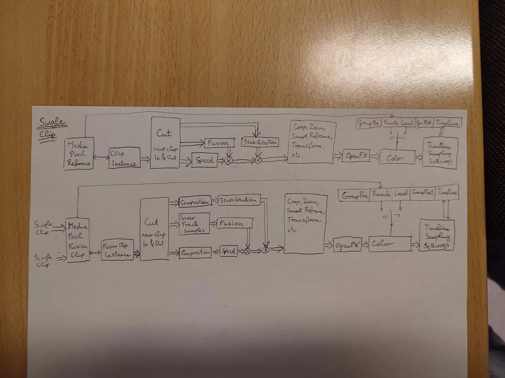
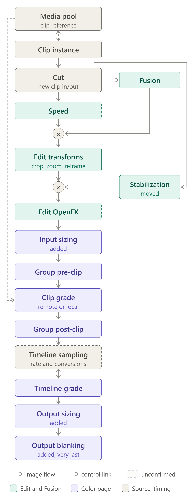
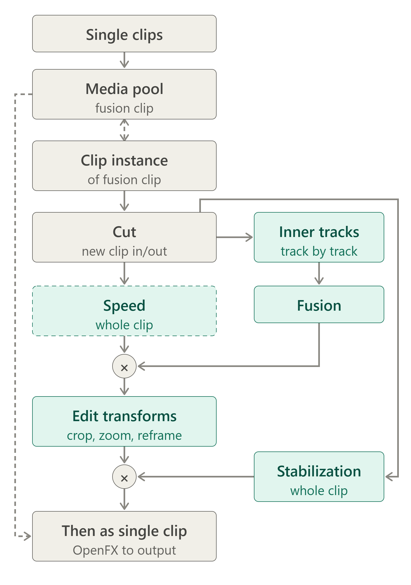

# DaVinci Resolve x AI - Szoftverhasználati jegyzetek feldolgozása és javítása

## Motiváció 

Néhány éve már a DaVinci Resolve szoftvert használom videó utómunkára, és ezalatt az idő alatt számos kézzel írt jegyzetet készítettem már magamnak a program működéséről. Erre azért volt szükség, mert a DaVinci Resolve több nézet és megközelítés mentén alkalmazható videó utómunkára, így a program szekciói (Cut, Edit, Fusion Color, stb.) önmagukban is komplex folyamatok szerint működnek, de ha ezeket egyszerre használjuk egy munkafolyamaton belül, sokat számít, hogy az egyes műveletek milyen sorrendben mennek végbe. 
Nem mindegy ugyanis, hogy pl. ha egyszerre gyorsítok és stabilizálok egy felvételt, akkor a gyorsított felvételt mintázza a stabilizátor vagy a stabilizált kép kerül gyorsításra. De az se mindegy például, hogy ha saját effect láncot csinálok a Fusion nézetben, akkor azok a módosítások az Edit oldalon való transzformációk előtt vagy után történnek meg.
Épp ezért hasznos, ha szem előtt van egy olyan saját egyszerűsített vázlat, amely segítségével gyorsan átláthatjuk a program működését a műveleti sorrendek szemszögéből, és ebből okulva hatékony workflow mentén tudjuk szervezni az utómuka folyamatokat.

Korábban már készítettem egy kézzel rajzolt ábrát, egyrészt arról, hogy milyen szoftver komponenseken megy keresztül egy egyszerű clip, másrészt arról hogy milyen folyamatokon mehet keresztül egy Fusion Composition clip.
Egyszerű clip alatt a nyers videó forrás DaVinci timelineon belüli példányosodását értem, Fusion clip alatt pedig a több clipből létrehozott Fusion compositiont, amely videó sávonként értelmezi a saját bemeneteit, arra optimalizált, hogy komplex effekt láncokat tervezzünk rá, de outputját tekintve egyszerű clipként látható.

{width=1080}
***Ábra:** a kézzel rajzolt jegyzet felső részén az egyszerű clip, alsó részén pedig a Fusion Composition clip szoftveren belüli folyamatábárja látható, a saját előzetes elképzeléseim alapján*

A DaVinci Resolve hivatalos dokumentációja nagyon hosszú, így nehéz utánajárni, hogy a lerajzolt ábrák valóban helyesek-e. Az is hasznos lenne továbbá, hogy a rajz digitális formában, jobban olvasható módon is rendelkezésre állna. Ebben szeretnénk kérni AI segítséget. Választásom ezúttal a Claude AI-ra esett, mert a skill-creatorával már készítettem a DaVinci Resolve dokumentációit feldolgozó skilleket, amelyeket helyes referenciaként használhatok ellenőrzésre, ugyanis általános tudásból merítva gyakran hallucinációkat tartalmaznak az AI által generált válaszok, mivel a szoftver verzióról-verzióra jelentős változásokon mehet keresztül, akár struktúrálisan vagy az eszközök elnevezésében is.
Az általunk példaként vett verzió a DaVinci Resolve 20. A terv az, hogy a hivatalos Reference Manualból betanított skill mentén, értelmezzük a rajzolt ábrákat, ellenőrizzük azok helyességét, majd generáljuk újra képként!


## 1. Skill készítés DaVinci Resolve 20 Reference Manual felhasználásával

### *Felhasznált forrás*

A DaVinci Resolve 20 szoftverhez többféle dokumentáció létezik a különböző komponensei számára, viszont nekünk az általános szoftverhsználatot lefedő 4000+ oldalas Reference Manual-ra van szükségünk. Az egyéb, starting guide, illetve scripting manual jellegű dokumentumok speciális területeket fednek le, azokat nem vonjuk bele a skillbe ezúttal.
A odkumentumot megkaphatjuk a szoftver telepítése révén, ez talán a leghitelesebb forrás, ahonnan beszerezhetjük, annak érdekében, hogy tényleg a megfelelő szoftver verzió dokumentációjából tudjunk dolgozni.

### *Előkészítés*

A Reference Manual pdf formátumban elérhető és tele van illusztrációkkal, képekkel. Ez azért lehet probléma, mert a képek feldolgozása és mapelése sok ráfordítást igényelhet az AI modell által, holott számunkra igazán a szöveges leírások is elegendőek lennének.
Éppen ezért érdemes szöveges fileként exportálni a pdf tartalmát. Ha az Adobe hivatalos pdf olvasójával teszzük ezt meg, a szöveges fileban a láblécek, képaláírások is megmaradnak, amelyek zajként lehetnek jelen, ezért átadhatnánk egy AI modellnek tisztításra a szöveges fájlt még egy lépésben, ebben a példában azonban nem foglalkoztam ezzel a problémával, az egy lépésben exportált szöveges fájlt használtam referenciaként a skill készítéséhez.

### *davinci-resolve-20 skill fejlesztése*

#### Prompt

A skill létrehozásához a Claude által támogatott skill-creator használata mellett döntöttem. Az előre előállított DaVinciResolve.txt fájlt csatolva a következő utasítást adtam.

USER:
```
/skill-creator
 Create a new skill with a name 'davinci_resolve_20' based on attached txt converted user manual of DaVinci Resolve 20. Skill must contain all the information the original user manual does in order to use the skill later to navigate through the actual software and get answers for any questions related to DaVinci Resolve 20.
```

MI:
Eredményül adta az elkészített skillt, amit el is mentettem. Nem foglalkoztam az eredmény ellenőrzésével, rábíztam az egészet a skill-creatorra.

## 2. Kézzel készült ábra feldolgozása, ellenőrzése és újraalkotása

### *Előkészítés*

Az eredeti, legelső ábrám egy összefirkált, gyűrött papíron volt, így a jobban kondícionált feldolgozás érdekében átmásoltam egy új lapra, de megtartottam ugyanazt az elrendezést, mondhatni a zajt szűrtem csak ki. Ez az újrarajzolt ábra látható telefonnal befotózva, feljebb.
Ezentúl semmilyen képi utómunkát nem végeztem, a fotót használom fel csatolmányként az utasítások mellé.
A rajz elkészítése elsősorban saját tapasztalatokon, kísérletezéseken alapult, de néhány kérdéses ponton igyekeztem utánajárni a pontos működésnek, amennyire tudtam.
A jelöléseimet is igyekeztem logikusan alkalmazni, a dupla vonalas nyilag jelentik a kép haladását a feldolgozó modulokon át, az egyvonalas nyilak pedig információcserére, vezérlésre utalnak két műveleti szekció között.

### *Első feldolgozási iteráció*

Az első utasítást úgy terveztem, hogy problémát kontextusba helyezze, a készített /davinci-resolve-20 skillt alkalmazza, és azt vegye fő referenciának, illetve bármilyen kérdéses pont felmerül az ábrával kapcsolatban, kérdezzen vissza az értelmezésre. Magát a promt szöveget jaívottam és struktúráltam Google Gemini segítségével.

A fotó csatolása mellett a következő utasítással éltem az első körben.

USER:
```
/davinci-resolve-20
 
# Task
Analyze a hand-drawn pipeline diagram of **DaVinci Resolve 20**'s processing workflow, reconstruct a clean version of the diagram, verify ambiguous notations with me, and validate/correct the pipeline against the **DaVinci Resolve 20 Reference Manual**.

# Input Context
- **Software:** DaVinci Resolve 20
- **Attached Image:** A hand-drawn diagram showing my notes on the processing pipeline:
  - **Upper section:** Single clips pipeline.
  - **Lower section/line:** Fusion clips pipeline.
- Because the workflow is complex, I want to check whether my mental model and notes accurately reflect how DaVinci Resolve 20 processes media.

# Step-by-Step Instructions
1. **Extract & Reconstruct:**
   - Carefully read all labels, arrows, nodes/stages, and connections in the uploaded image across both the upper (single clips) and lower (Fusion clips) sections.
   - Recreate the entire diagram clearly (e.g., as a structured text/ASCII/Mermaid diagram or clearly organized stage-by-stage flow) faithful to what I drew.
2. **Clarify Uncertainties:**
   - List any handwriting, symbols, arrows, or stage names that are unclear or ambiguous, and ask concise clarifying questions before finalizing assumptions.
3. **Validate Against DaVinci Resolve 20 Reference Manual:**
   - Compare the reconstructed pipeline against the official **DaVinci Resolve 20 Reference Manual** processing order/architecture (including single clip vs. Fusion clip evaluation, Color/Fusion/Edit/deliver order where applicable).
   - Point out any inaccuracies, missing steps, or misordered stages, explaining *why* they differ from DaVinci Resolve 20's actual processing behavior.
4. **Produce a Corrected Pipeline:**
   - Provide a refined, accurate version of the diagram/pipeline representing DaVinci Resolve 20's valid processing flow, clearly highlighting what changed from my original draft.

# Output Format
- **1. Reconstructed Draft Diagram** (faithful to the image)
- **2. Questions & Ambiguities** (bulleted list)
- **3. Validation & Discrepancies** (referencing DaVinci Resolve 20 behavior)
- **4. Corrected DaVinci Resolve 20 Pipeline** (clean, accurate diagram + brief summary of fixes)
```

MI:
A mesterséges intelligencia többek közt visszaadta szövegesen lebontott értelmezését a gráfomra, amely többé-kevésbé jól adaptáltnak bizonyult:
```
[...]

SINGLE CLIP
Media Pool Reference ⇄ Clip Instance ⇒ Cut (new clip, In & Out)
Cut ⇒ Speed ⇒ ⊗ ⇒ ⊗ ⇒ [Crop/Zoom/Smart Reframe/Transform/etc.]
    ⇒ OpenFX ⇒ Color ⇒ Timeline Sampling Settings
Cut ⇒ Fusion ↓ feeds 1st ⊗
Cut →→ Stabilization ↓ feeds 2nd ⊗ (two thin lines from Cut)
Grade bar: [Group Pre | Remote : Local | Gr. Post | Timeline]
  Remote/Local switch → Color; Timeline ⇕ Timeline Sampling Settings
  Media Pool Reference → (over the top) → Remote/Local

FUSION CLIP
Single Clips ⇒ Media Pool Fusion Clip ⇄ Fusion Clip Instance ⇒ Cut
Cut ⇒ Composition ⇒ Stabilization ↓ 2nd ⊗
Cut ⇒ Inner Track Samples ⇒ Fusion ↓ 1st ⊗
Cut ⇒ Composition ⇒ Speed ⇒ 1st ⊗ ⇒ 2nd ⊗ ⇒ [Crop/Zoom/…]
    ⇒ OpenFX ⇒ Color ⇒ Timeline Sampling Settings
Same grade bar; Media Pool Fusion Clip → Remote/Local

[...]
```

Az értelmezés és az ellenőrzés kapcsán felmerültek benne kérdések is, amelyeket pontokba szedve listázott:

```
[...]

2. Questions
- Do double arrows mean image data and single lines mean settings or metadata?
- Does ⊗ mean “apply this operation to the image stream”?
- What are the two thin lines from Cut to Stabilization? In/Out timing?
- Is “OpenFX” Edit/Cut-page clip effects, or Color-page node plugins?
- What is “Timeline Sampling Settings”, and what does the ⇕ with the Timeline tab mean?
- Does the arrow from Media Pool Reference to Remote mean remote versions are stored per source clip?
- In the Fusion clip row, why does “Composition” appear twice, and what are “Inner Track Samples”?
- Does “Crop/Zoom/…etc.” include Input Sizing?

[...]
```

A kérdések mind olyanok, amelyre válaszolni tudunk, és mivel egyelőre a megoldás pontosítást igényel és ábrát sem kaptunk vissza, jelezzünk vissza az AI-nak és pontosítsunk a specifikáción.

### *Visszajelzés, pontosítás*

USER:
```
- double arrows mean process pipeline flow like image data propagating and single line means information or control relations
- x with circle means some sort of combined application
- cut to stabilization is also a parallel branch of a process, not thin lines but one double arrow
- openfx is in terms of edit page effects
- upper timeline box is color page timeline grading, and timeline sampling settings is the step when frame rate and similar conversions are made before making and outlut of a timeline
- the arrow from media pool reference to remote grading means that remote grading refers to the whole raw recording
- composition is when a fusion clip is regarded as one unit and inner track sample is when inside a fusion clip processes are made track-wise
- crop, zoom etc. are only examples for edit page common effects in general

As you got my answers, correct my solution and remake my figure graphically.
```

MI:
```
[...]

**What I changed from your draft**

- **Stabilization moved.** It now sits after the Edit transforms, not before. Edit sizing, Stabilization and Input Sizing all refer back to the source (or Fusion output) resolution, which fits your “combined application” ⊗ (Ch. 11, p. 294).
- **Added Input sizing, before the node graph.** I also added Output sizing after it, and Output blanking as the very last operation (Ch. 152, p. 3430; Ch. 11, pp. 294–295).
- **Your Pre → Clip (remote or local) → Post → Timeline order is right** (Ch. 142, pp. 3303–3304).
- **Remote grades follow the source file.** Clips from the same media file share a remote grade, so your dashed link from the media pool is correct (Ch. 142, pp. 3276–3277).
- **Fusion before Edit effects is right,** so the Edit OpenFX stage stays after it (Ch. 11, p. 287).
- **Fusion clips work at timeline resolution.** That makes sizing after them relative to the timeline, not the original source (Ch. 11, p. 287; Ch. 65, p. 1268).
- **Fusion clip diagram:** I merged your two “Composition” boxes into “whole clip” labels on Speed and Stabilization. “Inner tracks” feeds Fusion track by track.

**Left out of the figure to keep it readable**

- Lens Correction is the one Edit effect processed before Fusion (Ch. 11, p. 287; Ch. 76, p. 1591).
- Super Scale (Studio only) raises the source resolution at the very start (Ch. 11, p. 286).

**Dashed boxes: the manual text doesn’t confirm these**

- Whether Speed comes before Fusion.
- Where Edit OpenFX sits relative to Input sizing.
- Where Timeline sampling sits. I read your ⇕ as the image going into the timeline grade and back, so I placed it before the Timeline grade.

[...]
```

A válaszok elegendőnek bizonyultak ahhoz, hogy az AI kijavítsa és újraalkossa az ábrákat.

A visszajelzésében ismerteti a változtatásokat. Ami kiemelt hiba volt, a kézzel készült ábrámon, hogy a stabilizációt az Edit nézek effektjei elé képzeltem, valójában utánuk történik meg, ami nagyon nem mindegy a stabilizáló algoritmus szempontjából.
A másik fontos változtatás, hogy A folyamatábrán kiegészítő szövegként kerültek feltüntetésre az olyan információk, amelyek nem konkrét feldolgozó egységet jelölnek, hanem körülményt, formátumot vagy magyarázatot, ezzel egyszerűsödött is az ábra, és a jelölésrendszer is konzisztensebbé vált.

Az AI válasza arra is figyelmeztetettt, hogy melyek azok az információk, amelyekre nem talált biztos választ.
- Az, hogy a Fusion és az Edit oldali Speed hatása hol kerül kiszámításra, az inkább a preview render szempontjából érdekes, de használat szempontjából csak az számít, hogy melyik blokk honnan kap inputot. Az Fusion és a Speed között párhuzamos műveleteket jelöltünk, amiket az ⊗ jel kombinál. az biztos, hogy nem a Speed kimenete táplálja a Fusiont, fordítva pedig nincs jelentőssége.
- Az Edit oldali OpenFX fül effektjei és a Color szekcióba való belépés pontos sorrendisége szintén nem számít a workflow szempontjából, a hatások sorrendtől függetlenül kombinálódnak akkor is, ha valami color gradinggel kacsolatos effektet használunk az Edit oldalon. Az egyéb effektek logikusan szinte biztos, hogy a Color oldali folyamatok előtt jutnak érvényre. az ábrán ez így is szerepel.
- A Timeline frame rate és felbontás konverziói, hogy pontosan hol mennek végbe, az ábra alapján logikusnak tűnik, ami azt üzeni, hogy amíg lehet, a legjobb felbontás mellett történjen a Color Grading számítása, kivéve magának a Timelinenak a color gradingje. Ez a legésszerűbb lehetőség, de bárhogy is legyen, felhasználóként nem befolyásolja a workflowt magát.

A válaszokból általánosságban látszik, hogy igen szigorúan a hivatkozott skill, ezáltal az aktuális Reference Manual szolgál fő hivatkozási alapként a válaszokhoz.
A hiányzó válaszok leginkább elvi kérdések, az ábra használhatóságát nem befolyásolják, az eredmények elfogadhatók. Az újraalkotott ábrák alább láthatók.

{width=480}{width=480}


## Tanulságok

- A legtöbb erőforrást a skill létrehozása vette igénybe, a 4000+ oldalas Reference Manual feldolgozásához. Használata azonban megérte, részletesen hivatkozott válaszokat kaptunk a dokumentáció alapján.
- Az eredeti ábra is nagyjából helyesen lett felépítve, de az ellenőrzés mégis talált néhány pontatlanságot, amelyet különösebb szerkesztési utasítások nélkül képes volt javítani, ráadásul néhány körülményt is konzisztensebb formában épített bele az ábrába.
- A rajz feldolgozása, jelölésrendszerének azonosítása egyetlen hibától eltekintve szinte önmagától tökéletes volt, így elmondható, hogy jegyzetek digitalizálásához kiváló segítséget nyújtanak az AI eszközök.