# DaVinci Resolve x AI - Multicam bemutató videó készítése

Projekt dokumentációk, demok során gyakran felmerülő igény olyan kellően illusztratív videó készítése, amely hűen visszaadja a példa jelenet történéseit, így a feladat megoldásának validációját is elősegítheti, nem beszélve arról, hogy a külső szemlélők számára is könnyebben átláthatóvá teszi a projektet.
Amennyiben a teszkörnyezet nagyobb területre is kiterjed, vagy akár a berendezések apróbb részleteire is fontos odafigyelni, szükséges több kameraállásból is egyszerre rögzíteni ugyanazon történéseket.

A felvételek elkészítését követően, az utómunka nehézségét nemcsak a párhuzamos felvételek szinkronizációja okozza, hanem annak irányítása is, hogy melyek jelenjenek meg a kész videón, párhuzamos megjelenítéskor milyen legyen az osztott képernyő, hogy alakuljon ezek egymásra lapolása, stb.
2-3 réteg esetén ez még könnyedén kezelhető, de minél több kameraállással, megjelenítendő réteggel dolgozunk, és minél hosszabb a teljes jelenet annál nehezebbé válik ezt manuálisan megtervezni.

## Az esettanulmány kontextusa

A demo jelenet egy olyan szállítási folyamat bemutatása, ahol egy köszpontiszervező egység egy LLM UI segítségével utasítást kap egy adott doboz elszállítására egy kívánt cél állomásra. A parancs beérkezése után a rendszer elküldö a szállító mobil robotot, egy robotkaros munkaállomásra, ahol a kamerával támogatott állomáson a robotkar a választott dobozt a szállító robotra emeli, amely ezután elszállítja a kívánt célponthoz a doboz munkadarabot.
Ez a példa tartalmazza mindazon problémákat, amelyek nehézséget okoznak a videó elkészítése szempontjából:
* A mobil robot nagy területen mozog, több kamera szükséges a terület lefedéséhez és azáltal a mozgása folyamatos követéséhez.
* A teljes terület méretéhez képest jóval kisebb a robotkaros munkaállomás, az ottani folyamatokat muszáj közeliként felvenni.
* A résztvevő robotok mozgástervezéséről és az LLM UI ablakról is szeretnénk felvételeket készíteni a számítógép képernyő rögzítésével.

Összesen nyolc különböző nyers rétegünk lesz, amellyel dolgoznunk kell a későbbiekben:
* Felülnézeti, amibe a történések jelentős része belefér (overhead)
* Sarokból, a robotkaros állomás mellett (corner)
* Oldalnézet, a robotkaros állomásra merőlegesen (side)
* Kézikamera portré látószög a szemközti sarokból (handcam)
* Közeli a robotkar tárgyfelvételéről (closeup)
* Monitorozás a mobil robot mozgásáról és pályatervezéséről (rviz)
* Monitorozás a robotkar mozgástervezéséről (moveit)
* LLM UI ablak felvétele (llm)

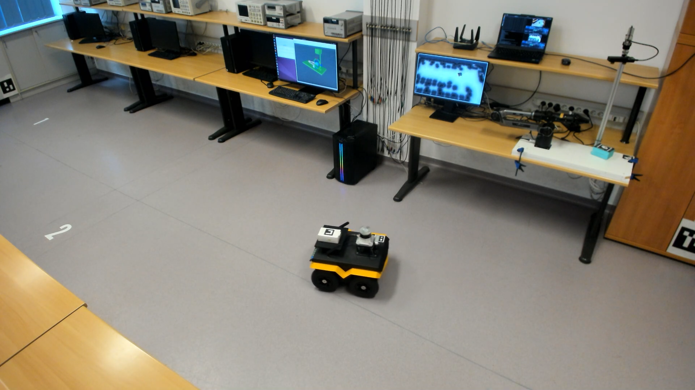{width=480px} 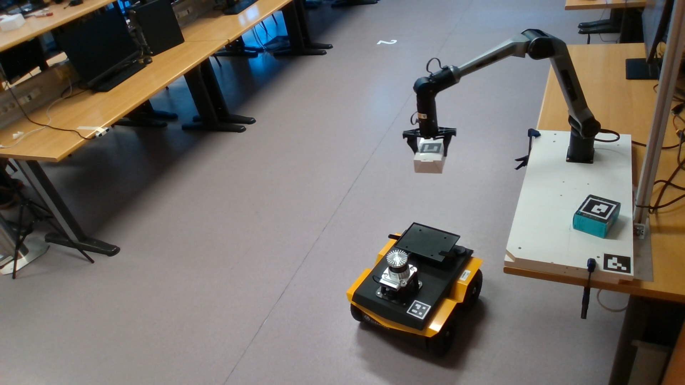{width=480px} 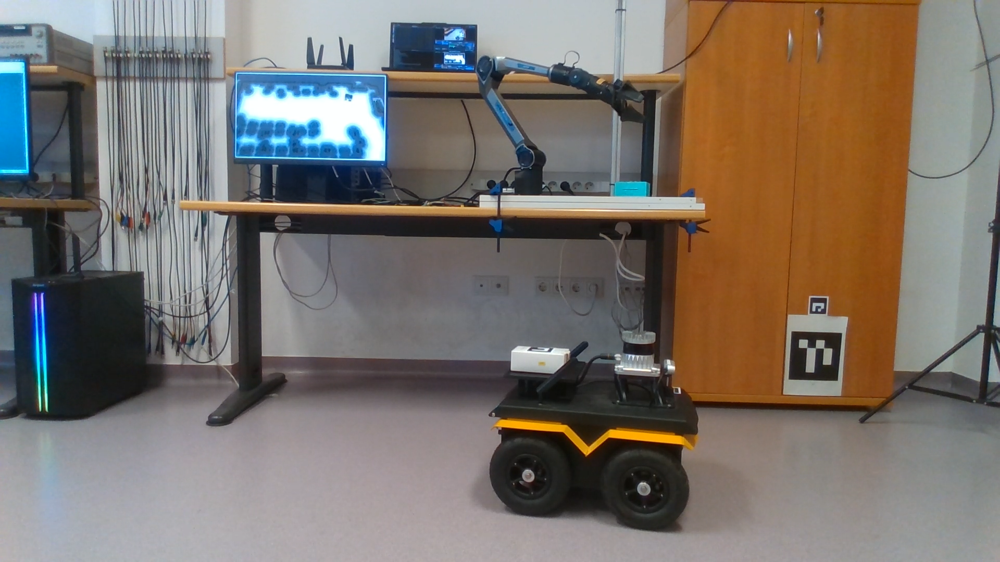{width=480px}
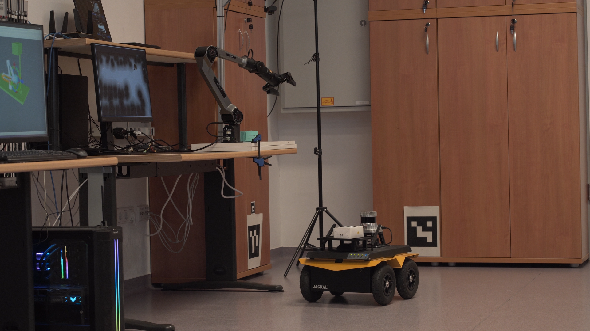{width=480px} 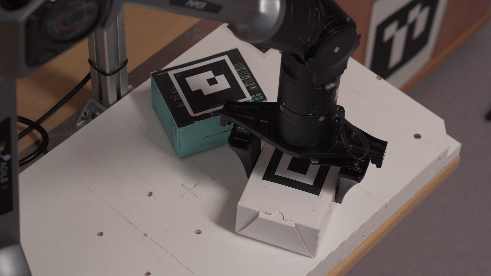{width=480px} 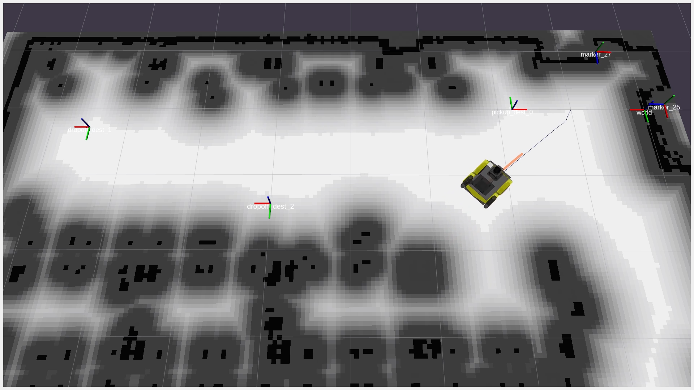{width=480px}
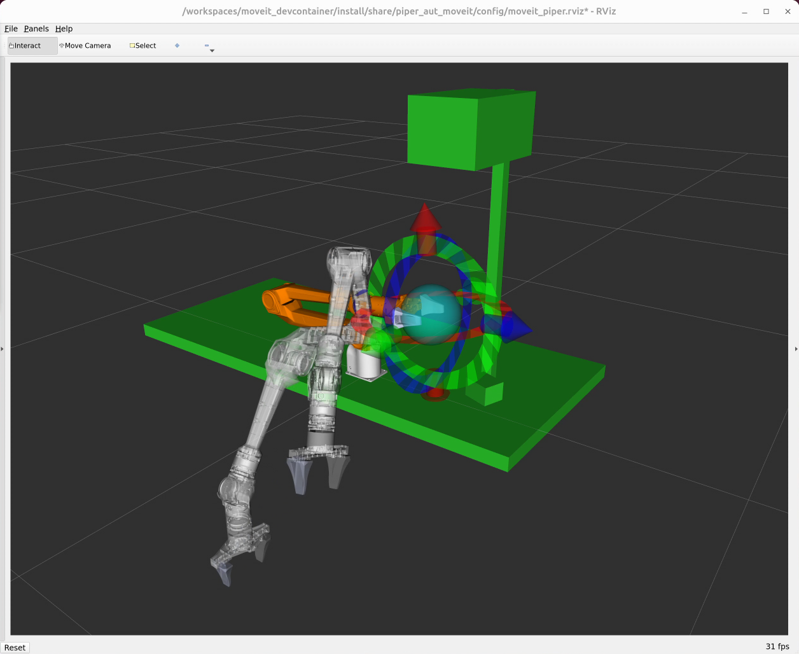{width=480px} 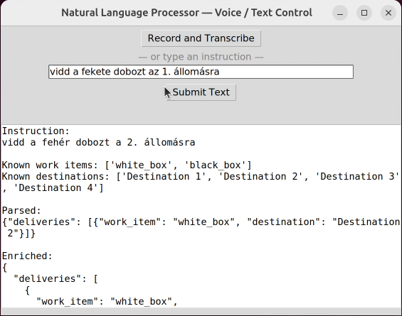{width=480px}
***Ábra:** a videó rétegek sorban: overhead, corner, side, handcam, closeup, llm, rviz, moveit*

## A videó rétegek előkészítése

Bármi is legyen az AI ajánlása, egyszerűbben tudjuk megvalósítani a szerkesztési tervet, ha a nyers videó sávokat amennyire lehet, előkészítjük, értve ez alatt a felvételek szinkronizálását, és a haszontalan részek eliminálását.

### Nyers videó rétegek szinkronizálása

Mivel nem valódi, már a felvételkor szinkronizált multicam felvételt készítettünk, szerkesztési tervtől függetlenül kénytelenek vagyunk kézzel szinkronizálni a videó rétegeket. Ezt célszerű a legelső lépésként megtenni. Ennek eredményeként nyolc sávot kapunk az idővonalon.

### Holtidők kivágása a nyers felvételekből

Következő lépésként vágjuk le a felvételek elindítása és leállítása miatt keletkező haszontalan részeket. Ezután, mivel korlátos a bemutatásra szánt idő és a nézőt sem szeretnénk untatni, vágjuk ki azokat a részeket, ahol nem történik mozgás a rendszerben, csak számítások a háttérben vagy ahol az emberi operátorok belelógtak a képbe. Mivel már szinkronizáltuk a nyers videó rétegeket, ezért a nyolc sávot mindig egyszerre vágjuk!
Az egységbe zárás érdekében, a haszontalan részek kivágása után, a megmaradt nyers klipeket sávonként tegyük egy-egy csoportba (ún. Compound Clip-be), hogy később egy klipként kezelhessük a különböző nézetekhez tartozó rétegeket.

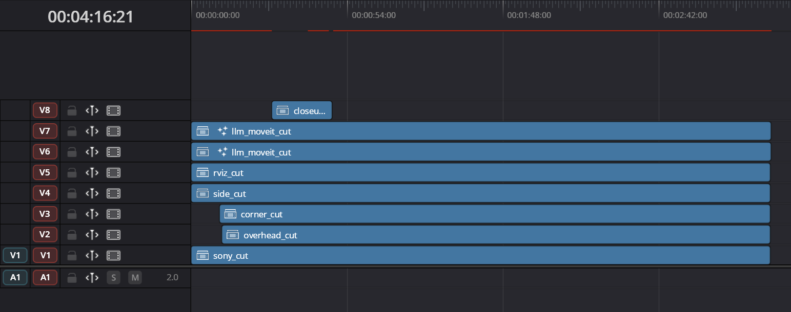{width=720px}
***Ábra:** Idővonal kinézete az előkészítés végeztével*

### Videó szerkesztés tervezése AI eszköz segítségével

A multicam sávok dinamikus váltakozása, illetve az osztott képernyő animálása komplex tervezést igényel ilyen sok réteg esetén, ezért alapvető igény, hogy a Davinci Resolve Fusion komponensét használjuk az animációra, amellyel lehetőségünk van az effektjeinknek komplex végrehajtási sorrendet kialakítanunk, gráf szerkezetbe rendezés segítségével. Az effekt vezérlési gráf kialakítása az a rész, amelyben a leginkább szeretnénk, ha a választott AI eszköz kisegítene minket.

Megemlítendő, hogy egy ilyen Fusion gráf architektúra váz nem generálható a DaVinci Resolve által használt formátumban, erre egyik AI eszköz se képes, így leginkább csak tervezési javaslatot kérhetünk, fizikailag nekünk kell összerakni, és animálni is a rendszert.

A prompt hívásakor nemcsak a Fusion gráf megoldására támasztunk igényt, hanem mivel a teljes tervezési kontextust megadjuk, így teljeskörű megoldási javaslatot várunk, hogyan csoportosítsuk a nyers klipeket, hogyan szervezzük hogy biztosan használható belépési pontunk legyen a Fusion effektek alkalmazása felé a teljes DaVinci Resolve pipelineban. Legfeljebb nem követjük az összes javaslatot, csak amelyeket praktikusnak látunk a saját megoldásunkhoz. Nagy vonalakban, a következő igényeink vannak az elkészítendő videó bemutató felé:
* A videó alapvetően osztott képernyő megoldásokkal dolgozzon
* Nyolc rétegünk van, mindig csak az elérhetőek és relevánsak közül szeretnénk mutatni képet
* A képernyők váltása legyen élettel teli hatású, folytonos és dinamikus, ne legyen ugrásszerű váltás
* Legyen lehetőség a képernyők szélének levágására (Crop), és ez a lehetőség utólag is bármikor könnyen hozzáférhető maradjon
* Legyen aktív lehetőség a méretezésre és mozgatásra (ez valószínűleg szükséges feltétel lenne egyébként is)

**Fontos megjegyzés**, hogy ennél a példánál leginkább, mint komplex keresőmotor szeretném használni az AI modellt, mert a DaVinci Resolve van annyira komplex, hogy szinte lehetetlen, hogy minden generált megoldás kielégítse a felhasználói igényeket. Ellenkező esetben, annyira részletes specifikációkat kéne megfogalmaznom, hogy eleve azt a tudást igényelné, amit épp keresek, ráadásul nagyságrenddel megnövelné a ráfordított időt, ahhoz képest, mint ha manuálisan összeraknám saját kútfőből, némi gyakorlattal. Tulajdonképpen azt szeretném kiváltani, hogy végig kelljen böngésznem 10-20 tutorial videót, ami az esetek többségében a bevett megoldást biztosította régebben. 

***Az átadott utasítás a következő:***

```

🛠️ [SYSTEM ROLE]

You are a Senior Technical Video Editor, Motion Graphics Designer, and DaVinci Resolve Studio Expert specializing in multi-stream video editing, telemetry overlay design, and node-based Fusion workflows for technical demonstrations.

📋 [PROJECT PARAMETERS]

• Subject Domain: [e.g., Autonomous Robotics / Industrial Automation / Surgical Systems]
• Scenario Overview: [e.g., Autonomous multi-agent coordination sequence triggered by higher-level planning UI]
• Target Duration: [e.g., ~3.5 minutes]
• Camera Feeds:
	• Feed C1: [e.g., 85mm Close-up / Focal view]
	• Feed C2: [e.g., Wide-angle / Context view]
	• Feed C3: [e.g., Overhead / Top-down layout view]
	• Feed C4: [e.g., Object-level / Side-view]
• Screen/Telemetry Feeds:
	• Feed S1: [e.g., Path planner / Navigation telemetry UI]
	• Feed S2: [e.g., Manipulator planner / Motion state UI]
	• Feed S3: [e.g., Command input / LLM prompt terminal UI]
• Software & Skill Level: DaVinci Resolve Studio 20.2 (Advanced Node Graph user in Fusion & Color)

📐 [CORE METHODOLOGICAL REQUIREMENTS]

1. Multi-Feed Continuity Rule: Establish a strict continuity rule where at least one physical camera feed is visible at all times. Never drop to full-screen UI takes or black transitions without maintaining spatial context.
2. Modular Layout Engine: Design a universal, dynamic Split-Screen / Picture-in-Picture (PiP) layout system. Provide a generic framework for how primary (accented) vs. secondary (supporting) feeds should scale, swap, and transition fluidly based on key action triggers.
3. Node Graph Reusability: All Fusion recommendations must be structured as modular, macro-friendly Node Graphs (using native Fusion nodes: sShapes, Paint, Planar/Point Trackers, Custom Polygons, Modifiers, and Merge nodes).
4. Informational Hierarchy: Build a clean telemetry and subtitle overlay framework that highlights active states, vector paths, and command logs without obscuring core footage.

📦 [REQUESTED TECHNICAL DELIVERABLES]


1. Modular Multi-Feed Timeline Architecture

• Best practices for setting up Sync Bins, Multicam Clips, and track hierarchy in Resolve Studio 20.2 when combining [N] camera feeds and [M] screen recordings.
• A strategy for managing high-resolution screen captures alongside camera footage.

2. Universal Dynamic Split-Screen Layout Framework

• Layout rules for 2-pane, 3-pane, and 4-pane configurations.
• Logic for selecting which feed takes the dominant frame based on action types (macro navigation vs. fine manipulation vs. text/telemetry).
• Rules for smooth visual transitions between changing screen division geometry.

3. Fusion Node Graph Architecture for Dynamic Layouts

• Step-by-step Fusion Node setup for flexible split-screen grid creation (using DVE, Crop, Transform, Crop/Masking, Matte Control, or Layout nodes).
• How to animate frame division boundaries and focus highlights using Keyframes/Modifiers/Expression bindings.

4. Advanced Path & Vector Infographics (Fusion Node-by-Node)

• Detailed Node Graph build for animated 2D/3D path lines, directional arrows, and boundary zones overlaid onto physical camera footage.
• Workflow for planar tracking or point tracking camera motion to anchor graphics precisely to physical surfaces (e.g., floors, workbenches).
• Techniques for applying pulse, dash-line animation, or glow effects using sRender/sShapes, Paint (Stroke Animators), or FastNoise modifiers.

5. Telemetry & Subtitle Overlay System Design

• System for displaying real-time state changes, subtitles, callout cards, and prompt/command logs.
• Fusion Node composition for responsive lower-thirds and bounding boxes that automatically adjust size to text length.
```

### Válaszok


A teljeskörű megoldási javaslat kérése miatt sokkal bővebb magoldási javaslat adódott eredményül, mint amire ténylegesen szükség volt, ugyanis a felvételek rendszerezése és előkészítése már megtörtént ezelőtt, azon változtatni nem akartam. Amire szükségem volt, az effekt gráf szervezésére vonatkozó ötletek. Ennél fogva kiválogattam a válasz hasznos részeit, amelyeket implementálásra érdemesnek tartottam.

***Hasznos válaszok***

MI:
```
[...]

2. Universal Dynamic Split-Screen Layout Framework
2.1 Panel Tiering (domain-agnostic vocabulary)
* Hero — dominant panel, holds the primary action of the current moment.
* Support — secondary panel(s), provides direct corroborating context (the telemetry behind what Hero shows, or a second camera angle on the same action).
* Ambient — minimal-footprint panel(s), maintains the Multi-Feed Continuity Rule without competing for attention.

Continuity Rule enforcement: at minimum one camera feed (never a telemetry feed alone) must occupy ≥15% of frame area as Ambient at all times, even when telemetry dominates Hero/Support.

[...]

2.3 Pane-Count Configurations

2-Pane (Hero + 1 Support, Ambient omitted or nested inside Support as a corner chip):
* Use when the scenario has low feed complexity at a given moment, or during simple/fast beats where more panels would only add clutter.
* Split: Hero 65–75% / Support 25–35%, either as classic PiP corner or 60/40 side-by-side.

3-Pane (Hero + Support + Ambient):
* The default configuration for most action beats — matches Section 2.2's three-feed-class logic directly.
* Split: Hero 50–65% / Support 25–35% / Ambient 10–15%.

4-Pane (Hero + Support + Ambient + secondary Support):
* Use only for beats needing simultaneous corroboration from two telemetry/camera sources at once (e.g., a Fine Manipulation beat where both a second camera angle AND telemetry are equally necessary — see the original plan's Phase 3b, which used Hero + two stacked Support panels).
* Split: Hero 55–65% / two Support panels stacked or side-by-side at 15–20% each / Ambient 10% or omitted if the two Supports already satisfy the continuity rule.
* Cap at 4 panes — beyond this, legibility of any single panel drops below the threshold where it adds information rather than noise.

2.4 Transition Geometry Rules (pane-count or Hero changes)

1. Any change in which feed is Hero must animate as a coordinated swap: outgoing Hero's Size/Center keyframes to its new tier's slot in the same keyframe range as the incoming Hero animates from its old slot to the Hero slot (see Section 3.2 for the node-level implementation).
2. Any change in pane count (e.g., 3-pane → 4-pane at a Fine-Manipulation beat needing dual corroboration) should animate the existing panels' resize to make room, then reveal the new panel via an opacity/scale ramp — never a hard cut-in.
3. Standard transition duration: 12–20 frames at 24–30fps (0.4–0.7s) — fast enough not to stall pacing, slow enough to read as intentional rather than glitchy.
4. All transition keyframes use Bezier ease-in/ease-out — never linear (reads mechanical) and never a snap/hold (reads like a bug).
[...]
```
Ez az első kiemelt részlet azért fontos, mert nagy mértékben megerősíti az előzetes feltételezéseinket a multicam dramaturgiával kapcsolatban. 
Először is, hogy szükség van egy domináns nézetre, amely jelen esetben a legszemléletesebb vagy képileg legszebb felvétel. Ezt egy technikai, monitoring megjelenítéssel érdemes támogatni, amely aktuális eseménytől függően, számunkra rviz, moveit, UI ablak. Mivel korlátos területen dolgozunk és ez a szállító robot saját térképén is látszik, érdemes kihasználnunk, hogy az ajánlás szerint legyen egy 'ambient'-nek számító, a dominánstól eltérő nézet, amely segít kontextusba helyezni az aktuális eseményt.
A másik fontos információhalmaz, amelyben megerősít az ajánlás, az az, hogy a megjelenített képernyők száma 4-nél több semmiképp se legyen, és hogy a nem domináns felvételek egyenként max 15-25%-át foglalják el a képernyőnek, ezek váltogatásához használt dinamikus be-/kiúszások másodperc töredéke alatt menjenek végbe, és az egyszerre történő legkvesebb mozgás elve legyen érvényben (helycsinálás új nézetnek, stb.).

A számunkra kiemelten fontos javaslatokat a következő részlet tartalmazza:

MI:
```
3. Fusion Node Graph Architecture for Dynamic Layouts

3.1 Core Reusable Panel Node Chain
Build this once as a Fusion Macro/Group Tool ("Panel_Template") so it can be duplicated per feed per phase without rebuilding from scratch:

MediaIn
  → Crop1              (pre-crop: normalize aspect ratio, esp. for S-feeds per Sec 1.3)
  → Transform1          (Size + Center — the primary animated layout parameter)
  → RectangleMask + Border/sShapes outline   (defines panel edge; optional rounded corner via sShapes)
  → Matte Control        (combines mask with source alpha if needed; cleanly isolates panel from Merge background)
  → Merge (onto composite, in tier stacking order: background → Hero → Support(s) → Ambient)

Publish this chain as a Macro (Fusion → right-click selected nodes → Group → Save As Macro) with exposed controls for: Size, Center, Corner Radius, Border Width/Color. This turns every panel instantiation in Section 3.2 into a single macro drop + parameter set rather than a 5-node rebuild.

3.2 Animating Layout Boundary Changes (Hero swaps, pane-count changes)
1. On each Panel_Template macro instance's exposed Size/Center controls, right-click → Animate.
2. In the Spline (Keyframes) Editor, set the swap range (per Section 2.4's 12–20 frame rule):
    * Outgoing Hero: Size keyframes from its Hero value down to its new tier's value; Center keyframes from Hero slot to new slot.
    * Incoming Hero: mirrored animation, same frame range, opposite direction.
3. Set all keyframes to Bezier, then right-click → Smooth for natural ease.
4. For Focus Highlights (drawing attention to Hero without a full geometry swap — e.g., a brief emphasis pulse rather than a tier change): keyframe a subtle Glow node's Glow Size/Gain on the Hero panel only, or a thin Border color-shift, triggered at the exact frame of the underlying action event (see Section 5 for event-sync principles).
5. Expression-binding option (advanced, for reusable rigs): instead of manual per-transition keyframing, bind each panel's Size/Center to a Background node's custom control (e.g., a single "LayoutState" slider from 0–1 representing "Ambient→Support→Hero") via right-click parameter → Connect To…, then write per-panel expressions (ATan, Lerp/Remap via Fusion's expression syntax) that map LayoutState to Size/Center. This lets you drive an entire multi-panel swap by animating a single control per Compound Clip — the most macro-friendly, reusable version of Section 3.2 once you have 3+ projects' worth of comps to justify the setup time.
```

A fenti ajánlások szerint minden egyes képernyő nézethez rendeljünk egy makrót, amely a vezérlés gerincét adja, és láncba szervezett effekt sorból áll a perem levágásoktól a transzformációkig. Nemcsak ez a releváns információ, hanem az is, hogy a makró milyen felhasználói paraméterek mentén lehessen hangolható, ugyanis, amint létrehoztuk, már nem konfigurálhatjuk újra, legfeljebb, ha új makrót alkotunk, és kicseréljük rá a régieket.

Ezt a pipelinet szinte teljes mértékben ésszerűnek és elfogadhatónak tartom, így ezt fogjuk, bizonyos rugalmas módosításokkal impementálni.

Már előre eldöntöttük, hogy a 8 nézetet egyetlen Fusion Clipként olvasztjuk egybe, ami azt jelenti, hogy az összeolvasztott sávok különböző inputként lesznek jelen a Fusion gráfban. Páronként tudjuk csak szimpla Merge nodehoz kötni őket, mivel definiálnunk kell hátteret és előteret minden alkalommal, ezért a Merge nodeot a rugalmas alakíthatóság érdekben ne rakjuk bele a makróba, szervezzük azon kívül.

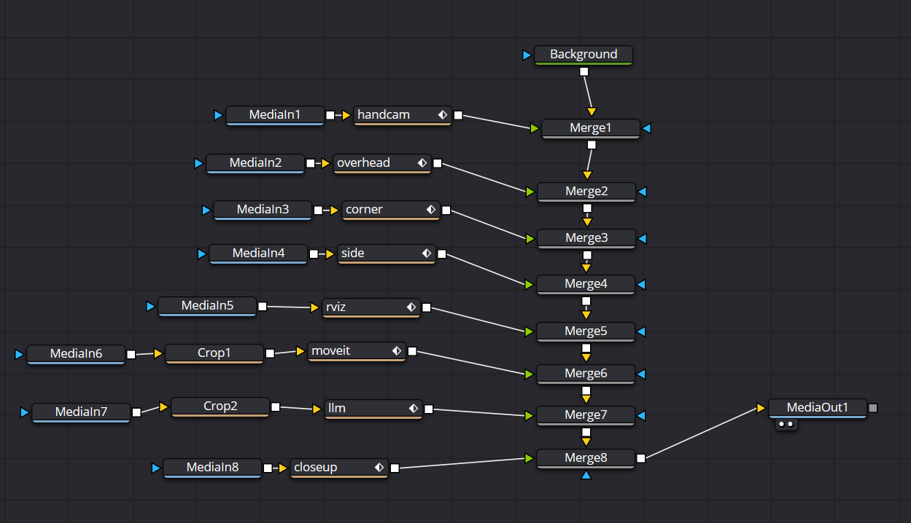{width=720px}
***Ábra:** A Fusion gráf kezdő kialakítása, az AI ajánlásai alapján. A rétegekhez illesztett makró példányokat a rétegek tartalma alapján neveztem el, hogy könnyen átlátható legyen a láncolat. A moveit és llm nézetekhez extra Crop effekteket használtam előszerkesztés gyanánt.*

***A feladathoz nem illeszkedő, egyéb javaslatok***

Ezen válaszrészletekkel sincs alapvető probléma, de mivel a teljeskörű megoldás azon részleteit nem specifikáltuk szigorúan, amelyeket már magunk is megoldottunk, így ezek számunkra felesleges kiegészítések. Ilyenek voltak a következő szempontok, a teljesség igénye nélkül:
* A jelenet dramaturgiája, melyik lépés mennyi ideig tartson. "Vágatlanul" szeretnénk az egész jelenetet közölni, így ennek az ajánlásnak nincs relevanciája.
* Media Pool szervezése. A filok rendszerezése a probléma megoldásának szempontjából irreleváns.
* Szinkronizáció, formátum egyeztetés, multicam clip létrehozása. A Claude feltételezte, hogy ténylegesen felépített multicam rendszerrel rögzítettünk mindent, de ez nem igaz, a timecode szerinti szinkronizációt, a framerate, felbontás egyeztetését már előkészítettük, egységként vezérlehető multicam clipet nem szeretnénk létrehozni, megoldjuk Compound és Fusion Clipek segítségével.
* Általános megfontolások Edit és Fusion tabok használati különbségei mentén. Elsősorban az animáció megoldása érdekel, minden egyéb előszerkesztést ezzel együtt a Fusion nézetben szeretnénk megoldani, ezen szabályalkotások irrelevánsak.
* Infografikai ajánlások. Benne volt a promptban, hogy ha később szükség lenne ilyesmire, ne érjen váratlanul. Mivel a Claude ajánlása külön komponensként kezelte az infografikát, és nem szükséges az alap animáció közé integrálnunk, így ezzel most nem foglalkozunk.


### Hiányzó, nem egyértelmű információk

***A nézetek arányainak értelmezése az elrendezés tekintetében***

Százalékos formában ugyan megkaptuk az ajánlást, hogy a domináns nézet mennyire uralkodjon a képernyőn a többi színesítő felvételhez képest, azonban az elrendezési mód nem volt világos számomra. Emiatt pontosítást kértem:

USER:
```
Give me a graphic explanation about 2, 3 and 4 pane split screen layout recommendations. How to organize screen components on a 1080p 16:9 screen?
```

MI:

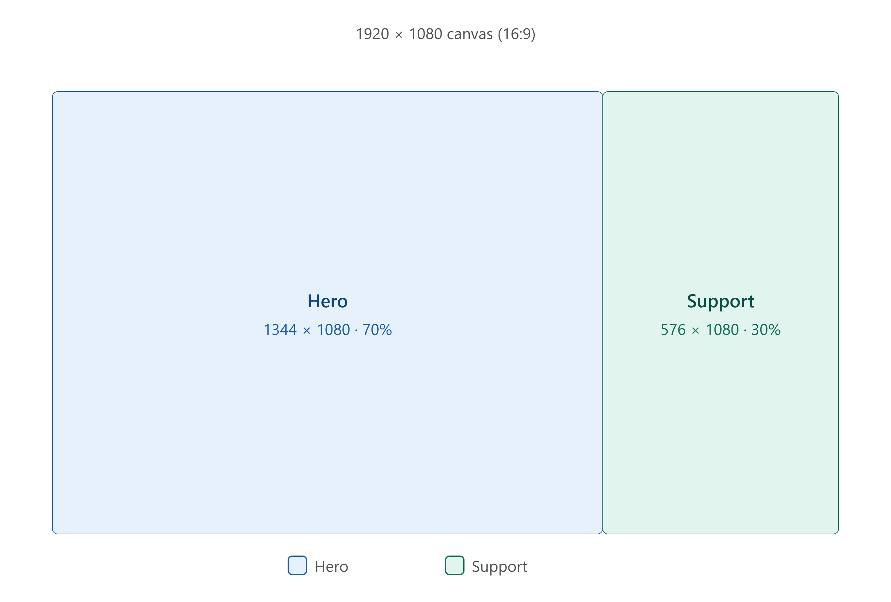{width=480px} 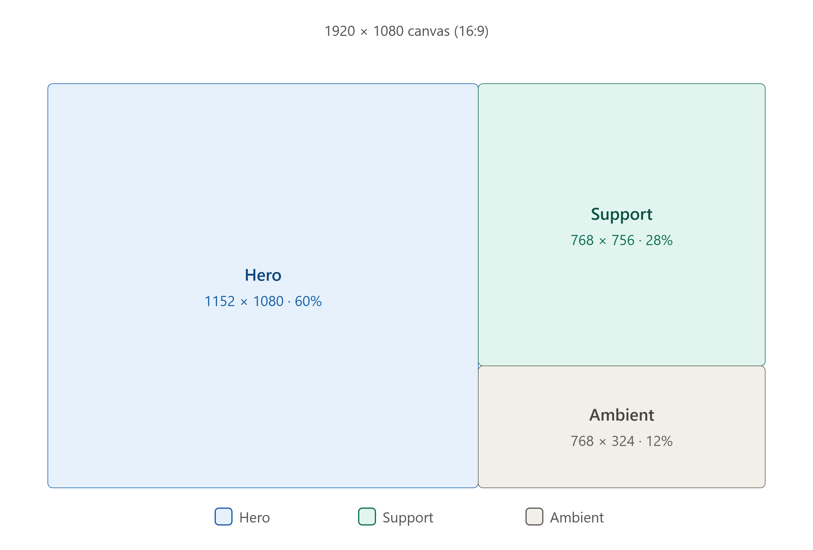{width=480px} 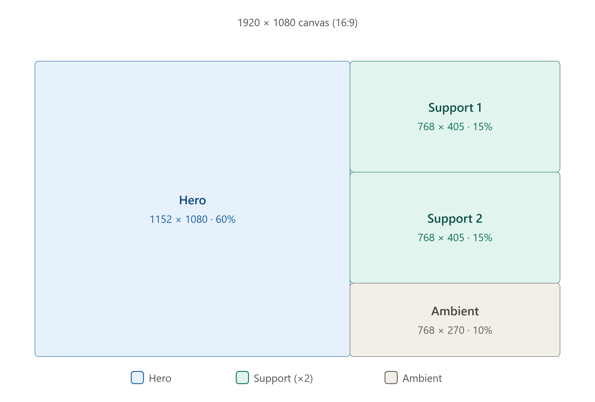{width=480px}

Az visszakapott ábrák alapján az derül ki, hogy az ajánlás alapvetően szó szerint felosztott képernyőről szól. Mivel a felvételeink nagyrész 16:9-es fekvő kép, aminek a nagy része hasznos felvétel, a szélek drasztikus levágása valószínűleg nem lesz számunkra járható út.
A háromfelé osztott képernyő 1/2:1/4:1/4 arányokkal viszont egy veszteségmentes megoldás lehet.
Ezen kívül olyan nézetekkel is számolunk, ahol egy nézet egyben teljes képernyős háttérként is szolgál, és abba beágyazva szerepel kiegészítő felvétel (ami nem feltétlen ér ki a képernyő széléig).

***Átfedési sorrendek aktív változtatása***

A megoldási javaslat alapvetően addig terjed, hogy előre kitaláljuk azt a sorrendet a felvételek közt, amilyen módon egymást fedhetik. Amennyiben tényleg a képernyő szigorú felosztását követnénk, ezzel nem sok problémánk lenne, hiszen nem alakulna ki átfedés a felvételek között.
A háttérként használt felvételbe ágyazott kiegészítő képernyők módszere azonban újabb kihívás elé állít. Előfordulhat például, hogy egyszer az térképezést szeretnénk teljes háttérként használni, és az élőképet beágyazni, másszor pedig egy nagy látószögű élőképre szeretnénk a térképet illeszteni illusztrációként. Ha ez a két nézet oda-vissza ugyanaz, meg kell cserélnünk az átfedési sorrendet, azaz a Merge sorrendjét a két nézet között.
Ehhez szeretnénk egy olyan megoldást, amellyel egy adott nézet duplikációja bárhova beszúrható a gráfba és opcionálisan kikapcsolható, szükség szerint. Kérjük meg az AI-t, hogy adjon tanácsot:

USER:
```
How to organize my Fusion graph nodes if I want to change overlap order of two screens?
```

MI:
A mesterséges intelligencia ajánlása, hogy Switch nodeot használva, alakítsunk ki küönféle merge láncolatokat, és igény szerint váltsunk a kettő között. Ez egy ésszerű, általános megoldás, olyan esetekben is, amikor egymástól jelentősen különböző merge sorrendre is szükségünk van.

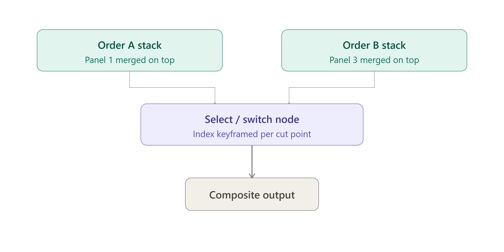{width=480px}

Mivel azonban csak az rviz nézetet szeretnénk több képernyő fölé lapolva is használni, erőforrás pazarló lenne feleslegesen olyan merge sorrendek felépítése, ami alig tér el az alapból használttól. Fordítsuk meg a sorrendet, és a rétegek effekt utáni kimeneteit kössük a Switch nodeba, ahol váltani akarunk, és a Switch kimenetét kössüg a Merge nodehoz. 

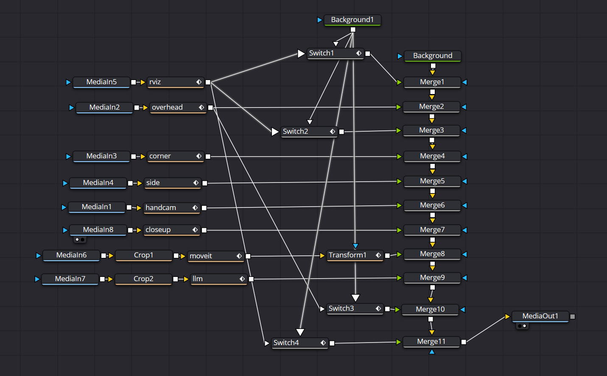{width=720px}
***Ábra:** Fusion graph kiegészítése annak érdekében, hogy az eredeti merge sorrend ne jelentsen gondot az egymásra lapolásnál. Az eredeti merge sorrend okos megválasztásával elkerülhető, hogy túl sok patchelésre legyen szükség, és a gráf átláthatatlanná váljon.*

## Eredmény

Innentől kezdve a felhasználó dolga, hogy a DaVinci Resolve keyframe rendszerén keresztül animálja a dinamikus váltásokat a képernyők között.
A megoldási javaslatok összességében hasznosnak bizonyultak, fontosnak tartom megadni az AI számára a teljes kontextust, amely keretein belül dolgozunk, viszonylag részletesen, így talán jobban eliminálhatjuk azokat az eseteket, amikor véletlenül alulspecifikálunk egy következő kérdést, és emiatt helytelen, nem a helyzetünkhöz passzoló választ kapunk.

Végezetül néhány képernyőkép a megvalósult elrendezésekből, a kész videón belül:

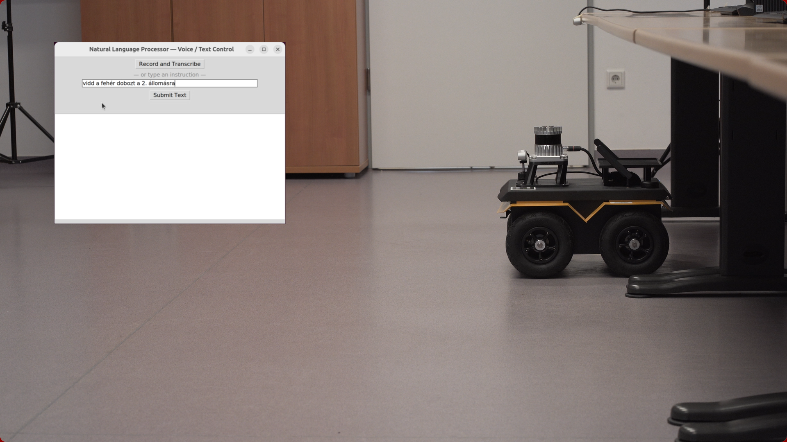{width=480px} 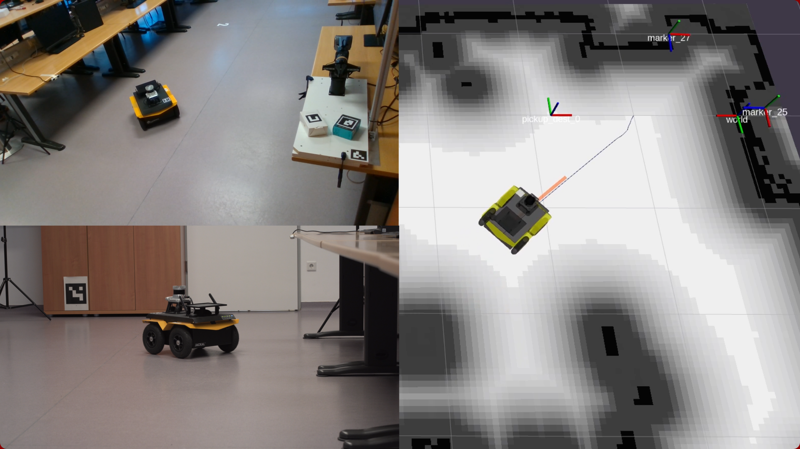{width=480px} 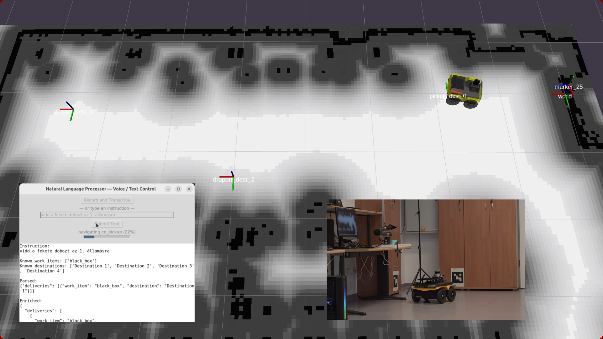{width=480px}
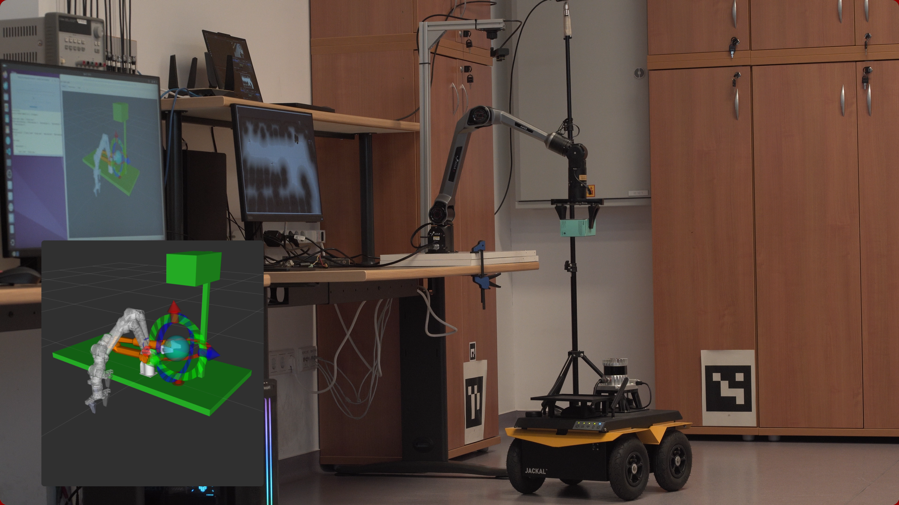{width=480px} 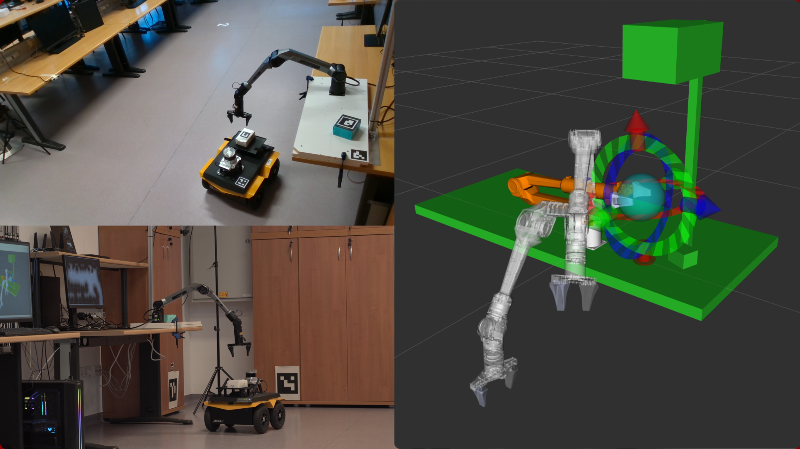{width=480px} 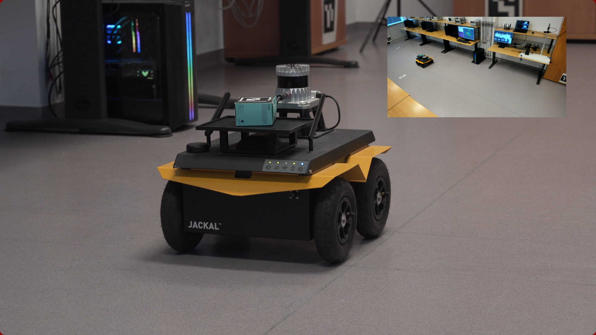{width=480px}