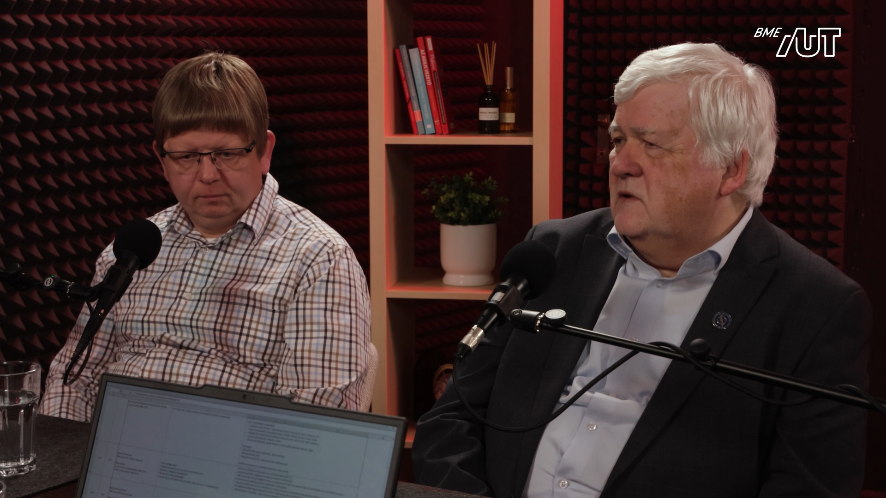
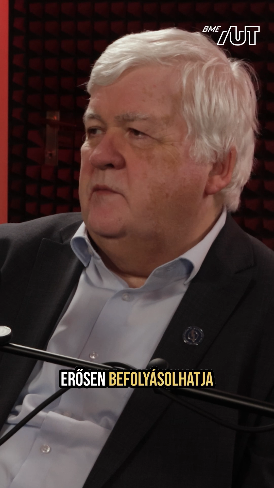
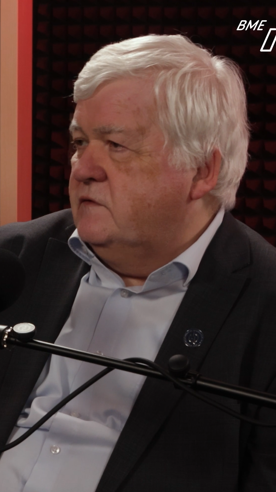
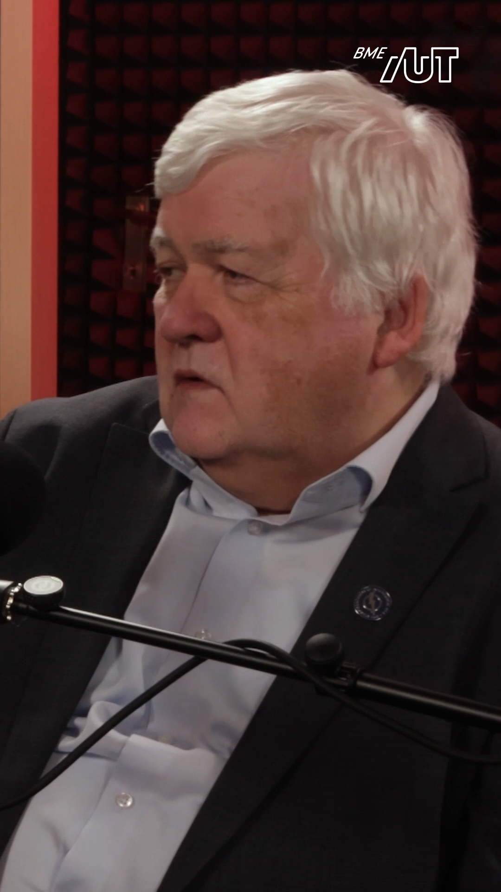
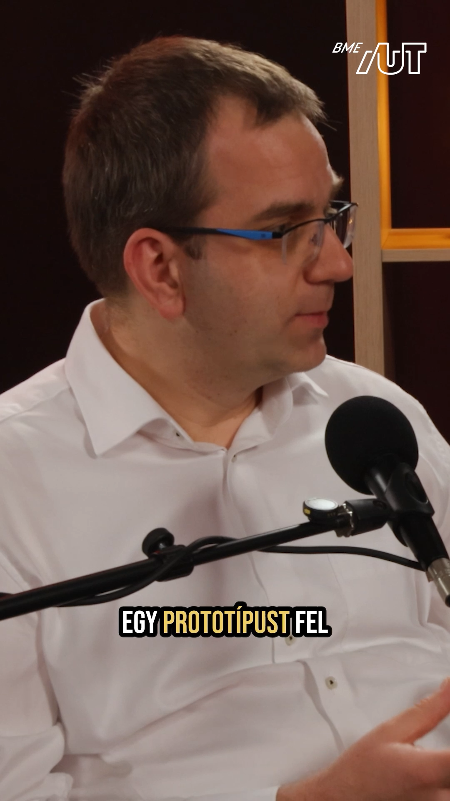
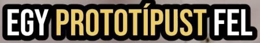
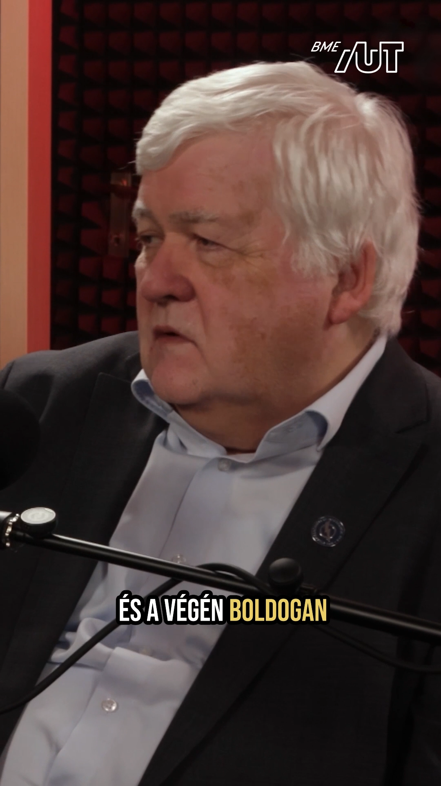

# DaVinci Resolve x AI - Felirat stílus visszafejtése short video sorozathoz

Elmész egy podcast-stúdióba. Vásárolsz egy szolgáltatás csomagot, amely a teljes szerkesztett beszélgetés mellett tartalmaz néhány rövid részletet, álló short video formájában. Csak utólag jössz rá, hogy szükséged lenne több kivágott részletre is, de a hivatalos szolgáltatás keretében az már amúgy is feláras lett volna. A kifizetett, szerkesztett videókat nem akarod kidobni és újracsinálni, de jó lenne ugyanabban a stílusban legyártani a saját kivágásokat is. A méretezést, kép levágásokat, logo eltűntetést, némi gyakorlattal akár szemre is meg lehet csinálni, de a felirat pontos animációs stílusát, betűtípust megtalálni nehéz feladat. Hogy lehetne mégis megszerezni a szolgáltató eme üzleti titkát?

## A kezdeti állapot és annak eléréséhez végzett módszerek

{width=720px}
***Ábra:** Nyersanyagként használt, eredeti, fekvő videó*

Az egyetlen forrásunk, amiből kiindulhatunk, az a kapott teljes terjedelmű, fekvő podcast beszélgetés. Ahhoz, hogy úgy tűnjön, mintha a saját short videóinkat is a podcast szolgáltató készítette, álljon itt egy példa a kapott short videók közül, hogy milyenné kell alakítanunk a fekvő videót.

{height=720px}
***Ábra:** Példa az egyik eredeti short videoból, hasonlóan kell kinéznie a sajátunknak is*

Az előzőek alapján három feladatot különíthetünk el:
- Kivágás és méretezés
- Régi logo eltávolítása, új logo illesztése
- Felirat készítése

### Méretezés álló formátumra

A fekvő videóból való kivágás, nagyítás, álló formátumra méretezés, az eredeti short példát referenciának használva könnyedén, szemmértékkel is véghezvihető, egyszerű transzformációs műveletekkel. Ezek eredménye:
{height=720px}
***Ábra:** Eredmény a fekvő nyersből való, short videó célú kivágás után*

### Logo javítás

A kép sarkában marad eredeti logo részletet el kell valahogy távolítani, és a hivatalos short video példa alapján újat kell illeszteni. Ez már nehezebb feladat, de elfogadható eredménnyel megvalósítható, a DavinciResolve Color oldalán, *Object Removal* és *Lens Blur* effektek segítségével. (Azok számára, akik nem rendelkeznek ismerettséggel a DaVinci Resolve lehetőségeinek a terén, természetesen ezen effektek megtalálásához is használható bármely LLM UI, mint keresőmotor.)

{height=720px}
***Ábra:** A logo javításának eredménye*

## A felirat animáció azonosítása

Amikor a feliratozás reprodukálásának igényével szembesülünk, a következőket állapíthatjuk meg:
- Függetlenül attól, hogy nem tudjuk, a szolgáltató milyen sablont használt, egyáltalán milyen szoftverrel dolgozott, DaVinci Resolvon belül találhatunk megfelelő felirat sablon, *Word Highlight* néven, így a továbbiakban ezt szeretnénk használni.
- A betűk és a kiemelések színét egyszerűen mintavételezhetjük a hivatalos álló rövid videóból.
- A fekete körvonal vastagságát, az eredetivel egymásra illesztve szabad szemmel kimérhetjük.
- Az eredetileg használt betűtípust nem ismerjük, ami nélkülözhetetlen az eredetivel egyező látványhoz.

**Az ötlet az, hogy próbáljuk meg AI model segítségével meghatározni a keresett betűtípust!**

## Font azonosítás AI segítségével

Adjunk át egy jól megválasztott példát a keresett betűtípusra, az valamelyik eredeti, feliratozott videóból! A cél, hogy olyan karaktereket tartalmazzon a példa, amelyeken keresztül a leginkább megkülönböztethető kétféle betűtípus. A tapasztalatok alapján ilyen karakter az **R** vagy a **G**. A választott részlet tartalmazza ezen karaktereket, továbbá számos további karaktert is, amely segítheti a jobb találatok elérését.

{height=720px}
***Ábra:** Egy eredeti videóból mintavételezett példa, betűtípus meghatározásához*

### AI model és prompt

Eléggé leszűkítettük a problémát ahhoz, hogy ne legyen szükség bonyolult utasításra a választott LLM számára. Ne csak egyetlen modelltől kérjünk megoldást, a két használt modell ezúttal a Claude Sonnet 4.6, illetve Gemini 3.1 Pro.

***Az átadott utasítás a következő:***


```
What is the font type on the image I attached? The outline does not matter, only the shape of the characters.
```

### Claude találatok

MI:
```
The font appears to be **Impact** (or a very similar condensed sans-serif like **Haettenschweiler** or **Anton**).

Key characteristics that point to this:

-Very tall, narrow (ultra-condensed) letterforms
-Thick uniform strokes with minimal variation
-Tight letter spacing
-All-caps with flat terminals
-No serifs

**Anton** (available free on Google Fonts) is essentially the web/modern equivalent of Impact and would be the easiest to use if you're recreating this style digitally.
```

### Gemini találatok

MI:
```
Based on the shape and characteristics of the characters, the font belongs to the bold, condensed sans-serif family.

It is highly likely to be **Bebas Neue**.

Here is a breakdown of why, along with a couple of closely related alternatives:

-**Bebas Neue**: This is the most probable match. It's a massively popular font for video editing, thumbnails, and bold headers. The uniform thickness, the tall and narrow (condensed) proportions, the straight vertical right-side drop on the "G", and the specific angles on the "Y" and "R" all perfectly align with Bebas Neue.

-**League Gothic**: This is another very similar open-source font that shares the same historical roots (inspired by Alternate Gothic). It has almost identical proportions and shapes.

-**Oswald (Bold)**: While slightly more geometric, Oswald also has a very similar tight, condensed footprint, though its curves are usually a bit more open than what is seen here.

If you are trying to replicate this text, downloading and using **Bebas Neue** will give you a nearly identical result.
```

## Találatok értékelése

A két modell többféle lehetséges megoldást is talált a betűtípus kilétére. Ezeket az ajánlásokat először érdemes az említett kritikus karakterek összehasonlításával megvizsgálnunk, így anélkül zárhatunk ki jelölteket, hogy alkalmazás közben kellene tesztelnünk őket.
Amely típusokat nem tudtunk kizárni szemrevételezéssel, érdemes úgy kipróbálni, hogy az eredetire rétegként keverve megpróbáljuk a ugyanazon jelenet feliratozását reprodukálni. H a tökéletes illeszkedés révén megtaláljuk a helyes betűtípust, egyúttal megkapjuk a felirat pontos pozícióját és méretezését is a jelenetben.

A vizsgálatok eredménye alapján a Gemini által javasolt **Bebas Neue** pontosan az a font, amelyet a szolgáltató is használt a feliratokhoz. Érdemes összevetni az egyik eredeti rövid videót a sajátunkkal:

{height=720px} {height=720px}
***Ábra:** Eredeti short videó példa vs. saját short videó példa - Feltűnő a különbség?*


## A módszer további javítási lehetőségei

- A prompt mellé csatolt kivágott kép a feliratról nem tartalmazta a teljes karakterkészletet. Ha nem kaptuk volna meg a helyes találatot, elképzelhető, hogy a teljes ABC mintavételezése és átadása segíthetett volna ezen.
- A prompt szövege nem tartalmazta azt az információt, hogy a kiragadott felirat vélhetően a DaVinci Resolve *Word Highlight* sablonjával készült, illetve annak milyen egyéb beállítási feltételezhetőek. Ez jelen esetben nem okozott problémát, de akár egy belső árnyékolás vagy extrém textúra, a kontúrral együtt már befolyásolhatta volna a találatok sikerességét.