# DaVinci Resolve x AI - Color Grading

## Motiváció 

Az ún. color grading a videó utómunka egyik olyan feladata, amely előzetes ismereteket, módszereket, tapasztalatot igényel ahhoz, hogy jó minőségű eredménnyel járjon. Ennek elsajátításhoz, főleg a tapasztalatszerzés része miatt, idő kell. Időnk az márpedig nincs, ha nem videó utómunka a fő foglalkozásunk, csupán egy laklami videót el szeretnénk készíteni.
Kézenfekvő volna útmutatókat keresni, tutorial videókat nézni, de mi a garancia, hogy ezek tényleg minőségi információval szolgálnak? Elég magabiztosak vagyunk egyáltalán a saját esztétikai érzékeinkben, hogy adaptálni tudjuk ezket a módszereket?
Tegyük fel, hogy DaVinci Resolve szoftvert használunk. Rendelkezésünkre áll a a hivatalos User Manual is, hogy segítsen. Azonban 4000+ oldalas, ember legyen a talpán, aki képes végigolvasni.
Tegyük fel azt is, hogy szerencsére van némi alap tudásunk az utómunkával és a szoftver használatával kapcsolatban is, amellyel gazdálkodhatunk, így azzal tisztában vagyunk, mihez kéne nyúlnunk, de az említett, tapasztalatot igénylő szaktudásnak híján vagyunk.
Vegyünk igénybe AI segítséget! A példában a Claude AI-ra esett a választás. Az ötlet az, hogy mivel a DaVinci Resolve tudása verzióról verzióra változik, ezért a 20-as verzió User Manualjának feldolgozásával készítsünk skillt, első lépésként. Ezután próbáljuk ki a tudást, egy teljes color grading megoldás felépítésére, a körülmények és célok megadásával! Végül pedig kísérlet gyanánt használjunk referencia videót a color gradingre, "nézzen ki úgy, mint a Batman"!


## 1. Skill készítés DaVinci Resolve 20 Reference Manual felhasználásával

### *Felhasznált forrás*

A DaVinci Resolve 20 szoftverhez többféle dokumentáció létezik a különböző komponensei számára, viszont nekünk az általános szoftverhsználatot lefedő 4000+ oldalas Reference Manual-ra van szükségünk. Az egyéb, starting guide, illetve scripting manual jellegű dokumentumok speciális területeket fednek le, azokat nem vonjuk bele a skillbe ezúttal.
A odkumentumot megkaphatjuk a szoftver telepítése révén, ez talán a leghitelesebb forrás, ahonnan beszerezhetjük, annak érdekében, hogy tényleg a megfelelő szoftver verzió dokumentációjából tudjunk dolgozni.

### *Előkészítés*

A Reference Manual pdf formátumban elérhető és tele van illusztrációkkal, képekkel. Ez azért lehet probléma, mert a képek feldolgozása és mapelése sok ráfordítást igényelhet az AI modell által, holott számunkra igazán a szöveges leírások is elegendőek lennének.
Éppen ezért érdemes szöveges fileként exportálni a pdf tartalmát. Ha az Adobe hivatalos pdf olvasójával teszzük ezt meg, a szöveges fileban a láblécek, képaláírások is megmaradnak, amelyek zajként lehetnek jelen, ezért átadhatnánk egy AI modellnek tisztításra a szöveges fájlt még egy lépésben, ebben a példában azonban nem foglalkoztam ezzel a problémával, az egy lépésben exportált szöveges fájlt használtam referenciaként a skill készítéséhez.

### *davinci-resolve-20 skill fejlesztése*

#### Prompt

A skill létrehozásához a Claude által támogatott skill-creator használata mellett döntöttem. Az előre előállított DaVinciResolve.txt fájlt csatolva a következő utasítást adtam.

USER:
```
/skill-creator
 Create a new skill with a name 'davinci_resolve_20' based on attached txt converted user manual of DaVinci Resolve 20. Skill must contain all the information the original user manual does in order to use the skill later to navigate through the actual software and get answers for any questions related to DaVinci Resolve 20.
```

MI:
Eredményül adta az elkészített skillt, amit el is mentettem. Nem foglalkoztam az eredmény ellenőrzésével, rábíztam az egészet a skill-creatorra.

## 2. Color Grading tervezés, saját specifikáció alapján

### *Előkészítés*

Adott egy nyers felvételekből szerkesztett viedó, már csak a color grading feladatok vannak hátra. Nem szeretném az egészet feltölteni az AI számára, és azt szeretném, hogy az időzítésekkel se foglalkozzon, a munkát szűkítse csak a color grading feladatokra. Éppen ezért egy rövidített mintát vágtam ki előzetesen a teljes videóból, olyat, amely tartalmazza az összes előforduló nézetet, ahol a color grading eltérhet.
A feladatot saját információim mentén szerettem volna pontosítani, amennyire lehet, ugyanakkor nem fordítani túl sok energiát a prompt elkészítésére, hogy az már ne érje meg a vele való foglalkozást.
Azt viszont fontosna tartottam definiálni, hogy milyen céllal készül a videó és milyen általános kinézete, hangulata kell legyen, illetve rögzítettem azokat a fontos beállításokat és eszköz paramétereket, amelyeket a felvételkor használtam.

### *Color node graph tervezés*

#### Prompt

Feltöltöttem a minta videót, és az elkészített davinci-resolve-20 skillre való hivatkozás mellett a következő hívást eszközöltem.

USER:
```
/davinci-resolve-20
I want you to act like a professional video editor with a lot of experience in color grading. I have a short video sample attached and I want to color grade in DaVinci Resolve 20.
Provide me a complete professional solution for a node graph on color page considering basic corrections, white balance, noise reduction, creative coloring, color space transform and every single aspects usually considered in order to achieve desired look. 
Graph should contain maximum about 5-10 nodes and and there should be considered when to use remote or local grading, groups with pre or post group nodes or shared nodes or timeline nodes if necessary.
Given sample is not the actual video, it is only a reference, so do not deal with timing.

Point of the result:
- It is gonna be an unboxing video for a robotic arm at a university department made for anyone who is interested in our current works especially for students. Let the video have clear aesthetics and technological vibes in general.

Raw video recording conditions:
- camera body: Sony A7III
- camera lenses: Sony 20mm f1.8 G
- misc settings: auto white balance, continuous auto focus, PP5 picture profile
```

MI:
Eredményül adott egy tartalmas kivonatot, amely részletes javaslatokat tesz a node graph felépítésre és első látásra ésszerűnek tűnik.
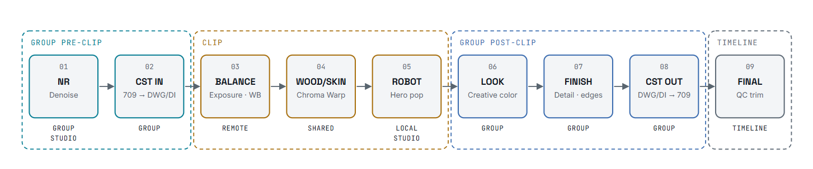{width=1080}

A teljes kivonat lementhető volt html formában, letölthető [innen](resources/Agile-X%20Grade%20Plan.html).

A részletes terv mellett, ami lényeges, hogy konkrét beállítási javaslatokat kaptunk az egyes nodeokhoz, így a továbbiakban ezeket alkalmazva vizsgáljuk az eredményeket.

#### Teszt

A node graph felépítése lépésről lépésre, a pontos ajánlások mentén történt. a Clipjeimet remote grade módba tettem, és egy groupba illesztettem, így a gráf pipeline 4 szekcióra különíthető, group pre-clip (group közös előzetes beállítása), clip (egyéni clip beállításaok), group post-clip (group közös utó-beállításai), timeline (globális ) 9 nodeot hoztam létre a következő tulajdonságokkal:
1. **Group Pre-Clip**
    - Noise Reduction: csak zajszűrés
    - Color Space Transform In: azért kell, hogy a nyers kép dinamikáját még jobban komprimáljuk (szürkés, kontrasztszegényebb, színszegényebb megjelenés az eredmény)
2. **Clip**
    - Basic Correction: white balance, expo, kontraszt, szaturáció korrekciók nnak érdekében, ohgy kiegyenlített képünk legyen, amire a kreatív építkezést folytathatjuk
    - Wood/Skin: kifejezetten a barnás, narancsos, pirosas színek megszelidítésére, hogy a bőrszínek élethűek maradjanak, a szekrények ne legyenek lilásak
    - Details: shadow felhúzás és midtone erősítés, kontúrosabbá tétel céljából
3. **Group Post-Clip**
    - Creative: kreatív színeltolások, kontraszt, szaturáció
    - Finish: élesítés, kiemelés, általános kontúr erősítés
    - Color Space Transform Out: a Color Space Transform In lépés inverze, az összenyomott képi dinamikát újra széthúzzuk, pont annyira, amennyire az elején komprimáltuk
4. **Timeline**
    - Final Trim: globális egységesítés, kiégés elleni kompenzáció, enyhe mesterséges zaj képhez keverése

A nodeok alkalmazása után a következő eredményeket értem el a videó mintákban. A következő képeken az eredeti és az ajánlott Color Gradinggel ellátott minták láthatók:

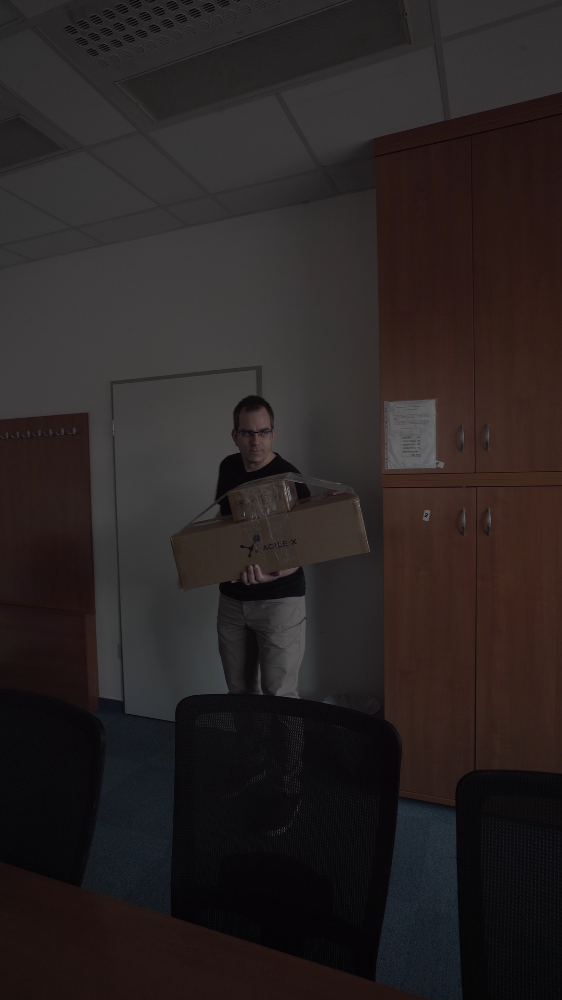{width=320}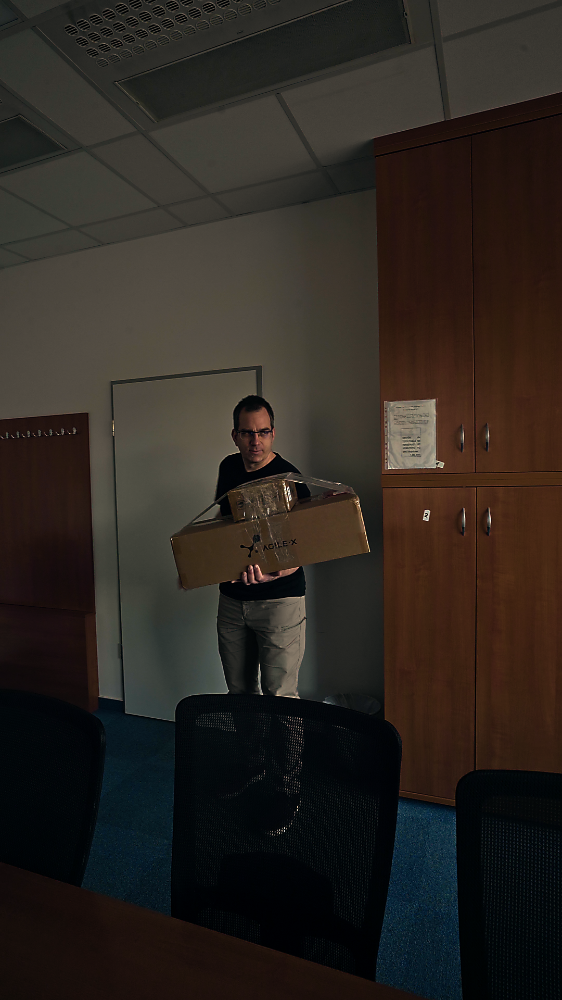{width=320}
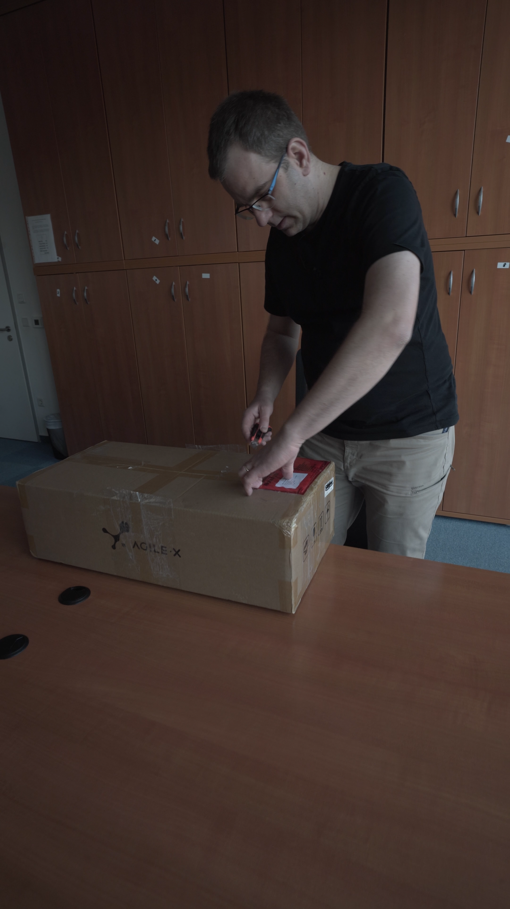{width=320}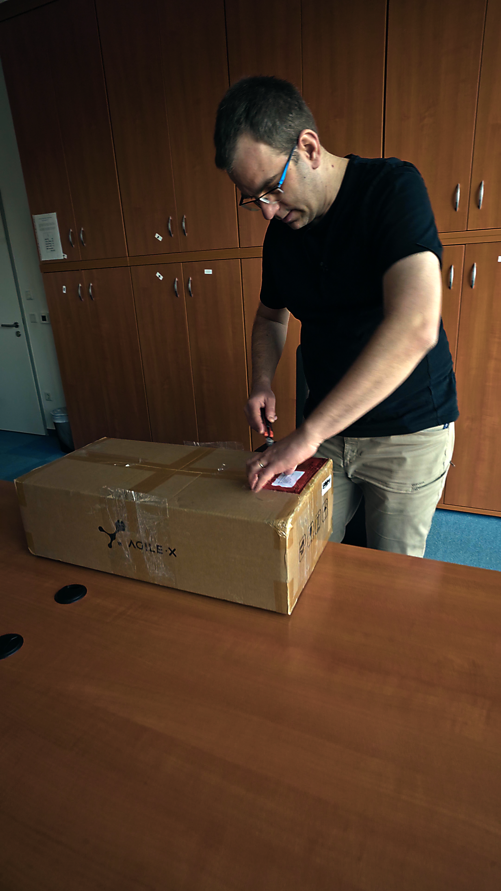{width=320}
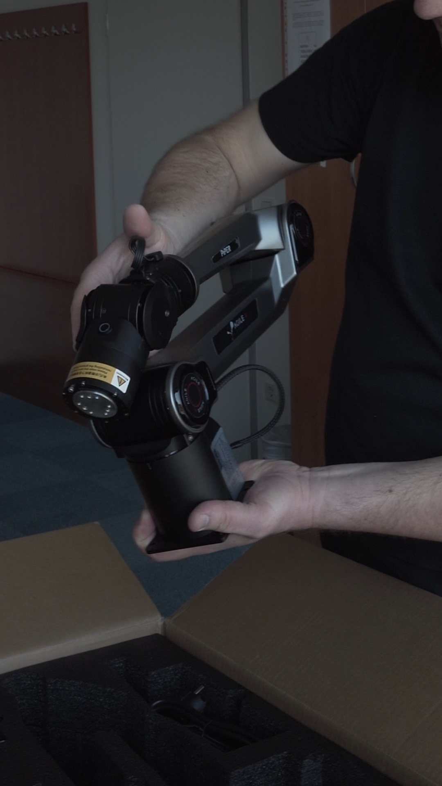{width=320}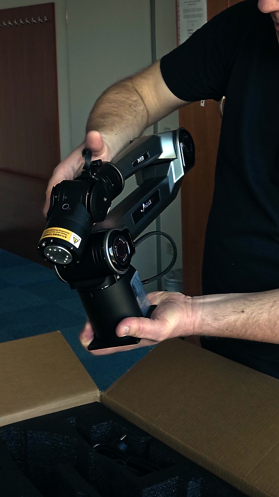{width=320}


### *Color node graph módosítása képi referencia mentén*

Az ajánlott Color Grading megfelelően működött, így jó alapot biztosít a további célok eléréséhez. A munkamenetet folytatva, próbáljuk ki, hogyan lehet elérni a 2022-es Batman film, többnyire éjszaka játszódó, vöröses kinézetét.

#### Prompt

Kerestem egy minta jelenetet az említett Batman filmből, és feltöltöttem referenciaként, utasítva az AI-t, hogy ennek megfelelő kinézetet alakítson ki a saját videónkhoz is.
[A példa jelenet.](batman_sample.mp4)

USER:
```
Keep the node structure but provide refined actual parameter values in order to look like the shots in batman_sample.mp4 video attached.
```

MI:
A javasolt megoldást megkaptam, de az AI által készített minta képek túl kontrasztosnak és szaturáltnak tűntek, a megjelenés alapvetően hibásra sikerült, ki se próbáltam a DaVinci Resolveban.
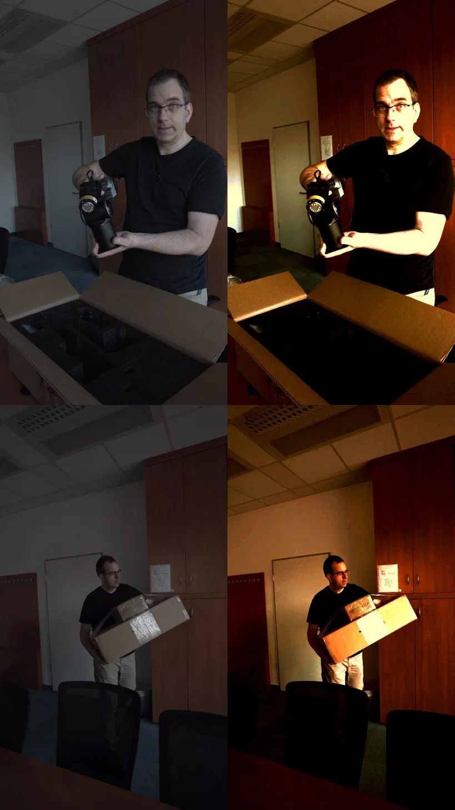{width=480}

Rájöttem, hogy specifikációs hibát követtem el, ugyanis a filmjelenetben éjszakai körülmények vannak, a saját videónkban pedig fényes nappal, az expozíció viszonyok teljesen különböznek, így az AI figyelmét fel kellene hívni arra, hogy vegye ezt figyelembe, és a hangsúlyt a kreatív színezésre helyezze, amin változtatni kell leginkább.

USER:
```
Refine the last solution considering that batman sample was a night shot while my own video is by daylight. You should only take color grading style from batman sample not necessarily matching the actual histograms.
```

MI:
Az eredményül adott kivonat és minta képek alapján biztatóbb eredmény született ezúttal, így ezt érdemes is kipróbálni a szoftveren belül is.

Az új teljes kivonat ismét lementhető volt html formában, letölthető [innen](resources/Agile-X%20Grade%20Plan%20Batman.html).

#### Teszt

A node graph új felépítését megvizsgálva, lényeges mértékben csak a 6. node, a kreatív színezés változott meg igazán. A beállítások részletes leírása mellett kaptunk egy ajánlott letölthető LUT-ot, amelyet a 6. nodera alkalmazva azonos eredményt kapunk, mint a kézi beállításokkal, így én is ezt használtam teszt gyanánt. 

Az új beállítások alkalmazása után a következő eredményeket értem el a videó mintákban. A következő képeken az eredeti, az előző ajánlott és a Batman mintához igazított Color Gradinggel ellátott minták láthatók:

{width=320}{width=320}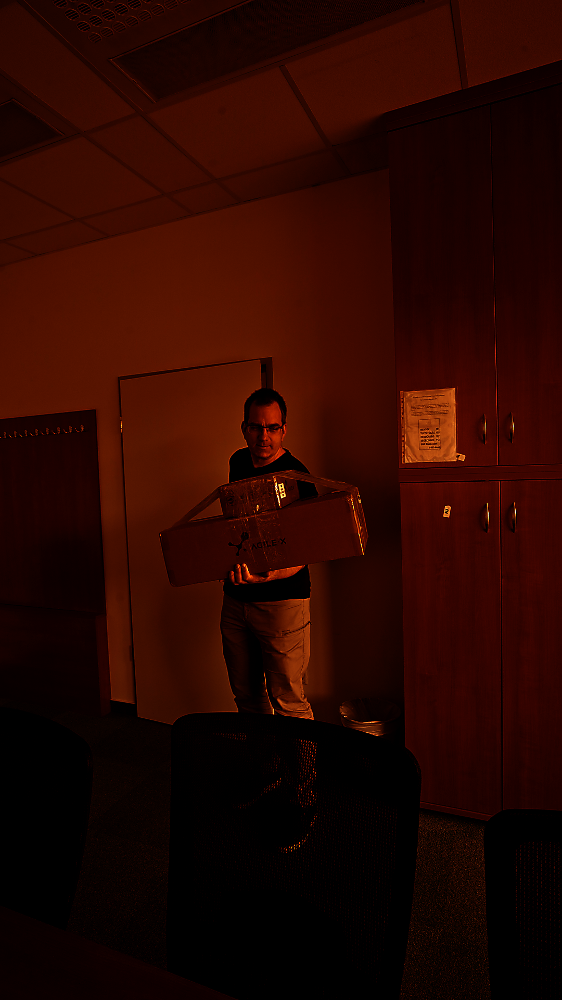{width=320}
{width=320}{width=320}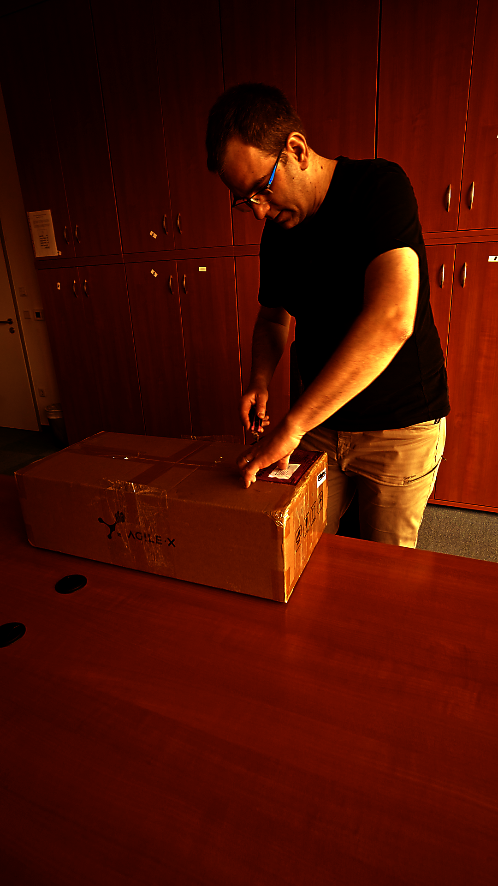{width=320}
{width=320}{width=320}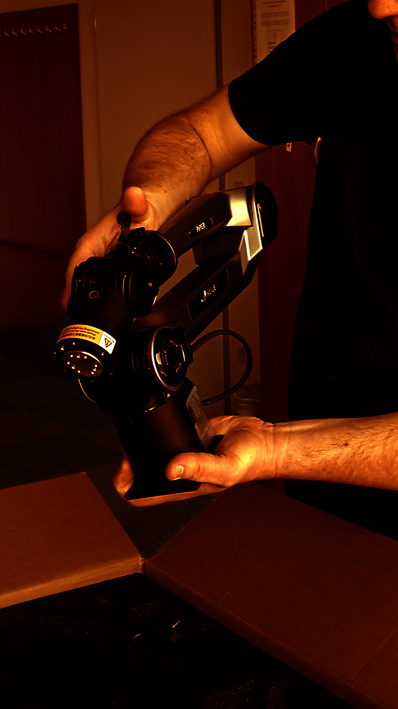{width=320}

Az előző megoldáshoz képest a vöröses képek a valóságtól nagyon elrugaszkodottnak tűnnek, de a film jelenetében valóban hasonló színképet láthattunk. Persze a nappali fényviszonyok miatt, ha tényleg ezt szeretnénk alkalmazni, esztétikusabb volna csökkentett mértékben hozzákeverni a színezést.
Ezt könnyedén megtehetjük a node graphon belül is, layer mixer node és egy effect nélküli párhuzamos node réteg hozzáadásával.
Ami számunkra fontos az eredmény kapcsán, az nem a valósághűség, hanem hogy az erősen vöröses színárnyalatok felé való eltolás ellenére, a kép kiegyenlített marad az expozíció tekintetében, se a csúcsfények, se a feketék nem telítődnek, a módosítás nem roncsolja a képet.

## Tanulságok

- Maga a node graph ajánlás kielégítőnek bizonyult, kevés kivétellel minden beállításhoz pontos paraméter érték javaslat érkezett, amelyek helyes beállítások voltak.
- A Color Warper (Wood/Skin node) igényelt egyedül komoly odafigyelést, hiszen folyamatosan monitorozni kellett a bőrszíneket és a baran szekrény színét, ezek annyira összetett feladatok, hogy konkrét beállítás nehezen adható meg hozzá. Némi tapasztalatot igényel emiatt a szoftverhasználat terén, hogy biztosan a megfelelő előnézetet vizsgáljuk.
- Érdemes nem sorban haladni, hanem először a group pre és group post részeket felépíteni, hogy már ezeken a technikai nodeokon keresztül monitorozhassuk az eredményeinket munka közben is.
- Hiába a pontos ajánlások, a node graph figyelmes felépítése így is viszonylag hosszadalmas munka, legjobb volna a későbbiekben automatizálni az egész folyamatot.