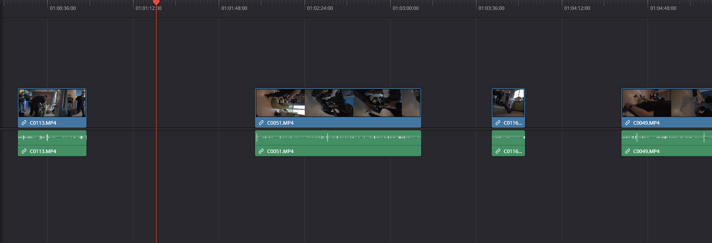
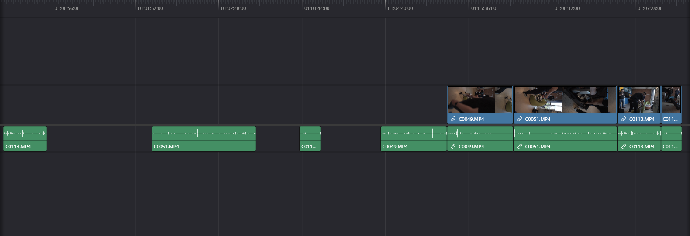
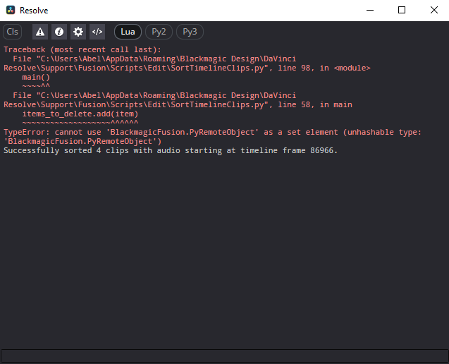
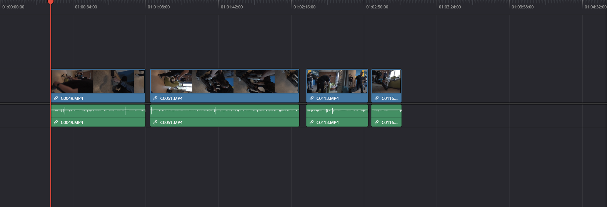
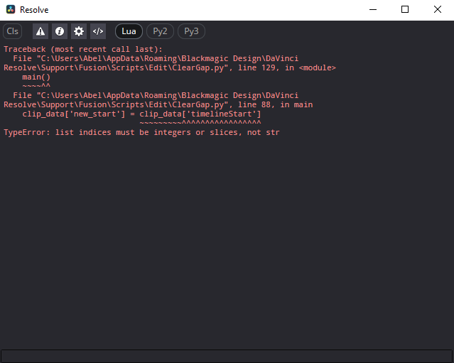
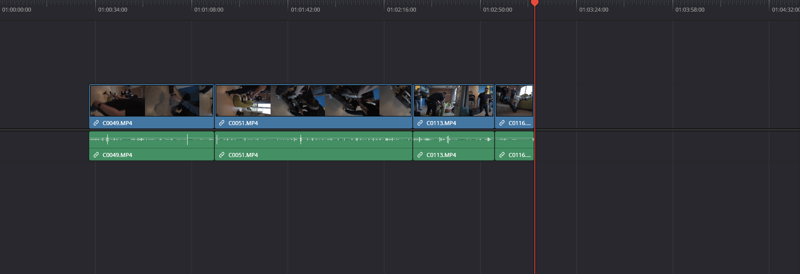

# DaVinci Resolve x AI - Saját szoftver funkciók fejlesztése

[Letölthető sorba rendező script (.zip)](scripts/SortTimelineClips.py)
[Letölthető gap eltávolító script (.zip)](scripts/ClearGap.py)

## Motiváció 

A művészet, iparművészet ágazatához tartozó munkafolyamatok során, ideértve a szoftveres munkafolyamatokat is, rengeteg kreatív döntést kell meghozni kevés idő alatt ahhoz, hogy a munka megfelelő sebességgel haladjon. Általánosságban elmondható, hogy a gördülékenységet fenyegető legnagyobb veszély a kreatív ötletek flowjának megakadása. A videós utómunka szemüvegén keresztül nézve, ha megszületik néhány szerkesztési ötlet konkrét felvételekhez, de azt nem tudjuk gyorsan implementálni, mert a szoftveres eszközök beállításait keresgéljük, hamar elpárolognak a már meglévő ötletek is a fejünkből.
Éppen ezért a képi/videó/audio utómunkára szánt szoftverek kiemelt figyelmet szentelnek annak, hogy a felhasználó minél gyorsabban és ergonomikusan tudjon mozogni benne. Miután a tapasztalatok alapján kialakul a saját workflownk, és már a billentyűkombinációkat magunkra szabtuk, már csak azzal tudjuk tovább gyorsítani a munkafolyamatunkat, ha komplexebb shortcutokat alkotunk.
Erre a példában szereplő DaVinci Resolve videós utómunka szoftver lehetőséget nyújt, saját python és lua alapú könyvtárával. Ennek segítségével előre megírt és a szoftveren belül futtatok scriptekkel több, komplex műveletet is végrehajthatunk egyszerre, amelyet billentyűkombinációhoz is köthetünk.

## Kontextus

### *Előzmények*

Korábban már próbáltam használható scriptet írni DaVinci Resolve alá, kíváncsiságból, illetve hogy még jobban személyre szabjam a munkafolyamatokat. Ennek ellenére nem jártam sok sikerrel, a script írás nehézkes volt, a fejlesztői dokumentáció nem ergonomikus, így ha hagyományos programozási módszerekkel szeretnénk próbálkozni, egyszerűen nem térül meg a befektetett munka, hacsak nem vagyunk főállásban videó szerkesztők.
Nagyjából egy évvel ezelőtt megpróbáltam az akkori Gemini és Claude modellek általános tudásbázisával, egyszerű chat promptok mentén scripteket generálni, azonban mindegyik működése hibás volt, sokat kellett debugolni így is.
A DaVinci Resolve alapvetően egy jól használható, elterjedt szoftver, érdemes tovább próbálkozni a scriptelésével.

### *Konkrét gyorsítható feladatok*

Érdemes a munkafolyamat azon területén keresgélni a gyorsítási lehetőségeket, ami monoton, könnyen automatizálható. A példában ez a témakör a nyers felvételek szortírozása, osztályozása. Ez a saját esetemben úgy történik, hogy létrehozok egy 'sort' nevű Timelinet, rá ömlesztve behúzom a nyers felvételeket, ha nem file név szerinti (gyakran időrendi) sorrendben vannak, azt nagyjából elrendezem, majdelkezdem a hibás felvételeket, felesleges részeket törölni, hogy csak a használhatók maradjanak meg a végére.
Van például két olyan apró tevékenység ezzel kapcsolatban, amely teljesen feleslegesen vesz el időt:

1. A nem sorban beillesztett fileok sorrendbe helyezése kézzel.
2. A törölt felvételek/részletek után maradt üres rések a timelineon, amelyek miatt időnként sokat kéne oldalra görgetni, ezért össze szoktam húzni őket, megszűntetve a réseket, hogy tömörebben helyezkedjenek el.


## Script fejlesztés AI eszköz segítségével

### *Nehézségek*

Maga a kódolási feladat, technikailag egyszerű, egy összetettnek tekinthető alkalmazás se okoz túlságosan komplex kódot, hiszen a DaVinci Resolveban már implementált feladatokat kell megfelelően szervezni. Ennek ellenére akad néhány nehézség, amely hátráltatja a jó eredmény létrejöttét.
A fejlesztői dokumentációk közül, a nem elavult, hiteles verziók legegyszerűbben a DaVinci Resolve telepítésével együtt érhetők el. A gond az, hogy a szoftvert folyamatosan fejlesztik, nem ritkán olyan mértékben, hogy a kódjaink elveszítik a kompatibilitásukat.
Azt is érdemes kiemelni, hogy a felhasználói tudás a gyakorlatban tutorial videókból, fórumbejegyzésekből épül, így ezek is évről évre veszíthetnek a hitelességükből. Ezek mennyisége iszonyúan nagy, ezért ha az AI modell mindennel meg van etetve, könnyen futhat már elavult, hibás következtetésekre, még akkor is, ha az ember a hivatalos verziószámra és dokumentációra hivatkozik. 

### *Eszközválasztás, előkészítés*

A tökéletes, működő megoldás önmagában nem elegendő szempont. A DaVinci Resolve mellett eleve szól a nagy képességű ingyenes verziója, a kompakt, jól rendezhető layoutja és a workflowja maga. Ahhoz, hogy értelme legyen scripteket készíteni hozzá, azoknak valóban gyorsítaniuk kell a munkát, és nem igényelhet bonyolult promtokat és speciális tudást, gyorsan és egyszerűen kell tudnunk generálni őket, lehetőleg ingyen.
A fentebb részletezett problémák alapján az világos, hogy olyan AI eszközre van szükség, amelyet a hiteles dokumentációk irányába tudunk kényszeríteni. Egyszerű, speciális tudást nem igénylő, bárki számára ingyen elérhető szolgáltatás gyanánt a Google Gemini Notebook (Notebook LM) alkalmazását választottam, a példa fejlesztés ennek segítségével kerül bemutatásra.

Az eszköz kifejezetten jegyzet feldolgozásra optimalizált, így bármely, az adott sessionbe feltöltött dokumentum erős prioritást élvez a megoldások keresésében. 
Két, a telepített szoftver 'Developer' mappájában talált dokumentációt töltöttem fel forrásként:
* A vezérlő scriptekhez való függvénykönyvtár dokumentációjaként szolgáló README fájlt
* Az ún. Fusion Fuse SDK pdf dokumentációját

### *Clip rendező script fejlesztése*

#### Prompt

USER:
```
Craete a simple script that can sort my clips on the current timeline into alphabetical or numerical order on Edit tab in DaVinci Resolve Studio 20. I work on Windows 11 OS. Give me a step-by-step guide for script installation and other necessary configuration steps.
```

MI:
Eredményül adott egy SortTimelineClips.py scriptet és néhány fontos információt az üzembe helyezés kapcsán:
```
[...]
1. System Requirements Check
Ensure Python 3.6+ (64-bit) is installed on your Windows 11 system

In DaVinci Resolve, verify external scripting permission by opening Preferences > System > General > External scripting using and setting it to Local or Console

2. Installing the Script File on Windows 11
DaVinci Resolve automatically scans specific subfolders on startup to populate its script menu

Press Win + R on your keyboard, paste the following path, and press Enter

%APPDATA%\Roaming\Blackmagic Design\DaVinci Resolve\Support\Fusion\Scripts\Edit\
(If the Edit folder does not exist inside Scripts, create a new folder named Edit.)
(Alternatively, for all system users, you can place it in %PROGRAMDATA%\Blackmagic Design\DaVinci Resolve\Fusion\Scripts\Edit\)
Copy your SortTimelineClips.py file into this Edit folder
[...]
```

#### Teszt
A telepítési ajánlásokat követve, a saját script megjelent a DaVinci Resolveon belül, és könnyedén hozzáköthettem egy szabad billentyűkombinációhoz.

Négy, tesztként használt clipet véletlenszerűen beillesztettem egy új Timelinera:
{width=1080}
Ezután a saját scripthez kötött billentyűkombináció segítségével meghívtam a rendezést.
{width=1080}

Az figyelhető meg, hogy maga a sorba rendezés helyes, azonban a script úgy használja ehhez a törlést és visszaillesztést, hogy az eredetileg elhelyezett clipek audio részeit meghagyja, és ezek után fűzi a már rendezett clip szekvenciát.
Ez számunkra bug, nem szeretnénk, az ott hagyott audio clipeket törölgetni, olyan alkalmazásra van szükség, ami ezeket nem hagyja ott.

#### Javítási lépések

USER:
```
Refine the script in order to clear out all parts of original clip insertions from timeline including audio parts too,  and new, ordered clip set must placed to the same timecode where the first one of the original clips started.
```

MI:
Visszaadta a script egy javított változatát, amely az eredeti, sorba nem rendezett clipek linkelt audio részét is törli, illetve azok kezdő timecodától kezdve illeszti be az új rendezett clip készletet.

A script futtatása azonban nem végezte el a feladatot a tesztelés során. A DaVini Resolve rendelkezik beépített Console alkalmazással, amelyet megnyitva megtekinthetjük az error logot. Ennek tartalmát átadtam az AI számára.

USER:
```
I got this error while applying your script:
Traceback (most recent call last):
File "C:\Users\Abel\AppData\Roaming\Blackmagic Design\DaVinci Resolve\Support\Fusion\Scripts\Edit\SortTimelineClips.py", line 98, in 
main()
~~~~^^
File "C:\Users\Abel\AppData\Roaming\Blackmagic Design\DaVinci Resolve\Support\Fusion\Scripts\Edit\SortTimelineClips.py", line 58, in main
items_to_delete.add(item)
~~~~~~~~~~~~~~~~~~~^^^^^^
TypeError: cannot use 'BlackmagicFusion.PyRemoteObject' as a set element (unhashable type: 'BlackmagicFusion.PyRemoteObject')
```

MI:
A mesterséges intelligencia egy adatszerkezeti problémát talált, ezt jaívtva ismét visszaadott egy frissített kódot.

A script ezúttal már sikeresen lefutott, ezt a beépített Console is visszaigazolta:
{width=560}

A hatása pedig az alábbi képen látható:
{width=1080}
***Ábra:** látható, hogy a rendező script valóban a file neve szerint sorba rendezte a nyers clipeket, és nem hagyott maga után eltakarítani való clip komponenseket. Ami változott, hogy eltérő módszerrel történik a clipek timecode számítása, ezért apró réseket figyelhetünk meg a clipek közt.*


### *Clip-közi réseket eltűntető script fejlesztése*

#### Prompt, teszt és javítás

USER:
```
Craete a 'ClearGap.py' script that can clear empty gaps only between selected clips of a timeline on Edit tab in DaVinci Resolve Studio 20.
```

MI:
Eredményül adott egy ClearGap.py scriptet, de első kipróbáláskor error log jelent meg a belső konzolon:
{width=560}

A logot visszaadva az AI eszköznek, két iteráció kellett, hogy technikailag működőképes kódot adjon vissza, azonban ami a sorba rendező script esetén csak egy feature volt, ugyanez a timecode számolási szisztéma került alkalmazásra. Itt az apró gapek generálása a timelineon már bugként értelmezhető, hiszen pont a gapek teljes eltűntetése lenne az új script eredeti célja. 

A nehézségek itt kezdődtek, ugyanis az AI valamiért képtelen volt észlelni a clipek 'duration' értékével való abszolút kalkuláció és a sima hozzáfűző függvény közt fennálló különbségeket. 3-4 iterációnyi sikertelen próbálkozás után magam néztem bele a kódba és hasonlítottam össze a clipek elhelyezését azzal, ahogy a sorba rendező script első próbálkozása még gapek nélkül működött. A különbséget ralizálva explicite utasítottam az AI-t, hogy melyik módszerén változtasson.

USER:
```
simply do not use duration and current_record_frame parts only append clips one after each other as you did by the very first solution of 'SortTimelineClips.py'
```

MI:
Kijavította a bugot, amit eredetileg szerettem volna tőle. Visszaadta a javított script kódját.
Lefuttatva, ezúttal hibátlnul működött, ahogyan az alábbi képen is megfigyelhető:
{width=1080}


## Tanulságok

- A második script esetén könnyen lehet, hogy nagyban implikálta a bugot, hogy a megoldást egyetlen chat sessionön belül, rögtön az első script után kértem, ezért mivel az ott alkalmazott megoldás pozitív visszajelzést kapott, azon a munkaponton maradt a kód clip illesztéssel kapcsolatos része.
- Az előző pont miatt, nem szorosan összefüggő script írások során érdemes külön sessiönt nyitni, vagy törölni a prompt előzményeket.
- Ilyen egyszerű scriptek esetén hatékonyabb lehet az emberi tesztelés (nem mcp serveren keresztül automatikusan validálva), főleg ha figyelembe vesszük, mennyire holtpontra jutott a végén a gap eltávolítás.
- Az mindenképp pozitív, hogy kevés efforttal, egy ingyenes eszköz segítségével lehetett generálni a scripteket, nem volt szükség részletes specifikációra, maga a promptolás nem vett el sok időt.