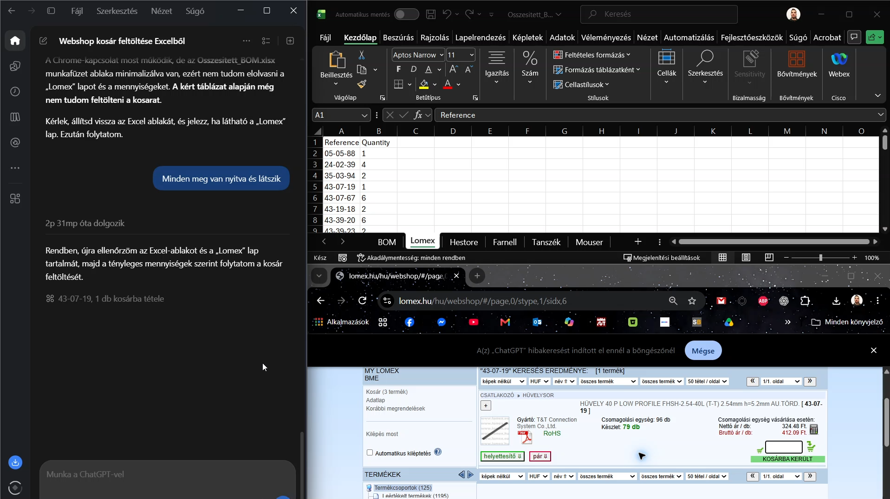

# MS Excel VBA script létrehozása BOM listák összefésüléséhez

## A feladat leírása

A Miktokontroller laboratórium tárgy hallgatóinak egy egész féléves, hardverépítős házifeladatot kell teljesítenie. Ezek egyedi hardverek, egyedi tervekkel és egyedi alkatrészlistákkal. A gyártást és beszerzést a tanszék finanszírozza, de ehhez az kell, hogy az összes hallgató igényét összefésülve, beszerzési helyenként egyetlen rendelésben meg tudjuk oldani az egészet. A hallgatók egyedi BOM (Bill of materials) listáinak vannak kiadott formai követelményei, meg kell adni a beszerzési helyet, a cikkszámot, a nevet és a mennyiséget mindeképp, és ezek oszlopait is egységesen kell elnevezni. Az elnevezéseket be szokták tartani, viszont az oszlopok számát és sorrendjét illetően előfordulnak eltérések.

Ilyen nevű oszlopokat mindenképp várunk:

|Supplier|Reference|Name|Quantity|
|---|---|---|---|
| | | | |
| | | | |
| | | | |

Korábban egy összesítő táblázatba kézzel másoltam be egyesével a hallgatók által beadott külön fájlok tartalmát, majd csoportosítottam szűrőkkel beszerzési helyek szerint, ami eléggé időigényes.
Emiatt jött az ötlet, hogy meg lehetne-e az egészet csinálni egy gombnyomásra, Excel makrók segítségével.
Fontos leszögezni, hogy én korábban sosem írtam ilyen makrót, és nem is tudtam, hogyan kell ezeket haszálni, ezért csak szóban azt írtam le a promptokban, amit látni szerettem volna az összesített táblázatban. A feladathoz az OpenAI **GPT-5.3** modellt használtam.

## Tanulságok

- Nehéz úgy leírni a megoldandó problémát egy prompt-ban, hogy az MI elsőre jó eredményt generáljon. Sokminden, ami az ember számára magától értetődő azzal kapcsolatban, hogy mit szeretne, hogy nézzen ki egy táblázat, az MI-nek nem az.
- Ha valakinek nincs tapasztalata a VBA szkriptekkel kapcsolatban, talán több iterációban, de ugyanúgy működőképes megoldásra lehet jutni. Az MI azt is elmagyarázza, hogyan kell használni a szkriptet.
- Sokkal könnyebb dolgunk van, ha át tudunk adni az MI-nek példa fájlokat, hogy milyen bemenetekből milyen kimenetet szeretnénk. (Könnyebb megmutatni, mint elmagyarázni.)
- Ha van hozzáférésünk desktop alkalmazást használni, amin keresztül az MI hozzáfér a lokálisan tárolt fájljainkhoz, azt a lépést is megspórolhatjuk, hogy nekünk kellejen mindig kézzel bemásolni a generált kódot az Excel-be.

## A munkafolyamat tanulságos részletei

A folyamatot egy kevésbé részletes, a célomat nagyvonalakban leíró prompttal kezdtem, majd a generált szkriptet mindig kipróbálva visszajeleztem az MI-nek, hogy mit kellene még módosítania.

### Kezdő prompt

```prompt
Szeretnék csinálni egy BOM listát egy excel fájlban, ami több különböző, ugyanabban a mappában lévő .xlsx fájlból átmásolja a megfelelő oszlopokat úgy, mint "Name", "Quantity", "Supplier", "Reference", egymás alá, valamint egy ötödik oszlopba minden sorhoz odaírja az adott fájl nevét, amiből másolva lett.
```

Felajánlotta a Power Query használatát is, de tudtam, hogy lesznek majd kevésbé általános formázási igényeim, valamint szerettem ,volna, ha minden egy gombnyomásra lejátszódik, ezért a VBA-t választottam. Generált is egy első verziót.

### Bemeneti fájlok elérése

Az első problémám a bemeneti fájlok elérési útjával volt. Ő magától beírta, hogy mindig a "C:\BOM\" mappában lévő .xlsx fájlokat kell betöltenie (holott én nem adtam meg ilyen mappát). Én ehelyett azt szerettem volna, hogy az összesítő szkriptet tartalmazó táblázattal egyazon mappában lévő fájlokból dolgozzon.

Prompt:

```prompt
Hogyan tudom megadni a VBA szkriptben, hogy a saját mappa legyen az elérési út?
```

MI:

```MI
[...]
Ha azt szeretnéd, hogy mindig az aktuális Excel fájl mappájából dolgozzon, akkor ezt használd:
mappa = ThisWorkbook.Path & "\"
[...]
```

### Oszlopok azonosítása

A következő probléma az volt, hogy ő feltételezte, hogy amilyen sorrendben én írtam az oszlopokat, minden bemeneti fájlban is úgy lesz, ezért csak az oszlop sorszáma alapján rendezte össze a különböző listákat, ami sok esetben összekevert értékeket eredményezett.

Prompt:

```prompt
A bemeneti fájlokban nem mindig ugyanabban az oszlopban vannak a megfelelő értékek, az első sor határozza meg, hogy mik az oszlopok alatta, az alapján kellene jó helyre bemásolni
```

MI:

```MI
[...]
Ez már egy szinttel jobb megközelítés 👍 — ilyenkor nem oszlopszám alapján, hanem fejléc (első sor) alapján kell dolgozni.
A lényeg:
➡️ megkeressük, hogy az adott fájlban melyik oszlopban van pl. "Name", "Quantity", stb.
➡️ és onnan olvassuk ki az értékeket
[...]
```

Itt már adott továbbfejlesztési ötleteket is:

```MI
[...]
💡 Továbbfejlesztési ötletek
Ha még robusztusabb kell:
🔸 Többféle elnevezés kezelése
Pl:
•	"Qty" = Quantity
•	"Vendor" = Supplier
→ ezt is bele lehet építeni
________________________________________
🔸 Hibajelentés
Kiírhatod, melyik fájl maradt ki
________________________________________
🔸 Több sheet kezelése
Nem csak Sheets(1)
[...]
```

### Formázások

Szerettem volna, ha minden oszlop tetején az első cellában szerepel az oszlop neve, úgy, ahogy a bemeneti fájlokban, automatikusan állítsa az oszlopszélességet a leghosszabb szöveghez idomulva, valamint legyenek balra rendezett az összes cella tartalma. (Ezeket több prompton keresztül adtam meg neki.)

Itt is és a legtöbb válaszban leírta, hogy min változtatott, mit fogunk tapasztalni, ha a frissített verziót futtatjuk, valamint adott extra ötleteket, továbbfejlesztési javaslatokat is.

### Cikkszámok szövegként

Tipikus hiba tud lenni Excelben, hogy az automatikus formátumfelismerés elrontja a cellaértékeket. Ilyen eset az is, ami itt gyakran elő is fordul, hogy a Lomex áruház cikkszámait, amelyek formátuma "NN-NN-NN" (pl. 95-04-21) sokszor dátummá alakítja át. Ezen lehet a formátumbeállításokban is változtatni, de a legegyszerűbb, ha minden érték elé egy ' karaktert szúrúnk be, ami a megjelenítésben nem látszik, de garantált, hogy nem változik meg a beírt szöveg formátuma.

Prompt:

```prompt
Egészítsd ki azzal, hogy a Reference oszlop elemei elé minden cellába beszúr egy ' karaktert
```

MI:

```MI
[...]
Rendben 👍 ezt nagyon egyszerűen hozzá tudjuk adni: a Reference érték elé beszúrunk egy ' karaktert, így Excelben biztosan szövegként kezeli (nem konvertálja pl. számra vagy tudományos formátumra).
[...]
🎯 Mit értünk el ezzel?
✔ A Reference oszlop minden értéke így néz ki:
'ABC123
'001234
'1.23E+05  → nem romlik el!
✔ Excel nem fogja:
•	számként értelmezni
•	levágni a nullákat
•	tudományos formátumba tenni
[...]
```

### Rejtettebb hibák

Ekkor már ránézésre jól működött a szkript, a megfelelő nevű oszlopokba megfelelő értékek kerültek. Az egyik tesztesetben elkezdtem egyesével végignézni a bemeneti BOM fájlokat, hogy valóban minden alkatrész átkerült-e az összesítésbe. Ekkor láttam, hogy néhány fájl utolsó sorát nem vette figyelembe, és azok nem kerültek átmásolásra. Ezeket a sorokat az jellemezte, hogy voltak benne üres cellák, legtöbbször a "Name" oszlopban, de volt, hogy a "Reference" oszlopban is, ha azt az alkatrészt a tanszék biztosította.

Ezért megkértem az MI-t, hogy minden sort másoljon, ha legalább egy oszlopában van érték. Elsőre csak részben sikerült megoldania, még így is maradtak fájlok, aminek az utolsó sora nem került bele az összesítésbe. Itt már nem tudtam volna neki jól elmagyarázni, ezért feltöltöttem azt a fájlt, amelyikből nem másolta át az utolsó sort, és így már be tudta azonosítani a hibát, és helyesen módosította a makrót.

MI:

```MI
[...]
Ez így már teljesen világos — és jó hír, hogy erre van egy stabil, minden fájlra működő megoldás, függetlenül attól, hogy melyik oszlopok vannak kitöltve vagy melyik fejléc létezik.
A kulcs az, hogy nem egy konkrét oszlop alapján kell meghatározni az utolsó sort, hanem:
👉 A táblázat bármely oszlopában lévő utolsó nem üres cella alapján kell megállapítani a lastRow értékét.
Ez garantálja, hogy a makró mindig a valódi utolsó sorig megy, akkor is, ha:
•	a Name oszlop üres,
•	a Description hiányzik,
•	a Designator hiányzik,
•	vagy bármelyik másik oszlop üres.
[...]
🎯 Miért működik ez biztosan?
Mert a te BOM fájljaidban:
•	mindig van legalább egy oszlop, amelyben az utolsó sorban van adat (pl. Supplier, Reference, Quantity),
•	de nem garantált, hogy ugyanaz az oszlop van kitöltve minden fájlban.
Ezért a „bármely oszlopban lévő utolsó adat” módszer a legjobb
[...]
```

Ezek után még feltételes formázásként kértem különböző háttérszíneket a különböző beszerzési helyeknek, hogy vizuálisan jobban elkülöníthetőek legyenek, valamint megkértem, hogy hozzon létre mindegyik bolthoz egy külön fület a táblázatban, és oda szortírozza az alkatrészeket, az azonos cikkszámok összevonásával. (Ezt külön makróként, mert nem minden esetben van rá szükség.)

### Kipróbálás

Az elkészült makrók kipróbálhatóak [ezekkel a tesztfájlokkal](Test_files/Test_files.zip). Az *Osszesitett_BOM.xlsm* fájlban a "BOM_osszesito", majd opcionálisan a "SplitBySupplierAndMerge" nevű makrókat lehet futtatni.

## Kiegészítés GPT Work segítségével

A későbbiekben, már a ChatGPT desktop appot és a Work funkciót is használva **(GPT-6 Luna)** megkértem az MI-t, hogy az összesített táblázat Lomex füléről az alkatrészeket ő tegye bele a böngészőben megnyitott webshopban a kosárba. Ugyanis amíg sok webshop lehetővé teszi, hogy listákat/táblázatokat feltöltve egyszerre kerüljenek a kosárba az alkatrészek, a Lomex-nél nincs erre lehetőség, muszáj egyesével kézzel a kosárba rakni azokat.

Prompt:

```prompt
Meg van nyitva a webáruház (https://lomex.hu/hu/webshop/#/page,0) a Chrome-ban, és meg van nyitva az Osszesitett_BOM.xlsx fájl. A táblázat "Lomex" nevű lapján szereplő cikkszámokkal megadott alkatrészeket rakd a webáruházban a kosárba a megadott mennyiségben
```

Ehhez engedélyezni kell a desktop appnak a számítógéphez való hozzáférést, valamint a böngészőbe is telepíteni kell a chatGPT bővítményt. Így már hozzáfér a lokálisan tárolt BOM táblázathoz, és a böngésző megnyitott weboldalaihoz is. Első próbálkozásra azt is igényelte, hogy meg legyen nyitva a böngésző, tehát látszon a képernyőn, különben valamiért nem tudta elérni. Amint minden szükséges ablak osztott képernyőelrendezésben látható volt, probléma nélkül megoldotta a feladatot. Az alkatrészek számát szándékosan lecsökkentettem 10-re, hogy ne használjak el feleslegesen sok kreditet, valamint ugyanezen okból kifolyólag nem is az elérhető legerősebb modellt használtam, így nem tudom, az gyorsabban oldotta volna meg a feladatot.

Ezzel az elrendezéssel a 10 alkatrész kosárba helyezése 3 perc 53 másodpercbe telt, de ebből az első alkatrész sikeres kosárbahelyezéséig majdnem 2 perc eltelt. Amint ráállt arra, hogy csak kimásolja a megfelelő cellaértéket, és a weboldalon a megfelelő helyre beírja, felgyorsult, a maradék 9 alkatrészt szűk 2 perc alatt kosárba helyezte.

Végül összegezte a műveletet:

MI:

```MI
[...]
A „Lomex” lapon szereplő mind a 8 alkatrészt a megadott mennyiségben hozzáadtam a Lomex kosárhoz, majd ellenőriztem a kosár tételeit és darabszámait. A kosárban összesen 23 darab van; a kijelzett bruttó összeg 16 186 Ft. A rendelést nem adtam le.
[...]
```

A folyamat lényegi része megtekinthatő az alábbi videóban (2x gyorsításban):

[](Video/Lomex_kosar_AI.mp4)