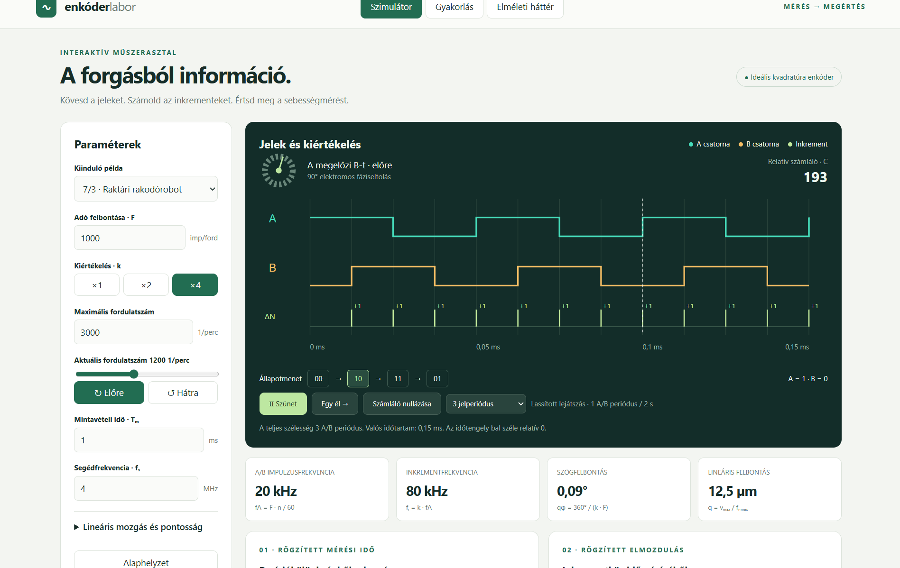
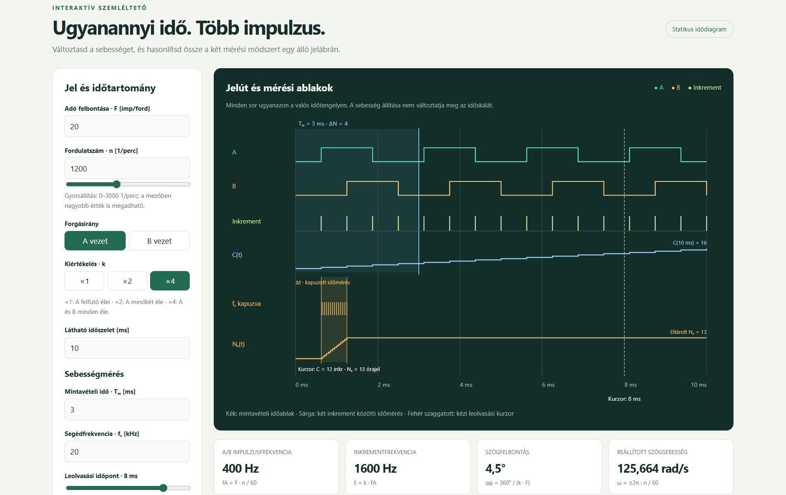
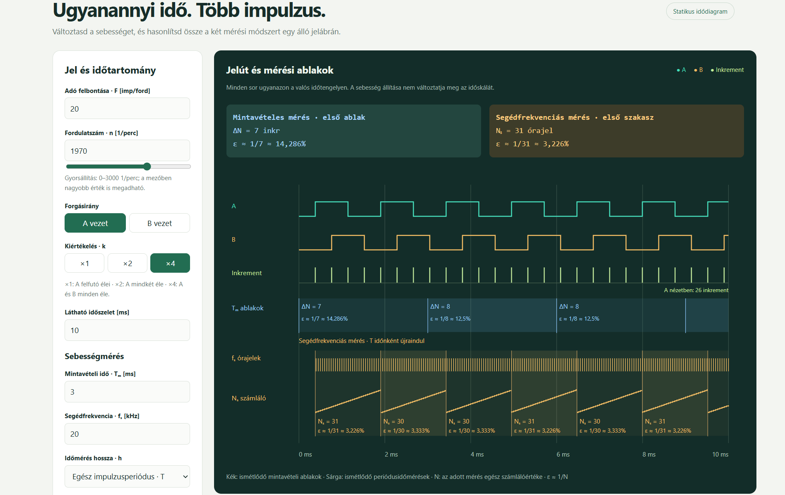
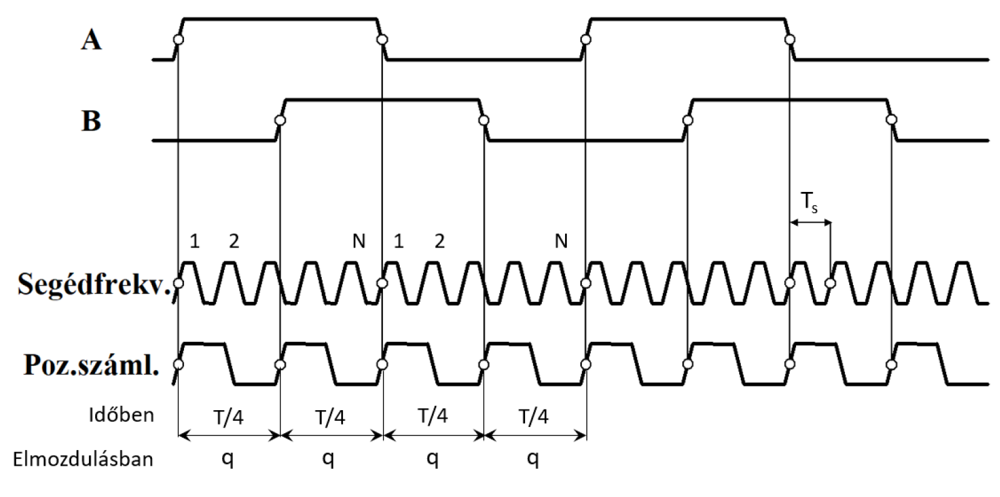
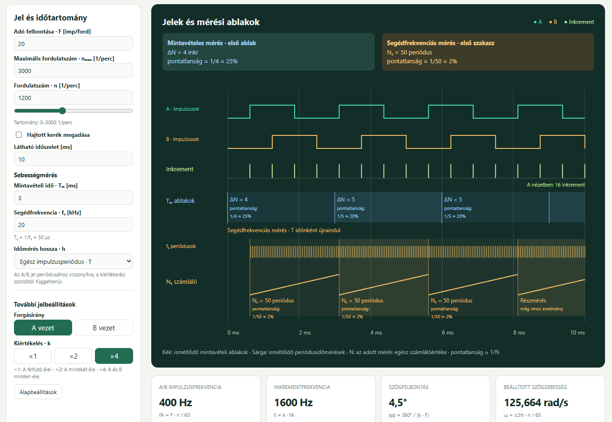

# Interaktív enkóder-szemléltető weboldal létrehozása MI segítségével

## A feladat leírása

Az inkrementális adók és enkóderek több, általunk oktatott tárgyban is előkerülnek. Az a tapasztalat, hogy a működésüket nehezen értik meg a hallgatók csak statikus ábrák és képletek alapján. Fontos lenne szemléltetni azt is, hogy a tengely forgásából hogyan keletkeznek az A és B impulzusok, ezekből hogyan lesznek számlálható inkrementek, és a mért értékek alapján hogyan határozható meg a sebesség. A sebességet két módszerrel is mérhetjük, amelyek pontossága függ a sebesség nagyságától, ez is nehezen szemléltethető csak statikusan. Emiatt szerettem volna egy olyan felületet létrehozni, ahol az ilyen rendszerek alap paramétereit megadva és változtatva, szimultán változnak egy ábrán a mérendő/számolandó értékek is.

A feladatot az OpenAI Work funkcióját használva, a **GPT-6.1 Sol** modellel oldottam meg. Mivel szerettem volna, hogy a hallgatók is ki tudják próbálni a végeredményt - amennyiben jól sikerül -, a felületet weblapként kértem. Kiindulásként átadtam az MI-nek két PDF dokumentumot, amelyek tartalmazták a témakör elméleti összefoglalóját, valamint tipikus példákat, amiket az oktatás során is alkalmazunk. A kívánt működést természetes nyelven írtam le, az MI pedig elkészítette a weboldalt, módosította a visszajelzéseim alapján, és online is elérhetővé tette. Előnyös volt, hogy nem kellett minden válasz után kézzel bemásolnom a generált kódot egy szerkesztőbe.

Az eredmény egy átlátható, könnyen kezelhető, interaktív felület, ahol jól szemléltethetőek az inkrementális adós rendszerek számításai, a különböző módszerek pontatlanságai.

A végső változatban az alábbi beállítások és eredmények szerepelnek:

| Beállítható paraméter | Mit befolyásol? |
| --- | --- |
| Adófelbontás, fordulatszám | Az A/B impulzusok és az inkrementek sűrűségét |
| Maximális fordulatszám | A sebességállítás megengedett tartományát |
| Látható időszelet | Az egyszerre megjelenített jelrészlet hosszát |
| Mintavételi idő | Az egy mérési ablakban megszámolt inkrementeket |
| Segédfrekvencia | Az időmérés során megszámolt periódusokat |
| Egész, fél vagy negyed impulzusperiódus | A segédfrekvenciás mérés hosszát |
| Forgásirány és kiértékelési szorzó | Az inkrementek előjelét és számát |
| Opcionálisan kerékátmérő és áttétel | A szögsebességből számított haladási sebességet |

## Tanulságok

- A PDF-ek átadása sokat segített a témakör behatárolásában, a fogalmak és számítások beazonosításában, nem kellett elmagyaráznom, mit szeretnék szemléltetni
- Az MI a desktop alkalmazás a fájlok előállítását és az online közzétételt is elvégezte. A számítások ellenőrzése és a böngészős kipróbálás ettől még külön munkalépés maradt.
- MI segítségével egy lépésben tudunk létrehozni működő weboldalakat, és a webszervert sem nekünk kell futtatni, cloud alapon a fiókunkhoz kapcsolva a szolgáltatónál fut.
- Az MI nem csak szolgai módon végrehajtja a kéréseket, igyekszik kiegészíteni, és kitalálni akár olyan részleteket is, amit nem mondtunk neki, de szerinte illik a módosított elképzelésekhez. Ez van, hogy segít, mert nem kell minden apró részletet pontosan körülírni, viszont előfordulhat, hogy olyan plusz funkciót épít be, amit egyáltalán nem szerettünk volna.

## A munkafolyamat tanulságos részletei

A folyamatot a hallgatóknak is kiadott jegyzet betöltésével és az elképzelt felhasználás leírásával kezdtem. Ezután a generált oldalt kipróbálva, több lépésben pontosítottam, hogy mi legyen látható az ábrán, hogyan lehessen állítani a paramétereket, és milyen számításokat végezzen el a felület.

### Kezdő prompt

A két helyi PDF-et elérési úttal adtam meg, és az alábbi kérést fogalmaztam meg:

```prompt
Ezek a dokumentumok egy tantárgyon belül az inkrementális adók és enkóderek témakörével foglalkozik. A jegyzet fájlban az elméleti háttér szerepel, a példáknál pedig, hogy milyen paramétereket kell kiszámolni egy-egy feladatnál. Szeretnék egy weboldalt, ahol interaktívan lehet állítani is ezeket a paramétereket, és azzal összhangban egy ábrán is látszana, hogy aktuálisan hogy jönnek az A és B impulzusok, hogy lesznek belőlük inkrementek, hogy számoljuk a sebességet stb. A cél, hogy interaktívan szemléltetni lehessen ezt a témakört, valamint a számolós példákhoz is lehessen használni gyakorlásként.
```

Ebből a prompt-ból is látszik, hogy nem konkretizáltam, hogy nézzen ki a felület, vagy, hogy pontosan miket lehessen beállítani, kiszámolni.

MI:

```MI
[...]
Elkészült az Enkóder labor weboldal, jelenleg privát hozzáféréssel.
- Állítható paraméterek, animált A/B jelek és ×1/×2/×4 kiértékelés.
- Léptethető inkrementszámláló és forgásirányváltás.
- Kétféle sebességmérés, hibabecslés és bitszámítás.
- A 7/3–7/4. feladat gyakorlása ellenőrzéssel, levezetéssel és új adatsorokkal.
[Offline változat letöltése](outputs/enkoder-labor.html) — böngészőben megnyitható, telepítés nélkül.
[...]
```

Az MI átnézte a dokumentumokat, és egy szimulátort, elméleti magyarázatot és gyakorlófeladatokat tartalmazó első változatot készített. Ebben a PDF-ben szereplő két konkrét feladat betölthető mintapéldaként is megjelent, az ábra pedig lassított animációval mutatta a működést. Az általam elképzelt szemléltetést már ez a változat is jól közelítette.



Viszont itt kissé félreértette azt, hogy azt írtam, a számolós példákhoz is lehessen használni gyakorlásként. Nem arra gondoltam, hogy legyen egy felület, ahol a megadott példákat lehet megoldani, és beírni a válaszokat, hanem, hogy az interaktív ábra alapján könnyebben el tudják képzelni a hallgatók a számpéldákban szereplő változókat, mennyiségeket.

### Animáció helyett álló jelábra

Nem arra volt szükségem, hogy a jelek folyamatosan mozogjanak, és az idő múlásával számolja össze az inkrementeket, hanem arra, hogy azonos időskálán össze lehessen hasonlítani a különböző sebességekhez tartozó impulzussűrűséget, és a sebességmérést. Ezért azt kértem, hogy az ábra állókép legyen, és a sebesség változtatásakor rajzolódjon újra. Azt is külön kértem, hogy a látható időszelet hossza állítható legyen.

Prompt:

```prompt
Az ábrához nem kellenek az állapotmenetek, csak statikus állóképet szeretnék, amiben az impulzusok/inkrementek sűrűsége változik aszerint, hogy állítom a sebességet. Az időszelet is állítható legyen, hogy egyszerre mennyit szeretnék látni a jelekből. Szeretném, ha megjelenne az ábrán a mintavételi idős sebességmérés is, illetve a segédfrekvenciás számláló állása is. Emellett ne konkrét példákból induljon ki, ennek az oldalnak a célja egy általánosabb, tantárgyfüggetlen szemléltetés, nem a beküldött példák implementálása.
```

MI:

```MI
[...]
Frissítettem az Enkóderlabor oldalát:
- Statikus jelábra, sebességfüggő impulzus- és inkrementsűrűséggel.
- Külön állítható látható időszelet és mintavételi idő.
- Az ábrán látható mérési ablak, inkrementszámláló és segédfrekvenciás számláló.
- Kézi kurzor a közbenső számlálóállások leolvasásához.
- Eltávolítottam az állapotmenetet és a konkrét tantárgyi példákat.
A működést böngészőben is ellenőriztem.
[...]
```

Ennek hatására eltűntek a konkrét tantárgyi példák és az állapotmenetek. Az oldal általános paraméterekkel kezdett dolgozni, az ábrán pedig megjelent a sebességméréshez tartozó mintavételi ablak és a segédfrekvenciás számláló is.



Viszont, ahogy az ábrán is látható, nem csak azt változtatta meg, amit konkrétan kértem, hanem hozzá idomította a címeket, szövegeket is. Az ábrán is megjelentek új funkciók, amiket nem kértem, pl. a számláló változása és a kurzor.

### A kurzor és a leolvasási időpont elhagyása

A kurzorra nem volt  szükség, azt szerettem volna, hogy a lényeges eredmények külön leolvasási művelet nélkül is látszódjanak. Ezen kívül több módosítási kérést is megfogalmaztam, ahogyan az alábbi prompt-ban is olvasható.

Prompt:

```prompt
Nincs szükség kurzorra és leolvasási időpontra. A lényeg, hogy minden beállításnál látszon az inkrementek száma, és a segédfrekvenciás számláló értéke. A segédfrekvenciás mérésnél ne automatikusan két inkrement közötti időt mérjük, hanem legyen beállítható, hogy egy egész, fél vagy negyed impulzus periódust akarunk megmérni. Ezen kívül mindig legyen látható az ábrán az aktuális pontatlansága a sebességmérésnek, mindkét módszernél (1/N). Az ábrán nem szükséges a C(t) sor, nem fontos, hogy változik az inkrement számláló értéke. A segédfrekvenciás mérésnél ne csak az első mérés legyen az ábrán, hanem az is periodikusan számolódjon újra a következő impulzusélek között is.
```

MI:

```MI
Frissítettem az oldalt:
- Eltűnt a kurzor, a leolvasási időpont és a C(t) sor.
- Választható egész, fél vagy negyed impulzusperiódus mérése.
- A segédfrekvenciás számlálás minden következő szakaszban újraindul.
- Az ábrán mindkét módszernél látható a számlálóérték és az 1/N pontatlanság, százalékosan is.
Böngészőben is ellenőriztem a működést.
```



A folyamatos, periodikus sebességmérés ábrázolásának következménye, hogy látható, hogy állandó sebességnél sem feltétlenül ugyanaz az egész számlálóérték jelenik meg minden mérésben. Ez tökéletesen szemlélteti, miért úgy számoljuk a módszer pontatlanságát, hogy 1/N.

### Utolsó simítások

A sok ismétlődő mérési szakasz feliratai bizonyos beállított sebesség felett nehezen fértek el. Az MI ezt először oldalirányban görgethető ábrával oldotta meg. Én viszont azt szerettem volna, hogy mindig a teljes beállított időszelet látszódjon egyszerre.

Prompt:

```prompt
az ábra ne legyen oldalirányba görgethető, mindig a teljes látható időszelet látszon. A beállítások közül a Forgásirány és a Kiértékelés nem olyan fontos, azok mehetnek alulra.
```

MI:

```MI
[...]
Frissítettem az oldalt:
- A teljes beállított időszelet mindig látszik, oldalirányú görgetés nélkül.
- A Forgásirány és a Kiértékelés a beállítások aljára került.
Böngészőben is ellenőriztem.
[...]
```

Ez az újabb változat kinézetben már elérte azt, amit eredetileg szerettem volna, így ezután már csak a feliratokon, szövegeken változtattam, valamint plusz funkcióként szerettem volna, ha nem csak egy motor forgását lehetne vizsgálni, hanem egy általa valamilyen áttétellel hajtott kerékét is. Ez nem szükséges mindig, ezért azt kértem, hogy legyen egy checkbox-szal aktiválható, ha szeretnénk. Ha aktiváljuk, akkor a sebességmérés is egészüljön ki a kerék haladási sebességének számításával.

Prompt:

```prompt
A beállításoknál lehessen aktiválni, hogy egy hajtott kerék paramétereit is szeretném megadni/számolni. Ha aktiválva van, meg lehet adni egy kerékátmérőt és egy áttételt a motortengely és a kerék között. Ezáltal m/s sebességet is lehessen állítani, és ezt számolja is ki az ábra alatti szögsebesség számolásokhoz hasonlóan. Az ábrán az A és B feliratok mellett szerepeljen, hogy ezek Impulzusok. A segédfrekvenciás mérésnél az N mértékegysége "periódus" legyen "órajel" helyett. Ugyanígy az ábrán az f_s órajelek helyett f_s periódusok. A segédfrekvenciás módszernél írja ki a frekvencia reciprokát, a periódusidőt (Ts)
```

MI:

```MI
[...]
Az áttételt i = motorfordulatszám / kerékfordulatszám formában adhatod majd meg: i = 10 esetén a kerék tízszer lassabban forog a motornál. A kerékmodell csúszásmentes gördülést feltételez; ebből számolja a haladási sebességet és az egy inkrementhez tartozó utat.
[...]
```

A fordulatszám csúszkája eredetileg mindig 0 és 3000 között működött. Ezt általánosabbá szerettem volna tenni, és azt is fontosnak tartottam, hogy az összekapcsolt sebességértékekre ugyanaz a határ vonatkozzon. Ezen kívül egy kis részletezést kértem még az ábra alatt lévő extra számításokhoz.

Prompt:

```prompt
Lehessen egy külön szövegdobozban megadni a maximális fordulatszámot, és utána a csúszka 0 és az itt megadott maximum között legyen változtatható (tehát ne mindig a fix 3000 legyen a maximum) Ugyanez a maximum legyen érvényes átszámítva a m/s sebességre is. Az ábra alatt, ahol a sebesség számolódik, a haladási sebességnél legyenek kifejtve a képletek változói, mi mit jelent, és miből jön ki.
```

Az MI a számításokat mindvégig programozott ellenőrzésekkel, a felület működését pedig a beépített böngészőn keresztül is vizsgálta.

Az egyik eredeti ábra a tantárgyi jegyzetekből, és az elkészült interaktív felület összehasonlításképp:





### Kipróbálás

Az oldalból egyetlen HTML-fájlként használható [offline változat](Site/enkoder-site.html) is készült. Ezt letöltve és böngészőben megnyitva internetkapcsolat és telepítés nélkül is működik.