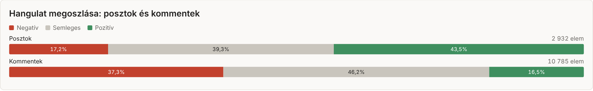
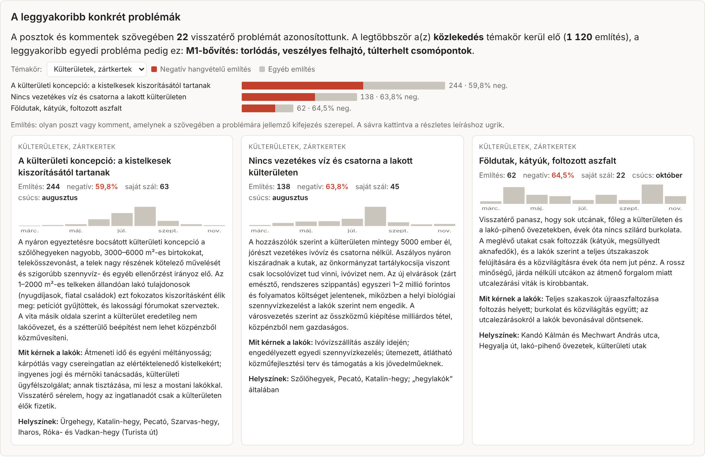
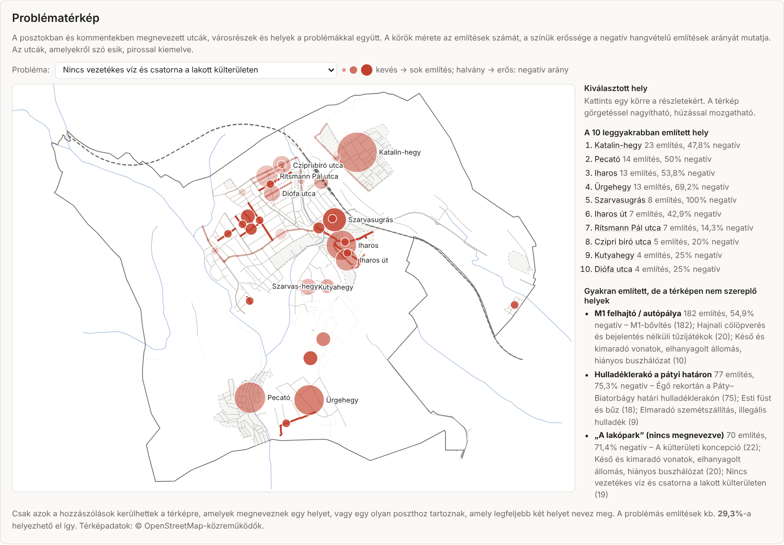

# Helyi Facebook-csoport szentimentelemzése és problématérképe AI-ágenssel

Az esettanulmány azt mutatja be, hogyan készült egy agglomerációs település (Biatorbágy) lakossági Facebook-csoportjának nyolc hónapnyi anyagából szentimentelemzés, konkrét problémalista és interaktív problématérkép. A munkát egy AI-ágenssel (Claude) végeztem, beszélgetés formájában. A kiindulópont egy nyers, gépi úton letöltött adatfájl és egyetlen mondat volt: *„Tudsz készíteni az alábbi adatbázis alapján egy szentiment elemzést?”*. A végeredmény egy megosztható, interaktív dashboard lett, amely megmutatja, milyen a csoport hangulata, mi bántja a lakókat, és hol.

A tanulmány a gyakorlati eredmény mellett azt is részletezi, hogyan dolgozott az ágens, hol hibázott, és milyen pontokon volt szükség emberi döntésre vagy adatra.

## Tanulságok

- **A magyar nyelv külön kihívás.** A ragozás miatt egy egyszerű kulcsszavas keresés könnyen téved. A *„Forrás utcában”* nem forrás, a *„zajlik”* nem zaj, a *„YouTube-csatorna”* nem csatornázás, a *„2051”* pedig nem évszám, hanem Biatorbágy irányítószáma. Minden kulcsszólistát többször kellett szúrópróbával ellenőrizni és szűkíteni. Az ágens ezt magától is elvégezte: mintákat kért le a találatokból, és kijavította a téves egyezéseket.
- **Validálás nélkül nincs megbízható szám.** Az első, szabályalapú hangulatosztályozó csak kb. 59%-os pontosságot ért el. Ez csak azért derült ki, mert az ágens a kézzel címkézett mintán lemérte. Egy 460 elemes, erre a csoportra címkézett mintán tanított modellel a pontosság keresztvalidációval 71% lett (makro-F1: 70%). Ez három kategóriánál már közel van ahhoz, amennyire két emberi címkéző egyetért.
- **Fontos, ki címkéz.** A validáló mintát ebben a munkamenetben maga az AI címkézte fel, miután egyenként elolvasta a bejegyzéseket. Ez adatvédelmi szempontból előny, mert így ember nem olvasta a lakók bejegyzéseit (lásd lent). Módszertanilag viszont kompromisszum: az AI saját címkéi nem függetlenek a modelltől. Ha a pontosságot szigorúbban kell igazolni, egy kis, előzetesen álnevesített mintát (nevek, címek, telefonszámok nélkül) érdemes emberi címkézővel is ellenőriztetni.
- **A homokozó korlátai alakítják a módszert.** Az ágens felhős munkakörnyezetéből nem volt elérhető a Hugging Face, ezért kész magyar nyelvi modellt nem lehetett betölteni. Az ágens nem állt meg. A GitHubon talált nyilvános magyar korpuszokból (HuSST, OpinHuBank) és a PrecoSenti szentimentszótárból saját osztályozót épített. Ugyanígy az OpenStreetMap sem volt elérhető, ezért a térképadatot nekem kellett letöltenem. Az ágens ehhez pontos, bemásolható lekérdezést adott.
- **Az összesítés pontosabb, mint az egyedi címke.** A tévesztések zöme negatív és semleges között történik (irónia, költői kérdések). Az ágens a tévesztési mátrixszal korrigált becslést is kiszámolta, és ez a fő arányokat nem változtatta meg. Egy-egy konkrét komment címkéjére viszont nem szabad építeni.
- **Az automatizálás adatvédelmi előny is.** A folyamat legfontosabb eredménye talán nem is maga az elemzés, hanem az, hogy több ezer magánszemély bejegyzését úgy lehetett feldolgozni, hogy azokat egyetlen kutató vagy címkéző sem olvasta végig. Ezt a következő fejezet részletezi.

## Adatvédelem: elemzés emberi átnézés nélkül

Egy lakossági Facebook-csoport bejegyzései személyes adatok: a szerzők neve mellett gyakran lakcímet, telefonszámot, családi és egészségügyi részleteket is tartalmaznak. A hagyományos társadalomtudományi módszer (kvalitatív kódolás, kézi címkézés) azzal jár, hogy kutatók vagy diákmunkások ezreket olvasnak el ezek közül. Minden további ember, aki látja az adatokat, újabb kockázat.

Ebben a munkamenetben a személyes adatokkal járó munkát az AI végezte el:

- **Címkézés:** a 460 elemes validáló mintát az AI címkézte, nem ember.
- **Témakeresés és -értelmezés:** a kulcsszavas találatok ellenőrzését és a legaktívabb szálak elolvasását az AI végezte, és saját szavaival foglalta össze a problémákat.
- **Helyszínek:** az utcanevek felismerése és hozzárendelése automatikus volt.
- **Kutatói rálátás:** én kizárólag összesített eredményeket láttam (arányokat, problémaleírásokat, térképet) és néhány rövid, ellenőrzött posztrészletet. A nyers bejegyzéseket és kommenteket nem olvastam végig.

Az eredmények közlésénél is az adatminimalizálás volt a cél:

- **Nincsenek nevek:** a dashboardon sehol nem szerepel szerzőnév.
- **Kitakart elérhetőségek:** a telefonszámokat automatikusan kitakartuk.
- **Nincsenek szövegrészletek:** a munka közben használt dashboardon még szerepeltek rövid, jellemző posztrészletek. A publikált változatból ezeket eltávolítottuk. A legaktívabb szálaknál csak a téma rövid, saját megfogalmazása látszik.
- **Összesítés:** a problémaleírások a hozzászólások összefoglalói, nem idézetek, így egyetlen hozzászólás sem azonosítható belőlük.

Ez a megközelítés jól illeszkedik a GDPR alapelveihez: az adattakarékossághoz (csak a szöveg és az időpont kellett, a szerző személye nem), a beépített és alapértelmezett adatvédelemhez, valamint a tudományos kutatásra vonatkozó garanciákhoz (álnevesítés, összesített közlés).

Fontos ugyanakkor látni, hogy az automatizálás önmagában nem jelent megfelelést. A GDPR a gépi adatkezelésre is vonatkozik, ezért egy hasonló projektnél a következőkre is szükség van:

- **Jogalap és célhoz kötöttség:** például tudományos kutatás vagy jogos érdek, dokumentáltan.
- **A nyers adat kezelése:** a letöltött export neveket tartalmaz, ezért biztonságosan kell tárolni, és a kutatás végén törölni.
- **Az AI-szolgáltató szerepe:** a szolgáltató adatfeldolgozóként kezeli az adatokat, ezért meg kell nézni a feltételeit (adatfeldolgozási szerződés, adattovábbítás az EU-n kívülre).
- **Visszakereshetőség:** a rövid posztrészletek egy kereséssel visszavezethetők az eredeti bejegyzésre, ezért a publikált változatból kihagytuk őket. A közzétett kimenet így csak összesített adatokat és saját összefoglalókat tartalmaz. Egy maradék kockázat azért megmarad: a legaktívabb szálak dátuma és témája alapján maga a nyilvános poszt megtalálható a csoportban, a szerzője azonban a közölt adatokból nem.
- **A platform szabályai:** az adatgyűjtésnek a Facebook felhasználási feltételeivel is összhangban kell lennie.

## A folyamat felépítése

### 1. fázis: Az adat feltérképezése

A forrás egy Apify Facebook group post scraperrel készült, 25,9 MB-os JSON-export volt: 3331 poszt és 11 620 komment 2026. március 17. és november 18. között. Az ágens először a szerkezetet térképezte fel, és kiderítette, hogy:

- a posztok kb. 40%-a szöveg nélküli (kép vagy megosztás), ezeknél a megosztott poszt szövegét kell használni,
- a kommentek három mélységi szinten (komment, válasz, válasz a válaszra) érkeznek,
- a reakciók és kommentszámok posztonként rendelkezésre állnak.

A munkát az ágens egy látható feladatlistával követte (osztályozó építése, validálás, elemzés, publikálás), és minden lépés után frissítette.

### 2. fázis: A hangulatosztályozó felépítése

A modell négy rétegből áll:

1. **Általános magyar modell:** karakter-n-gram alapú logisztikus regresszió, a HuSST és az OpinHuBank mondatain tanítva.
2. **Szentimentszótár:** a PrecoSenti szólista, kiegészítve a Facebook-nyelv kifejezéseivel (*„mutyi”*, *„gáz”*, *„szuper”*), tagadáskezeléssel (*„nem jó”*).
3. **Emoji- és írásjelek:** 😡 vagy 👍, illetve a *„!!!”*.
4. **Csoportra hangolt modell:** a fenti három jelzést egy erre a csoportra címkézett 460 elemes mintán tanított modell súlyozza össze.

A mérések keresztvalidációval készültek (ismételt 5-szörös felosztás). Így a közölt pontosság nem a tanítóadaton mért, hanem a modell számára ismeretlen elemeken.

**Főbb eredmények:**

- A kommentek 37%-a negatív és csak 17%-a pozitív, míg a posztok 44%-a pozitív. A csoport hirdetőfelület is, a viták és panaszok a hozzászólásokban zajlanak.
- A negatív posztok átlagosan 41,9 reakciót és 10,9 kommentet kapnak, a pozitívak 12,9-et és 1,8-at. A panasz sokkal több figyelmet kap.
- A válaszláncokban egyre élesebb a hang: a fő kommentek 33%-a negatív, a válaszoké 40%, a válaszokra adott válaszoké 45%.
- A kommentek negatív aránya júniusban tetőzött (44%), novemberre 29%-ra csökkent.

### 3. fázis: A konkrét problémák azonosítása

A hangulat önmagában nem mondja meg, *mi* a gond. Ezért a következő kérésem az volt, hogy az ágens konkrét problémákat fogalmazzon meg, például a csatornázás, az utak minősége vagy a zártkertek helyzete kapcsán. Ehhez három lépésben dolgozott:

1. **Témakeresés:** 24 témára állított össze magyar kulcsszólistát (szótövekkel és kizárásokkal), majd témánként véletlen mintákat olvasott el a találatokból, és javította a listákat.
2. **Olvasás:** minden témánál elolvasta a legtöbbet kommentelt szálakat és a legtöbb reakciót kapott hozzászólásokat.
3. **Megfogalmazás:** minden problémához saját szavaival írt összefoglalót (nem idézetet), azzal együtt, hogy mit kérnek a lakók, és mely helyszínekről van szó.

Mivel az ágens maga írta az összefoglalókat, ezeknek is volt ellenőrzési köre: a „lakók kamionforgalom kitiltását kérik” típusú, a forrásban nem szereplő állításokat utólag törölte.

Az eredmény 22 visszatérő probléma, hat témakörbe sorolva (külterületek és zártkertek, közlekedés, környezet, közszolgáltatások, közbiztonság, közélet). A legtöbbet említett ügyek:

- az M1-bővítés okozta torlódás és a veszélyes ideiglenes felhajtó (461 említés),
- a késő vonatok és az elhanyagolt állomás (317),
- a külterületi koncepció, vagyis a zártkertes kistelkek jövője (244).

### 4. fázis: A problématérkép

A térképhez Biatorbágy utcáira és városrészeire volt szükség. Mivel az ágens nem érte el az OpenStreetMapet, az általa megírt Overpass-lekérdezést én futtattam le az overpass-turbo.eu oldalon, és a GeoJSON-exportot csatoltam a beszélgetéshez. Ebből az ágens 408 elemes helynévtárat épített (387 utca, valamint városrészek, hegyek és nevezetes helyek). A szövegekben ragozott alakban is felismerte őket: *„Szabadság úton”*, *„Katalin-hegyen”*, *„Forrás utcában”*.

Két szabály tette használhatóvá az eredményt:

- **Szűkített öröklés:** egy komment csak akkor örökli a posztja helyszínét, ha a poszt legfeljebb két helyet nevez meg. Egy vaddisznó-gyérítésről szóló hirdetmény például tucatnyi utcát sorolt fel. Ennek a 80 kommentje különben mind a felsorolt utcákhoz került volna.
- **Rész-egyezések kiszűrése:** a *„Kossuth Ferenc u.”* ne számítson a *„Ferenc utca”* említésének, a *„Baross Gábor utca”* pedig a *„Gábor Áron utca”* említésének.

A problémás említések 29%-a köthető konkrét helyhez. A gyakran említett, de a térképadatban nem szereplő helyek (az M1-felhajtó, a pátyi határon lévő hulladéklerakó és a név nélkül emlegetett „lakópark”) a térkép mellett, külön listában jelennek meg.

### 5. fázis: Publikálás és megosztás

Az eredmény egy interaktív dashboard lett, amelyen témakörre és problémára lehet szűrni, a térkép nagyítható, és egy helyre kattintva megjelennek a részletek. Minden szám mögött látszik, melyik adatforrásból származik. Az összesített forrásadatok a repóban JSON-ként is elérhetők (lásd lent). Két kényelmi funkció külön említést érdemel:

- **Javítás megjegyzéssel:** a dashboardon közvetlenül egy elemhez fűztem megjegyzést (*„ennek a posztnak nem volt szövege, csak egy kép; legyen a címe a kép felirata”*). Az ágens a megjegyzés alapján elvégezte a javítást, és a szálban válaszolt.
- **Offline változat:** kérésemre az ágens egyetlen, kb. 600 KB-os HTML-fájlba ([biatorbagy_szentiment_dashboard.html](biatorbagy_szentiment_dashboard.html)) csomagolta a teljes dashboardot, a beágyazott adatokkal és a rajzoló könyvtárral együtt. A publikált fájl az anonimizált változat, posztrészletek nélkül. Ez internet nélkül is megnyílik, és interaktív marad. A fájlt átadás előtt egy fej nélküli böngészőben automatikusan tesztelte.

## Hibák és hibakeresés

Az ágens munkája nem volt hibátlan. Tanulságos azonban, hogyan találta meg és javította a hibáit.

### Az üres térkép esete

A térkép első változata nem jelent meg. A dashboard automatikus ellenőrzése 99 „nem szám” értéket jelzett a térképen. Az ágens először a vetítést gyanúsította, és lecserélte, de ez nem segített. Ezután azt derítette ki, hogy a koordináta-listák szövegként érkeznek a rajzoló kódhoz. Ezt is javította, a hiba mégis maradt. Végül a feltöltött adatfájl nyers tartalmát nézte meg, és itt találta meg a valódi okot: a vonalegyszerűsítő algoritmus (Douglas–Peucker) a zárt településhatárt két pontra egyszerűsítette, mert egy zárt sokszög első és utolsó pontja ugyanaz. A két pontból álló határvonal miatt a térkép szélessége nulla lett, és minden koordináta érvénytelenné vált.

**A tanulság:** az ágens három lépésben jutott el a megoldáshoz. Az első két javítás részben valós problémákat oldott meg, de nem a döntő hibát. Ez jól mutatja, hogy egy összetett hibánál az ágens is hipotézisről hipotézisre halad, ahogy egy ember. Az is kiderül belőle, mennyire fontos, hogy a munkakörnyezet automatikus visszajelzést adjon (itt: a dashboard beépített ellenőrzője), mert ezt maga az ágens nem látta.

### Téves helyszín-hozzárendelések

Az első helyszínelemzésben a „Gábor Áron utca” gyanúsan sok említést kapott. Szúrópróbából kiderült, hogy a rövidített *„Gábor utca”* alak a *„Baross Gábor utca”* említéseit is elkapta. Hasonlóan a *„vasútállomás”* keresés a *„Kelenföld vasútállomásról”* induló buszokat is az állomáshoz rendelte. Mindkét hibát az ágens a saját mintavételéből vette észre, és környezetfüggő szabályokkal javította.

## Adatok és kód

A repóban a következők találhatók:

- [`biatorbagy_szentiment_dashboard.html`](biatorbagy_szentiment_dashboard.html): az offline, anonimizált dashboard.
- [`data/`](data/): a dashboard összesített adatfájljai JSON formátumban. Ezek:
  - havi és témánkénti hangulatarányok;
  - a 22 probléma statisztikái és összefoglalói;
  - helyszínenkénti említésszámok;
  - az egyszerűsített alaptérkép;
  - a validáció mérőszámai.

  Szerzőnév, posztszöveg vagy posztrészlet nincs bennük.
- [`code/`](code/): a feldolgozási lánc Python-szkriptjei, a kulcsszavas problémataxonómia, a dashboard forrása, valamint egy [README](code/README.md) a futtatási sorrenddel és a más településre való átültetés lépéseivel.

A kódot az AI-ágens írta a munkamenet során. A közzétételhez utólag rendeztük futtatható formába (relatív útvonalak, futtatási sorrend). Kutatási prototípus, nem karbantartott szoftver.

### Adatelérhetőségi nyilatkozat

Az elemzés alapjául szolgáló nyers adatállomány (a Facebook-csoport posztjainak és kommentjeinek Apify-exportja) személyes adatokat tartalmaz: szerzőneveket, Facebook-azonosítókat és teljes szövegeket. Ezért nem tesszük közzé. Ugyanezen okból nem publikáljuk a modell validálásához használt, kézzel címkézett mintát és a tételenként címkézett adattáblát sem, mert ezek a bejegyzések teljes szövegét tartalmazzák.

A nyers adatokat a kutatás idejére védett tárhelyen őrizzük, a kutatás lezárásakor töröljük. Az eredmények ellenőrzéséhez az összesített adatok és a teljes kód nyilvánosak. A kód saját, jogszerűen gyűjtött adatokon újrafuttatható. A külső nyelvi erőforrások (HuSST, OpinHuBank, PrecoSenti) és az OpenStreetMap-adatok nyilvánosan elérhetők. Az OSM-adatok az [ODbL](https://opendatacommons.org/licenses/odbl/) licenc alá tartoznak.

## Korlátok

- **Csak a csoport hangja.** Ez a hangulat nem a település véleménye, hanem azoké, akik a Facebook-csoportban aktívak. A panaszos posztok jobban terjednek, ezért a negatív arány felülreprezentált lehet.
- **A kulcsszavas témafelismerés alsó becslés.** Nem találja meg azokat a hozzászólásokat, amelyek nem nevezik meg a témát (*„ez tarthatatlan”*).
- **A problémaleírások az AI összefoglalói.** Mielőtt bármilyen döntés-előkészítő anyagba kerülnének, érdemes őket a szálak elolvasásával ellenőrizni.

Az elemzés eredményeit tartalmazó interaktív dashboard offline változata ezen a linken keresztül tekinthető meg: [biatorbagy_szentiment_dashboard.html](biatorbagy_szentiment_dashboard.html). Letöltés után böngészőben megnyitva internetkapcsolat nélkül is működik.
